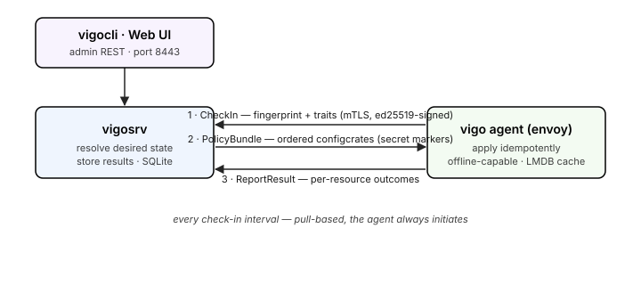

# Architecture

**How are the pieces arranged, and what talks to what?**

Vigo has three binaries and one loop. A central **server** (`vigosrv`) holds the desired state; a Rust **agent** (`vigo`) on every managed node (an *envoy*) pulls that state, applies it, and reports back; an admin **CLI** (`vigocli`) and an HTMX **web UI** drive the server's REST API. The agent always initiates — the server never reaches into a node — so envoys behind NAT or firewalls need no inbound ports.

## The check-in loop

Everything an envoy does happens on a fixed interval, in three steps:

1. **CheckIn** — the agent calls the server over gRPC/mTLS with its UUID, a fingerprint of its current state, and its [traits](../reference/vigo/traits/_index.md) (auto-discovered facts: OS, hardware, packages, …). Every request is ed25519-signed against the pubkey the server stored at enrollment.
2. **Resolve → PolicyBundle** — the server matches the envoy's hostname against [hostcrates](configcrates.md) (first match wins), resolves roles → [configcrates](configcrates.md) → resources, merges variables and per-environment overrides, builds the dependency DAG, and returns an ordered bundle. `secret:` references are replaced with opaque markers — plaintext never crosses the wire.
3. **Apply → ReportResult** — the agent applies each resource idempotently (check before act), honors `depends_on` ordering and `notify`/`subscribes` triggers, fetches real secret values at apply time, and reports per-resource outcomes back to the server, which stores them.

The model is **pull-based**: there is no push channel from server to node for routine work. When an operator needs immediacy (a force-push, an ad-hoc task, a [Scrier](scrier.md) session), the server uses the agent's already-open stream rather than dialing in.

## Why it's shaped this way

- **The agent survives a missing server.** It caches the last bundle, its traits, and a results queue in an embedded LMDB store, so it keeps converging offline and flushes results on reconnect. See [convergence vs compliance](convergence-vs-compliance.md).
- **Files are the only source of truth.** Operators edit YAML (`.vgo`) under the stacks; `vigocli config publish` validates and reloads. There is no API/UI/DB path that writes config.
- **One server scales to tens of thousands of envoys at a tight cadence**, and past that, [spanner](spanner-federation.md) federates write-equal peers.

## Where this shows up

- [Configcrates](configcrates.md) — how desired state is written and resolved.
- [The security model](security-model.md) — mTLS, signing, RBAC, the audit chain.
- [Install the server](../howto/operate/install.md) · [Enroll an envoy](../howto/operate/enroll-an-envoy.md) — the loop, set up for real.

---
*Confidential — Alexander4, LLC. Not for redistribution.*
