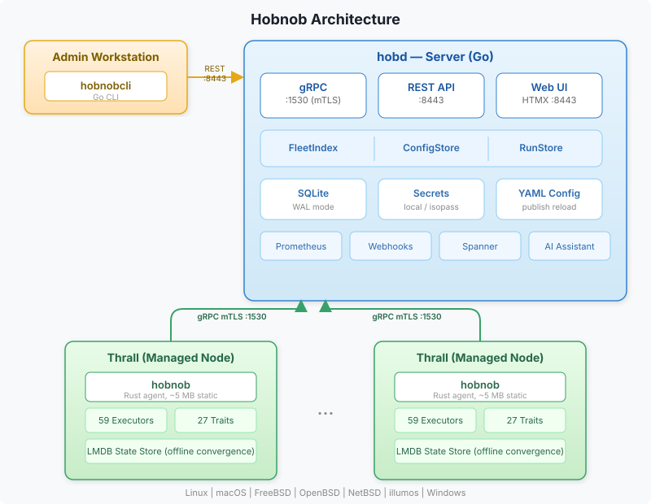
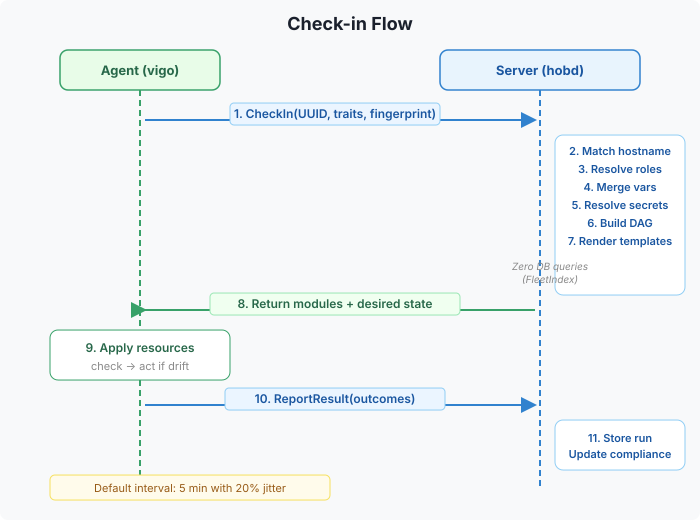
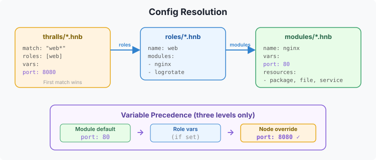

# Architecture

Hobnob has three binaries, two network ports, and a filesystem-only config path.

## Three Binaries

### hobd (server)

The central server written in Go. It:
- Accepts agent check-ins via gRPC over mTLS (port 1530)
- Serves the REST API, web UI, metrics, and bootstrap endpoint (port 8181)
- Reads YAML config from disk, reloads on publish via REST endpoint
- Stores state in SQLite (default) or PostgreSQL
- Resolves secrets through a pluggable backend (local, isopass)

### hobnob (agent)

The Rust agent that runs on each managed machine (thrall). It:
- Checks in with the server on a configurable interval (default 5m)
- Receives desired state (modules + resources) from the server
- Applies resources idempotently using 59 built-in executors
- Reports results back to the server
- Collects 27 traits (hardware, OS, network, packages, etc.)
- Caches policy bundles in LMDB for offline convergence

### hobnobcli (CLI)

The admin CLI written in Go. It:
- Talks to the server's REST API
- Manages enrollment, tokens, approved patterns
- Dispatches ad-hoc tasks and live queries
- Runs workflows
- Views runs, compliance, thralls, packages, inventory

## Data Flows

### Check-in Flow

### Config Resolution

### Offline Convergence

## Key Subsystems

| Subsystem | Package | Purpose |
|-----------|---------|---------|
| FleetIndex | `server/fleet/` | In-memory thrall index, zero DB on check-in hot path |
| ConfigStore | `server/config/` | YAML loader with publish-triggered reload |
| RunStore | `server/db/` | Run history (DBRunStore or MemRunStore) |
| BundleSigner | `server/grpc/` | ED25519 signing for compiled promises |
| Registry | `server/registry/` | Enrollment: pattern match + token validation |
| Secrets | `server/secrets/` | Pluggable secret backend (local, isopass) |
| Compliance | `server/compliance/` | Per-thrall status: compliant/drifted/failing/stale/unknown |
| Federation | `server/federation/` | Hub-spoke scaling with enrollment routing |

## Related

- [Check-in Lifecycle](check-in-lifecycle.md) -- Detailed check-in flow
- [Config Format](config-format.md) -- Module, role, and node definitions
- [Compiled Promises](compiled-promises.md) -- Bundle signing and offline convergence
- [FleetIndex](../operations/fleet-index.md) -- In-memory index internals
