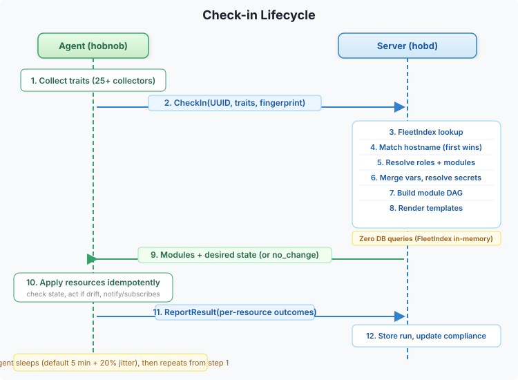
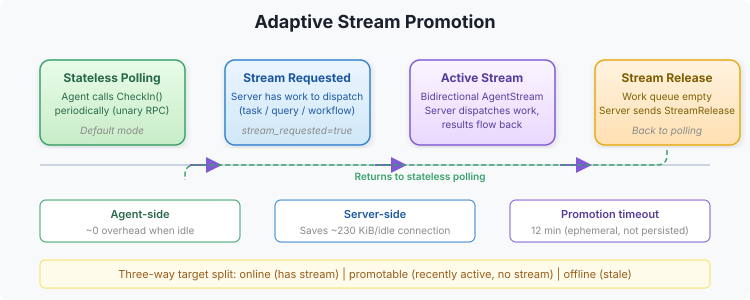
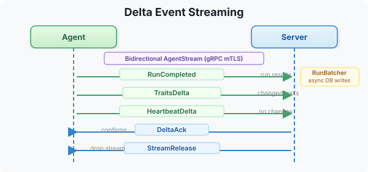

# Check-in Lifecycle

The agent check-in is the core data flow in Hobnob. Every 5 minutes (configurable), the agent contacts the server, receives its desired state, applies changes, and reports results.

## Pull Loop



## Step by Step

### 1. Trait Collection

The agent runs all trait collectors (OS, hardware, network, packages, etc.) to gather current system state. Traits are cached in LMDB with a configurable TTL.

### 2. State Fingerprint

The agent computes a fingerprint of its current state — a hash of its UUID, last-applied policy hash, and trait hashes. This enables delta transfer: if nothing changed, the server can respond with "no change."

### 3. Signature Verification

Every request from the agent is signed with its ED25519 private key. The server verifies the signature against the stored public key. Replay protection uses a timestamp window (default 5m).

### 4. FleetIndex Update

The server updates the in-memory FleetIndex with the thrall's last-seen timestamp. This is O(1) and touches no database — the dirty set is flushed to SQLite asynchronously every 10s.

### 5. Config Resolution

The server resolves the thrall's desired state:

```
Hostname match (nodes.hnb, first match wins)
    ↓
Expand roles → module list
    ↓
Load module definitions
    ↓
Merge vars: module defaults → node vars → environment_overrides → conditional vars
    ↓
Resolve secret: references through secrets provider
    ↓
Evaluate server-side when: expressions (filter modules/resources)
    ↓
Render content: templates with .Vars and .Traits
    ↓
Build module DAG (topological sort)
```

### 6. Delta Transfer

If the computed policy fingerprint matches the agent's fingerprint, the server responds with "no change" — no modules are sent. This dramatically reduces bandwidth for stable fleets.

When the policy has changed, only the changed modules are sent (delta streaming).

### 7. Resource Execution

The agent executes resources in topological order:

```
For each module (in DAG order):
    For each resource (in depends_on order):
        1. Evaluate when: expression → skip if false
        2. Check current state (executor-specific)
        3. If state matches desired → report "ok" (no change)
        4. If drift detected → apply change
        5. Report result (changed/failed/ok)
        6. If changed → trigger notify targets
```

### 8. Result Reporting

After all resources are applied, the agent sends results to the server:
- Per-resource: action taken, changed flag, error message, duration
- Per-run: total modules, changed count, failed count, duration

Results are stored in the database and used to compute compliance status.

## Timing

| Parameter | Default | Description |
|-----------|---------|-------------|
| `checkin.interval` | `5m` | Check-in frequency |
| `checkin.jitter_percent` | `20` | Random jitter to avoid thundering herd |
| `checkin.bundle_max_age` | `24h` | Compiled promise validity period |

With default settings, an agent checks in every 5m ± 20% jitter (4m–6m). A thrall is considered **stale** if it hasn't checked in within 2× the interval (10m).

## Adaptive Stream Promotion

Agents default to stateless unary polling (CheckIn RPC). When the server needs to dispatch work (tasks, queries, workflows) to a polling agent, it sets `stream_requested = true` on the next CheckInResponse. The agent opens a bidirectional stream, receives the work, and closes the stream when released.



This eliminates the ~230 KiB/connection memory overhead of persistent streams. Agents that are idle (no dispatched work) consume near-zero server memory.

**Target classification:** When dispatching tasks or queries, the server categorizes targets into three groups:
- **Online** — already has an active stream. Work dispatched immediately.
- **Promotable** — recently active (checked in within 2× the check-in interval). `stream_requested` is set; work queued for delivery when the stream opens. A 12-minute timeout marks the target offline if no stream arrives.
- **Offline** — stale agent. Marked offline immediately.

## Delta Streaming

When the bidirectional stream is active, the agent uses delta events instead of full request/response RPCs:



Delta streaming reduces per-check-in overhead by sending only what changed.

## Related

- [Architecture](architecture.md) — System overview
- [Compiled Promises](compiled-promises.md) — Offline convergence
- [Compliance](compliance.md) — How run results map to compliance status
