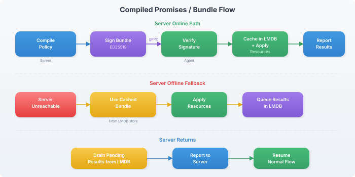

# Compiled Promises

Compiled promises are signed policy bundles that allow agents to converge locally when the server is unreachable. The server signs bundles with ED25519; agents verify and cache them in LMDB.

## How It Works



## Bundle Signing

The server generates an ephemeral ED25519 signing key at startup. Each policy bundle is signed:

```
Bundle = modules + resources + vars (serialized)
Signature = ED25519_sign(server_private_key, SHA256(bundle))
KeyID = SHA256(server_public_key)[:8]
```

The agent stores the server's public key in LMDB on first successful check-in.

## Bundle TTL

Bundles have a configurable maximum age:

```yaml
checkin:
  bundle_max_age: "24h"  # default
```

| Value | Behavior |
|-------|----------|
| `24h` (default) | Bundles expire after 24 hours. Agent proactively renews at 80% (19.2h) |
| `0` | Bundles never expire (not recommended for production) |
| `168h` | One week validity (for intermittently-connected thralls) |

When a bundle expires, the agent stops converging and waits for server contact.

## LMDB State Store

The agent persists state in LMDB at `/var/lib/hobnob/state/`:

```
/var/lib/hobnob/state/
├── policy/          # Cached policy bundle + signature
├── checksums/       # File content checksums (for drift detection)
├── traits/          # Cached traits with TTL
├── pending/         # Queued results for offline reporting
└── server_pubkey    # Server's ED25519 public key
```

### Offline Convergence

When the server is unreachable:

1. **Check-in fails** — agent uses exponential backoff for retries
2. **Load cached bundle** — reads the last accepted policy from LMDB
3. **Verify TTL** — if the bundle has expired, skip convergence
4. **converge_local()** — apply resources using cached policy + cached traits
5. **Queue results** — store per-resource outcomes in the pending queue
6. **Drain on reconnect** — when the server is reachable again, drain all pending results

### Proactive Renewal

The agent attempts to renew its bundle at 80% of the TTL. With the default 24h TTL:

```
0h        19.2h      24h
│──────────│──────────│
│  Normal  │ Renewal  │ Expired
│  check-in│ window   │ (stop converging)
```

This ensures the bundle stays fresh even with brief server outages.

## Security

- Bundles are signed, not encrypted — the policy content is visible to the agent (by design)
- Signature verification prevents tampering with cached bundles
- The server key is ephemeral (regenerated per server start) — all agents refresh on server restart
- Secret values in bundles are resolved at check-in time and transmitted over mTLS

## Configuration

Server-side:

```yaml
checkin:
  bundle_max_age: "24h"  # bundle validity period
```

Agent-side: No configuration needed. The agent automatically:
- Accepts and verifies signed bundles
- Caches them in LMDB
- Falls back to cached bundles when offline
- Drains pending results on reconnect

## Related

- [Check-in Lifecycle](check-in-lifecycle.md) — Normal check-in flow
- [Architecture](architecture.md) — System overview
