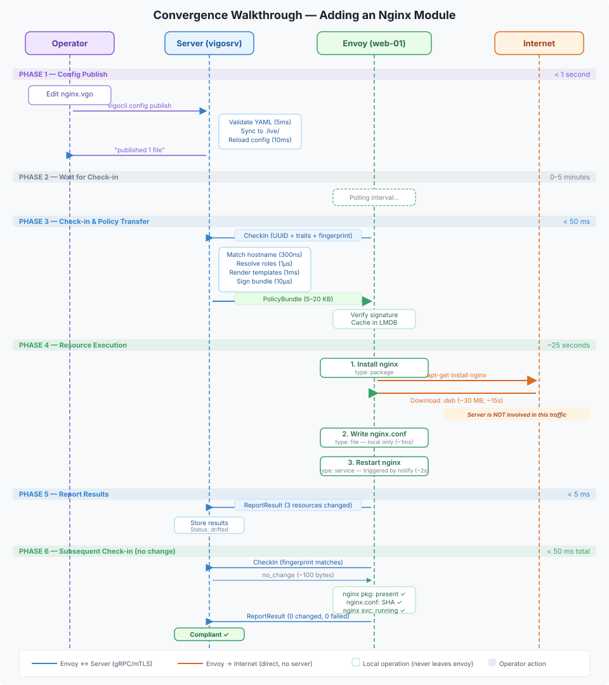

# Convergence Walkthrough

A step-by-step trace of what happens when you add a new module, publish it, and a envoy converges — with realistic timing and traffic flow for each phase.

## Scenario

You add an nginx module that installs a package, writes a config file, and starts the service. A envoy named `web-01.example.com` picks it up on its next check-in.

## Timeline



## Traffic Flow

The key insight: **most traffic bypasses the server entirely**. The server only sends declarative intent — the envoy does the actual work directly.

### What goes through the server (gRPC/mTLS, port 1530)

| Direction | Payload | Size | Frequency |
|-----------|---------|------|-----------|
| Envoy → Server | CheckIn (UUID, traits, fingerprint) | 2-5 KB | Every 5 min |
| Server → Envoy | PolicyBundle (modules, resources, rendered content) | 5-50 KB | Only when config changed |
| Server → Envoy | no_change response | ~100 B | When fingerprint matches |
| Envoy → Server | ReportResult (per-resource outcomes) | 1-10 KB | After each convergence |

### What goes directly from envoy to the internet (or LAN)

| Operation | Destination | Size | Notes |
|-----------|-------------|------|-------|
| `apt-get install` / `dnf install` | Package mirror | 1-500 MB | Downloaded by the envoy, not proxied through the server |
| `git clone` (git executor) | Git remote | varies | Envoy clones directly |
| `curl` in source_package executor | URL in resource config | varies | Envoy downloads directly |
| Docker image pulls | Registry (Docker Hub, GHCR) | 50-500 MB | Envoy pulls directly |
| Repository key downloads | Key server URL | 1-5 KB | Envoy fetches directly |

### What stays local on the envoy

| Operation | Notes |
|-----------|-------|
| File writes, chmod, chown | Local filesystem only |
| Service start/stop/restart | Local systemd/launchd/etc. |
| User/group management | Local passwd/shadow |
| Cron job installation | Local crontab |
| Template rendering | Pre-rendered by server, written locally |
| Idempotency checks (SHA256, stat, dpkg -l) | Local state comparison |

## Timing Summary

| Phase | Duration | Where |
|-------|----------|-------|
| Config publish (validate + sync + reload) | < 1s | Operator → Server |
| Wait for next check-in | 0-5 min (configurable) | — |
| Check-in round-trip (cache hit) | < 1 ms | Envoy ↔ Server |
| Check-in round-trip (cache miss, config compilation) | 10-50 ms | Server |
| Bundle transfer | < 10 ms (LAN) | Server → Envoy |
| Package install | 5-60s | Envoy → Internet |
| File write + permission set | < 5 ms | Envoy local |
| Service restart | 1-5s | Envoy local |
| Result report | < 5 ms | Envoy → Server |

| **Total (first convergence)** | **~30s + wait** | |
| **Subsequent check-ins (no change)** | **< 50 ms** | |

## Force Convergence

Skip the check-in wait by forcing an immediate convergence:

```bash
vigocli envoys push web-01.example.com
```

The server sets `stream_requested` on the envoy. If the envoy has an active stream, the effect is immediate. If it's polling, it takes effect on the next check-in (up to one interval).

## Offline Convergence

If the server is unreachable, the envoy continues applying its last cached policy bundle from LMDB. Package installs that require internet access will still fail if the envoy has no network, but all local operations (file writes, service management, user creation) continue working.

## Related

- [Check-in Lifecycle](check-in-lifecycle.md) — Detailed check-in protocol
- [Compiled Promises](compiled-promises.md) — Bundle signing and offline mode
- [Resource DAG](resource-dag.md) — Execution ordering
---
*Confidential -- Alexander4, LLC. Not for redistribution. See [documentation-license](../legal/documentation-license.md).*
