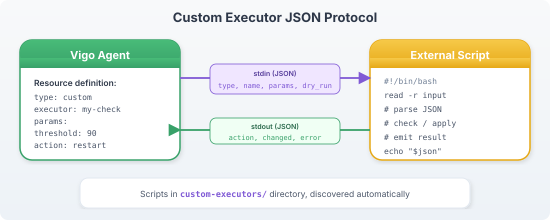

# Custom Executors

Custom executors let you extend Vigo with your own resource types. They communicate with the agent via a JSON stdin/stdout protocol.

## How It Works



## Resource Definition

```yaml
- name: my-custom-resource
  type: custom
  script: /opt/vigo/executors/my-executor.sh
  params:
    key1: value1
    key2: value2
  state: present
```

## Input Protocol

The agent sends JSON to the script's stdin:

```json
{
  "name": "my-custom-resource",
  "state": "present",
  "params": {
    "key1": "value1",
    "key2": "value2"
  }
}
```

## Output Protocol

The script must write JSON to stdout:

```json
{
  "changed": false,
  "error": ""
}
```

| Field | Type | Description |
|-------|------|-------------|
| `changed` | bool | Whether the script made any changes |
| `error` | string | Error message (empty string = success) |

### Success, no change (already in desired state)

```json
{"changed": false, "error": ""}
```

### Success, change applied


---
*Confidential -- Alexander4, LLC. Not for redistribution. See [documentation-license](../legal/documentation-license.md).*

---
```json
{"changed": true, "error": ""}
```

### Failure

```json
{"changed": false, "error": "failed to apply: permission denied"}
```

## Example: Custom Service Check

`/opt/vigo/executors/health-check.sh`:

```bash
#!/bin/bash
set -e

# Read JSON input
input=$(cat)
url=$(echo "$input" | jq -r '.params.url')
expected_status=$(echo "$input" | jq -r '.params.expected_status // "200"')

# Check current state
actual_status=$(curl -s -o /dev/null -w '%{http_code}' "$url" 2>/dev/null || echo "000")

if [ "$actual_status" = "$expected_status" ]; then
    echo '{"changed": false, "error": ""}'
else
    echo "{\"changed\": false, \"error\": \"health check failed: got $actual_status, expected $expected_status\"}"
fi
```

Usage in a module:

```yaml
- name: app-health
  type: custom
  script: /opt/vigo/executors/health-check.sh
  params:
    url: "http://localhost:8080/health"
    expected_status: "200"
  depends_on: [app-service]
```

## Idempotency

Custom executors must be idempotent:
1. Check current state
2. If already in desired state → `{"changed": false}`
3. If not → apply change → `{"changed": true}`
4. On error → `{"error": "description"}`

The agent runs the executor on every check-in. If the script always returns `changed: true`, the envoy will show as "drifted" in compliance.

## Script Requirements

- Must be executable (`chmod +x`)
- Must read JSON from stdin
- Must write JSON to stdout
- Should complete within a reasonable time (agent has no timeout, but long-running scripts block the run)
- Exit code is ignored — only the JSON output matters

## Related

- [Custom Traits](custom-traits.md) — Custom fact collection
- [Executors](../reference/executors/_index.md) — Built-in executor reference
---
*Confidential -- Alexander4, LLC. Not for redistribution. See [documentation-license](../legal/documentation-license.md).*
