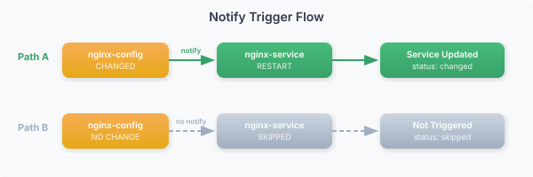
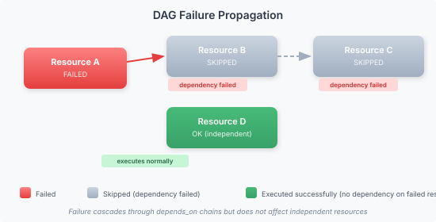

# Resource DAG

Resources within a module form a Directed Acyclic Graph (DAG) based on their dependency declarations. The agent executes resources in topological order — dependencies first, dependents after.

## depends_on

Declares that a resource must run after its dependencies succeed:

```yaml
resources:
  - name: nginx-package
    type: package
    package: nginx

  - name: nginx-config
    type: file
    target_path: /etc/nginx/nginx.conf
    content: "..."
    depends_on: [nginx-package]

  - name: nginx-service
    type: service
    service: nginx
    state: running
    depends_on: [nginx-package, nginx-config]
```

Execution order: `nginx-package` → `nginx-config` → `nginx-service`.

If a dependency fails, all dependent resources are skipped.

## before

The inverse of `depends_on`. Declares that other resources must run after this one:

```yaml
resources:
  - name: repo-setup
    type: repository
    repository: nginx
    repo: "https://nginx.org/packages/debian"
    before: [nginx-package]

  - name: nginx-package
    type: package
    package: nginx
```

`before: [nginx-package]` is equivalent to adding `depends_on: [repo-setup]` to `nginx-package`.

## notify

Triggers re-application of another resource when this one makes a change. The target resource must have `when: "changed"` so it only fires when triggered — without it, the resource runs unconditionally every cycle.

```yaml
resources:
  - name: nginx-config
    type: file
    target_path: /etc/nginx/nginx.conf
    content: "..."
    notify: [restart-nginx]

  - name: restart-nginx
    type: service
    service: nginx
    state: restarted
    when: "changed"
```

Key behavior:
- `restart-nginx` is skipped in the normal pass (gated by `when: "changed"`)
- When `nginx-config` reports a change, `restart-nginx` is re-run with the trigger flag set
- If the config file is unchanged, the service is not touched
- Multiple resources can notify the same target — it's only re-applied once per run
- Works for both intra-module references (resource names) and cross-module references (module names)



**This is the recommended pattern for intra-module service restarts** — the source resource declares who to notify, and the service gates itself with `when: "changed"`.

## subscribes

The inverse of `notify`. Instead of the source declaring who to notify, the target declares what to watch. Use this when the target module needs to watch multiple source modules without modifying them.

**Cross-module example** (preferred use case for subscribes):

```yaml
# modules/nginx-config.vgo — no notify, doesn't know about the service module
name: nginx-config
resources:
  - name: nginx-conf
    type: file
    target_path: /etc/nginx/nginx.conf
    content: "..."

# modules/nginx-ssl.vgo — also no notify
name: nginx-ssl
resources:
  - name: ssl-cert
    type: file
    target_path: /etc/nginx/ssl/cert.pem
    content: "..."

# modules/nginx-service.vgo — watches both config modules
name: nginx-service
subscribes: [nginx-config, nginx-ssl]
resources:
  - name: restart-nginx
    type: service
    service: nginx
    state: restarted
    when: "changed"
```

When any resource in `nginx-config` or `nginx-ssl` changes, `restart-nginx` is triggered. The config modules don't reference the service module — the dependency points inward. This makes it easy to add new config modules: update `subscribes` in one place instead of adding `notify` to every source.

**Rule of thumb:** `notify` = "I changed, go poke them." `subscribes` = "If they change, come poke me." Same mechanism, opposite direction of declaration.

Both `notify` and `subscribes` work with resource names (intra-module) and module names (cross-module). The publish validator requires `when: "changed"` (or `subscribes`) on any service with `state: restarted` or `reloaded` to prevent unconditional restarts every cycle.


## watch_secret

Watches secret paths for rotation. When a secret is changed via `vigocli secrets set` (or detected by the isopass watcher), resources with matching `watch_secret` paths are re-applied on the next check-in:

```yaml
resources:
  - name: app-config
    type: file
    target_path: /etc/app/config.yaml
    content: |
      dsn: {{ .Vars.db_dsn }}
    watch_secret: ["vigo/db/dsn"]
    notify: [app-service]
```

When the secret at `vigo/db/dsn` is changed:
1. `vigocli secrets set` notifies the server
2. The config file is re-rendered with the new secret value
3. The service is restarted via notify

## Module-Level Dependencies

Modules can depend on other modules:

```yaml
# modules/app.vgo
name: app
depends_on: [nginx, postgres]
resources:
  - ...
```

Module ordering ensures all resources in `nginx` and `postgres` run before any resource in `app`.

## Circular Dependency Detection

Circular dependencies are rejected at config load time:

```yaml
# This will fail validation:
resources:
  - name: a
    type: exec
    command: "echo a"
    depends_on: [b]

  - name: b
    type: exec
    command: "echo b"
    depends_on: [a]
```

Error: `circular dependency detected: a → b → a`

## Failure Propagation



When a resource fails:
1. All resources that `depends_on` the failed resource are skipped
2. Skipping cascades through the dependency chain
3. Resources with no dependency on the failed resource continue normally

## Related

- [Config Format](config-format.md) — Module and resource structure
- [Resource Language](resource-language.md) — defaults, foreach, case/match
- [Executors](../reference/executors/_index.md) — Available resource types
---
*Confidential -- Alexander4, LLC. Not for redistribution. See [documentation-license](../legal/documentation-license.md).*
