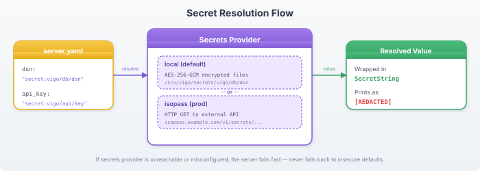

# Secrets

Hobnob never stores secrets in config files, environment variables, logs, or database records. All secret values use the `secret:` prefix and are resolved through a pluggable backend at runtime.

## The secret: Prefix

Any config value starting with `secret:` is resolved through the secrets provider:

```yaml
database:
  dsn: "secret:hobnob/db/dsn"

smtp:
  password: "secret:hobnob/smtp/password"
```

At startup, the server resolves `secret:hobnob/db/dsn` by calling `provider.Get("hobnob/db/dsn")`. The actual secret value is never written to disk in plaintext.

## Two Backends

### local (default, recommended)

Secrets are stored as AES-256-GCM encrypted files on disk. The master key is a 32-byte hex key stored in a 0600-permission file.

```yaml
secrets:
  backend: local
  key_file: "/srv/hobnob/master.key"
  secrets_dir: "/srv/hobnob/secrets"
```

Secret path mapping: `secret:hobnob/db/dsn` → file at `secrets_dir/hobnob/db/dsn`.

On first start, the local backend auto-generates:
- The master key (if `key_file` doesn't exist)
- TLS certificates (self-signed CA + server cert)
- A random database DSN

### isopass (production)

Resolves secrets from an external isopass API server. Supports versioning for rotation detection.

```yaml
secrets:
  backend: isopass
  url: "https://isopass.internal:8443"
  token_file: "/srv/hobnob/isopass-token"   # 0600, contains bearer token
```

The `token_file` is read at startup. The file should be owned by root with mode `0600`.

## Secret Resolution Flow



## Fail-Fast

If the secrets provider is unreachable or a secret path doesn't exist, the server **refuses to start**. It never falls back to insecure defaults.

```
$ hobd
ERROR server failed error="loading server config: resolving secret 'hobnob/db/dsn': file not found"
```

## Secret Rotation

### Local backend

When you change a secret with the CLI, rotation is automatic:

```bash
hobnobcli secrets set hobnob/grafana/admin-password "newpass"
  Secret "hobnob/grafana/admin-password" stored.
  Server notified — affected thralls will apply on next check-in.
```

The CLI writes the encrypted file and notifies the server. The server:
1. Reloads config to resolve the new value
2. Finds thralls whose configs reference the secret
3. Queues `_secret_triggered=true` for resources with `watch_secret: ["path"]`
4. Sets force-push on affected thralls

On the next check-in, watch_secret resources re-execute with the new value.

### Isopass backend

The server polls isopass for version changes:

```yaml
watcher:
  enabled: true
  poll_interval: "5m"
```

When a version change is detected, the same rotation flow triggers automatically.

## Secrets in Modules

Modules reference secrets via vars:

```yaml
# nodes.hnb
thralls:
  - match: "db*.example.com"
    roles: [database]
    vars:
      db_password: "secret:hobnob/db/password"
```

The `content:` template renders the resolved value:

```yaml
# modules/database.hnb
resources:
  - name: pg-config
    type: file
    targetpath: /etc/postgresql/conf.d/auth.conf
    content: |
      password = {{ .Vars.db_password }}
    watch_secret: ["hobnob/db/password"]
    notify: [pg-service]
```

## Exec Secret Safety

Never embed secrets in command strings (they appear in process listings). Use `stdin` or `secret_file`:

```yaml
# GOOD — pipe to stdin
- name: set-grafana-password
  type: exec
  command: "grafana-cli admin reset-admin-password --password-from-stdin"
  stdin: "secret:hobnob/grafana/admin_password"

# GOOD — temporary 0600 file
- name: deploy-with-key
  type: exec
  command: "deploy.sh --key-file {{secret_file}}"
  secret_file: "secret:hobnob/deploy/key"

# BAD — secret visible in ps output
- name: bad-example
  type: exec
  command: "grafana-cli admin reset-admin-password MySecret123"
```

## Related

- [Server Configuration](../getting-started/server-config.md) — secrets: section
- [Resource DAG](resource-dag.md) — watch_secret
