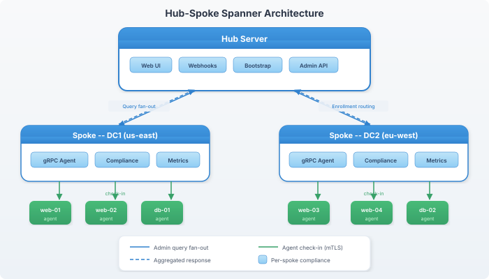

# Spanner

Spanner enables hub-spoke scaling for large fleets. A hub server aggregates data from spoke servers, each of which handles a partition of envoys.

> **License requirement:** Spanner requires a paid license. The built-in free license (25 envoys) does not support hub or spoke mode. The server will refuse to start if `spanner.role` is set to `hub` or `spoke` on the free license. Paid licenses are bound to a specific server via [machine fingerprint](../operations/licensing.md#machine-fingerprint-binding) — if you migrate the hub to a new machine, you will need a new license.

## Architecture



## Roles

### standalone (default)

Single server handles everything. No spanner config needed.

### hub

The central server that:
- Serves the web UI, webhooks, bootstrap
- Routes enrollment to the correct spoke based on hostname patterns
- Fans out admin queries to all spokes and aggregates results
- Aggregates compliance and fleet statistics
- Handles license enforcement

```yaml
spanner:
  role: hub
  spokes:
    - id: dc1
      addr: "spoke1.example.com:1530"
      patterns: ["*.dc1.*"]
    - id: dc2
      addr: "spoke2.example.com:1530"
      patterns: ["*.dc2.*"]
```

### spoke

A partition server that:
- Handles agent check-ins for its assigned envoys
- Stores runs, traits, and results locally
- Responds to admin queries from the hub
- Does not serve the web UI, webhooks, or bootstrap

```yaml
spanner:
  role: spoke
  spoke_id: "dc1"
```

## Enrollment Routing

When a envoy bootstraps through the hub, the hub routes the enrollment to the correct spoke based on hostname pattern matching:

```
Envoy: web3.dc1.example.com
    ↓
Hub: match "*.dc1.*" → route to spoke dc1
    ↓
Spoke dc1: complete enrollment, store pubkey
```

## Admin Query Fan-out

CLI and API queries go through the hub, which fans out to all spokes:

```bash
vigocli envoys list
```

```
Hub receives request
    ↓
Fan out to spoke dc1 + spoke dc2 (parallel)
    ↓
Merge results
    ↓
Return to CLI
```

## Config Sync

When `vigocli config publish` runs on the hub, the config is automatically pushed to all spokes. The hub creates a tar.gz of the `.live/` directory and sends it via the `SyncConfig` RPC. Spokes extract the archive, overwrite their local `.live/` directory, and reload. This is best-effort — if a spoke is unreachable, it's skipped and logged.

## Spoke Health

The hub monitors spoke health via periodic gRPC probes. Spokes can also push their status to the hub if `hub_addr` is configured. The web UI shows:
- Spoke status (online/offline)
- Per-spoke compliance breakdown
- Per-spoke latency metrics
- Envoy count per spoke

### Spoke Status Reporting

Spokes can proactively report their status to the hub:

```yaml
spanner:
  role: spoke
  spoke_id: "dc1"
  hub_addr: "hub.example.com:1530"  # enables spoke→hub reporting
```

The spoke sends compliance metrics to the hub every 30 seconds. If the hub is unreachable, the spoke continues operating normally.

### Hub Failover for Spokes

When the hub has [peer replication](../concepts/p2p-spanner.md) configured, spokes should list the hub's peer addresses as fallbacks. After 3 consecutive failures on the current hub address, the spoke automatically tries the next fallback:

```yaml
spanner:
  role: spoke
  spoke_id: "dc1"
  hub_addr: "hub.example.com:1530"
  hub_fallback_addrs:
    - "hub-standby.example.com:1530"
```


The spoke cycles through all addresses (primary, then fallbacks) until one responds. This ensures spokes reconnect to a promoted hub peer without manual intervention.

### Auto-Failover

The hub can automatically drain unhealthy spokes:

```yaml
spanner:
  role: hub
  auto_failover:
    enabled: true
    threshold: 3      # consecutive failures before drain (default 3)
    interval: "30s"   # health check interval (default 30s)
```

When a spoke fails `threshold` consecutive health checks (default: 3 failures = 90 seconds), the hub automatically drains all its envoys to other spokes based on hostname pattern matching. When the spoke recovers, it's marked healthy again and can accept new envoys.

## Envoy Reassignment

Move envoys between spokes:

```bash
vigocli spanner reassign --hostname "web3.dc1.*" --to dc2
```

Drain all envoys from a spoke:

```bash
vigocli spanner drain --spoke dc1 --to dc2
```

The agent handles reconnection automatically — on next check-in, it's redirected to the new spoke.

## Spoke Detail

View detailed spoke information:

```bash
vigocli spanner spoke dc1
```

The web UI has a spoke detail page at `/spanner/spokes/{id}` showing per-spoke compliance, recent runs, and envoy list.

## Related

- [Architecture](architecture.md) — System overview
- [Server Configuration](../getting-started/server-config.md) — spanner: section
---
*Confidential -- Alexander4, LLC. Not for redistribution. See [documentation-license](../legal/documentation-license.md).*
