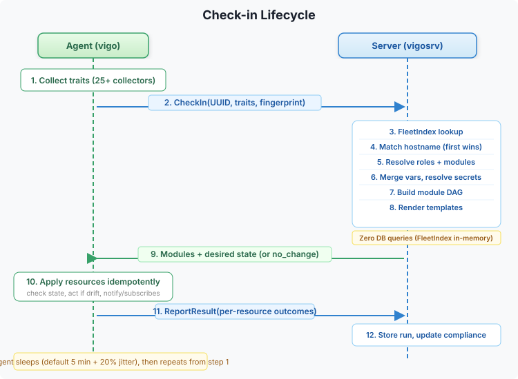
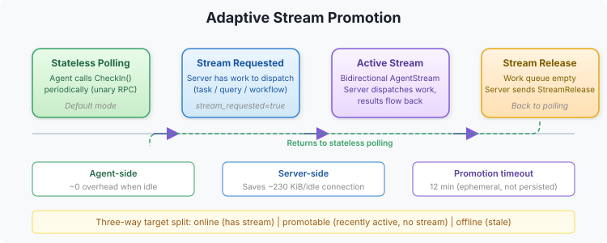
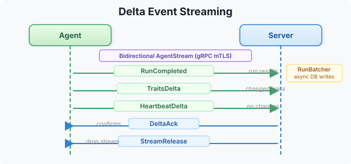

# Check-in Lifecycle

The agent check-in is the core data flow in Vigo. Every 5 minutes (configurable), the agent contacts the server, receives its desired state, applies changes, and reports results.

## Pull Loop



## Step by Step

### 1. Trait Collection

The agent runs all trait collectors (OS, hardware, network, packages, etc.) to gather current system state. Traits are cached with a configurable TTL.

### 2. State Fingerprint

The agent computes a fingerprint of its current state. This enables delta transfer: if nothing changed, the server can respond with "no change."

### 3. Signature Verification

Every request from the agent is signed with its private key. The server verifies the signature against the stored public key.

### 4. FleetIndex Update

The server updates the in-memory FleetIndex with the envoy's last-seen timestamp.

### 5. Config Resolution

The server resolves the envoy's desired state:

```
Hostname match (envoys.vgo, first match wins)
    |
Expand roles -> module list
    |
Load module definitions
    |
Merge vars: module defaults -> common.vgo inherited -> match-block -> environments.vgo
    |
Resolve secret: references through secrets provider
    |
Evaluate server-side when: expressions (filter modules/resources)
    |
Render content: templates with .Vars and .Traits
    |
Build module DAG (topological sort)
```

### 6. Delta Transfer

The server uses two levels of no-change detection:

1. **Global version check:** If the agent's `policy_version` matches the server's config version and there are no pending force-pushes, the server responds with "no change" immediately — no config lookup, no bundle construction.

2. **Per-envoy Merkle root check:** If the global version changed but this envoy's resolved config didn't, the server detects this by comparing the agent's `state_fingerprint` against the envoy's Merkle root. The Merkle root is a SHA256 tree over the envoy's modules and vars, computed at config publish time. If the roots match, the server responds with "no change" — skipping bundle construction entirely.

When the config has changed, individual modules are compared by content hash. Modules the agent already has are sent as stubs (name + hash only), and only modules with new content include full resource definitions.

### 7. Resource Execution

The agent executes resources in topological order:

```
For each module (in DAG order):
    For each resource (in depends_on order):
        1. Evaluate when: expression -> skip if false
        2. Check current state (executor-specific)
        3. If state matches desired -> report "ok" (no change)
        4. If drift detected -> apply change
        5. Report result (changed/failed/ok)
        6. If changed -> trigger notify targets
```

### 8. Result Reporting

After all resources are applied, the agent sends results to the server:
- Per-resource: action taken, changed flag, error message, duration
- Per-run: total modules, changed count, failed count, duration

Results are stored in the database and used to compute compliance status.

## Timing

| Parameter | Default | Description |
|-----------|---------|-------------|
| `checkin.interval` | `5m` | Check-in frequency |
| `checkin.jitter_percent` | `20` | Random jitter to avoid thundering herd |
| `checkin.bundle_max_age` | `24h` | Compiled promise validity period |

With default settings, an agent checks in every 5m with jitter randomization.

## Adaptive Stream Promotion

Agents default to stateless unary polling (CheckIn RPC). When the server needs to dispatch work (tasks, queries, workflows) to a polling agent, it sets `stream_requested = true` on the next CheckInResponse. The agent opens a bidirectional stream, receives the work, and closes the stream when released.



Agents that are idle (no dispatched work) consume minimal server resources.

**Target classification:** When dispatching tasks or queries, the server categorizes targets into three groups:
- **Online** — already has an active stream. Work dispatched immediately.
- **Promotable** — recently active. `stream_requested` is set; work queued for delivery when the stream opens.
- **Offline** — stale agent. Marked offline immediately.

## Delta Streaming

When the bidirectional stream is active, the agent uses delta events instead of full request/response RPCs:



Delta streaming reduces per-check-in overhead by sending only what changed.

## Related

- [Architecture](overview.md) — System overview
- [Compiled Promises](offline-bundles.md) — Offline convergence
- [Compliance](../../compliance/overview.md) — How run results map to compliance status
---
*Confidential -- Alexander4, LLC. Not for redistribution. See [documentation-license](../../legal/documentation-license.md).*
