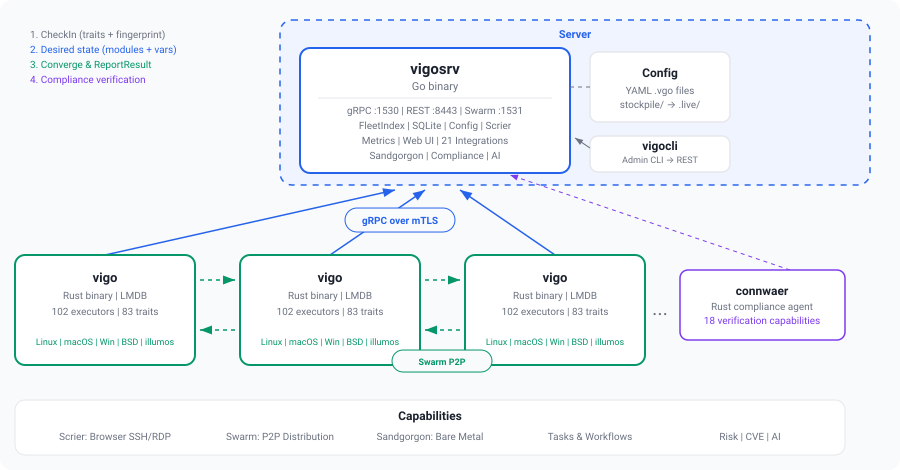
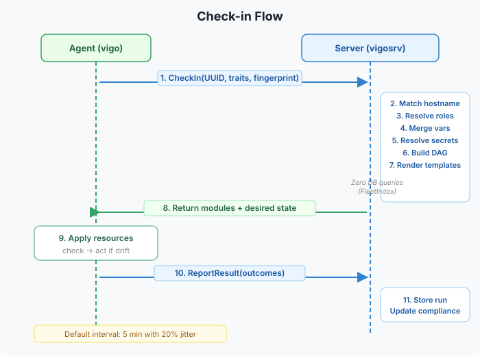
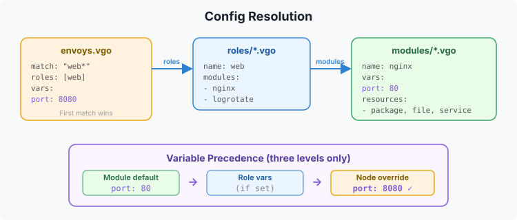
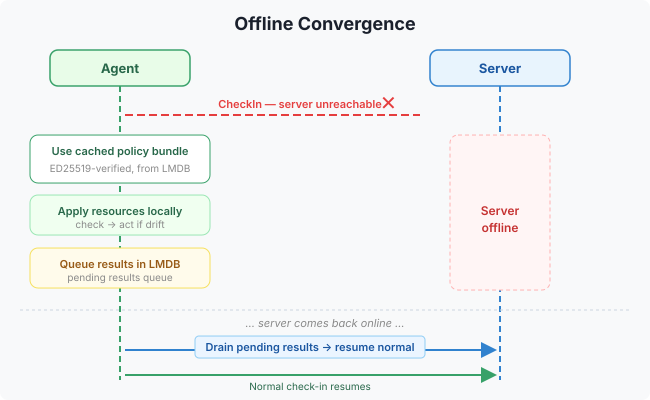

# Architecture

Vigo has three binaries, two network ports, and a filesystem-only config path.

## Three Binaries

### vigosrv (server)

The central server written in Go. It:
- Accepts agent check-ins via gRPC over mTLS (port 1530)
- Serves the REST API, web UI, metrics, and bootstrap endpoint (port 8443)
- Reads YAML config from disk, reloads on publish via REST endpoint
- Stores state in SQLite (default) or PostgreSQL
- Resolves secrets through a pluggable backend (local, isopass)

### vigo (agent)

The Rust agent that runs on each managed machine (envoy). It:
- Checks in with the server on a configurable interval (default 5m)
- Receives desired state (modules + resources) from the server
- Applies resources idempotently using 72 built-in resource types
- Reports results back to the server
- Collects 28 traits (hardware, OS, network, packages, security scanning, etc.)
- Caches policy bundles for offline convergence

### vigocli (CLI)

The admin CLI written in Go. It:
- Talks to the server's REST API
- Manages enrollment, tokens, approved patterns
- Dispatches ad-hoc tasks and live queries
- Runs workflows
- Views runs, compliance, envoys, packages, inventory

## Data Flows

### Check-in Flow

### Config Resolution

### Offline Convergence

## Network Requirements

Vigo is **pull-based** — the agent initiates all connections outbound to the server. The server never connects inbound to envoys. This means agents behind NAT, home routers, corporate firewalls, or VPNs work without any special configuration as long as they can reach the server.

### Required Outbound Connectivity (Agent → Server)

| Port | Protocol | Purpose |
|------|----------|---------|
| 1530 | gRPC/mTLS | Check-in, result reporting, trait collection, task dispatch, streaming |
| 8443 | HTTPS | Bootstrap enrollment, binary updates |

These are the only ports agents need to reach. No inbound ports are required on the agent side for core functionality.

### Features Requiring Inbound Connectivity

Some optional features require the agent to accept inbound connections:

| Feature | Port | Impact if Unreachable |
|---------|------|-----------------------|
| Scrier (remote SSH/RDP) | Agent SSH/RDP port | Sessions cannot be established to that envoy |
| Swarm P2P transfers | 1531 (mTLS HTTPS) | Falls back to server-mediated download — slower but functional |

### Deployment Scenarios

- **Office/datacenter envoys** — Full functionality, all features work
- **Laptops behind home routers** — Convergence, traits, compliance, tasks, workflows, and queries all work. Scrier requires a VPN or tunnel. Swarm falls back to server relay.
- **Cloud VMs behind security groups** — Open 1530/8443 outbound to the server. Optionally open 1531 between peers for P2P swarm.
- **Air-gapped / intermittent** — Agent caches policy bundles and converges offline, syncs results when connectivity returns

## Key Subsystems

| Subsystem | Package | Purpose |
|-----------|---------|---------|
| FleetIndex | `server/fleet/` | In-memory envoy index for fast check-in operations |
| ConfigStore | `server/config/` | YAML loader with publish-triggered reload |
| RunStore | `server/db/` | Run history persistence |
| BundleSigner | `server/grpc/` | Signing for compiled promises |
| Registry | `server/registry/` | Enrollment: pattern match + token validation |
| Secrets | `server/secrets/` | Pluggable secret backend (local, isopass) |
| Convergence | `server/convergence/` | Per-envoy status: converged/relapsed/diverged/degraded/failed/offline/no data |
| Spanner | `server/spanner/` | Hub-spoke scaling with enrollment routing |

## Related

- [Check-in Lifecycle](check-in-lifecycle.md) -- Detailed check-in flow
- [Config Format](../writing-modules/config-format.md) -- Module, role, and node definitions
- [Compiled Promises](offline-bundles.md) -- Bundle signing and offline convergence
- [FleetIndex](../../operations/fleet-index.md) -- In-memory index operations
---
*Confidential -- Alexander4, LLC. Not for redistribution. See [documentation-license](../../legal/documentation-license.md).*
