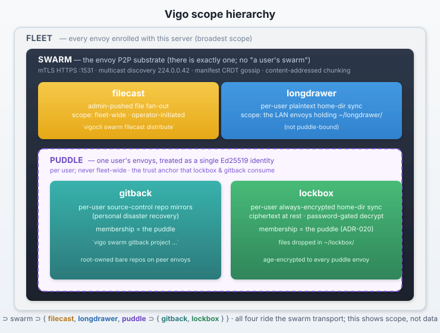

# Swarm — The Envoy P2P Substrate

Swarm is the envoy-only peer-to-peer network that Vigo's content subsystems ride on. It is not itself a product feature operators push files with — it's the transport layer: peer discovery, mTLS HTTPS between envoys on port 1531, a manifest CRDT gossiped across the fleet, and content-addressed chunking. Four content subsystems reuse this substrate:

- **[Swarmcast](../../reference/glossary.md#swarmcast)** — administrator-pushed file distribution (`vigocli swarm swarmcast distribute`). Fleet-wide, operator-scoped.
- **[Longdrawer](longdrawer.md)** — per-user plaintext home-directory sync. User-scoped; sync set = the envoys on the user's LAN that hold a `~/longdrawer/` directory.
- **[Swarmgit](swarmgit.md)** — per-user source-control repo mirroring for personal disaster recovery. User-scoped; membership is the user's [puddle](puddle.md).
- **[Lockbox](lockbox.md)** — per-user always-encrypted home-directory sync. Ciphertext at rest, password-gated decryption; membership is the user's [puddle](puddle.md).

Each content subsystem has its own content rules, multicast group, and sidecar format, but all four reuse swarm's mTLS trust, peer channel, and manifest gossip. This page documents the substrate. For a given content type, follow the links above.

## Scope: fleet vs swarm vs puddle

These three are distinct and the UI/docs must not conflate them — see the [glossary entry for *fleet*](../../reference/glossary.md#fleet) for the canonical definitions:



- **Fleet** — every envoy enrolled with this server. Broadest scope. "Fleet-wide" = across all of them.
- **Swarm** — *the* P2P substrate (singular). It spans the same envoys as the fleet, but it's the transport layer, not the machine set. There is no "a user's swarm."
- **Puddle** — a *per-user* trust unit: one user's collection of envoys, expressed as a single Ed25519 identity. Lockbox and swarmgit use it as the trust anchor. "A user's puddle" is meaningful; "the fleet's puddle" is not.

"Mesh" is **not** a canonical term — older UI prose used it loosely for the puddle (lockbox) or for the ad-hoc LAN sync set (longdrawer). Prefer the precise word.

## When to Use Swarm

The rest of this page describes swarm's original workload — distributing large binary artifacts — surfaced as the **[swarmcast](../../reference/glossary.md#swarmcast)** content subsystem via `vigocli swarm swarmcast distribute`. Good candidates are agent updates, firmware images, application tarballs, disk images, database dumps. For small config files (a few KB), the normal check-in bundle is more efficient.

**Good candidates:** 50 MB+ files going to 10+ envoys — agent binaries, container images, OS images, application releases.

**Not needed:** Config files, scripts, templates — these are already delivered in the policy bundle.

## How It Works

### Content Addressing

Every blob is identified by its SHA256 hash. Blobs are split into 1 MiB chunks. There is no filename at the transport layer — only the hash matters.

### Distribution Flow

1. **Seed:** Admin runs `vigocli swarm swarmcast distribute <file> --target '*.web.*'`, which streams the file to the server's seed directory (hashed in a single pass). Alternatively, drop a file + `.swarm` manifest on any envoy.
2. **Registration:** The server registers the seed in the tracker and manifest CRDT immediately on upload, then force-pushes streaming agents. For envoy-seeded blobs, the seeder's agent reports the file via the `swarm_seeds` trait on the next check-in.
3. **Manifest:** The manifest entry is gossipped to all envoys via check-in responses
4. **Self-assignment:** Each agent evaluates the manifest's target specs against its own hostname and traits. If it matches, it queues the blob for download — no server assignment needed.
5. **Peer discovery:** The agent finds peers through four layers (see below)
6. **Download:** The SwarmManager coordinates downloads with bounded concurrency and deduplication
7. **Reporting:** The agent reports completed blobs via the `swarm.blobs` trait
8. **Serving:** Envoys that have the blob serve chunks to peers that still need it
9. **Retirement:** After retention expires (default 7 days), seeders stop serving and receivers evict

Both `vigocli swarm swarmcast distribute` and the envoy seed directory use the same mechanism. The CLI is a convenient way to place a file in the server's seed directory remotely. The server is just another envoy.

### Agent-Driven Peer Discovery

The agent discovers peers through five layers, tried in order:

| Layer | Mechanism | Scope | Latency |
|-------|-----------|-------|---------|
| 1. Server hints | Peer addresses from check-in response | Fleet-wide | On check-in |
| 2. Multicast | UDP on `224.0.0.42:1531`, including WANT solicitation | LAN segment | < 5s |
| 3. Peer exchange | `X-Peers` header on chunk responses | Transitive | 0 (piggybacks on data) |
| 4. Active probing | `GET /blob/{sha}/meta` to known peer addresses | Fleet-wide | < 2s |
| 5. Refresh loop | Conditional `/meta` probes every 5s, `If-None-Match` against the peer's last `ETag` | Known peers | 5s |

On a LAN, multicast discovers peers within seconds. Agents also announce which blobs they need (WANT lines), so peers with the blob can respond immediately. Multicast `HAVE` lines for partial blobs carry an inline base64 bitmap of which chunks the peer has, so listeners can populate their peer map without a follow-up probe. Across subnets, active probing queries known peer addresses from the persistent peer registry — peers discovered for previous blobs are candidates for new ones. The server's check-in response provides peer hints as a supplementary channel, but agents do not depend on it.

While downloads are in flight, a background refresh loop re-probes known peers every 5 seconds using `If-None-Match` against the peer's last `ETag`. Unchanged inventories cost a single 304 with an empty body; changed ones return the new bitmap and overwrite the stored one (authoritative replace semantics — a dropped chunk no longer lingers in the scheduler's view).

Peer state persists across agent restarts in `peers.json`, so a restarted agent immediately knows which peers to try without waiting for multicast or a server round-trip.

### Download Jitter

When envoys receive a new swarm assignment, each one delays its download start by a deterministic 0–1 second (hashed from hostname + blob SHA256). This staggers initial requests to the seeder, preventing a thundering herd when many envoys all check in on the same cycle.

### Chunk Scheduling

The agent uses a **rarest-first** scheduling strategy: it prioritizes downloading chunks that fewer peers have. This maximizes the diversity of chunks across the swarm, so peers can serve each other more effectively. Up to 8 concurrent peer connections are maintained.

**Peer rotation:** The peer list for each chunk is rotated by `chunk_index % num_peers`, so different chunks start with different peers. This distributes load across all available sources instead of every chunk hitting the same first peer.

**Host-seeded tiebreaker:** Within a rarity group (chunks that have the same number of peers), the sort order is broken by a deterministic seahash of `(hostname, chunk_index)` so different envoys attack the same group in different orders. Without this, every envoy with the same availability matrix would pile onto the peer that happens to serve chunk 0 on every tick.

If a peer fails, the scheduler tries the next available peer for that chunk. Failed chunks are retried in subsequent rounds with exponential backoff (capped at 30s). Retries continue as long as progress is being made; the download only bails when a full round completes with zero new chunks (all peers down). Partial chunks survive on disk and are resumed on the next check-in cycle.

**Endgame mode:** Once the retry loop is on its second or later attempt and only the tail of the blob remains (fewer than `max(chunk_count/20, 1)` chunks), the scheduler switches to endgame: every remaining chunk is requested from every peer that has it in parallel, up to a fleet-wide cap of 32 concurrent fetches, and the first response per chunk wins while duplicates are dropped on arrival. This kills the long tail where one slow peer holding chunk N stalls the whole blob. Endgame has a hard 15-second deadline per round — anything still outstanding falls back to the normal retry path.

**Pre-download peer discovery:** When only the seeder is known (the common cold-start case), the orchestrator waits 2 seconds for multicast HAVE announcements, then actively probes all known peer addresses for the target blob. This discovers peers that already have chunks from a previous download cycle before the scheduler commits to its chunk ordering. Cost: ~2s + one /meta probe per known peer.

**Mid-download peer refresh:** Every 100 chunks (~10 seconds), the scheduler re-reads the peer map and updates availability for remaining chunks. This picks up new peers discovered via multicast during the download, enabling progressive seeding even within a single round.

This enables **progressive seeding**: envoy A gets chunks from the seeder, envoy B starts from the seeder but discovers A mid-download and pulls from both, envoy C finds all three and distributes load across them.

### Adaptive Bandwidth

Agents monitor host network utilization by reading interface statistics from sysfs. When the host is busy, swarm throttles its download rate to avoid interfering with production traffic. Four tiers:

| Host utilization | Swarm behavior |
|-----------------|----------------|
| < 25% | Full speed |
| 25–50% | 75% throttle |
| 50–75% | 50% throttle |
| > 75% | 25% throttle (trickle) |

The `max_bandwidth_percent` setting in `server.yaml` sets the upper bound.

### Disk Space Guardrails

Before downloading, the agent runs `BlobCache::check_disk_space` which enforces two gates — either one aborts the download:

1. **Absolute reserve** — `available_bytes >= blob_size + 512 MiB` (the historical check; protects against accepting a blob that would fully consume the disk).
2. **Pressure threshold** — `free_pct > 10` on the blobs mountpoint (`/var/lib/vigo/swarm/.blobs`). Swarm is pull-based, so the fleet-wide "sender doesn't push to ≤10%-free recipients" guardrail lands here as "receiver refuses to start a download when its own disk is already pressured."

Both checks go through the shared `swarm::peer_health` module so the gate matches the one answered by `GET /health/storage?for=swarm` on the same mount. Skipped downloads are reported to the server as "skipped" with the triggering reason. See [Disk Space in swarm operations](../../operations/swarm.md#disk-space) for how the same guardrail shows up in the other three peer-delivery paths.

## Architecture

```
       ┌──────┐    seed     ┌──────┐
       │Seeder│────────────►│Server│
       │:1531 │             │gossip│
       └──┬───┘             └──┬───┘
          │ P2P                │ manifest
     ┌────┼────┐          ┌───┼────┐
     ▼    ▼    ▼          ▼   ▼    ▼
  ┌──────┐ ┌──────┐   ┌──────┐ ┌──────┐
  │Envoy1│◄│Envoy2│   │Envoy3│◄│Envoy4│
  │:1531 │►│:1531 │   │:1531 │►│:1531 │
  └──────┘ └──────┘   └──────┘ └──────┘
    mTLS HTTPS peer connections
```

- **Seeder** has the original file — serves chunks to peers via port 1531
- **Server** gossips manifest entries and provides peer hints — does NOT assign per-envoy
- **Agents** self-assign by evaluating manifest target specs, discover peers autonomously, and coordinate downloads via the SwarmManager
- **Peers** exchange chunks directly — distribution accelerates as more envoys complete

## Manifest — Decentralized Blob Lifecycle

Every envoy maintains a local **manifest** — a LWW-Map CRDT (Last-Writer-Wins Map) that tracks which blobs are active and which are revoked. The manifest propagates between envoys via gossip, enabling fleet-wide revocation without depending on the server.

### How It Works

Each blob has a manifest entry with a status (`active` or `revoked`), a timestamp, and an author. When two envoys merge their manifests, the entry with the higher timestamp wins. If timestamps are equal, revoked wins over active (safety property).

This means revocations are **conflict-free** — no matter what order envoys receive updates, they all converge to the same state.

### Revocation Propagation

When a blob is revoked (via `vigocli swarm revoke`, by the seeder, or by retention expiry), the revocation propagates through three channels:

| Channel | Scope | Speed |
|---------|-------|-------|
| Multicast gossip | LAN segment | 5–10 seconds |
| Peer HTTPS sync | Cross-subnet (on P2P connections) | On next chunk exchange |
| Server check-in push | Anywhere agents reach the server | On next check-in |

On a LAN, multicast announcements include the manifest version. When a peer detects a version mismatch, it fetches the full manifest over mTLS HTTPS and merges it. Revoked blobs are evicted from cache immediately and their peer map entries are flushed, so re-seeding the same SHA starts with a clean slate instead of trusting stale peer claims.

The server also ships its manifest CRDT with every check-in response. This is the bridge for operator-initiated revocations: `vigocli swarm revoke` only updates the server's in-memory store, so without the server-side push, agents on isolated subnets (no shared multicast group, no direct peer reach) would never learn. The push complements multicast — it's redundant on the LAN, essential for any envoy that can reach the server but not its peers.

### Authorization

- **Only the seeder** or the **server** can revoke a blob
- A compromised envoy cannot revoke another envoy's blobs

### Server-side persistence + agent-gossip gate

The server's `ManifestStore` persists to `<dir(seed_dir)>/server-manifest.json` (mode `0600`, atomic temp+rename via a 1-second debounced background flusher). Without persistence, a server restart wipes the in-RAM manifest and agents reporting their cached `swarm_seeds` traits re-create every entry — including ones the operator just revoked — within seconds. This was the root cause of the 2026-04-24 cairn/swarmgit reset incident; persistence + the gate below close the footgun structurally. The filename is deliberately distinct from the agent's `/var/lib/vigo/swarm/manifest.json` (Rust schema) since the server-as-envoy story has both processes sharing that directory via bind-mount.

The agent-driven `RecordSeedFromAgent` path is gated: agents can only refresh entries the server has already seen via the authoritative admin-distribute path. Unknown or revoked SHAs reported via gossip are dropped (logged at INFO, no entry created). The admin path (`POST /api/v1/swarm/swarmcast/distribute` → `RecordSeed`) remains the only way to introduce new entries.

A liveness sweep in `RetentionPruner` revokes active entries whose `LastReSeededAt` (a per-entry timestamp parallel to LWW's `UpdatedAt`, bumped on every Record\* call) has aged past `swarm.manifest_liveness_ttl` (default `24h`). Combined with the gossip gate, this keeps the manifest from accumulating orphans when a publisher permanently disappears. Set `manifest_liveness_ttl: 0` to disable the sweep on tiny static fleets where no entry should ever expire.

### Manifest Endpoints

Each envoy's peer server (port 1531) exposes:

- `GET /manifest/version` — current manifest version (Lamport clock)
- `GET /manifest` — full manifest as JSON

These are used by the gossip protocol for efficient sync — peers compare versions before transferring the full manifest.

## Security

All peer-to-peer traffic uses the same mTLS certificates as gRPC communication. The agent's HTTPS peer server on port 1531 verifies client certificates against the Vigo CA. No unauthenticated connections are accepted.

Blob integrity is verified by SHA256 hash after download — if the hash doesn't match, the blob is discarded and re-downloaded.

## Operability — pattern-list authorization

In 0.41.0 the substrate switched from a fleet-wide enabled-bool plus per-substrate blacklists to a **two-layer hostname pattern list per subsystem**. Every entry in `swarm:` (server.yaml) is a list with first-match-wins, `-` prefix denies, default-deny on no match — same semantics as Vigo's existing matchfile patterns (ADR-002).

```yaml
swarm:
  enabled: ["*"]                          # substrate runs on these hosts
  puddle:    { enabled: ["*"] }           # lockbox derives from this list
  swarmgit: { enabled: ["annlap", "plex", "girlslaptop"] }
  longdrawer:  { enabled: ["*"] }
  swarmcast:   { enabled: ["*"] }
  swarmresolve: false                     # plain bool — agent-managed /etc/hosts block (default off)
```

The server evaluates patterns against each agent's hostname and emits the resolved bools in `PolicyBundle.vars_json` on every check-in (`swarm_enabled`, `swarm_puddle_enabled`, `swarm_swarmgit_enabled`, `swarm_longdrawer_enabled`, `swarm_swarmcast_enabled`, plus `swarm_swarmresolve_enabled` when `swarm.swarmresolve: true`). Agents never see the patterns — they only see their own resolved gate. A `vigocli config publish` propagates within one check-in cycle without restarting anything.

### swarmresolve — agent-managed `/etc/hosts` block

`swarm.swarmresolve` is the one swarm knob that's a plain bool, not a pattern list (it follows `swarm.enabled` per host), and the one that's **default-OFF on the agent** rather than fail-open: editing `/etc/hosts` is an operator decision, so the agent treats absence of `swarm_swarmresolve_enabled` (a fresh enrollment, a config that doesn't set it, an explicit `false`) as off. When on, every swarm-enabled agent emits its hostname in a `HOST:<hostname>` line in the multicast announcement preamble; receivers join `(hostname, datagram-source-IP)` into a fleet `hostname → IP` index, and the swarmresolve reactor renders it into a delimited block in `/etc/hosts`. The reactor runs on two triggers: an **inotify/kqueue watch on `/etc/hosts`** (it re-renders the block within ~1 s of any out-of-band rewrite — so a config-management run that clobbers the file is repaired fast) and a **~60 s backstop timer** (eventual convergence and stale-entry pruning if the watch ever misses an event). The block looks like:

```
# BEGIN vigo swarm peers — managed by the vigo agent; do not edit
192.168.1.2     danlap
192.168.1.74    annlap
# END vigo swarm peers
```

Strictly additive: lines outside the markers are preserved verbatim (atomic temp+rename, file mode preserved), loopback addresses are skipped defensively, and any name the swarm doesn't hold still resolves via the OS resolver / DNS unchanged — `/etc/hosts` (`files`) is consulted alongside `dns`, not instead of it. Flipping `swarm.swarmresolve` back to `false` removes the managed block on the next tick; stale entries (a peer gone quiet for >5 min) drop out the same way. It exists for the case the swarm is built for — a LAN where DNS doesn't authoritatively own the local domain — so `vigo swarm puddle join --from <host>`, `ssh <host>`, `git`, and friends resolve fleet hostnames without `/etc/hosts` edits or a working local resolver. (`/etc/hosts` is **not** on the agent's hardcoded guardrail protected-path list — and shouldn't be, since the agent only ever rewrites its own delimited region.) Inspect it from the envoy with `vigo swarm swarmresolve status` — the resolved gate plus the current managed-block contents — or the `swarmresolve:` line in `vigo swarm status`.

#### Coexisting with `/etc/hosts` management

swarmresolve owns **only** the `# BEGIN ... # END vigo swarm peers` region — it reads the current file, re-emits every line outside the markers verbatim, and rewrites just the block. So it composes cleanly with anything that manages a *different* part of `/etc/hosts`: the [`host`](../../reference/executors/host.md) resource (which manages individual `ip hostname` entries and leaves the rest, including swarmresolve's block, untouched), a [`blockinfile`](../../reference/executors/blockinfile.md) region editor with its own distinct markers, static hand-edited entries, DHCP-injected lines — none of those collide with the managed block, and the managed block doesn't collide with them.

What it does **not** compose with is a *whole-file* owner of `/etc/hosts`: a `type: file` resource with `path: /etc/hosts` and a `content:` / `source:` template, or any external tool that does `cat > /etc/hosts`. That rewrites the file from scratch on every run — dropping the managed block (and any `host`-resource entries) — after which swarmresolve re-adds its block (the inotify watch fires within ~1 s of the clobber), the next config-management pass drops it again, and the two flap against each other; in the gaps the peer names are unresolvable. **Don't manage `/etc/hosts` with a whole-file `file:` resource on a swarmresolve-enabled envoy.** If you need Vigo to place `/etc/hosts` entries, use `type: host` for per-entry control, or a `type: blockinfile` editor with markers distinct from `# BEGIN/END vigo swarm peers`. The agent can't tell "this `file:` resource is fighting swarmresolve" from "the operator means it" — which is exactly why `/etc/hosts` isn't a guardrails-protected path — so this is a config-design rule, not something the agent enforces. (If a fight does occur it's bounded, not corrupting: swarmresolve reconverges within ~1 s of each clobber and the config-management tool within its own interval; it's a lost-update flap, not file corruption — but it's still a flap, so don't set it up.)

**Two layers.** Both the substrate-level `swarm.enabled` AND the per-subsystem list must allow a host for the subsystem to be active there. Empty list at either layer disables the subsystem on that host.

**Lockbox derives from puddle.** ADR-020. There is no `swarm.lockbox` section. A host allowed in `swarm.puddle.enabled` can hold lockbox ciphertext for its locally-enrolled members; a host denied there cannot use lockbox at all. Single source of truth.

**No more blacklists.** The destructive-blacklist semantic retired in 0.41.0 (one-tiny-typo-wipes-fleet-state was a footgun). Negative patterns subsume the gate-only use case (`["-rasp1", "*"]` excludes a single host; the rest of the fleet is allowed). Destructive scrub of per-user state moved to the usercrate `puddle: bool` and `swarmgit: bool` flags — see [Usercrate authorization](#usercrate-authorization) below.

| Knob | Effect | Audit event |
|------|--------|-------------|
| `swarm.enabled: []` | Substrate-level kill switch. Agents whose hostname doesn't match stop announcing, stop serving, stop fetching across every subsystem. | `swarm.enabled` (with added/removed patterns) |
| `swarm.puddle.enabled: []` | Halts puddle and lockbox on hosts that don't match. Identity material under `~user/.vigo-puddle/` and `~user/.lockbox/` is preserved (gate-only). | `swarm.puddle.enabled` |
| `swarm.swarmgit.enabled: []` | Halts swarmgit publisher and receiver on hosts that don't match. Already-held mirrors preserved. | `swarm.swarmgit.enabled` |
| `swarm.longdrawer.enabled: []` | Halts longdrawer announcer / listener / push handler on hosts that don't match. `~user/longdrawer/` content preserved. | `swarm.longdrawer.enabled` |
| `swarm.swarmcast.enabled: []` | Halts swarmcast reception. `POST /api/v1/swarm/swarmcast/distribute` returns **403** with `audit_event=swarm.swarmcast.denied` when the list is empty (no envoy could possibly receive). | `swarm.swarmcast.enabled` (flip), `swarm.swarmcast.denied` (per blocked admin push) |

**Audit-chain coverage.** Every pattern-list change at config-publish time records a tamper-evident entry under `actor=config.reload` / `source=config`. Admin-push denials record under `actor=<authenticated user>` / `source=api`. Inspect via `/api/v1/audit?event_type=swarm.*`.

**Soft-skip vs hard-stop.** Vigo uses soft-skip: data structures stay resident, the listener stays bound, but emit/serve paths consult an `Arc<AtomicBool>` and return early when the gate is off. Re-enabling resumes work without process restart and without losing in-flight transfers. Hard-stop semantics (kill listener, drop in-flight) are not implemented.

**Swarmcast note.** Swarmcast rides this generic transport rather than having its own per-substrate listener, so the agent-side gate for swarmcast is currently **forward-compat only** — the `swarm_swarmcast_enabled` flag flows to agents but no agent code branches on it. The operator-meaningful enforcement for swarmcast is server-side: the gate guard at `POST /api/v1/swarm/swarmcast/distribute`. Existing in-flight swarmcast blobs continue propagating across the fleet via the shared swarm transport regardless.

## Usercrate authorization

The envoy-level pattern lists answer "is this subsystem available on this envoy?" The user-level usercrate flags answer "which Unix users on this envoy can use it?" Both must say yes for a user to use a subsystem; default-deny on both.

```yaml
# usercrate
resources:
  - type: user
    name: dan
    home: /home/dan
    puddle: true       # authorizes dan to run `vigo swarm puddle *`
    swarmgit: true    # authorizes dan to run `vigo swarm swarmgit project *`
```

Both flags default to `false`. Longdrawer and swarmcast have no usercrate flag — longdrawer gates by Unix file ownership (the user creates `~/longdrawer/`), swarmcast by admin call site.

**Cache.** The user executor writes the resolved flags to `/var/lib/vigo/usercrate-policy/<username>.json` on every reconcile pass (root-owned, mode 0644). Per-user CLI verbs read this cache as a precondition — no server round-trip, works offline.

**Scrub-on-transition.** Removing `puddle: true` from a usercrate triggers destructive cleanup on the next reconcile: lockbox LEAVE sentinel, then wipe of `~/.vigo-puddle/`, `~/.lockbox/`, `~/lockbox/`, and `~/.vigo-swarmgit/`. Removing `swarmgit: true` scrubs only `~/.vigo-swarmgit/`. The flags' removal is the destructive lever in 0.41.0 — envoy-level pattern flips are gate-only.

## Related

- [Swarm Operations](../../operations/swarm.md) — Configuration, monitoring, troubleshooting
- [vigocli swarm swarmcast](../../reference/cli/swarm-swarmcast.md) — CLI reference for admin-pushed swarmcasts on this substrate
- [Server Configuration](../../getting-started/server-config.md) — `swarm:` section
---
*Confidential -- Alexander4, LLC. Not for redistribution. See [documentation-license](../../legal/documentation-license.md).*
