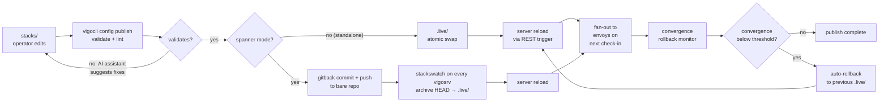

<!-- vigo-i18n source_sha:0a74ee874ca9d9456ec0c385ad6a6d400628b696b96c02e809d9679fc5e27bba -->

# Publier votre configuration

À la fin de cette page, vous saurez comment livrer un changement de configuration à la flotte en toute sécurité : éditer sous `stacks/`, valider sans appliquer, publier de façon atomique vers `.live/`, et (quand quelque chose ne va pas après publication) revenir à la version live précédente en une seule commande.

**Quand l'utiliser :** chaque fois que vous ajoutez ou modifiez un configcrate, un rôle, un hostcrate, un usercrate, une surcharge d'environnement, une dérogation ou une déclaration de conformité. La validation s'exécute localement avant que quoi que ce soit ne touche la flotte, c'est donc aussi le moyen de vérifier la cohérence des changements avant de les pousser dans une barrière CI.

**Quand l'éviter :** jamais, si vous rédigez de la configuration. Il n'existe pas d'autre voie ; le serveur ne lit que `.live/`.

Les opérateurs éditent les fichiers `.vgo` dans `stacks/`. La commande `config publish` les valide en utilisant la même logique que le chargeur de configuration du serveur, détecte les changements, puis les propage vers `/srv/vigo/.live/` — le répertoire verrouillé en lecture seule depuis lequel le serveur lit (le contenu reflète directement `stacks/` ; pas d'espace de noms interne). La propagation prend deux formes :

- **Mode standalone** — la CLI synchronise atomiquement l'arbre validé dans le `.live/` local et appelle le déclencheur de rechargement REST. Un seul vigosrv, un seul système de fichiers ; la publication est terminée quand l'échange est effectué.
- **Mode Spanner** — la CLI commite l'arbre validé dans le projet gitback stacks de l'ops-puddle et le pousse vers le dépôt bare local. La goroutine d'arrière-plan `stackswatch` sur chaque vigosrv (y compris celui d'origine) voit la nouvelle référence, archive `HEAD`, le valide et le publie dans son `.live/` local par le même pipeline qu'une publication locale (instantané, verrou, vérification du gel), et recharge. La CLI interroge ensuite `GET /api/v1/config/version` jusqu'à ce qu'elle s'incrémente avant de signaler le succès.

Les deux modes partagent le même verbe visible par l'opérateur (`vigocli config publish`) et le même pipeline de validation. Le mode est auto-détecté via `GET /api/v1/spanner/status`.


## Disposition des répertoires

```
/srv/vigo/
├── stacks/                    ← operators edit here (the config tree)
│   ├── configcrates/             # Configcrate definitions
│   ├── usercrates/               # Per-user configcrates (inert until included via `usercrates:`)
│   ├── templates/                # Go template files for source: references
│   ├── tasks/                    # Reusable task definitions
│   ├── workflows/                # Workflow definitions
│   ├── roles.vgo                 # Role definitions (single, fleet-wide)
│   ├── common.vgo                # Fleet-wide directory-inherited defaults
│   ├── waivers.vgo               # Fleet-wide compliance waivers
│   ├── compliance.vgo            # Fleet-wide compliance claims
│   ├── envoys.vgo                # Top-level hostcrate (any .vgo with envoys: works)
│   └── customerA/
│       ├── common.vgo            # Inherited by customerA subtree
│       ├── envoys.vgo            # Per-customer hostcrate
│       └── web/web.vgo           # Per-host hostcrate
├── stacks-examples/           ← read-only install templates (image-seeded)
└── .live/                     ← server reads here (locked, do not edit) — mirrors stacks/ contents directly
```

La structure des répertoires est à la fois une organisation de fichiers et une hiérarchie d'héritage. Voir [Format de configuration : héritage de répertoire](../../reference/configcrate-language.md#directory-inheritance) pour les détails.

La publication ne parcourt que `stacks/`. `.live/` et `stacks-examples/` se trouvent en dehors, sous `/srv/vigo/`, ils n'apparaissent donc jamais dans le diff ni dans la synchronisation.

## Utilisation

```bash
# Validate without publishing
vigocli config publish --dry-run

# Validate and publish
vigocli config publish

# Skip URL checks (air-gapped environments)
vigocli config publish --skip-url-check
```

## Options

| Option | Défaut | Description |
|------|---------|-------------|
| `--dry-run` | `false` | Valider seulement, ne pas synchroniser |
| `--skip-url-check` | `false` | Ignorer les vérifications de disponibilité HTTP des URL |
| `--url-timeout` | `10s` | Délai d'attente par vérification de disponibilité d'URL |
| `--ask-ai` | `false` | Demander à l'IA de suggérer des corrections pour les erreurs de validation |

## Fonctionnement

Les six premières étapes (validation + lint) sont les mêmes dans les deux modes. L'étape de propagation (7) se sépare selon le mode.



1. Normalise les espaces dans tous les fichiers `.vgo` (suppression des espaces de fin, correction des fins de ligne, remplacement des tabulations dans l'indentation YAML, suppression du BOM UTF-8). Les templates (`.tmpl`) ne sont pas normalisés — les opérateurs peuvent s'appuyer sur les espaces à l'intérieur des directives de template Go. Il **formate ensuite vos crates source sur place** : en rafraîchissant les étiquettes standard `#~` de modlint (une par module, une par ressource) tout en préservant tout ce que vous avez écrit — vos commentaires `#` (prose *et* attributs commentés comme `#owner: 0644`) et tout le contenu. Les étiquettes vivent dans votre source ; la copie synchronisée vers `.live/` est dépouillée de tous les commentaires (étape 7).
2. Compare `stacks/` à `.live/` en utilisant des hachages SHA-256 pour trouver les fichiers nouveaux, modifiés et supprimés. Seuls les fichiers `.vgo` et `.tmpl` sont suivis ; tout le reste sous stacks est invisible pour la publication.
3. Exécute le **linter de configcrate** sur les fichiers de configcrate modifiés/nouveaux (voir ci-dessous)
4. Charge tous les fichiers `.vgo` depuis une copie de staging de stacks en utilisant `config.NewConfigStore()` — le même chemin de code que celui utilisé par le serveur. Le chargement de l'arbre complet est requis car les configcrates, les rôles et les entrées d'Envoy se référencent mutuellement.
5. Les URL HTTP/HTTPS dans les **configcrates modifiés uniquement** sont sondées pour leur disponibilité (HEAD avec repli GET). Les configcrates inchangés sont ignorés.
6. La CLI appelle `GET /api/v1/spanner/status` pour détecter le mode. Les vigosrv standalone passent par l'étape 7a ; les vigosrv en mode Spanner passent par l'étape 7b.
7. **(7a, standalone)** Élague l'arbre de staging de tout configcrate / usercrate / template qu'aucun porteur ne référence (sauf si `--no-prune` est défini), puis le synchronise atomiquement dans `.live/` (voir [Synchronisation atomique — mode standalone](#atomic-sync--standalone-mode) ci-dessous), et appelle `POST /api/v1/config/reload` pour déclencher un rechargement côté serveur.
   **(7b, spanner)** Commite l'arbre de staging dans le clone local du projet gitback stacks de l'ops-puddle et le pousse vers le dépôt bare à `/var/lib/vigo/swarm/gitback/projects/<project_id>.git` via `file://`. La goroutine `stackswatch` locale voit la nouvelle référence, archive `HEAD`, le valide et le publie dans `.live/` (un arbre qui échoue à la validation, ou un gel de publication, laisse `.live/` inchangé), et recharge. La CLI interroge `GET /api/v1/config/version` jusqu'à ce qu'elle s'incrémente (délai de 30s) avant de déclarer le succès. Les autres vigosrv du spanner reçoivent les octets via le peer-pull du substrat gitback au prochain cycle du réacteur et exécutent le même chemin de surveillance localement.
8. `.live/` et `stacks-examples/` (frères de `stacks/` sous `/srv/vigo/`) ne sont jamais lus par le publieur.
9. Si rien n'a changé, la commande signale « Nothing to publish » et ne touche pas à `.live/`.

## Linter de configcrate


Chaque fichier de configcrate modifié ou nouveau passe par le linter de configcrate (`server/modlint`) avant la validation. Le linter est un pipeline à quatre étapes :

### 1. Réparation YAML

Corrige les problèmes de syntaxe courants au niveau du texte :
- Tabulations → 2 espaces
- Suppression des espaces de fin
- Normalisation des fins de ligne (CRLF → LF)
- Garantie d'une nouvelle ligne finale
- Valeurs spéciales YAML non quotées (`yes`/`no`/`on`/`off`) → `true`/`false`

### 2. Normalisation de la structure

- Ordre canonique des clés par type de ressource (par ex. `target_path` avant `content` avant `owner` pour les ressources fichier)
- Indentation cohérente de 2 espaces
- Gestion des clés en double (la dernière l'emporte selon la spécification YAML)

### 3. Validation du schéma

- Champs requis par type de ressource (par ex. `file` nécessite `target_path`, `owner`, `group`, `mode`)
- Types de ressource inconnus rejetés (sauf si `skip_validation: true` est défini)
- Validation des références croisées (`depends_on`, `notify`, `subscribes`, `before` doivent référencer des noms de ressource existants)
- Détection de cycle dans le DAG
- Vérifications d'idempotence (exec nécessite `onlyif`/`unless`, service `restarted`/`reloaded` nécessite `subscribes` ou `when: "changed"`)
- Détection de déclencheur redondant (`notify` + `subscribes` sur la même paire)

### 4. Auto-commentaire

Le linter ajoute des commentaires auto-générés préfixés par `#~` :

- **Au niveau du configcrate** : un commentaire de bloc en haut décrivant ce que le configcrate gère
- **Au niveau de la ressource** : un commentaire d'une ligne au-dessus de chaque ressource décrivant son action

```yaml
#~ Manages package, file, service
name: nginx

resources:
  #~ Install nginx package
  - name: nginx-package
    type: package
    package: nginx

  #~ Deploy /etc/nginx/nginx.conf
  - name: nginx-config
    type: file
    target_path: /etc/nginx/nginx.conf
    content: "server {}"
    owner: root
    group: root
    mode: "0644"
    notify: [nginx-service]

  #~ Ensure nginx is running and enabled
  - name: nginx-service
    type: service
    service: nginx
    state: running
    enabled: true
    depends_on: [nginx-package, nginx-config]
```

**Convention de commentaire :**
- Les commentaires `#~` sont auto-générés et **rafraîchis sur place à chaque publication**. Ne les éditez jamais — ils sont écrasés.
- Les commentaires `#` (sans le tilde) sont les vôtres et **ne sont jamais touchés** dans la source — y compris les **attributs commentés** comme `#owner: 0644`, que Vigo conserve comme information opérateur plutôt que de les supprimer. Utilisez-les pour vos propres notes.
- Le `#` à l'intérieur des blocs `content:` et de `files/` est une **donnée** de fichier — jamais touché, ni dans la source ni dans `.live/`.
- Dans `.live/` (côté serveur), chaque commentaire est dépouillé des configcrates et usercrates — les étiquettes `#~` comme vos notes `#` ; seuls la config et le contenu restent. (Les fichiers d'échafaudage — `envoys.vgo`, `roles.vgo`, `waivers.vgo`, `environments.vgo` — conservent leurs commentaires dans `.live/` ; le serveur ignore de toute façon les commentaires de `.live/`.)
- Les étiquettes sont dérivées du nom, du type et des attributs de la ressource — elles ne répètent jamais ce que le YAML dit déjà.

## Synchronisation atomique — mode standalone

En mode standalone, la CLI écrit directement dans `.live/`. Chaque sous-répertoire est synchronisé indépendamment en utilisant une stratégie de renommage :

1. Copier le sous-répertoire de stage vers un répertoire temporaire dans `.live/` (`.publish-tmp-*`)
2. Renommer le sous-répertoire `.live/` existant en sauvegarde (`.publish-backup-*`)
3. Renommer le temporaire en live
4. Supprimer la sauvegarde en cas de succès ; rollback en cas d'échec

Les sous-répertoires absents de stage sont supprimés de `.live/` (la synchronisation est un remplacement, pas un ajout).

## Archive bare→.live — mode spanner

En mode Spanner, la CLI ne touche jamais directement à `.live/` — elle pousse vers le dépôt bare gitback et la goroutine `stackswatch` sur chaque vigosrv (y compris celui-ci) propage les octets :

1. fsnotify sur `<bare-repo>/refs/heads/` se déclenche quand le push arrive ; le watcher applique un debounce de 250ms pour qu'une rafale de push multi-écriture se stabilise en un seul rechargement.
2. Le watcher pipe `git --git-dir=<bare-repo> archive --format=tar HEAD | tar -x -C <tmp>` pour matérialiser l'arbre de HEAD sans checkout git de travail sous `.live/`.
3. `pruneMissing` parcourt `.live/` et supprime tout ce qui n'est pas présent dans `<tmp>` ; `copyTree` parcourt `<tmp>` et écrit dans `.live/`. Ensemble, ils donnent une sémantique rsync-avec-suppression, mais sans dépendre de git ou rsync à l'exécution.
4. Le watcher appelle `configStore.Reload()` — le même point d'entrée de rechargement que le chemin standalone déclenche via REST. Du point de vue du serveur, les deux modes sont indistinguables au-delà de cette étape.

Une validation échouée en mode Spanner laisse le contenu `.live/` précédent en place et la configuration précédente en cours d'exécution — même forme qu'une publication standalone qui échoue à la validation, juste appliquée un cran plus loin dans le pipeline.

## Ce qui est validé

### Structurel (via `NewConfigStore`)

- Syntaxe YAML
- Références de configcrate et de rôle (pas de références pendantes)
- Détection de dépendance circulaire
- Idempotence des ressources (les ressources exec nécessitent `onlyif` ou `unless`)
- Références inter-ressources (`depends_on`, `notify`, `subscribes`, `before` doivent référencer des noms de ressource existants)
- Déclencheurs redondants (ressource A `notify: [B]` et B `subscribes: [A]` — double déclenchement)
- Types de ressource inconnus (bloqués sauf si `custom: true` est défini sur la ressource)
- `file` avec `state: directory` (doit utiliser `type: directory` à la place)
- `service` avec `state: restarted/reloaded` sans `subscribes` ou `when: "changed"` (redémarre à chaque convergence). Si `subscribes` est présent mais que `when: "changed"` est manquant, le linter l'ajoute automatiquement.
- `reboot` sans `subscribes` ou `reboot_required_file` (redémarre à chaque convergence)
- Format de référence de secret (pas la disponibilité du secret)
- Syntaxe de template dans les attributs `content:`
- Analyse des expressions `when:`
- Validation des chemins absolus pour les champs `targetpath` et `path`
- Validation du format de mode octal
- Énumération de l'état de service (`running`, `stopped`, `restarted`, `reloaded`)
- Champs requis : source_package (`url`), git (`repo`, `path`), mount (`path`)

### Disponibilité des URL (configcrates modifiés uniquement)

- Sonde HTTP HEAD pour toutes les URL http/https dans : `source_package.url`, `repository.key_url`, `git.repo`
- Repli sur GET avec en-tête Range si HEAD renvoie 405
- 4xx/5xx ou échec de connexion = erreur de validation
- Les URL non-HTTP (ssh://, git://) sont ignorées
- Désactivé avec `--skip-url-check`

## Suggestions de correction assistées par IA

Quand la validation échoue, `config publish` appelle l'assistant IA (si le serveur fonctionne avec l'IA activée) pour expliquer chaque erreur et suggérer un YAML corrigé. Les suggestions sont diffusées sur stderr sous la sortie d'erreur.

Ajoutez `--ask-ai` pour demander à l'assistant IA de suggérer des corrections pour chaque erreur. Nécessite que le serveur fonctionne avec l'IA activée.

## Permissions de fichiers

Le répertoire `.live/` est protégé afin que les opérateurs ne puissent pas contourner la validation en écrivant directement :

- **`.live/`** — `0750` (root peut lire/écrire, le groupe peut lire)
- **Fichiers dans `.live/`** — `0640` (root peut lire/écrire, le groupe peut lire)

- **`stage/`** — `0770` (les opérateurs peuvent lire/écrire)

Les permissions sont appliquées automatiquement après chaque publication. Le serveur consigne un avertissement au démarrage si `.live/` est accessible en écriture par tous.

Pour mettre en place le modèle de permissions recommandé :

```bash
# Create vigo group for server process
groupadd vigo

# Lock down .live (only root/publish can write, vigosrv can read via group)
chown -R root:vigo /srv/vigo/stacks/structure
chmod 750 /srv/vigo/stacks/structure

# Operators can write to stage
chmod 770 /srv/vigo/stacks
```

## Ressources d'exécuteur personnalisé

Les types de ressource inconnus sont bloqués par défaut. Si une ressource utilise un exécuteur personnalisé, ajoutez `skip_validation: true` pour contourner la validation de type :

```yaml
- name: deploy-app
  type: capistrano
  skip_validation: true
  command: "cap production deploy"
  unless: "test -f /var/www/app/current"
```

## Comportement au démarrage avec une configuration invalide

Si le serveur démarre avec une configuration invalide dans `.live/`, le comportement dépend du type d'erreur :

- **Erreurs d'idempotence** (exec non gardé, reboot sans subscribes, etc.) — **non fatales**. Le serveur démarre avec zéro configcrate chargé. L'erreur est consignée au niveau ERROR et stockée dans `LastReloadError()`, exposée via `vigocli doctor` et le tableau de bord web. L'API REST, l'UI et gRPC restent disponibles afin que vous puissiez diagnostiquer et corriger la configuration. Les Envoys reçoivent une politique vide (aucun changement appliqué) jusqu'à ce que la configuration soit réparée et republiée.
- **Erreurs structurelles** (YAML invalide, références role→configcrate pendantes, échecs de résolution de secret) — **fatales**. Le serveur refuse de démarrer. Elles indiquent un arbre de configuration fondamentalement cassé.

Puisque `config publish` exécute le linter de configcrate avant la synchronisation, la plupart des erreurs d'idempotence sont détectées avant d'atteindre `.live/`. Le comportement de démarrage non fatal est un filet de sécurité pour les configurations qui contournent la publication (par ex. placées directement dans `.live/`).

## Configuration initiale

Sur une installation neuve, `.live/` est vide. Le serveur démarre normalement avec zéro configcrate et zéro entrée d'Envoy. Placez vos configurations dans `stage/` et exécutez `vigocli config publish` pour peupler `.live/` pour la première fois.

## Sortie

```bash
$ vigocli config publish --dry-run
Validation passed: 12 configcrates, 3 roles, 8 envoy entries
  + configcrates/nginx.vgo
  + configcrates/sshd.vgo
  + envoys/web.vgo

$ vigocli config publish
Published: 12 configcrates, 3 roles, 8 envoy entries (15 files synced)
  + configcrates/nginx.vgo
  + configcrates/sshd.vgo
  + envoys/web.vgo
```

## Et ensuite

- **Une publication a échoué à la validation** → lisez les suggestions de correction diffusées par l'IA dans votre terminal ; si vous avez besoin des règles de validation complètes, voir [la référence de rédaction de configcrate](../../reference/configcrate-language.md).
- **Vous voulez tracer pourquoi un Envoy particulier a obtenu une valeur particulière** → `vigocli config trace <envoy> <configcrate>` parcourt la chaîne de résolution.
- **Une publication a abouti mais s'est auto-annulée** → le moniteur de rollback de convergence l'a détectée ; inspectez le journal d'audit via `vigocli config history`.
- **Vous devez vérifier ce qui est live** → `vigocli config tree` affiche l'arbre résolu complet tel que le serveur le voit.
- **Vous avez publié en mode Spanner et le `config_version` d'un bolt est en retard** → vérifiez le `journalctl -u vigosrv` de ce bolt pour les lignes `stackswatch`. Le watcher utilise un debounce de stabilisation de 250ms par changement de référence, donc un décalage bref est normal ; un retard persistant pointe vers un fetch gitback ops-puddle obsolète (le réacteur de peer-pull ne s'est pas exécuté) ou un démon helper puddle non réactif (`/var/run/vigo/puddle.sock`).

---
*Vérifié sur Vigo 0.65.10 · 2026-05-18.*
