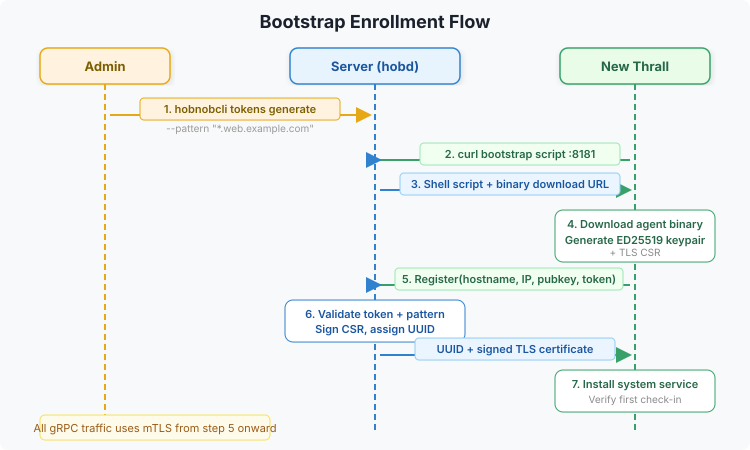

# Bootstrap Enrollment

Bootstrap is the process by which a new machine becomes a managed envoy. The server provides a one-line bootstrap script that handles agent installation and enrollment.

## How It Works



## Bootstrap Script

The server serves a shell script at `GET /bootstrap`:

```bash
curl -sSfk https://<server>:8443/bootstrap | sudo sh
```

The `-k` flag allows curl to connect to the server's self-signed TLS certificate. Once the agent is enrolled, all subsequent communication uses mTLS with the CA certificate received during bootstrap. If your server uses a trusted certificate (e.g., from Let's Encrypt), you can omit `-k`.

The script:
1. Detects OS (Linux, macOS, FreeBSD, OpenBSD, NetBSD, illumos) and architecture
2. Stops any existing vigo-envoy service and removes previous enrollment data for a clean start
3. Downloads the correct agent binary from the server (always replaces existing)
4. Verifies the SHA256 checksum of the downloaded binary (aborts on mismatch)
5. Generates an ED25519 keypair
6. Calls the server's bootstrap registration endpoint
7. Receives a client UUID and signed TLS certificate
8. Writes agent config to `/etc/vigo-envoy/config`
9. Installs the appropriate service for the platform:
   - **Linux:** systemd unit (`vigo-envoy.service`)
   - **macOS:** launchd plist (`com.vigo.envoy`)
   - **FreeBSD / NetBSD:** rc.d script (`/usr/local/etc/rc.d/vigo_envoy`)
   - **OpenBSD:** registered via `rcctl`
   - **illumos:** SMF service manifest (`svc:/system/vigo-envoy:default`)
10. Starts the service

### Windows Bootstrap

For Windows, use the PowerShell bootstrap:

```powershell
# PowerShell 7+
irm https://<server>:8443/bootstrap?os=windows -SkipCertificateCheck | iex

# PowerShell 5
[Net.ServicePointManager]::ServerCertificateValidationCallback = {$true}; irm https://<server>:8443/bootstrap?os=windows | iex
```

The `-SkipCertificateCheck` flag (or the `ServerCertificateValidationCallback` on PowerShell 5) is the equivalent of curl's `-k` — it allows connecting to the server's self-signed TLS certificate. Once inside the script, TLS verification is automatically skipped for all download calls. After enrollment, all subsequent communication uses mTLS with the CA certificate received during bootstrap.

The PowerShell script performs the same steps but installs a Windows Service via `sc.exe` with automatic restart on failure. See [Windows Support](../reference/platforms/windows.md) for details.

## Enrollment Methods

### Token-Free (Trusted Enrollment)

Configure trusted patterns in `server.yaml`:

```yaml
bootstrap:
  trusted_enrollment:
    - pattern: "*.web.example.com"
      cidrs: ["10.0.0.0/8"]
    - pattern: "*.dev.*"
      cidrs: ["192.168.0.0/16"]
```


Envoys matching both the hostname glob and source CIDR enroll without a token.

### One-Time Token

For stricter environments, generate a token:

```bash
vigocli tokens generate --pattern "web3.example.com"
```

Pass the token to the bootstrap script:

```bash
curl -sSfk https://<server>:8443/bootstrap | sudo sh -s -- --token <token>
```

Tokens are:
- One-time use (consumed on successful enrollment)
- Bcrypt-hashed at rest in the database
- Pattern-matched against the enrolling hostname

### Approved Patterns

Pre-approve hostname patterns so matching envoys can enroll:

```bash
vigocli approved add "*.prod.example.com"
```

## Certificate Signing

When `server.tls.ca_key_file` is configured, the server acts as a Certificate Authority:

1. Agent generates a CSR during bootstrap
2. Server signs the CSR with the CA key
3. Agent receives a signed client certificate
4. All subsequent gRPC communication uses this certificate for mTLS

Certificate validity is configurable:

```yaml
bootstrap:
  cert_validity: "8760h"  # 1 year (default)
```

## Binary Integrity

The bootstrap script verifies the SHA256 checksum of the downloaded agent binary before proceeding with enrollment. After downloading the binary, it fetches the expected checksum from the server's `/api/v1/agent/latest` endpoint and compares it against the locally computed digest. If the checksums do not match, the script removes the binary and aborts with an error.

On Unix systems, the script uses `sha256sum`, `shasum -a 256`, or `digest -a sha256` (whichever is available). On Windows, the PowerShell script uses `Get-FileHash`.

For distribution builds, agent binaries can also be signed with an ED25519 key (`make dist-sign-agent`). The signature and public key are served via the `/api/v1/agent/latest` (signature field) and `/api/v1/agent/signing-key` endpoints. During self-update, the agent:

1. Compares its compiled-in version against the server's advertised version — if they already match, the update is skipped (circuit breaker to prevent exec-loops)
2. Downloads the new binary using mTLS (presenting its bootstrap client certificate)
3. Verifies the SHA256 checksum
4. If a signature is present, fetches the signing public key from the server and verifies the ED25519 signature over the SHA256 digest
5. Atomically replaces the binary and exec-restarts

This means even a compromised server cannot push a malicious binary without the offline signing key. Updates can be triggered remotely via `vigocli envoys rebootstrap`.


## Security

- All gRPC traffic uses mTLS — the bootstrap HTTP endpoint is the only plaintext path
- Agent public keys are stored server-side and verified on every check-in (ED25519 signatures)
- One-time tokens prevent replay attacks
- Revoked agents receive an error on check-in and cannot re-enroll with the same UUID
- Bootstrap endpoints (`/bootstrap`, `/api/v1/agent/*`, `/api/v1/bootstrap/*`) are exempt from web UI authentication so agents can enroll without credentials
- The bootstrap endpoint can be restricted to specific CIDRs via reverse proxy

## Troubleshooting

**"An active envoy with this hostname already exists":**
- A envoy with the same hostname is already enrolled. The bootstrap script handles this automatically (it always passes `--force` to revoke and re-enroll). If using `vigo register` directly, pass `--force`:

```bash
vigo register --token <token> --force
```

**Agent fails to register:**
- Check that the server's gRPC port (1530) is reachable from the envoy
- Verify the token hasn't already been used
- Check hostname matches the token pattern or trusted enrollment pattern

**Certificate errors after enrollment:**
- Verify `ca_key_file` is configured in server.yaml
- Check certificate hasn't expired (`cert_validity` setting)

**Agent binary download fails:**
- Ensure the server's container image includes agent binaries for the target platform
- Check that the `/srv/vigo/` volume is correctly mounted

## Related

- [Installation](installation.md)
- [Server Configuration](server-config.md)
- [Architecture](../concepts/architecture.md)
---
*Confidential -- Alexander4, LLC. Not for redistribution. See [documentation-license](../legal/documentation-license.md).*
