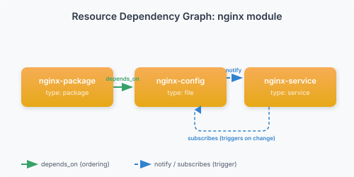

# First Module

This walkthrough builds a complete nginx module with package installation, config file management, and service control — demonstrating the core patterns you'll use in every Vigo module.

## Module Structure

A module is a YAML file with a `.vgo` extension in `stack/stage/modules/`. It contains:

```yaml
name: module-name
vars:
  key: default_value
resources:
  - name: resource-name
    type: resource-type
    # type-specific attributes
```

## Step 1: Create the Module

Create `stack/stage/modules/nginx.vgo`:

```yaml
name: nginx

vars:
  nginx_port: 80
  server_name: localhost

resources:
  - name: nginx-package
    type: package
    package: nginx
    state: present

  - name: nginx-config
    type: file
    target_path: /etc/nginx/sites-available/default
    content: |
      server {
          listen {{ .Vars.nginx_port }};
          server_name {{ .Vars.server_name }};
          root /var/www/html;
          index index.html;
      }
    owner: root
    group: root
    mode: "0644"
    depends_on: [nginx-package]
    notify: [restart-nginx]

  - name: nginx-service
    type: service
    service: nginx
    state: running
    enabled: true
    depends_on: [nginx-package]

  - name: restart-nginx
    type: service
    service: nginx
    state: restarted
    when: "changed"
```

## Step 2: Understand the Resource Chain

This module demonstrates three key patterns:

**depends_on** — Ordering guarantee. `nginx-config` won't run until `nginx-package` succeeds. `nginx-service` also waits for `nginx-package`.

**notify + when: "changed"** — Trigger on change. When `nginx-config` changes the file, it notifies `restart-nginx`. The `restart-nginx` resource has `when: "changed"`, so it only fires when triggered — it won't restart every convergence cycle. This is the standard pattern: `notify` on the source, `when: "changed"` on the target.

**Two service resources** — `nginx-service` ensures nginx is running and enabled (idempotent — only starts if stopped). `restart-nginx` handles restarts on config change (non-idempotent — gated by `when: "changed"`). Separating these is the recommended pattern.

**Templates** — The `content:` attribute uses Go template syntax. `{{ .Vars.nginx_port }}` is replaced with the value of the `nginx_port` variable at check-in time.



## Step 3: Assign to a Envoy

Create a directory for your web servers and add a envoy entry:

```bash
mkdir -p stack/stage/web
```

```yaml
# stack/stage/web/web.vgo
envoys:
  - match: "web*.example.com"
    modules: [nginx]
    vars:
      nginx_port: 8080
      server_name: "web.example.com"
```

Node-level `vars` override the module's default `vars`. Here, `nginx_port` becomes `8080` instead of the default `80`.

**Tip:** If you have modules that should apply to *all* your envoys (like SSH and monitoring), put them in `stack/stage/common.vgo` — everything in subdirectories inherits them automatically. See [Directory Inheritance](../concepts/config-format.md#directory-inheritance).

## Step 4: Use Roles for Reuse

For multiple modules, group them into a role. Create `stack/stage/roles.vgo`:

```yaml
roles:
  - name: webserver
    modules:
      - nginx
      - logrotate-nginx
      - monitoring-node-exporter
```

Then assign the role:

```yaml
envoys:
  - match: "web*.example.com"
    roles: [webserver]
    vars:
      nginx_port: 8080
```

## Step 5: Environment-Specific Config

Use `environment_overrides` to vary config by environment:

```yaml
envoys:
  - match: "web*.example.com"
    environment: production
    roles: [webserver]
    vars:
      nginx_port: 80
    environment_overrides:
      staging:
        nginx_port: 8080
      production:
        nginx_port: 443
```

When the envoy's environment is `production`, `nginx_port` resolves to `443`.

## Step 6: Conditional Resources

Use `when:` to apply resources conditionally:

```yaml
resources:
  - name: nginx-package-debian
    type: package
    package: nginx
    when: "os_family('debian')"

  - name: nginx-package-redhat
    type: package
    package: nginx
    when: "os_family('redhat')"
```

The agent evaluates `when:` expressions using the envoy's traits. Only the matching resource runs.

## Step 7: Publish and Converge

Publish the config to make it active:

```bash
vigogo config publish
```

The publish command runs your module through the **module linter**, which:
- Fixes common YAML issues (tabs, trailing whitespace, unquoted booleans)
- Normalizes key ordering and indentation
- Validates required fields, cross-references, and idempotency
- Adds `#~` auto-comments describing each resource

After publishing, your module file will have `#~` comments like:

```yaml
#~ Manages package, file, service
name: nginx
...
resources:
  #~ Install nginx package
  - name: nginx-package
    ...
```

These `#~` comments are regenerated on every publish — don't edit them. Use plain `#` comments for your own notes.

Then force an immediate check-in:

```bash
vigogo envoys push web1.example.com
```

Check the run result:

```bash
vigogo runs list --limit 1
```

View the envoy's applied config:

```bash
vigogo envoys show web1.example.com
```

## What's Next

- [Config Format](../concepts/config-format.md) — Full reference for modules, roles, vars, environment_overrides
- [Resource DAG](../concepts/resource-dag.md) — depends_on, notify, subscribes in depth
- [When Expressions](../concepts/when-expressions.md) — Conditional logic reference
- [Templates](../concepts/templates.md) — Go template syntax for content: attributes
- [File Executor: stream_edit](../reference/executors/file.md#stream-edit) — Pipe file content through transform scripts before writing
