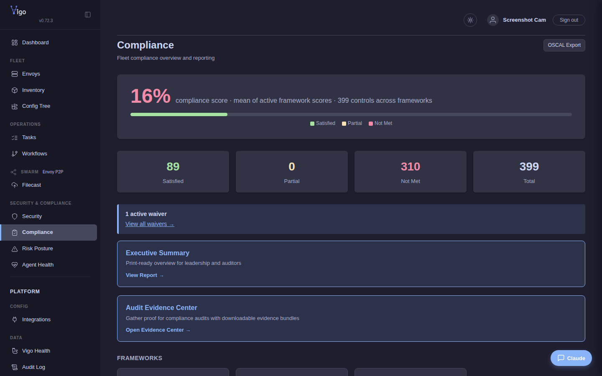
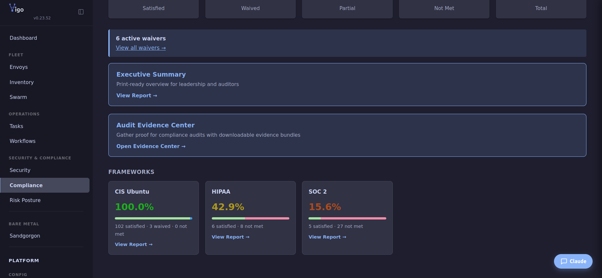

# Compliance reporting

You'll finish this page with configcrate-level `compliance:` tags rolled up into per-framework coverage that auditors can read directly — produced as JSON or HTML on the CLI, or browsed on the `/compliance` Web UI. The numbers come from one place: configcrates declare what controls they satisfy, the server unions that across the fleet (plus Connwaer trait checks and `waivers.vgo`), and every surface reads from the same join. No spreadsheets, no per-control bookkeeping outside the configcrate file itself.

**When you'd use this:** any time you need an artifact for an external auditor (HIPAA, SOC 2, PCI, HITRUST, CIS), feed evidence into a GRC platform (Vanta / Drata / Secureframe / Laika / Thoropass / ServiceNow), or answer "what controls is our fleet satisfying?" from a single command.

**When you'd skip this:** controls Vigo can't honestly attest (physical security, BAA paperwork, vendor reviews) — declare those in `waivers.vgo` and document the rationale; don't tag a configcrate that can't actually prove the control.

## Tag your configcrates

Every configcrate that satisfies a control gets a `compliance:` block. Use the framework's actual control IDs:

```yaml
# /srv/vigo/stacks/stockpile/configcrates/openvpn.vgo
name: openvpn
compliance:
  hipaa:       ["164.312(e)(1)", "164.312(e)(2)(ii)"]
  pci-dss:     ["2.3", "4.1"]
  nist-800-53: ["SC-8", "SC-8(1)", "SC-13"]
  iso-27001:   ["A.13.1.1", "A.13.2.1"]
  cis-ubuntu:  ["3.5.1.1", "3.5.1.2"]
resources:
  - …
```

See the [compliance matrix](../../reference/compliance-matrix.md) for the canonical control → Vigo-coverage table; use it to figure out which configcrates satisfy what.

A control counts as covered for an envoy when **any** of the following is true:

1. The envoy has a configcrate tagged with that control.
2. A Connwaer trait check escalates it to satisfied.
3. A waiver applies (declared in `waivers.vgo`).

## Look at the coverage

The Web UI is the right place to *browse* coverage. The CLI is the right place to *produce* the auditor's artifact.

**Web UI:** `https://vigo:8443/compliance` — framework cards with coverage %, drill-down to per-control state and per-envoy attribution.



Each card is clickable; the per-framework page shows which controls are covered, which are uncovered, and which envoy is currently the weakest link.



## Produce a report for an auditor

One verb per framework, with `--format html` or `--format json` and `--output <file>`:

```bash
vigocli compliance report compliance --format html --output hipaa-2026-Q2.html
vigocli compliance report soc2       --format html --output soc2-2026-Q2.html
vigocli compliance report pci        --format html --output pci-2026-Q2.html
vigocli compliance report hitrust    --format html --output hitrust-2026-Q2.html
vigocli compliance report cis        --format html --output cis-2026-Q2.html
```

(The HIPAA verb is `compliance` rather than `hipaa` for historical reasons — HIPAA was the original framework, so the generic name carries that mapping. The other verbs match their frameworks one-to-one.)

For a tamper-evident bundle that pairs the report with the relevant audit-log slice:

```bash
vigocli compliance report audit-bundle hipaa --output hipaa-audit-2026-Q2.zip
```

HTML reports render server-side; JSON reports give you the same data shaped for ingestion. Output includes:

- Executive summary with overall coverage % per framework.
- Per-control table: control ID, description, status (covered / partial / uncovered / waived), satisfying configcrates, attesting envoys, last-converged timestamp.
- For `audit-bundle`: a hash-chained audit-log extract over the report window.

## Feed a GRC platform

Outbound exporters for the major GRC platforms:

```bash
vigocli compliance export siem  --output evidence.jsonl
vigocli compliance export cmdb  --output cmdb.json
vigocli compliance export oscal --output oscal.json
```

For continuous push (rather than one-shot export), wire the GRC integration in `server.yaml` — Vigo POSTs evidence on a schedule.

## GRC platform push (Vanta, Drata, Secureframe, Laika, Thoropass, ServiceNow GRC)

Vigo's GRC exporters format per-control pass/fail evidence and POST it to your GRC platform on a schedule. Configure in `server.yaml`:

```yaml
grc:
  enabled: true
  vendor: vanta              # or drata | secureframe | laika | thoropass | servicenow | generic
  endpoint: "https://api.vanta.com/v1/..."
  token: "secret:grc/vanta/token"
  push_interval: "1h"
  frameworks: [soc2, iso-27001]
```

See `reference/server-yaml.md` for the full per-vendor schema.

## Waivers

Some controls can't be satisfied by automation (process controls, physical-security controls, BCP exercises). Declare a waiver:

```yaml
# /srv/vigo/stacks/stockpile/waivers.vgo
waivers:
  - control: "pci-dss:9.1"           # physical access to cardholder data env
    rationale: "Co-located in SOC-2 audited DC; vendor-provided physical security."
    expires: "2027-04-01"
    owner: "compliance@example.com"
  - control: "nist-800-53:CP-4"      # contingency-plan testing
    rationale: "Annual DR exercise per BCP-2026-03; next exercise 2026-09."
    expires: "2027-03-01"
    owner: "compliance@example.com"
```

Waivers show up in the per-control attribution as the reason for coverage. Expiring waivers fire a notification 30 days before expiry.

## Roles and access

- **Admin role** sees everything and can export every report.
- **Compliance role** (`compliance.read` + `compliance.docs.write` by default) sees the compliance UI and can upload documented-scope artifacts; it deliberately can't read the raw audit log (`audit.read` is admin/viewer only).
- **Viewer role** sees coverage but not raw audit data.

## Per-framework regulatory checklists

The framework matrix tells you what controls each framework requires and which Vigo configcrates satisfy them. The checklists below are operator-side preparation work — what evidence to gather, what waivers to file, what conversations to have with the auditor — that goes beyond what Vigo enforces directly.

### HIPAA Security Rule checklist

1. **Inventory PHI flows.** List every envoy that touches PHI; tag them with a `phi: true` hostcrate label. Vigo doesn't infer PHI scope — you declare it.
2. **§164.312(a)(1) access control.** Run the `user` and `sudo` configcrates; tag them with the relevant HIPAA control. Verify with `vigocli compliance report compliance --format html --output verify.html` and drill into the per-envoy section.
3. **§164.312(b) audit controls.** Vigo's hash-chained audit log satisfies the "audit mechanisms" requirement; export with `vigocli audit export --since 2026-01-01 --to 2026-03-31 --format pdf`.
4. **§164.312(c) integrity controls.** File-integrity-monitoring configcrates; pair with Connwaer's WORM verification if you're using it.
5. **§164.312(e)(1) transmission security.** mTLS is enforced by construction; document with `vigocli compliance report compliance`.
6. **Business Associate Agreement.** Outside Vigo's scope. Maintain in your contract repository; link from the compliance report.
7. **Annual risk assessment.** Vigo's `/risk` page produces fleet-wide scoring; export with `vigocli risk report --format pdf`.

### SOC 2 Type II checklist

1. **Define your trust services criteria scope.** Security, Availability, Processing Integrity, Confidentiality, Privacy — pick the ones in scope and tag configcrates accordingly.
2. **Common Criteria (CC) controls.** Most CC controls map to platform hardening (`security-hardening` configcrate set), monitoring (`set-up-monitoring`), and audit (the built-in audit log). Tag and export.
3. **Continuous monitoring requirement.** Vigo's 15-second-to-5-minute convergence interval IS your continuous monitoring; document the interval and drift-correction behavior in your SOC 2 narrative.
4. **Change management.** `vigocli config publish` produces a hash-chained audit trail; export it for the auditor's change-management sample.
5. **Subservice organizations.** Outside Vigo's scope.
6. **Annual penetration test.** Outside Vigo's scope; results feed into the report as evidence.

### PCI-DSS checklist

1. **CDE scoping.** Tag every envoy in the cardholder-data environment (`cde: true`). Configcrates that target CDE envoys carry the `pci-dss:` compliance tag.
2. **Requirement 1 — firewall.** Vigo doesn't replace your firewall; it can verify host-firewall state via the `firewall` executor or Connwaer's network-segmentation check.
3. **Requirement 2 — defaults.** The `security-hardening` configcrate disables default accounts and changes default passwords; cross-reference with `vigocli compliance report pci` and drill into the per-envoy section.
4. **Requirement 6 — secure dev.** Vigo's build provenance (binary signatures, supply-chain attestations) is captured in the audit log.
5. **Requirement 10 — logging.** mTLS-secured audit shipping to a SIEM; the `integrations` config covers Splunk, Datadog, generic syslog.
6. **Quarterly ASV scans.** Outside Vigo's scope.

### NY DFS Cyber (23 NYCRR 500) checklist

1. **§500.02 cybersecurity program.** Vigo's framework matrix is the artifact.
2. **§500.05 penetration testing.** Outside Vigo's scope; feed results into the report.
3. **§500.06 audit trail.** Hash-chained audit log; configurable retention via `audit.retention_days` in `server.yaml`.
4. **§500.09 risk assessment.** Vigo's risk-scoring engine; export with `vigocli risk report`.
5. **§500.11 third-party policy.** Outside Vigo's scope.
6. **§500.16 incident response.** Vigo's `notify` actions + integrations push to PagerDuty/Slack/ServiceNow — document in your IRP.

### Decommissioning an envoy (audit trail)

1. **Revoke first, delete later.** `vigocli envoys revoke <id>` — the envoy can no longer check in, but the historical record stays.
2. **Wipe sensitive state** if you're physically reusing the hardware: `vigo swarm puddle leave --yes` on the envoy (if puddle membership existed); standard NIST 800-88 wipe procedure for the disk.
3. **Document the decommission** with a final compliance report extract — run the per-framework report verbs you care about and archive the HTML output alongside the decommission ticket.
4. **Delete the envoy record** after your retention window: `vigocli envoys delete <id>`.

### Incident response checklist

1. **Detection.** Drift alerts, the `/risk` page, CVE-impact search — all surface anomalies. Configure `drift-alerting` and `cve-impact` integrations to feed PagerDuty / Slack.
2. **Triage with Scrier.** `vigocli scrier ssh <suspect-envoy>` — no inbound port needed, every session is audit-logged.
3. **Contain.** `vigocli envoys quarantine <id>` revokes the envoy's enrollment and pauses convergence; reverses cleanly with `unquarantine`.
4. **Forensic snapshot.** `vigocli envoys snapshot <id>` exports the envoy's full trait + run-history + config-resolution chain at the moment of the incident.
5. **Reset and re-enroll.** If the envoy is compromised: wipe and re-bootstrap; the new envoy gets a fresh ED25519 keypair, so the compromised host can't impersonate it on re-enrollment.
6. **Post-mortem.** Audit-log extract over the incident window; attach to your incident ticket.

## What's next

- **Tag a configcrate** → see the [compliance matrix](../../reference/compliance-matrix.md) for which controls each framework expects and which Vigo executors / Connwaer checks satisfy them.
- **Push evidence to a GRC platform on a schedule** → wire the GRC section in [`server.yaml`](../../reference/server-yaml.md).
- **A control can't be satisfied by automation** → file a waiver in `waivers.vgo` with a rationale and an expiry; the report still labels it covered-by-waiver rather than uncovered.
- **A report verb fails or the numbers look wrong** → [Troubleshoot common issues](../operate/troubleshoot.md).

---
*Verified on Vigo 0.51.6 · 2026-05-13.*

*Confidential — Alexander4, LLC. Not for redistribution. See [../legal/license.md](../../legal/license.md).*
