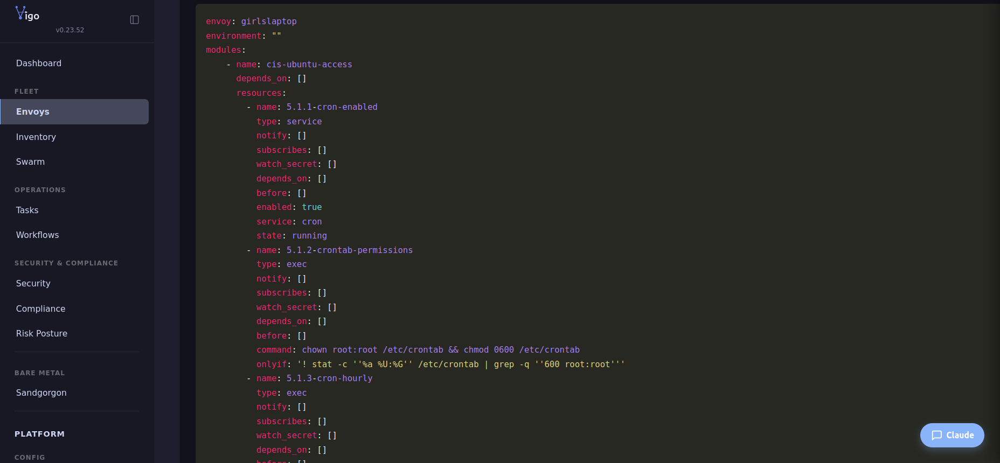
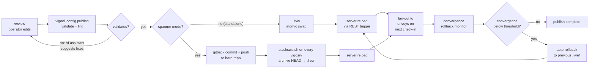

# Publish your config

You'll finish this page knowing how to ship a config change to the fleet safely: edit under `stacks/`, validate without applying, publish atomically to `.live/`, and (when something's wrong post-publish) roll back to the previous live version with one command.

**When you'd use this:** every time you add or change a configcrate, role, hostcrate, usercrate, environment override, waiver, or compliance claim. Validation runs locally before anything touches the fleet, so this is also how you sanity-check changes before pushing them through a CI gate.

**When you'd skip this:** never, if you're authoring config. There's no other path; the server only reads `.live/`.

Operators edit `.vgo` files in `stacks/`. The `config publish` command validates them using the same logic as the server's config loader, detects changes, then propagates to `/srv/vigo/.live/` — the locked-read-only directory the server reads from (contents mirror `stacks/` directly; no inner namespace). Propagation has two shapes:

- **Standalone mode** — the CLI atomically syncs the validated tree into the local `.live/` and calls the REST reload trigger. One vigosrv, one filesystem; the publish is done when the swap completes.
- **Spanner mode** — the CLI commits the validated tree to the ops-puddle's stacks gitback project and pushes it to the local bare repo. The `stackswatch` background goroutine on every vigosrv (including the originating one) sees the new ref, archives `HEAD` into its local `.live/`, and reloads. The CLI then polls `GET /api/v1/config/version` until it increments before reporting success.

Both modes share the same operator-visible verb (`vigocli config publish`) and the same validation pipeline. The mode is auto-detected via `GET /api/v1/spanner/status`.



## Directory Layout

```
/srv/vigo/
├── stacks/                    ← operators edit here (the config tree)
│   ├── configcrates/             # Configcrate definitions
│   ├── usercrates/               # Per-user configcrates (inert until included via `usercrates:`)
│   ├── templates/                # Go template files for source: references
│   ├── tasks/                    # Reusable task definitions
│   ├── workflows/                # Workflow definitions
│   ├── roles.vgo                 # Role definitions (single, fleet-wide)
│   ├── common.vgo                # Fleet-wide directory-inherited defaults
│   ├── waivers.vgo               # Fleet-wide compliance waivers
│   ├── compliance.vgo            # Fleet-wide compliance claims
│   ├── envoys.vgo                # Top-level hostcrate (any .vgo with envoys: works)
│   └── customerA/
│       ├── common.vgo            # Inherited by customerA subtree
│       ├── envoys.vgo            # Per-customer hostcrate
│       └── web/web.vgo           # Per-host hostcrate
├── stacks-examples/           ← read-only install templates (image-seeded)
└── .live/                     ← server reads here (locked, do not edit) — mirrors stacks/ contents directly
```

The directory structure is both file organization and an inheritance hierarchy. See [Config Format: Directory Inheritance](../../reference/configcrate-language.md#directory-inheritance) for details.

Publish only walks `stacks/`. `.live/` and `stacks-examples/` live outside it under `/srv/vigo/`, so they never appear in the diff or sync.

## Usage

```bash
# Validate without publishing
vigocli config publish --dry-run

# Validate and publish
vigocli config publish

# Skip URL checks (air-gapped environments)
vigocli config publish --skip-url-check
```

## Flags

| Flag | Default | Description |
|------|---------|-------------|
| `--dry-run` | `false` | Validate only, do not sync |
| `--skip-url-check` | `false` | Skip HTTP aliveness checks for URLs |
| `--url-timeout` | `10s` | Timeout per URL aliveness check |
| `--ask-ai` | `false` | Ask AI to suggest fixes for validation errors |

## How It Works

The first six steps (validate + lint) are the same in both modes. The propagate step (7) splits on mode.



1. Normalizes whitespace in all `.vgo` files (strip trailing spaces, fix line endings, replace tabs in YAML indentation, drop UTF-8 BOM). Templates (`.tmpl`) are not normalized — operators may rely on whitespace inside Go template directives. It then **formats your source crates in place**: refreshing modlint's `#~` standard labels (one per module, one per resource) while preserving everything you wrote — your `#` comments (prose *and* commented-out attributes like `#owner: 0644`) and all content. The labels live in your source; the copy synced to `.live/` is stripped of all comments (step 7).
2. Diffs `stacks/` against `.live/` using SHA-256 hashes to find new, changed, and removed files. Only `.vgo` and `.tmpl` files are tracked; everything else under stacks is invisible to publish.
3. Runs the **configcrate linter** on changed/new configcrate files (see below)
4. Loads all `.vgo` files from a staging copy of stacks using `config.NewConfigStore()` — the same code path the server uses. Full tree loading is required because configcrates, roles, and envoy entries cross-reference each other.
5. HTTP/HTTPS URLs in **changed configcrates only** are probed for aliveness (HEAD with GET fallback). Unchanged configcrates are skipped.
6. The CLI calls `GET /api/v1/spanner/status` to detect mode. Standalone vigosrvs go through step 7a; spanner-mode vigosrvs go through step 7b.
7. **(7a, standalone)** Prunes the staging tree of any configcrate / usercrate / template no carrier references (unless `--no-prune` is set), then atomically syncs it into `.live/` (see [Atomic sync — standalone mode](#atomic-sync--standalone-mode) below), and calls `POST /api/v1/config/reload` to trigger a server-side reload.
   **(7b, spanner)** Commits the staging tree to the local clone of the ops-puddle's stacks gitback project and pushes to the bare repo at `/var/lib/vigo/swarm/gitback/projects/<project_id>.git` via `file://`. The local `stackswatch` goroutine sees the new ref, archives `HEAD` into `.live/`, and reloads. The CLI polls `GET /api/v1/config/version` until it increments (30s timeout) before declaring success. Other vigosrvs in the spanner receive the bytes via the gitback substrate's peer-pull on the next reactor cycle and run the same watcher path locally.
8. `.live/` and `stacks-examples/` (siblings of `stacks/` under `/srv/vigo/`) are never read by the publisher.
9. If nothing changed, the command reports "Nothing to publish" and does not touch `.live/`.

## Configcrate Linter


Every changed or new configcrate file is run through the configcrate linter (`server/modlint`) before validation. The linter is a four-stage pipeline:

### 1. YAML Repair

Fixes common syntax issues at the text level:
- Tabs → 2 spaces
- Trailing whitespace removal
- Normalize line endings (CRLF → LF)
- Ensure final newline
- Unquoted YAML special values (`yes`/`no`/`on`/`off`) → `true`/`false`

### 2. Structure Normalization

- Canonical key ordering per resource type (e.g., `target_path` before `content` before `owner` for file resources)
- Consistent 2-space indentation
- Duplicate key handling (last wins per YAML spec)

### 3. Schema Validation

- Required fields per resource type (e.g., `file` needs `target_path`, `owner`, `group`, `mode`)
- Unknown resource types rejected (unless `skip_validation: true` is set)
- Cross-reference validation (`depends_on`, `notify`, `subscribes`, `before` must reference existing resource names)
- DAG cycle detection
- Idempotency checks (exec needs `onlyif`/`unless`, service `restarted`/`reloaded` needs `subscribes` or `when: "changed"`)
- Redundant trigger detection (`notify` + `subscribes` on the same pair)

### 4. Auto-Commenting

The linter adds `#~` prefixed auto-generated comments:

- **Configcrate-level**: A block comment at the top describing what the configcrate manages
- **Resource-level**: A single-line comment above each resource describing its action

```yaml
#~ Manages package, file, service
name: nginx

resources:
  #~ Install nginx package
  - name: nginx-package
    type: package
    package: nginx

  #~ Deploy /etc/nginx/nginx.conf
  - name: nginx-config
    type: file
    target_path: /etc/nginx/nginx.conf
    content: "server {}"
    owner: root
    group: root
    mode: "0644"
    notify: [nginx-service]

  #~ Ensure nginx is running and enabled
  - name: nginx-service
    type: service
    service: nginx
    state: running
    enabled: true
    depends_on: [nginx-package, nginx-config]
```

**Comment convention:**
- `#~` comments are auto-generated and **refreshed in place on every publish**. Never edit them — they're overwritten.
- `#` comments (without the tilde) are yours and **never touched** in source — including **commented-out attributes** like `#owner: 0644`, which Vigo keeps as operator information rather than stripping. Use them for your own notes.
- `#` inside `content:` blocks and `files/` is file **data** — never touched, in source or `.live/`.
- In `.live/` (server-facing) every comment is stripped from configcrates and usercrates — `#~` labels and your `#` notes alike; only config and content remain. (Scaffolding files — `envoys.vgo`, `roles.vgo`, `waivers.vgo`, `environments.vgo` — keep their comments in `.live/`; the server ignores `.live/` comments regardless.)
- Labels are derived from resource name, type, and attributes — they never restate what the YAML already says.

## Atomic sync — standalone mode

In standalone mode the CLI writes `.live/` directly. Each subdirectory is synced independently using a rename strategy:

1. Copy stage subdir to a temp directory inside `.live/` (`.publish-tmp-*`)
2. Rename existing `.live/` subdir to a backup (`.publish-backup-*`)
3. Rename temp to live
4. Remove backup on success; rollback on failure

Subdirectories not present in stage are removed from `.live/` (sync is replacement, not additive).

## Bare→.live archive — spanner mode

In spanner mode the CLI never touches `.live/` directly — it pushes to the gitback bare repo and the `stackswatch` goroutine on every vigosrv (including this one) propagates the bytes:

1. fsnotify on `<bare-repo>/refs/heads/` fires when the push lands; the watcher debounces 250ms so a multi-write push burst settles into one reload.
2. The watcher pipes `git --git-dir=<bare-repo> archive --format=tar HEAD | tar -x -C <tmp>` to materialize HEAD's tree without a working git checkout under `.live/`.
3. `pruneMissing` walks `.live/` and removes anything not present in `<tmp>`; `copyTree` walks `<tmp>` and writes into `.live/`. Together they give rsync-with-delete semantics, but without depending on git or rsync at runtime.
4. The watcher calls `configStore.Reload()` — the same reload entry point the standalone path triggers via REST. From the server's perspective the two modes are indistinguishable past this step.

Failed validation in spanner mode leaves the previous `.live/` content in place and the previous config running — same shape as a standalone publish that fails validation, just enforced one hop further down the pipeline.

## What Gets Validated

### Structural (via `NewConfigStore`)

- YAML syntax
- Configcrate and role references (no dangling refs)
- Circular dependency detection
- Resource idempotency (exec resources need `onlyif` or `unless`)
- Cross-resource references (`depends_on`, `notify`, `subscribes`, `before` must reference existing resource names)
- Redundant triggers (resource A `notify: [B]` and B `subscribes: [A]` — double trigger)
- Unknown resource types (blocked unless `custom: true` is set on the resource)
- `file` with `state: directory` (must use `type: directory` instead)
- `service` with `state: restarted/reloaded` without `subscribes` or `when: "changed"` (restarts every convergence). If `subscribes` is present but `when: "changed"` is missing, the linter auto-adds it.
- `reboot` without `subscribes` or `reboot_required_file` (reboots every convergence)
- Secret reference format (not secret availability)
- Template syntax in `content:` attributes
- `when:` expression parsing
- Absolute path validation for `targetpath` and `path` fields
- Octal mode format validation
- Service state enum (`running`, `stopped`, `restarted`, `reloaded`)
- Required fields: source_package (`url`), git (`repo`, `path`), mount (`path`)

### URL Aliveness (changed configcrates only)

- HTTP HEAD probe for all http/https URLs in: `source_package.url`, `repository.key_url`, `git.repo`
- Falls back to GET with Range header if HEAD returns 405
- 4xx/5xx or connection failure = validation error
- Non-HTTP URLs (ssh://, git://) are skipped
- Disabled with `--skip-url-check`

## AI-Assisted Fix Suggestions

When validation fails, `config publish` calls the AI assistant (if the server is running with AI enabled) to explain each error and suggest corrected YAML. Suggestions stream to stderr below the error output.

Add `--ask-ai` to ask the AI assistant to suggest fixes for each error. Requires the server to be running with AI enabled.

## File Permissions

The `.live/` directory is protected so operators cannot bypass validation by writing directly:

- **`.live/`** — `0750` (root can read/write, group can read)
- **Files in `.live/`** — `0640` (root can read/write, group can read)

- **`stage/`** — `0770` (operators can read/write)

Permissions are enforced automatically after each publish. The server logs a warning at startup if `.live/` is world-writable.

To set up the recommended permission model:

```bash
# Create vigo group for server process
groupadd vigo

# Lock down .live (only root/publish can write, vigosrv can read via group)
chown -R root:vigo /srv/vigo/stacks/structure
chmod 750 /srv/vigo/stacks/structure

# Operators can write to stage
chmod 770 /srv/vigo/stacks
```

## Custom Executor Resources

Unknown resource types are blocked by default. If a resource uses a custom executor, add `skip_validation: true` to bypass type validation:

```yaml
- name: deploy-app
  type: capistrano
  skip_validation: true
  command: "cap production deploy"
  unless: "test -f /var/www/app/current"
```

## Startup Behavior with Invalid Config

If the server starts with invalid config in `.live/`, the behavior depends on the error type:

- **Idempotency errors** (unguarded exec, reboot without subscribes, etc.) — **non-fatal**. The server starts with zero configcrates loaded. The error is logged at ERROR level and stored in `LastReloadError()`, surfaced via `vigocli doctor` and the web dashboard. The REST API, UI, and gRPC remain available so you can diagnose and fix the config. Envoys get empty policy (no changes applied) until the config is repaired and republished.
- **Structural errors** (invalid YAML, dangling role→configcrate references, secret resolution failures) — **fatal**. The server refuses to start. These indicate a fundamentally broken config tree.

Since `config publish` runs the configcrate linter before syncing, most idempotency errors are caught before they reach `.live/`. The non-fatal startup behavior is a safety net for configs that bypass publish (e.g., placed directly in `.live/`).

## First-Time Setup

On a fresh install, `.live/` is empty. The server starts gracefully with zero configcrates and zero envoy entries. Place your configs in `stage/` and run `vigocli config publish` to populate `.live/` for the first time.

## Output

```bash
$ vigocli config publish --dry-run
Validation passed: 12 configcrates, 3 roles, 8 envoy entries
  + configcrates/nginx.vgo
  + configcrates/sshd.vgo
  + envoys/web.vgo

$ vigocli config publish
Published: 12 configcrates, 3 roles, 8 envoy entries (15 files synced)
  + configcrates/nginx.vgo
  + configcrates/sshd.vgo
  + envoys/web.vgo
```

## What's next

- **A publish failed validation** → read the AI-streamed fix suggestions in your terminal; if you need the full validation rules, see [the configcrate-writing reference](../../reference/configcrate-language.md).
- **You want to trace why a particular envoy got a particular value** → `vigocli config trace <envoy> <configcrate>` walks the resolution chain.
- **A publish landed but rolled itself back** → the convergence-rollback monitor caught it; inspect the audit log via `vigocli config history`.
- **You need to verify what's live** → `vigocli config tree` shows the entire resolved tree as the server sees it.
- **You published in spanner mode and one bolt's `config_version` is lagging** → check that bolt's `journalctl -u vigosrv` for `stackswatch` lines. The watcher uses a 250ms quiesce-debounce per ref-change, so brief skew is normal; persistent lag points at a stale ops-puddle gitback fetch (the peer-pull reactor hasn't run) or an unresponsive puddle helper daemon (`/var/run/vigo/puddle.sock`).
- **You want the architectural narrative for spanner-mode distribution** → see `docs/internal.docs/design-config-distribution.md`.

---
*Verified on Vigo 0.65.10 · 2026-05-18.*

*Confidential -- Alexander4, LLC. Not for redistribution. See [license](../../legal/license.md).*
