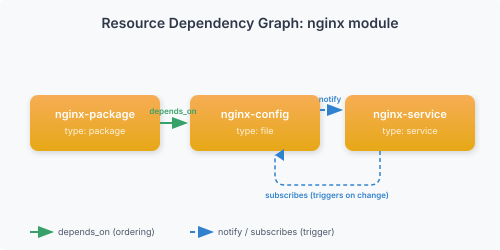
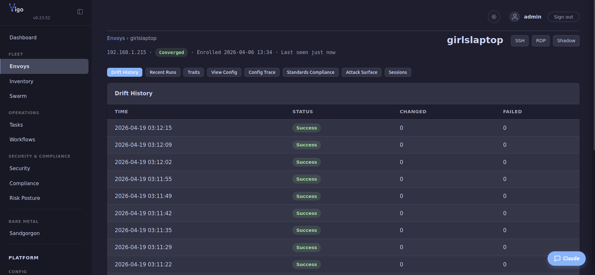

# Write your first configcrate

You'll finish this page with a working nginx configcrate published to your fleet — nginx installed, a config file rendered with traits, and the service started — applied idempotently on every envoy in scope. The same shape generalizes to every configcrate you'll write afterward: package, file, service, dependency chain.

**When you'd use this:** every operator writing their first Vigo configcrate. The example is nginx because it exercises the five most common resource types in one go (`package`, `file`, `service`, `directory`, `exec`); swap the package and config and you have a template for postgres, redis, prometheus, anything.

**When you'd skip this:** you've already shipped configcrates for a different service; jump straight to the [configcrate-writing reference](../../reference/configcrate-language.md).

This walkthrough builds a complete nginx configcrate with package installation, config file management, and service control — demonstrating the core patterns you'll use in every Vigo configcrate.

## Configcrate Structure

A configcrate is a YAML file with a `.vgo` extension in `stacks/configcrates/`. It contains:

```yaml
name: configcrate-name
vars:
  key: default_value
resources:
  - name: resource-name
    type: resource-type
    # type-specific attributes
```

## Step 1: Create the Configcrate

Create `stacks/configcrates/nginx.vgo`:

```yaml
name: nginx

vars:
  nginx_port: 80
  server_name: localhost

resources:
  - name: nginx-package
    type: package
    package: nginx
    state: present

  - name: nginx-config
    type: file
    target_path: /etc/nginx/sites-available/default
    content: |
      server {
          listen {{ .Vars.nginx_port }};
          server_name {{ .Vars.server_name }};
          root /var/www/html;
          index index.html;
      }
    owner: root
    group: root
    mode: "0644"
    depends_on: [nginx-package]
    notify: [restart-nginx]

  - name: nginx-service
    type: service
    service: nginx
    state: running
    enabled: true
    depends_on: [nginx-package]

  - name: restart-nginx
    type: service
    service: nginx
    state: restarted
    when: "changed"
```

## Step 2: Understand the Resource Chain

This configcrate demonstrates three key patterns:

**depends_on** — Ordering guarantee. `nginx-config` won't run until `nginx-package` succeeds. `nginx-service` also waits for `nginx-package`.

**notify + when: "changed"** — Trigger on change. When `nginx-config` changes the file, it notifies `restart-nginx`. The `restart-nginx` resource has `when: "changed"`, so it only fires when triggered — it won't restart every convergence cycle. This is the standard pattern: `notify` on the source, `when: "changed"` on the target.

**Two service resources** — `nginx-service` ensures nginx is running and enabled (idempotent — only starts if stopped). `restart-nginx` handles restarts on config change (non-idempotent — gated by `when: "changed"`). Separating these is the recommended pattern.

**Templates** — The `content:` attribute uses Go template syntax. `{{ .Vars.nginx_port }}` is replaced with the value of the `nginx_port` variable at check-in time.



## Step 3: Assign to a Envoy

Create a directory for your web servers and add a envoy entry:

```bash
mkdir -p stacks/web
```

```yaml
# stacks/web/web.vgo
envoys:
  - match: "web*.example.com"
    configcrates: [nginx]
    vars:
      nginx_port: 8080
      server_name: "web.example.com"
```

Node-level `vars` override the configcrate's default `vars`. Here, `nginx_port` becomes `8080` instead of the default `80`.

**Tip:** If you have configcrates that should apply to *all* your envoys (like SSH and monitoring), put them in `stacks/common.vgo` — everything in subdirectories inherits them automatically. See [Directory Inheritance](../../reference/configcrate-language.md#directory-inheritance).

## Step 4: Use Roles for Reuse

For multiple configcrates, group them into a role. Create `stacks/roles.vgo`:

```yaml
roles:
  - name: webserver
    configcrates:
      - nginx
      - logrotate-nginx
      - monitoring-node-exporter
```

Then assign the role:

```yaml
envoys:
  - match: "web*.example.com"
    roles: [webserver]
    vars:
      nginx_port: 8080
```

## Step 5: Environment-Specific Config

Declare `environment:` on each match block, then put env-specific vars in `environments.vgo` at the same directory level:

```yaml
# envoys.vgo
envoys:
  - match: "prod-*.web.example.com"
    environment: production
    roles: [webserver]
  - match: "stg-*.web.example.com"
    environment: staging
    roles: [webserver]
```

```yaml
# environments.vgo
env:
  production:
    vars:
      nginx_port: 443
  staging:
    vars:
      nginx_port: 8080
```

When the envoy's environment is `production`, `nginx_port` resolves to `443`. Env overrides are centralized in one file — each tier contributes one block, match blocks stay free of per-env noise.

## Step 6: Conditional Resources

Use `when:` to apply resources conditionally:

```yaml
resources:
  - name: nginx-package-debian
    type: package
    package: nginx
    when: "os_family('debian')"

  - name: nginx-package-redhat
    type: package
    package: nginx
    when: "os_family('redhat')"
```

The agent evaluates `when:` expressions using the envoy's traits. Only the matching resource runs.

## Step 7: Publish and Converge

Publish the config to make it active:

```bash
vigocli config publish
```

The publish command runs your configcrate through the **configcrate linter**, which:
- Fixes common YAML issues (tabs, trailing whitespace, unquoted booleans)
- Normalizes key ordering and indentation
- Validates required fields, cross-references, and idempotency
- Adds `#~` auto-comments describing each resource

After publishing, your configcrate file will have `#~` comments like:


```yaml
#~ Manages package, file, service
name: nginx
...
resources:
  #~ Install nginx package
  - name: nginx-package
    ...
```

These `#~` comments are regenerated on every publish — don't edit them. Use plain `#` comments for your own notes.

Then force an immediate check-in:

```bash
vigocli envoys push web1.example.com
```

Check the run result:

```bash
vigocli runs list --limit 1
```

View the envoy's applied config:

```bash
vigocli envoys show web1.example.com
```

## What's Next

- [Config Format](../../reference/configcrate-language.md) — Full reference for configcrates, roles, vars, environments.vgo
- [Resource DAG](../../reference/configcrate-language.md) — depends_on, notify, subscribes in depth
- [When Expressions](../../reference/configcrate-language.md) — Conditional logic reference
- [Templates](../../reference/configcrate-language.md) — Go template syntax for content: attributes
- [File Executor: stream_edit](../../reference/vigo/resources/file.md#stream-edit) — Pipe file content through transform scripts before writing

## What success looks like

After `vigocli config publish` and a check-in cycle, the configcrate applies cleanly across the fleet:

```text
$ docker exec vigo /usr/local/bin/vigocli runs list --limit 5
ID                                    ENVOY                                 STARTED           STATUS   CHANGED  FAILED
b791b14c-d9c9-4699-979f-0be8e232f930  d1f86266-139f-419a-b760-902c0616f586  2026-05-14 00:21  success  0        0
be3f86c5-c809-4989-a014-20a9d9647b2b  cb4acb1f-f995-4026-a01e-f5390283ca6c  2026-05-14 00:21  success  0        0
4f732d0f-c442-4c0c-81fc-b3352514de7c  d1f86266-139f-419a-b760-902c0616f586  2026-05-14 00:20  success  0        0
```

`CHANGED=0` after the first cycle means the configcrate has converged and the next cycle is a no-op — that's idempotency working. A non-zero `FAILED` count means an envoy's run had at least one resource refuse to converge; drill in via the envoy's detail page or `vigocli runs show <run_id>`.



## What's next

- **Add more configcrates** → assign by hostname pattern or role, see [Publish your config](publish-config.md).
- **Make configcrates vary by host / OS / environment** → [the configcrate-writing reference](../../reference/configcrate-language.md) covers conditionals, lookups, foreach, and per-environment overrides.
- **A resource didn't apply** → [Troubleshoot common issues](../operate/troubleshoot.md#configcrate-convergence-loop--same-resource-changes-every-cycle).

---
*Verified on Vigo 0.51.6 · 2026-05-13.*
