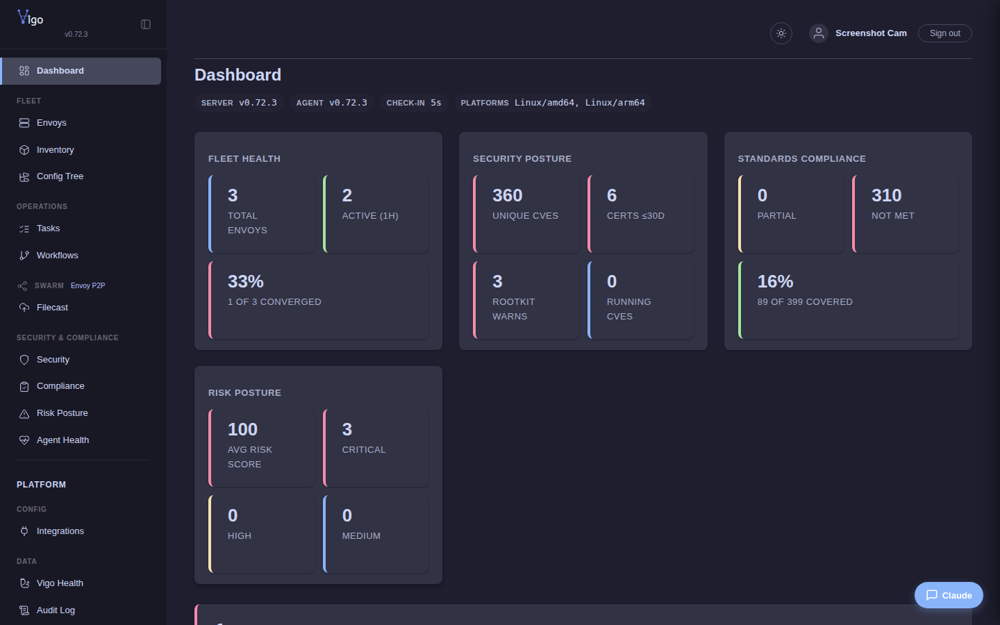

# Install the Vigo server

You'll finish this page with a Vigo server running in Docker on a host of your choice, listening on `:8443` (REST + Web UI) and `:1530` (gRPC), with TLS material auto-generated and a seeded config tree under `/srv/vigo/`. From there, [Enroll an envoy](enroll-an-envoy.md) is the natural next step.

**When you'd use this:** standing up Vigo for the first time, or re-installing after wiping a host. If you already have a running server and want to *upgrade* it, see the upgrade note at the bottom of this page.

**When you'd skip this:** if someone else stood up the server and you only need to enroll your laptop or a managed node, skip ahead to [Enroll an envoy](enroll-an-envoy.md).

Vigo has three components: the server (`vigosrv`), the CLI (`vigocli`), and the agent (`vigo`). The server and CLI ship as a container image. The agent is installed on each managed machine via a bootstrap script.



## Server

### 1. Seed the data directory

```bash
sudo mkdir -p /srv/vigo
docker run --rm -v /srv/vigo:/srv/vigo us-west1-docker.pkg.dev/project-69f2499e-5082-48f0-b19/vigo/vigo:latest --seed-only
```

This populates `/srv/vigo/` with everything needed to run the server:

```
/srv/vigo/
├── docker-compose.yml       # production compose file
├── server.yaml              # server config
├── .env                     # non-secret env vars
├── tls/                     # mTLS certificates (auto-generated)
├── license/                 # license .lic files
├── db/                      # SQLite database
├── secrets/                 # encrypted secret files
├── stacks/                  # config operation root
│   ├── stockpile/           # operator-edited working tree
│   │   ├── modules/         # reusable module definitions
│   │   ├── usercrates/      # user-scoped auto-apply modules
│   │   ├── templates/       # Go template fragments
│   │   ├── tasks/           # reusable task definitions
│   │   ├── workflows/       # workflow definitions
│   │   ├── envoys.vgo       # matchfile (any .vgo with envoys: works)
│   │   ├── roles.vgo        # role definitions (single, fleet-wide)
│   │   ├── common.vgo       # directory-inherited defaults
│   │   ├── waivers.vgo      # compliance waivers (any depth)
│   │   ├── environments.vgo # per-env module/var overrides
│   │   └── compliance.vgo   # directory-inherited claims
│   ├── examples/            # read-only install templates
│   │                        #   (rebuilt from image on every container start;
│   │                        #    vigocli config examples copy)
│   ├── anti-examples/       # read-only retract templates (mirrors examples/modules)
│   │                        #   (rebuilt from image on every container start;
│   │                        #    vigocli config anti-examples copy / mirror-check)
│   └── .live/               # published config (locked between publishes)
├── config-history/          # rollback snapshots
└── docs/                    # browsable documentation
```

### 2. Start the server

```bash
cd /srv/vigo
docker compose up -d
```

The server starts on ports **1530** (gRPC, agent check-in) and **8443** (HTTPS — REST API, web UI, metrics, bootstrap). On first access, the web UI shows setup instructions — bootstrap the secrets vault with `vigocli secrets init --key-file /srv/vigo/secrets/.master.key` (which also prompts for the unlock passphrase), `vigocli secrets unlock`, create an admin account with `vigocli webusers create --username admin --role admin`, set a password with `vigocli secrets set password vigo/web/auth/admin`, then sign in at `https://localhost:8443/login`.

### 3. Verify

```bash
docker compose ps                    # container running
curl -sk https://localhost:8443/healthz # health check
vigocli doctor                     # full diagnostic
```

### 4. Enroll the server's own envoy (do this first)

Vigo assumes every server runs a co-hosted `vigo` agent on the same host as the vigosrv container. The server's own envoy is what makes the server visible in `vigocli swarm status`, lets it participate in puddle / lockbox / gitback, and seeds payloads to peers via the swarm substrate. This step is the canonical first thing to do after the container is up.

From the server host itself:

```bash
curl -sSfk https://localhost:8443/bootstrap | sudo sh
```

The bootstrap script downloads the agent binary, generates a CSR, registers via the trusted-enrollment path (loopback is in the default `trusted_enrollment` CIDR list — no token needed), and installs `vigo-envoy.service` under systemd. After it finishes:

```bash
systemctl is-active vigo-envoy       # → active
vigocli envoys list                  # the server should appear under its host's hostname
```

The agent's enrolled hostname is whatever `hostname` returns on the host. Match this with `server.hostname` in `server.yaml` (used for compliance display) so the two views agree.

If you skip this step, swarm features that route through the server envoy will silently no-op for the server's own hostname. `vigocli swarm filecast distribute` still works (writes directly to the bind-mounted seed dir), but most other swarm operations don't involve the server in the peer set.

### Optional services

Edit `VIGO_SERVICES` in `/srv/vigo/.env` to enable optional containers:

```bash
# In .env, uncomment one of:
VIGO_SERVICES=ollama              # local AI assistant (free, CPU-only)
VIGO_SERVICES=postgres            # Postgres instead of SQLite
VIGO_SERVICES=ollama,postgres     # both
```

### Timezone

The container inherits the host's timezone via a read-only mount of `/etc/localtime`. All timestamps in the web UI, reports, and audit logs display in the server's local timezone. If you need to override the timezone, set the `TZ` environment variable in `.env`:

```bash
TZ=America/New_York
```

### Configuration

Edit `server.yaml` for server settings (check-in interval, TLS paths, spanner, SMTP, webhooks). Edit `.env` for optional services and environment variables. See [Server Configuration](../reference/server-yaml.md) for the full reference.

### Upgrading

```bash
cd /srv/vigo
docker compose pull
docker compose up -d
```

Your config, database, secrets, and TLS certs persist in `/srv/vigo/` across upgrades.

## CLI

The container automatically installs `vigocli` to `/usr/local/bin` on the host via the `/host-bin` volume mount. If the mount is not configured, install manually:

```bash
docker cp vigo:/usr/local/bin/vigocli /usr/local/bin/vigocli
```

The CLI auto-detects the server at `https://localhost:8443`. For remote servers:

```bash
export VIGO_SERVER="http://vigo-server:8443"
```

## Agent

The agent runs on managed machines (envoys). It supports Linux, macOS, FreeBSD, OpenBSD, NetBSD, illumos, and Windows.

### Linux

```bash
curl -sSfk https://<server>:8443/bootstrap | sudo sh
```

Downloads the agent binary, generates a keypair, registers with the server, and installs a systemd service (`vigo-envoy`).

### macOS

```bash
curl -sSfk https://<server>:8443/bootstrap | sudo sh
```


Detects macOS and installs a launchd plist (`com.vigo.envoy`).

### FreeBSD / NetBSD

```bash
curl -sSfk https://<server>:8443/bootstrap | sudo sh
```

Installs an rc.d service script at `/usr/local/etc/rc.d/vigo_envoy`.

### OpenBSD

```bash
curl -sSfk https://<server>:8443/bootstrap | sudo sh
```

Registers the service via `rcctl` and enables it at boot.

### illumos

```bash
curl -sSfk https://<server>:8443/bootstrap | sudo sh
```

Imports an SMF service manifest and enables it via `svcadm`.

### Windows

```powershell
# PowerShell 7+
irm https://<server>:8443/bootstrap?os=windows -SkipCertificateCheck | iex

# PowerShell 5
[Net.ServicePointManager]::ServerCertificateValidationCallback = {$true}; irm https://<server>:8443/bootstrap?os=windows | iex
```

Downloads the agent, registers with the server, and installs a Windows service. The cert-skip flags are the equivalent of curl's `-k` for the self-signed CA.

See [Bootstrap](enroll-an-envoy.md) for details on the enrollment flow, token-based authentication, and trusted enrollment patterns.

## Ports

| Port | Protocol | Purpose |
|------|----------|---------|
| 1530 | gRPC (mTLS) | Agent check-in, result reporting, streaming |
| 8443 | HTTPS | REST API, web UI, metrics, bootstrap |

## Agent directory layout

```
/etc/vigo-envoy/            # config + identity
├── envoy.uuid                # registration ID
├── certs/                     # TLS keypair
│   ├── ca.crt
│   ├── tls.crt
│   └── tls.key
└── executors/                 # custom executor scripts

/var/lib/vigo/               # persistent state
├── state/                     # LMDB (policy cache, checksums, traits, pending results)
├── snapshots/                 # file snapshots for rollback
└── flags/                     # flag markers for when: expressions
```

## What success looks like

A healthy server reports its components individually via `vigocli doctor`:

```text
$ docker exec vigo /usr/local/bin/vigocli doctor
  database ................ OK
  tls ..................... OK (expires 2027-05-05)
  secrets ................. OK (local)
  license ................. OK (Compliant, 5/100 envoys)
  spanner ................. SKIP (standalone)
  integrations ............ SKIP (no integrations configured)
  config .................. OK (43 modules, 5 entries)
  swarm_pattern_order ..... OK (all swarm.*.enabled pattern lists well-ordered)
  stale_envoys ............ OK
  Status: healthy
```

`SKIP` is expected for `spanner` (you're not running hub-spoke) and `integrations` (you haven't wired any external alerting yet). `database / tls / secrets / license / config` should all be `OK` on a fresh install. A `WARN` on `stale_envoys` after the first check-in cycle means at least one envoy hasn't reported in `2.5 × max(interval, observed_cycle)` seconds — go look at it.

## What's next

- **Add a managed node** → [Enroll an envoy](enroll-an-envoy.md).
- **Write your first declarative config** → [Write your first module](write-your-first-module.md).
- **If the server didn't come up clean** → [Troubleshoot common issues](troubleshoot.md).

---
*Verified on Vigo 0.51.6 · 2026-05-13.*

*Confidential -- Alexander4, LLC. Not for redistribution. See [license](../legal/license.md).*
