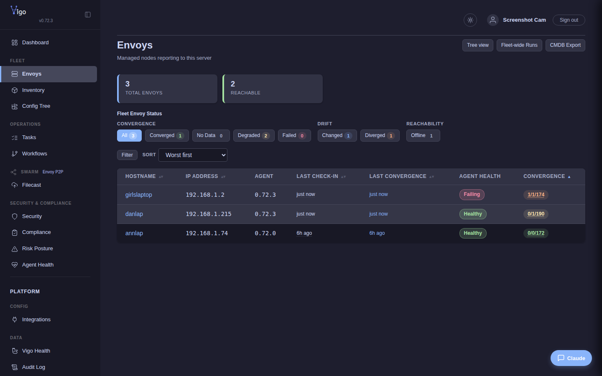

# Enroll an envoy

You'll finish this page with a new machine running the Vigo agent, signed in to the server, visible in the Web UI's envoy list, and checking in on its configured interval. One shell line on the new machine does all of it.

**When you'd use this:** any time you want a *remote* machine under Vigo management — a new laptop, a fresh VM, a freshly-imaged hardware node. The remote envoy dials the server by hostname or LAN IP, which is what the rest of this page documents.

**When you'd skip this:** the server's *own* host is a separate procedure — it enrolls itself over IPv4 loopback (`127.0.0.1`) so the path doesn't depend on hostname resolution. See [Install the Vigo server § Enroll the server's own envoy](install.md#4-enroll-the-servers-own-envoy-do-this-first). Do that one first, then come back here for every other machine.

**When you'd skip this entirely:** never, for any host you want under management. The agent is how Vigo applies state.

Bootstrap is the process by which a new machine becomes a managed envoy. The server provides a one-line bootstrap script that handles agent installation and enrollment.

## How It Works

```mermaid
sequenceDiagram
    autonumber
    participant N as New envoy
    participant S as Vigo server
    N->>S: GET /bootstrap (HTTPS)
    Note right of S: server returns OS/arch-aware<br/>install script
    S-->>N: install script
    N->>N: download `vigo` binary,<br/>generate ED25519 keypair,<br/>install per-OS service
    N->>S: Register (gRPC over mTLS)<br/>hostname, IP, pubkey, one-time token
    Note right of S: matches hostname against<br/>hostcrate patterns;<br/>validates token (bcrypt-hashed at rest)
    S-->>N: client UUID + initial policy bundle
    N->>S: CheckIn (every checkin.interval)
    Note over N,S: steady state: ed25519-signed CheckIn ↔ signed response,<br/>both sides mTLS-pinned
```

(The earlier in-tree `bootstrap-flow.svg` SVG covers the same path; the diagram above is the Markdown-native version.)

## Bootstrap Script

The server serves a shell script at `GET /bootstrap`:

```bash
curl -sSfk https://<server>:8443/bootstrap | sudo sh
```

The `-k` flag allows curl to connect to the server's self-signed TLS certificate. Once the agent is enrolled, all subsequent communication uses mTLS with the CA certificate received during bootstrap. If your server uses a trusted certificate (e.g., from Let's Encrypt), you can omit `-k`.

The script:
1. Detects OS (Linux, macOS, FreeBSD, OpenBSD, NetBSD, illumos) and architecture
2. Stops any existing vigo-envoy service and removes previous enrollment data for a clean start
3. Downloads the correct agent binary from the server (always replaces existing)
4. Verifies the SHA256 checksum of the downloaded binary (aborts on mismatch)
5. Generates an ED25519 keypair
6. Calls the server's bootstrap registration endpoint
7. Receives a client UUID and signed TLS certificate
8. Writes agent config to `/etc/vigo-envoy/config`
9. Installs the appropriate service for the platform:
   - **Linux:** systemd unit (`vigo-envoy.service`)
   - **macOS:** launchd plist (`com.vigo.envoy`)
   - **FreeBSD / NetBSD:** rc.d script (`/usr/local/etc/rc.d/vigo_envoy`)
   - **OpenBSD:** registered via `rcctl`
   - **illumos:** SMF service manifest (`svc:/system/vigo-envoy:default`)
10. Starts the service

### Windows Bootstrap

For Windows, use the PowerShell bootstrap:

```powershell
# PowerShell 7+
irm https://<server>:8443/bootstrap?os=windows -SkipCertificateCheck | iex

# PowerShell 5
[Net.ServicePointManager]::ServerCertificateValidationCallback = {$true}; irm https://<server>:8443/bootstrap?os=windows | iex
```

The `-SkipCertificateCheck` flag (or the `ServerCertificateValidationCallback` on PowerShell 5) is the equivalent of curl's `-k` — it allows connecting to the server's self-signed TLS certificate. Once inside the script, TLS verification is automatically skipped for all download calls. After enrollment, all subsequent communication uses mTLS with the CA certificate received during bootstrap.

The PowerShell script performs the same steps but installs a Windows Service via `sc.exe` with automatic restart on failure. See [Windows Support](../../reference/vigo/) for details.

## Enrollment Methods

### Token-Free (Trusted Enrollment)

Configure trusted patterns in `server.yaml`:

```yaml
bootstrap:
  trusted_enrollment:
    - pattern: "*.web.example.com"
      cidrs: ["10.0.0.0/8"]
    - pattern: "*.dev.*"
      cidrs: ["192.168.0.0/16"]
```


Envoys matching both the hostname glob and source CIDR enroll without a token.

### One-Time Token

For stricter environments, generate a token:

```bash
vigocli tokens generate --pattern "web3.example.com"
```

Pass the token to the bootstrap script:

```bash
curl -sSfk https://<server>:8443/bootstrap | sudo sh -s -- --token <token>
```

Tokens are:
- One-time use (consumed on successful enrollment)
- Bcrypt-hashed at rest in the database
- Pattern-matched against the enrolling hostname

### Approved Patterns

Pre-approve hostname patterns so matching envoys can enroll:

```bash
vigocli approved add "*.prod.example.com"
```

## Certificate Signing

When `server.tls.ca_key_file` is configured, the server acts as a Certificate Authority:

1. Agent generates a CSR during bootstrap
2. Server signs the CSR with the CA key
3. Agent receives a signed client certificate
4. All subsequent gRPC communication uses this certificate for mTLS

Certificate validity is configurable:

```yaml
bootstrap:
  cert_validity: "8760h"  # 1 year (default)
```

## Binary Integrity

The bootstrap script verifies the SHA256 checksum of the downloaded agent binary before proceeding with enrollment. After downloading the binary, it fetches the expected checksum from the server's `/api/v1/agent/latest` endpoint and compares it against the locally computed digest. If the checksums do not match, the script removes the binary and aborts with an error.

On Unix systems, the script uses `sha256sum`, `shasum -a 256`, or `digest -a sha256` (whichever is available). On Windows, the PowerShell script uses `Get-FileHash`.

For distribution builds, agent binaries are signed with an ED25519 key. The build pipeline (`make dist-agent`, `scripts/upgrade.sh`, and `Dockerfile.server`'s go-builder stage) derives a `VIGO_AGENT_SIGNING_PUBKEY` from `SIGN_KEY` and bakes it into every agent binary at compile time; the same `SIGN_KEY` then signs each cross-compiled binary, producing a `.sig` sidecar served via `/api/v1/agent/latest` (signature field). During self-update, the agent:

1. Compares its compiled-in version against the server's advertised version — if they already match, the update is skipped (circuit breaker to prevent exec-loops)
2. Downloads the new binary using mTLS (presenting its bootstrap client certificate)
3. Verifies the SHA256 checksum
4. **Fail-closed:** verifies the ED25519 signature against the agent's **baked-in pubkey** — not a pubkey fetched from the server. Empty signature, sentinel pubkey, or mismatch all bail (ADR-031). The agent never installs an unverified binary.
5. Atomically replaces the binary and exec-restarts

Because the verification pubkey is compiled into each agent, a compromised server cannot substitute its own key alongside its own signature — verification anchors at the agent, not the server. Updates can be triggered remotely via `vigocli envoys rebootstrap`.

When `SIGN_KEY` is unset at build time, `build.rs` falls back to a 32-zero-byte sentinel pubkey and the resulting agent refuses self-update at runtime (sentinel-check bail). Set `SIGN_KEY=<path>` before invoking `make` / `scripts/upgrade.sh` to enable self-update for the fleet. The signing private key is operator-side material — back it up; loss means a full fleet re-deploy with a new key.


## Security

- All gRPC traffic uses mTLS — the bootstrap HTTP endpoint is the only plaintext path
- Agent public keys are stored server-side and verified on every check-in (ED25519 signatures)
- One-time tokens prevent replay attacks
- Revoked agents receive an error on check-in and cannot re-enroll with the same UUID
- Bootstrap endpoints (`/bootstrap`, `/api/v1/agent/*`, `/api/v1/bootstrap/*`) are exempt from web UI authentication so agents can enroll without credentials
- The bootstrap endpoint can be restricted to specific CIDRs via reverse proxy

## Troubleshooting

**"An active envoy with this hostname already exists":**
- A envoy with the same hostname is already enrolled. The bootstrap script handles this automatically (it always passes `--force` to revoke and re-enroll). If using `vigo register` directly, pass `--force`:

```bash
vigo register --token <token> --force
```

**Agent fails to register:**
- Check that the server's gRPC port (1530) is reachable from the envoy
- Verify the token hasn't already been used
- Check hostname matches the token pattern or trusted enrollment pattern

**Certificate errors after enrollment:**
- Verify `ca_key_file` is configured in server.yaml
- Check certificate hasn't expired (`cert_validity` setting)

**Agent binary download fails:**
- Ensure the server's container image includes agent binaries for the target platform
- Check that the `/srv/vigo/` volume is correctly mounted

## What success looks like

After the script finishes and the agent's first check-in completes, the envoy appears in `vigocli envoys list`:

```text
$ docker exec vigo /usr/local/bin/vigocli envoys list
ID                                    HOSTNAME     IP             ENROLLED          LAST SEEN         STATUS
63dfa092-5262-44ac-b04b-1533c709ab42  danlap       192.168.1.2    2026-05-05 13:03  2026-05-14 00:21  active
cb4acb1f-f995-4026-a01e-f5390283ca6c  annlap       192.168.1.74   2026-05-05 13:03  2026-05-14 00:21  active
64cf705c-0caa-4a8c-a536-f660d3f8c625  raspberrypi  192.168.1.78   2026-05-05 13:03  2026-05-14 00:20  active
d1f86266-139f-419a-b760-902c0616f586  plex         192.168.1.219  2026-05-05 13:03  2026-05-14 00:21  active
6403aa29-096b-4b50-85b5-6ee4460665a0  girlslaptop  192.168.1.215  2026-05-05 13:03  2026-05-13 23:37  active
```

…and on the agent host, `vigo status` reports the cached policy bundle:

```text
$ sudo vigo status
Envoy ID:         cb4acb1f-f995-4026-a01e-f5390283ca6c
Server:           192.168.1.2:1530
Data directory:   /etc/vigo-envoy
State store:      /var/lib/vigo/state

Policy:
  Cached:         yes
  Version:        1
  Configcrates:   27 (cis-ubuntu-access, cis-ubuntu-filesystem, …)
  Resources:      172
```

In the Web UI, the new envoy appears in `/envoys` with a populated check-in time and resource count.



## What's next

- **Apply some declarative state to the envoy** → [Write your first configcrate](../configcrates/write-your-first-configcrate.md).
- **The envoy enrolled but isn't checking in** → [Troubleshoot common issues](troubleshoot.md#envoy-shows-as-stale-but-the-agent-is-running).
- **Repeat the procedure on more envoys** — the same one-liner works for every additional machine you want managed.

## Reference

- [Installation](install.md)
- [Server config (`server.yaml`) reference](../../reference/server-yaml.md)
- [Configcrate-writing reference](../../reference/configcrate-language.md)

---
*Verified on Vigo 0.51.6 · 2026-05-13.*

*Confidential -- Alexander4, LLC. Not for redistribution. See [license](../../legal/license.md).*
