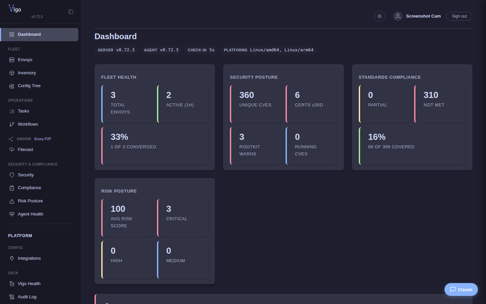

# Install the Vigo server

You'll finish this page with a Vigo server running in Docker on a host of your choice, listening on `:8443` (REST + Web UI) and `:1530` (gRPC), with TLS material auto-generated and a seeded config tree under `/srv/vigo/`. From there, [Enroll an envoy](enroll-an-envoy.md) is the natural next step.

**When you'd use this:** standing up Vigo for the first time, or re-installing after wiping a host. If you already have a running server and want to *upgrade* it, see the upgrade note at the bottom of this page.

**When you'd skip this:** if someone else stood up the server and you only need to enroll your laptop or a managed node, skip ahead to [Enroll an envoy](enroll-an-envoy.md).

Vigo has three components: the server (`vigosrv`), the CLI (`vigocli`), and the agent (`vigo`). The server and CLI ship as a container image. The agent is installed on each managed machine via a bootstrap script.



## Server

### 1. Seed the data directory

You can pull the published server image or build it yourself. Either way the image ends up tagged `vigo:latest`, the name the generated compose file runs.

**Pull the published image.** This is the quick path. The host needs Docker with the Compose plugin and an x86_64 CPU; on Ubuntu, `sudo apt-get install -y docker.io docker-compose-v2` installs them. The image is signed with the project's release key, so envoys update their agent on their own when you move to a newer image. It carries the Linux agent for amd64 and arm64. To pin a release, use its version tag, such as `:0.77.0`, in place of `:latest`.

```bash
sudo docker pull ghcr.io/daniel-alexander4/vigo:latest
sudo docker tag ghcr.io/daniel-alexander4/vigo:latest vigo:latest
IMAGE=vigo:latest
```

**Or build it from source.** The build runs inside Docker. The host needs Docker with the Compose and Buildx plugins, plus `git` and `rsync`; on Ubuntu, `sudo apt-get install -y git rsync docker.io docker-compose-v2 docker-buildx` installs them. The first build takes about 20 minutes. The optional signing key lets envoys update their agent on their own; without it, every upgrade means re-running the bootstrap on each envoy. Creating it needs Go 1.25, and you should keep the key safe.

```bash
git clone https://github.com/daniel-alexander4/vigo.git && cd vigo
go run ./server/hardening/cmd/sign -genkey -output signing.key   # optional: lets envoys self-update
sudo scripts/upgrade.sh full --norun   # builds the server image and the amd64 agent
IMAGE=vigo:latest   # the tag the build gives the local image
```

```bash
sudo mkdir -p /srv/vigo
sudo docker run --rm -v /srv/vigo:/srv/vigo "$IMAGE" --seed-only
```

This populates `/srv/vigo/` with everything needed to run the server:

```
/srv/vigo/
├── docker-compose.yml       # production compose file
├── server.yaml              # server config
├── .env                     # non-secret env vars
├── tls/                     # mTLS certificates (auto-generated)
├── db/                      # SQLite database
├── secrets/                 # encrypted secret files
├── stacks/                  # operator-edited config tree
│   ├── configcrates/        # reusable configcrate definitions
│   ├── usercrates/          # user-scoped configcrates (inert until included via `usercrates:`)
│   ├── templates/           # Go template fragments
│   ├── tasks/               # reusable task definitions
│   ├── workflows/           # workflow definitions
│   ├── envoys.vgo           # hostcrate (any .vgo with envoys: works)
│   ├── roles.vgo            # role definitions (single, fleet-wide)
│   ├── common.vgo           # directory-inherited defaults
│   ├── waivers.vgo          # compliance waivers (any depth)
│   ├── environments.vgo     # per-env configcrate/var overrides
│   └── compliance.vgo       # directory-inherited claims
├── stacks-examples/         # read-only install templates
│                            #   (rebuilt from image on every container start;
│                            #    vigocli config examples copy)
├── .live/                   # published config (locked between publishes)
└── config-history/          # rollback snapshots
```

### 2. Start the server

```bash
cd /srv/vigo
sudo docker compose up -d
```

The server starts on ports **1530** (gRPC, agent check-in) and **8443** (HTTPS — REST API, web UI, metrics, bootstrap), plus **1531** for swarm blob transfer between envoys. Open all three to the machines you will enroll if a firewall is in the way. Three CLI steps stand the install up from here, **in order**. `vigocli` on the host is root-only, so run it with `sudo`:

1. **Bootstrap the secrets vault** — `sudo vigocli secrets init` (the server already created the master key; this sets the unlock passphrase), then `sudo vigocli secrets unlock`. The vault must be initialized before you can store secrets with `vigocli secrets set`.
2. **Enroll the local agent** — `curl -sSfk https://127.0.0.1:8443/bootstrap | sudo sh` from the server host. **Use `127.0.0.1`, not `localhost` or this host's own hostname** — the agent the script installs dials whatever address the curl URL used on every subsequent check-in, and only the IPv4 loopback literal is resolver-independent (no nsswitch, no mDNS, no IPv6 link-local trap). Enrolling this host by its LAN address or hostname is refused, because its hostname is one of the server's own TLS names. This step enrolls *only* the server's own host; every other machine you want to manage follows the separate procedure in [Enroll an envoy](enroll-an-envoy.md), which dials the server by its reachable hostname. The server has a canonical assumption (per CLAUDE.md) that a `vigo` agent runs on the same host alongside the container; the admin-create step below uses that agent's `users` trait to verify the OS-user mapping. Wait until the agent has reported one check-in (~30s) before continuing.
3. **Create your per-operator admin** — `sudo vigocli webusers create --username <yourname> --role admin` from the server host, where `<yourname>` is a real human OS account on this machine (uid≥1000, real shell). The CLI auto-reads your pubkey from `/home/<yourname>/.ssh/id_ed25519.pub` (fallback `id_rsa.pub`); no `--ssh-key-file` flag for admin role. Then `sudo vigocli webusers set-password --username <yourname>` to set your login password (it stores a bcrypt hash; don't write the vault key directly).

Sign in at `https://localhost:8443/login` as `<yourname>`. The default `admin` user is deliberately not auto-created — admin webusers map 1:1 with real OS users so audit attribution always names a real human and browser scrier sessions seed your pubkey automatically. If you need multiple operators, repeat step 3 for each.

If no envoy has checked in yet, the dashboard shows a first-run panel with the step-2 bootstrap command and an otherwise-empty nav — both fill in automatically once the first envoy enrolls.

### 3. Verify

```bash
sudo docker compose ps                # containers running
curl -sk https://127.0.0.1:8443/healthz # ok = server ready (503 while it starts or stops)
sudo vigocli doctor                   # full diagnostic
```

### 4. Enroll the server's own envoy (do this first)

Vigo assumes every server runs a co-hosted `vigo` agent on the same host as the vigosrv container. The server's own envoy is what makes the server visible in `vigocli swarm status`, lets it participate in puddle / lockbox / gitback, and seeds payloads to peers via the swarm substrate. This step is the canonical first thing to do after the container is up — and it is **distinct from enrolling other envoys** (covered in [Enroll an envoy](enroll-an-envoy.md)) because the server's own agent dials *itself*, and that path must not depend on hostname resolution.

From the server host itself:

```bash
curl -sSfk https://127.0.0.1:8443/bootstrap | sudo sh
```

`127.0.0.1` is the IPv4 loopback literal — no nsswitch, no DNS, no mDNS, no IPv6 link-local. The bootstrap script writes whatever address the curl URL used into `/etc/vigo-envoy/config`, so the agent dials that exact address on every check-in. If you use `localhost` or this host's own hostname, the agent's check-in path silently inherits a dependency on the system's name-resolution stack — and the moment any layer of it shifts (Starlink prefix delegation rotates, NetworkManager re-announces, the host gets renamed), the agent stops being able to dial home. Use `127.0.0.1` even if `localhost` works today.

The bootstrap script downloads the agent binary, generates a CSR, registers via the trusted-enrollment path (loopback is in the default `trusted_enrollment` CIDR list — no token needed), and installs `vigo-envoy.service` under systemd. After it finishes:

```bash
systemctl is-active vigo-envoy       # → active
sudo vigocli envoys list             # the server should appear under its host's hostname
```

The agent's enrolled hostname is whatever `hostname` returns on the host. Match this with `server.hostname` in `server.yaml` (used for compliance display) so the two views agree.

If you skip this step, swarm features that route through the server envoy will silently no-op for the server's own hostname. `vigocli swarm filecast distribute` still works (writes directly to the bind-mounted seed dir), but most other swarm operations don't involve the server in the peer set.

### Optional services

Edit `COMPOSE_PROFILES` in `/srv/vigo/.env` to enable optional containers:

```bash
# In .env, uncomment one of:
COMPOSE_PROFILES=ollama              # local AI assistant (free, CPU-only)
COMPOSE_PROFILES=postgres            # Postgres instead of SQLite
COMPOSE_PROFILES=ollama,postgres     # both
```

The `postgres` profile also needs `VIGO_POSTGRES_PASSWORD` set in the same file. Both optional containers are host-networked and listen on `127.0.0.1` only, so the server reaches Ollama at `http://127.0.0.1:11434` and Postgres at `127.0.0.1:5432`.

### Timezone

The container inherits the host's timezone via a read-only mount of `/etc/localtime`. All timestamps in the web UI, reports, and audit logs display in the server's local timezone. If you need to override the timezone, set the `TZ` environment variable in `.env`:

```bash
TZ=America/New_York
```

### Configuration

Edit `server.yaml` for server settings (check-in interval, TLS paths, spanner federation, SMTP, integrations). Edit `.env` for optional services and environment variables. See [Server Configuration](../../reference/server-yaml.md) for the full reference.

### Upgrading

With the published image, pull the new release, tag it, and recreate the containers:

```bash
sudo docker pull ghcr.io/daniel-alexander4/vigo:latest
sudo docker tag ghcr.io/daniel-alexander4/vigo:latest vigo:latest
cd /srv/vigo && sudo docker compose down
sudo docker run --rm -v /srv/vigo:/srv/vigo vigo:latest --seed-only
sudo docker compose up -d
```

From a source checkout, rebuild the image and redeploy in one step:

```bash
sudo scripts/upgrade.sh full
```

Or build now and deploy later, for example to take the restart at a quiet moment:

```bash
sudo scripts/upgrade.sh full --norun
sudo scripts/upgrade.sh deploy
```

Don't upgrade with a plain `docker compose up -d`. On every start, the `vigo` container rewrites `/srv/vigo/docker-compose.yml` from the image it runs, so while a container from the old image exists, the file on disk can still be the old one, and the `guacd` sidecar would be created from it. The `docker compose down` above, and `upgrade.sh deploy`, stop the old containers before the new file is written.

Your config, database, secrets, and TLS certs persist in `/srv/vigo/` across upgrades.

## CLI

The container automatically installs `vigocli` to `/usr/local/bin` on the host via the `/host-bin` volume mount. If the mount is not configured, install manually:

```bash
docker cp vigo:/usr/local/bin/vigocli /usr/local/bin/vigocli
```

The CLI auto-detects the server at `https://localhost:8443`. For remote servers:

```bash
export VIGO_SERVER="http://vigo-server:8443"
```

## Agent

The agent runs on managed machines (envoys). It supports Linux, macOS, FreeBSD, OpenBSD, NetBSD, illumos, and Windows.

### Linux

```bash
curl -sSfk https://<server>:8443/bootstrap | sudo sh
```

Downloads the agent binary, generates a keypair, registers with the server, and installs a systemd service (`vigo-envoy`).

### macOS

```bash
curl -sSfk https://<server>:8443/bootstrap | sudo sh
```


Detects macOS and installs a launchd plist (`com.vigo.envoy`).

### FreeBSD / NetBSD

```bash
curl -sSfk https://<server>:8443/bootstrap | sudo sh
```

Installs an rc.d service script at `/usr/local/etc/rc.d/vigo_envoy`.

### OpenBSD

```bash
curl -sSfk https://<server>:8443/bootstrap | sudo sh
```

Registers the service via `rcctl` and enables it at boot.

### illumos

```bash
curl -sSfk https://<server>:8443/bootstrap | sudo sh
```

Imports an SMF service manifest and enables it via `svcadm`.

### Windows

```powershell
# PowerShell 7+
irm https://<server>:8443/bootstrap?os=windows -SkipCertificateCheck | iex

# PowerShell 5
[Net.ServicePointManager]::ServerCertificateValidationCallback = {$true}; irm https://<server>:8443/bootstrap?os=windows | iex
```

Downloads the agent, registers with the server, and installs a Windows service. The cert-skip flags are the equivalent of curl's `-k` for the self-signed CA.

See [Bootstrap](enroll-an-envoy.md) for details on the enrollment flow, token-based authentication, and trusted enrollment patterns.

## Ports

| Port | Protocol | Purpose |
|------|----------|---------|
| 1530 | gRPC (mTLS) | Agent check-in, result reporting, streaming |
| 8443 | HTTPS | REST API, web UI, metrics, bootstrap |

## Agent directory layout

```
/etc/vigo-envoy/            # config + identity
├── envoy.uuid                # registration ID
├── certs/                     # TLS keypair
│   ├── ca.crt
│   ├── tls.crt
│   └── tls.key
└── executors/                 # custom executor scripts

/var/lib/vigo/               # persistent state
├── state/                     # LMDB (policy cache, checksums, traits, pending results)
├── snapshots/                 # file snapshots for rollback
└── flags/                     # flag markers for when: expressions
```

## What success looks like

A healthy server reports its components individually via `vigocli doctor`:

```text
$ docker exec vigo /usr/local/bin/vigocli doctor
  database ................ OK
  tls ..................... OK (expires 2027-05-05)
  secrets ................. OK (local)
  spanner .................. SKIP (standalone)
  integrations ............ SKIP (no integrations configured)
  config .................. OK (43 configcrates, 5 entries)
  swarm_pattern_order ..... OK (all swarm.*.enabled pattern lists well-ordered)
  stale_envoys ............ OK
  Status: healthy
```

`SKIP` is expected for `spanner` (you're not running hub-spoke) and `integrations` (you haven't wired any external alerting yet). `database / tls / secrets / config` should all be `OK` on a fresh install. A `WARN` on `stale_envoys` after the first check-in cycle means at least one envoy hasn't reported in `2.5 × max(interval, observed_cycle)` seconds — go look at it.

## What's next

- **Add a managed node** → [Enroll an envoy](enroll-an-envoy.md).
- **Write your first declarative config** → [Write your first configcrate](../configcrates/write-your-first-configcrate.md).
- **If the server didn't come up clean** → [Troubleshoot common issues](troubleshoot.md).

---
*Verified on Vigo 0.51.6 · 2026-05-13.*
