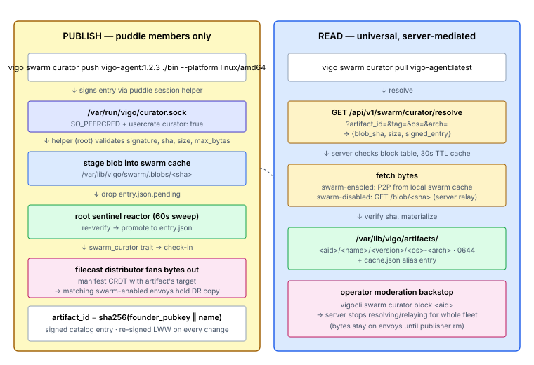

# Set up Curator

You'll finish this page with an artifact (binary, archive, package, container image) published from one envoy and pullable on every envoy in the fleet — peer-to-peer when reachable, server-relayed when not. The blob is signed by the publisher's puddle and verified end-to-end on every read. Reads are universal; writes are puddle-members-only.

**When you'd use this:** any time the same bytes have to land on more than one envoy — agent binaries, vendor tarballs, custom `.deb` / `.rpm` packages, ML model files, container images, large fixtures. Curator earns its keep when an HTTP file server is the alternative you're avoiding.

**When you'd skip this:** secrets and credentials (use [lockbox](set-up-lockbox.md) or the `secret:` config prefix); state that should live as a git repo (use [gitback](set-up-gitback.md)); ad-hoc admin-pushed config files (use filecast).

## Enable it

Per-envoy: opt in via `server.yaml`:

```yaml
swarm:
  curator:
    enabled:
      - "*"                   # pattern list, first-match-wins; "-" prefix denies
    max_bytes: 2147483648     # per-blob cap; default 2 GiB
```

Per-user: grant `curator: true` on the usercrate (heavier than `gitback:` — write access to a fleet-readable artifact registry):

```yaml
resources:
  - type: user
    username: dan
    puddle: true              # required
    curator: true             # opt-in for curator publish
```

Publish (`sudo vigocli config publish`).

## Use it

From an envoy where the operator has puddle unlocked:

```bash
# Publish a binary or archive (the implicit namespace is the operator's puddle name):
vigo swarm curator push vigo-agent:1.2.3 ./vigo-agent-linux-amd64 \
  --platform linux/amd64

# Tag mutably:
vigo swarm curator tag vigo-agent:latest 1.2.3

# Resolve / pull anywhere (no puddle needed for read):
vigo swarm curator resolve vigo-agent:latest      # show coordinates
vigo swarm curator pull vigo-agent:latest         # fetch to /var/lib/vigo/artifacts/...

# Operator views:
vigo swarm curator list                           # everything published
vigo swarm curator inspect vigo-agent             # full signed entry
vigo swarm curator versions vigo-agent
```

From the admin server (`vigocli`) — same verbs plus moderation:

```bash
vigocli swarm curator list
vigocli swarm curator block <artifact_id>         # server refuses to resolve/relay
vigocli swarm curator unblock <artifact_id>
```

## How it works



Curator combines two existing fleet primitives: the swarm blob substrate (content-addressed, chunked, target-scoped, P2P) handles the *bytes*, and gitback's puddle-keyed identity/access machinery handles the *who-can-do-what*. A thin signed-catalog layer stitches them together.

### Identity

`artifact_id = sha256(founder_puddle_pubkey ‖ name)` — same shape as a gitback project ID, so two operators can both publish `redis` without collision. Human-facing reference: `<founder-puddle-name>/<name>` (resolves to a pubkey via the [ADR-022](../adr/022-gitback-friendly-names.md) fleet name map, then to an artifact_id). The operator's own puddle is the implicit default namespace — `vigo-agent:latest` ≡ `<your-puddle>/vigo-agent:latest`. The hex `<artifact_id>/<name>` form always works (self-certifying).

### Catalog entry

One signed envelope per artifact, re-signed last-write-wins on every mutation:

```jsonc
{
  "body": {
    "name": "vigo-agent",
    "founder_puddle_pubkey": "<hex 32-byte ed25519>",   // frozen forever
    "signing_puddle_pubkey": "<hex 32-byte ed25519>",   // == founder until rekey
    "versions": {
      "1.2.3": { "platforms": [
        { "os": "linux",  "arch": "amd64", "blob_sha": "<hex>", "size": 12345678 },
        { "os": "darwin", "arch": "arm64", "blob_sha": "<hex>", "size": 13402011 }
      ]}
    },
    "tags":   { "latest": "1.2.3", "stable": "1.2.0" },   // mutable
    "target": "*",                                         // which envoys hold the DR replica
    "issued_at": 1714521600000                             // unix ms; LWW key
  },
  "signature": "<hex 64-byte ed25519 sig over canonical_bytes(body)>"
}
```

The signature anchors to the founder pubkey: any envoy verifying the entry rejects it if the signature doesn't trace back (via the [ADR-019](../adr/019-gitback-founder-rekey.md) rekey-bridge chain) to the pubkey that hashes the artifact_id. A founder cannot mutate another founder's artifact.

### Publishing — write path

`vigo swarm curator push <name>:<version> <file>` runs as a real user with `curator: true` on their usercrate and an unlocked puddle. The CLI:

1. Hashes the file (`sha256` + size), then drops the file plus a re-signed catalog entry into the helper daemon at `/var/run/vigo/curator.sock`.
2. The helper (root) validates the signature + delegation chain end-to-end, confirms the streamed bytes match `blob_sha` / `size`, and enforces the per-blob cap `swarm.curator.max_bytes` (default 2 GiB; raise for container images).
3. Stages the blob into the swarm blob cache and records a manifest entry with the artifact's `target` — the existing filecast distributor then fans the bytes out to matching swarm-enabled envoys, exactly like a filecast blob.
4. Drops the signed entry as `~<user>/.vigo-curator/<artifact_id>/entry.json.pending`. The root sentinel reactor (60s sweep) re-verifies it and promotes to `entry.json`, where the agent's trait collector picks it up → the server-side catalog aggregator → the fleet catalog.

Re-signs that don't ship new bytes (`tag` / `untag` / `set-recipients` / `set-target` / `rm`) ride the same socket via header-only ENTRY verbs. `set-target` also re-records the manifest seed for blobs this envoy seeded so distribution to the new target set fires on the next pass.

### Reading — universal, server-mediated

Every envoy (swarm-enabled or not) resolves via the server:

```
GET /api/v1/swarm/curator/resolve?artifact_id=<hex>&tag=<t>|&version=<v>&os=<os>&arch=<arch>
```

The server returns `{blob_sha, size, signed_entry}` from its 30-second-TTL aggregated catalog (block/unblock invalidates the cache). The agent then fetches bytes:

- **Swarm-enabled envoy** — P2P from the swarm cache (usually already holds the DR replica because `target` matched it).
- **Swarm-disabled envoy** — `GET /api/v1/swarm/curator/blob/<sha>` from the server, which relays from the server's co-resident envoy. Scoped to current-catalog shas only — not a back door to arbitrary swarm blobs.

Either way the agent verifies the sha and materializes to `/var/lib/vigo/artifacts/<artifact_id>/<name>/<version>/<os>-<arch>` (mode 0644), updating `/var/lib/vigo/artifacts/cache.json` with both `:<tag>` and `@<version>` aliases.

Agents also cache the fleet catalog at `/var/lib/vigo/artifacts/catalog.json` (refreshed every check-in), so a swarm-enabled envoy can resolve and materialize **locally** through a server outage for any artifact it already holds.

### Authorization

Two layers gate publishing. Both must say yes:

| Layer | Where | Question |
|---|---|---|
| Envoy | `server.yaml#swarm.curator.enabled` pattern list | Is curator available on this envoy at all? |
| User | usercrate `curator: bool` flag | May this Unix user publish? |

Plus the operator-puddle layer at signing time: the user's puddle session helper must be running (`vigo swarm puddle unlock`).

`curator: true` is a **heavier** grant than `gitback: true` — "may publish to the fleet's registry, fleet-readable by default" vs "may found personal git repos." Removing it from a usercrate triggers a scrub on the next reconcile (`~/.vigo-curator/` wiped for that user). Already-published artifacts stay; you can't recall them by losing a flag.

Reading is **ungated** — artifacts are fleet-readable. `pull` materializes into a root-owned tree, so it requires `sudo`.

The operator-moderation backstop is `vigocli swarm curator block <ref>` (admin-only). The server stops resolving/relaying the blocked artifact fleet-wide regardless of who published it. The signed entry still exists and gossips, and the DR bytes still sit on swarm-enabled envoys — only a publisher `vigo swarm curator rm` truly purges.

### CLI surfaces

Two thin clients of the same backend:

- **`vigo swarm curator`** (agent-side, runs as the user) — founder + consumer surface. Mutating verbs sign via the puddle helper and submit to the local socket. Read verbs (`status`, `list`, `inspect`, `versions`, `resolve`, `pull`) work locally + against the server. Cleanup verbs (`stale`, `prune`, `gc`, `purge`) hygiene the envoy.
- **`vigocli swarm curator`** (server-side, operator front-end) — read views + admin moderation (`block` / `unblock`). Mutating verbs deliberately don't live here — they need an unlocked per-user puddle, which doesn't fit vigocli's root-only / peer-auth posture.

### Where to look when it doesn't work

- **`vigo swarm curator status`** — local cache state, in-flight pushes, helper-daemon liveness.
- **`vigocli swarm curator list / fleet`** — server-side view of who's published what, who's pulled what, the blocked set.
- **Agent logs** carry one specific WARN per actionable failure (`sha mismatch`, `blob exceeds max_bytes`, `entry signature invalid`, `target glob matched zero envoys`).
- **Disk pressure**: like the other swarm subsystems, curator skips pushes to peers ≤10% free disk. See [Disk Space](set-up-swarm.md#disk-space).

## What's next

- **Refer to artifacts from a module's `package` / `source_package` / `file` resource** → `resources/package` in the reference vocabulary. Curator URIs work wherever a download URL fits.
- **The blob is bigger than 2 GiB** → raise `swarm.curator.max_bytes` per envoy. Republish; tags re-anchor automatically.
- **Recall a bad release** → `vigocli swarm curator block <artifact_id>` blocks fleet-wide resolution; only a publisher `rm` truly purges the bytes.
- **`pull` hangs or sha-mismatches** → [Troubleshoot common issues](troubleshoot.md).

---
*Verified on Vigo 0.51.6 · 2026-05-13.*

*Confidential — Alexander4, LLC. Not for redistribution. See [../legal/license.md](../legal/license.md).*
