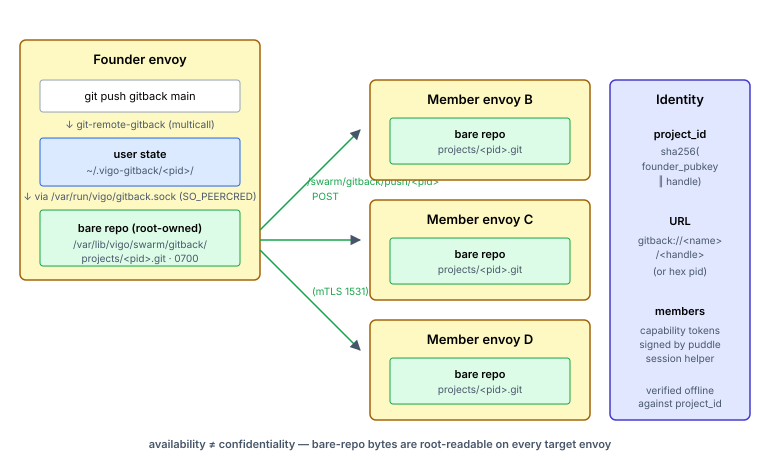

# Set up Gitback

You'll finish this page with a git project living across every puddle-member envoy a user touches — `git push` triggers fan-out to root-owned bare repos on each member's `/var/lib/vigo/swarm/gitback/projects/<pid>.git`, and any one of those envoys can hand a fresh clone back. The Vigo server stays out of membership decisions; project identity is the founder's puddle pubkey.

**When you'd use this:** personal disaster recovery — one user, many envoys, no central git server, no single envoy whose disappearance loses your repo. Also small-team collaboration where multiple puddles share a project.

**When you'd skip this:** repos where bytes-on-disk confidentiality matters (gitback bare repos are root-readable on every member envoy — use lockbox for content secrecy); repos where a central forge already meets the DR bar (GitHub/Gitea); single-envoy state with no replication need.

## Enable it

Gitback rides on top of puddle, so the prerequisite is [puddle membership](set-up-puddle.md). Also enable it per-user via the usercrate:

```yaml
# /srv/vigo/stacks/stockpile/usercrates/dan.vgo
resources:
  - type: user
    username: dan
    puddle: true
    gitback: true             # opt-in for git-over-swarm
```

The fleet-wide gate lives in `server.yaml`:

```yaml
swarm:
  gitback:
    enabled:
      - "*"                   # all envoys (or use first-match-wins patterns)
```

Publish (`sudo vigocli config publish`).

## Use it

```bash
# Start a project (on any envoy where you have puddle unlocked):
vigo swarm gitback project init my-config-repo

# Add the gitback remote and push:
cd my-config-repo
git remote add gitback gitback://<your-puddle-name>/my-config-repo
git push gitback main

# On another of your envoys:
git clone gitback://<your-puddle-name>/my-config-repo
```

Per-puddle status:

```bash
vigo swarm gitback status                          # what's local vs remote
vigo swarm gitback project list                    # all projects you have a foothold in
vigo swarm gitback project invite <other-puddle>   # for multi-member collaboration
```

The full verb tree: `vigo swarm gitback {status,purge}` plus `project {init,invite,join,leave,list,status,revoke,reanchor,re-invite-all,rejoin,re-found}`. Operators rarely touch `reanchor` / `re-found` — those are recovery paths for compromised-key scenarios documented in [ADR-019](../adr/019-gitback-founder-rekey.md).


## How it works



Each project is keyed `project_id = sha256(founder_puddle_pubkey ‖ handle)`, so two operators publishing `my-config` don't collide. Project shape is two orthogonal axes:

| `members:` | `dr_scope:` | Use case |
|---|---|---|
| `{my-puddle}` | `swarm-wide` | Personal disaster-recovery (today's default) |
| `{my-puddle}` | `members-only` | Single-user, no swarm replication |
| `{team1, team2, …}` | `members-only` | Multi-member collaboration only |
| `{team1, team2, …}` | `swarm-wide` | Team repo with swarm-wide DR |

The substrate sees fleets, not envoys. The Vigo server plays no role in membership decisions — it provides three thin services (the gitbackmesh fleet aggregator, cross-subnet address resolution, audit-log entries). Membership is enforced by **puddle-anchored capability tokens** that the receiver verifies offline against the URL's project_id.

### Push / fetch path

`git push gitback ...` invokes the multicall binary as `git-remote-gitback`. Per-user state lives at `~/.vigo-gitback/<project_id>/`; root-owned bare repos at `/var/lib/vigo/swarm/gitback/projects/<project_id>.git` (mode 0700). Non-root callers (your normal `git` invocations) reach the bare repo through the helper daemon at `/var/run/vigo/gitback.sock` (SO_PEERCRED-gated).

Push fan-out is automatic: after a successful local receive, the helper `POST`s to `/swarm/gitback/push/<pid>` on every live peer that holds a foothold. Receiver-initiated DR catch-up (since 0.46.0) handles the case where a peer was offline at push time — it pulls on next connection with a 2 GiB transfer cap to bound load.

### Membership envelopes

Membership operations (`invite`, `leave`, `revoke`, `re-invite-all`, `rejoin`) sign Ed25519 envelopes via the puddle session helper. The envelopes gossip P2P with **digest-based catch-up** — every gossip-tick announcement carries a digest of the local envelope table; mismatches trigger a pull of the full table. Offline-during-revoke peers converge without operator intervention.

### Recovery from a compromised founder key (ADR-019)

The `project_id` is anchored to the **genesis** founder pubkey forever — that's by design, otherwise renaming would let a stolen key impersonate the original founder. If a founder's puddle key is compromised, the recovery path is **founder-rekey delegation**: issue a per-project delegation chain (cap 5 hops, warn at 3) that bridges the retired pubkey to the new one. Every verifier walks the chain back to genesis. Past the cap, `re-found` mints a fresh `project_id` and tombstones the old.

Operator surface:

- `vigo swarm gitback project reanchor` — re-issue the project to a new local puddle pubkey (used in disaster recovery after `puddle rotate`).
- `vigo swarm gitback project re-invite-all` — re-issue invitations to every existing member from the current signing key.
- `vigo swarm gitback project re-found` — last-resort: new project_id, tombstone the old. URLs that used the friendly-name form continue to resolve via the [ADR-022](../adr/022-gitback-friendly-names.md) `supersedes` chain; hex-form URLs break by design.

### Friendly URLs (ADR-022)

`gitback://<project_id>/<handle>` is self-certifying but unmemorable. The puddle [name claim](set-up-puddle.md#friendly-names-adr-022) lets you write `gitback://<your-puddle-name>/<handle>` instead. The `git-remote-gitback` resolver maps `<puddle-name>` → puddle pubkey via the cached fleet name map at `/var/lib/vigo/swarm/puddle/names.json`, then computes `sha256(pubkey ‖ handle)` and proceeds as usual. Falls back to the hex form on miss or ambiguous collision.

### Operator authorization

Two layers gate gitback per envoy. Both must say yes:

| Layer | Where | Question |
|---|---|---|
| Envoy | `server.yaml#swarm.gitback.enabled` pattern list | Is gitback available on this envoy at all? |
| User | usercrate `gitback: bool` flag | Which Unix users on this envoy can use it? |

Removing `gitback: true` from a usercrate triggers a scrub on the next reconcile (`~/.vigo-gitback/` wiped for that user). Already-published projects on this envoy go away locally; other envoys keep their copies.

**Confidentiality is explicitly not a goal.** Bytes-on-disk for gitback bare repos are root-readable on every target envoy. Gitback is for *availability* (your repo survives any one envoy disappearing); lockbox is the right tool when you need *confidentiality*.

### Where to look when it doesn't work

- **`vigo swarm gitback status`** — local project list, helper-daemon liveness, signing-key state.
- **`vigocli swarm gitback fleet`** — fleet-wide view: members, head refs, divergent refs, envelope counts.
- **`/gitback` Web UI** (admin-only) — per-project membership, fleet-wide ref divergence visualization.
- **Disk pressure**: pushes refuse at ≤10% free (same fleet-wide rule as other swarm subsystems).
- **ADRs**: [ADR-015](../adr/015-unified-gitback-substrate.md) (substrate), [ADR-019](../adr/019-gitback-founder-rekey.md) (rekey), [ADR-022](../adr/022-gitback-friendly-names.md) (names), [ADR-023](../adr/023-gitback-puddle-wide-adoption.md) (puddle-wide adoption).

## What's next

- **Encrypt content that lives in the same fleet** → [Set up Lockbox](set-up-lockbox.md). Gitback is for availability; lockbox is for confidentiality.
- **Push admin-curated artifacts (binaries, model files, fixtures) over the same substrate** → [Set up Curator](set-up-curator.md).
- **A puddle key was compromised** → re-issue invitations with `vigo swarm gitback project re-invite-all` or, past the delegation cap, `re-found`. See [ADR-019](../adr/019-gitback-founder-rekey.md) before acting.
- **`git push` hangs or refuses** → [Troubleshoot common issues](troubleshoot.md).

---
*Verified on Vigo 0.51.6 · 2026-05-13.*

*Confidential — Alexander4, LLC. Not for redistribution. See [../legal/license.md](../legal/license.md).*
