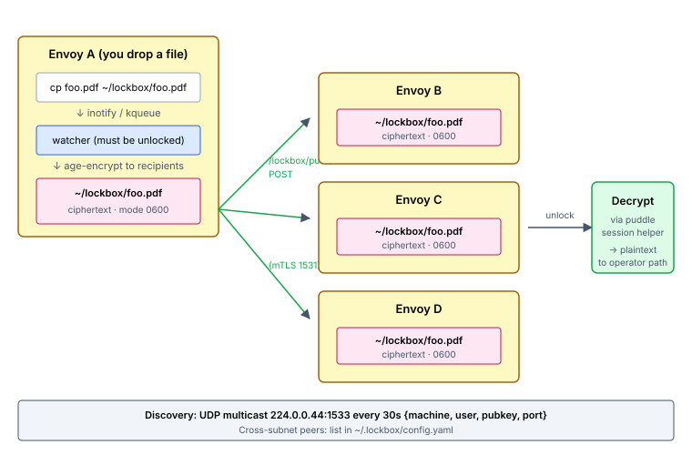

# Set up Lockbox

You'll finish this page with `~/lockbox/` syncing across every envoy a user is enrolled on — plaintext drops in, ciphertext fans out, every envoy holds the bytes at rest at mode 0600 and only the user's puddle passphrase decrypts them. The unlock ceremony piggybacks on `puddle unlock` — no separate password.

**When you'd use this:** any user with a per-user secret / credential / SSH-key set / personal files that they want available on every machine they use, without trusting the disk on any one of them. Operators routinely use lockbox for SSH keys, password-manager exports, license files, GPG keys.

**When you'd skip this:** files that should live on the LAN as plaintext (use [longdrawer](set-up-longdrawer.md) — same shape, no encryption); files an admin pushes (use filecast); secrets that should never leave the server's secret store (use the `secret:` config prefix).

Lockbox keeps `~/lockbox/` in sync across every envoy where a user is enrolled — **ciphertext at rest** on every disk. Drop a plaintext file on any envoy; lockbox encrypts it to every peer's public key and fans out the ciphertext. Unlock with the user's puddle passphrase on any envoy to decrypt.

## Enable it

Lockbox is a mandatory capability of [puddle](set-up-puddle.md) membership — any user with `puddle: true` on their usercrate gets it, no separate flag needed. Make sure puddle is set up first ([Set up Puddle](set-up-puddle.md)), then nothing more is required for lockbox.

The fleet-wide gate also lives in the same `server.yaml` block as puddle:

```yaml
swarm:
  puddle:
    enabled:
      - "*"
```

## Use it

On any envoy where the user has puddle unlocked:

```bash
# First-time setup on this envoy (runs automatically on `puddle unlock`):
vigo swarm puddle unlock                           # also bootstraps lockbox

# Encrypt-on-write:
cp /tmp/secrets.txt ~/lockbox/secrets.txt          # auto-encrypted in place

# Or explicit:
vigo swarm lockbox encrypt ~/Downloads/foo.pdf

# Decrypt out of lockbox on demand:
vigo swarm lockbox unlock                          # session-helper holds the key in RAM
vigo swarm lockbox decrypt secrets.txt -o /tmp/out

# Status / list:
vigo swarm lockbox status
vigo swarm lockbox list
```

The full verb tree: `unlock,lock,encrypt,decrypt,delete,list,status,reencrypt,resurrect,purge`, plus `vigo swarm lockbox puddle init` / `puddle renew-cert` for recovery. Lifecycle verbs (`init / leave / forget`) are retired — exit happens via `vigo swarm puddle leave`, admin eviction via `vigocli swarm puddle evict <host>`.

Lockbox is the encryption-first sibling of [Longdrawer](set-up-longdrawer.md):

| | Longdrawer | Lockbox |
|---|---|---|
| At-rest state | Plaintext | **Ciphertext** everywhere |
| Key material | N/A | Per-envoy age identity, password-wrapped |
| Read access | Any user login | Requires `vigo swarm lockbox unlock` (password) |
| Fan-out trigger | Directory scan every 30s | Filesystem watch + explicit CLI |
| Membership | Any user on the LAN with `~/longdrawer/` | Puddle membership (`puddle: true` on the usercrate) — lockbox bootstraps on `puddle unlock` |

Pick longdrawer for ambient work files you want across machines. Pick lockbox for anything you'd want to stay unreadable on a stolen envoy.

## How It Works



Pure peer-to-peer — the Vigo server never sees content or keys. Envoys discover each other via UDP multicast and exchange ciphertext directly over mTLS on swarm's peer port.

**Network surface** (open these for cross-host operation):

| Port / address | Purpose |
|---|---|
| UDP multicast `224.0.0.44:1533` | Per-user lockbox announcements every 30s. LAN-only by default. |
| TCP `1531` (mTLS) | Swarm peer port. Lockbox uses it for `/lockbox/push/...`, `/lockbox/tombstones/...`, `/lockbox/leaves/...`, `/lockbox/resurrects/...`. |

Cross-subnet peers (multicast doesn't traverse subnets) — list explicitly:

```yaml
# ~/.lockbox/config.yaml
cross_subnet_peers:
  - envoy-london.internal
  - envoy-tokyo.internal
idle_timeout_minutes: 60       # default 60; resets on every DECRYPT/STATUS
```

Both sides must trust the same fleet CA and have ports 1531 + 1533 reachable.

### The convergence loop

1. **Bootstrap (on first `vigo swarm puddle unlock`).** Agent generates a fresh age X25519 keypair for this envoy, wraps the private half under a key derived from the puddle session helper (Argon2id + XChaCha20-Poly1305), writes the wrapped blob to `~/.lockbox/identity.age` (mode 0600). The public half goes in `~/.lockbox/recipients.txt` and starts riding announcements.
2. **Discover.** Every 30s, each enrolled envoy multicasts `{machine, user, pubkey, port}`. Peers running lockbox for the same user receive it, add the pubkey to their local peer table, regenerate `recipients.txt`. Stale peers (no announcement for 90s) are evicted.
3. **Encrypt.** Either explicit (`vigo swarm lockbox encrypt …`) or drop-and-forget (copy plaintext into `~/lockbox/`; an inotify/kqueue watcher catches the event and encrypts in place). Output is mode 0600, owned by the invoking user, written via temp+rename.
4. **Push.** The agent watches `~/lockbox/` and `POST`s every ciphertext change to every live peer at `https://<peer>:1531/lockbox/push/<user>/<filename>`. Pushes are parallel with bounded concurrency.
5. **Decrypt.** `vigo swarm lockbox unlock` prompts for the puddle passphrase (just the one — same as puddle), unwraps the age identity into an in-RAM session helper, holds it until idle-timeout or logout. `decrypt` streams through the helper's socket to the operator-chosen output path.

### Auto-encrypt-on-write

The watcher auto-encrypts plaintext that lands in `~/lockbox/`. Three states:

| State | Behavior |
|---|---|
| Unlocked AND file ≤ 1 GiB | Encrypted in place, atomic-rename. Push fan-out fires from the resulting inotify event. |
| Locked | WARN + leave plaintext in place. Next `vigo swarm puddle unlock` runs an **unlock sweep** that walks `~/lockbox/` and encrypts everything failing the age-magic check. |
| File > 1 GiB | WARN + leave plaintext. Matches the 1 GiB push limit — a file that can't be transmitted shouldn't burn CPU on encryption. |

Encryption failures get renamed to `<filename>.<unix_ts>.failed` to keep them out of the push pipeline. Recovery: rename the artifact back to its original name; the watcher fires a fresh event and the encrypt retries from clean state.

`vigo swarm lockbox status` breaks the file count into subcounts so you can see at a glance what the watcher did:

```
files:            5
  ciphertext:     3
  plaintext:      1   (run 'vigo swarm lockbox unlock' to encrypt and sync)
  failed:         1
                  vigo-lic-backup.tar.gz.20260429.failed
```

### Deletion is a mesh operation — tombstones

Deleting a file (either `vigo swarm lockbox delete <name>` or plain `rm ~/lockbox/<name>`) propagates via a **signed DELETE envelope** fanned out to every peer. Each peer records a **tombstone** (retention: 90 days) and removes its local copy. Any future PUSH/PULL of that filename returns **410 Gone** until either the tombstone ages out or an operator runs `vigo swarm lockbox resurrect <file>` to override.

Each envoy has its own Ed25519 signing key (`/var/lib/vigo/swarm/lockbox/<user>/signing.key`, root-owned, daemon-managed) used to authorize DELETE / LEAVE / RESURRECT envelopes. Daemon-owned (not password-wrapped) so reactive deletion works without the user being unlocked — eviction of a compromised signing key is via `vigocli swarm puddle evict <host>` from the control plane.

Catch-up after a partition: every announcement carries three 16-byte digests (`tombstones_digest`, `leaves_digest`, `resurrects_digest`). On mismatch the peer pulls the full corresponding table from `GET /lockbox/{tombstones,leaves,resurrects}/<user>` and merges.

### Leaving the circle

Two paths, same end state:

- **Self-leave (operator on the departing envoy):** `vigo swarm puddle leave --yes` — covers lockbox LEAVE, puddle scrub, and gitback cleanup. Daemon signs a LEAVE envelope and fans it out; every peer drops the departed pubkey from `recipients.txt` and queues a re-encrypt. Local scrub wipes `~/.vigo-puddle/`, `~/.lockbox/`, `~/lockbox/`, `~/.vigo-gitback/` for that user.
- **Admin eviction (envoy is gone or unreachable):** `vigocli swarm puddle evict <host>` — control-plane dispatch, no envelope required (authority is the admin token, not a P2P signature). Each enrolled agent receives the task and drops the target's pubkey from its peer table.

`vigo swarm lockbox purge --yes` is the local-only alternative: wipes `~/.lockbox/` + `~/lockbox/` for the calling user without gossiping. Peers age this envoy out via the 90-second staleness rule. Use it when you don't want to announce the leave; use `puddle leave` when you do.

**Receive-side dormancy.** If `~/lockbox/` is absent on an envoy (the user has never enrolled, `rm -rf`'d it, or is between `purge` and re-`init`), `POST /lockbox/push/...` returns **HTTP 410 Gone** with `status: dormant`. The agent never silently re-creates `~/lockbox/` from a peer push — opt-in must come from the user side (running `vigo swarm lockbox … init` or `encrypt`). When the user is removed from `/etc/passwd` (e.g. `userdel -r`), the watcher's next reconcile fully nukes `/var/lib/vigo/swarm/lockbox/<user>/` (including `leaves.json`); this prevents stale state from re-attaching to a same-name user later.

### Limits

| Limit | Value |
|---|---|
| Max file size per push | 1 GiB (matches encryption cap) |
| Content supported | Regular files in `~/lockbox/` only — no subdirectories, no symlinks |
| Filename / size / mtime privacy | Not encrypted — only file *content* is |
| Password recovery | None — lose the passphrase on every envoy and the data is unrecoverable |
| Platforms | Linux + macOS (Phase 1) |
| Disk-pressure refusal | Lockbox skips pushes to a peer reporting ≤10% free disk; receiver-side `/lockbox/push/...` returns 507. See [Disk Space](set-up-swarm.md#disk-space). |

### Threat model

| Lockbox protects against | Lockbox does NOT protect against |
|---|---|
| Root compromise on an envoy *without* the user's puddle passphrase | Root compromise on an envoy with an active unlock session (root reads the session helper's RAM) |
| Physical theft of an envoy with no active unlock session | Keyloggers / compromised shells / passphrase capture |
| Network eavesdropping (mTLS + age content encryption — defense in depth) | Weak passphrases (Argon2id slows brute force; doesn't prevent it) |
| Evicted-host data access (a `reencrypt` after eviction cuts off the departed host) | Filename / size / mtime leakage (deliberate; matches longdrawer's boundary) |

Phase 1 has no key escrow. Lose the passphrase on every envoy → data is unrecoverable.

### Where to look when it doesn't work

- **`vigo swarm lockbox status`** on the envoy — shows recipient set, file count breakdown, session-helper state, long-absence gap line.
- **Agent logs** carry one specific WARN per actionable failure (`recipients empty`, `disk full`, `permission denied`, `source vanished mid-read`, etc.) — no retry storms, no opaque "encryption failed."
- **`/lockbox` Web UI** (admin-only) — presence matrix per (user × envoy × filename), recipient drift detection, active-session indicators, three-state envoy reporting (reporting / stale / not_reporting).
- **`vigo swarm puddle status`** — if the puddle session helper is down, lockbox is locked everywhere; that's the first thing to check.

## What's next

- **Add git over the same substrate** → [Set up Gitback](set-up-gitback.md). Same puddle identity; private project repos with content-encrypted blobs.
- **A non-encrypted LAN sibling for ambient work files** → [Set up Longdrawer](set-up-longdrawer.md). Same shape; plaintext at rest; never crosses the LAN.
- **You forgot a puddle passphrase** → no recovery in v1; re-init the puddle and rejoin lockbox. See the recovery notes in [Set up Puddle](set-up-puddle.md).
- **Files aren't fanning out** → [Troubleshoot common issues](troubleshoot.md).

---
*Verified on Vigo 0.51.6 · 2026-05-13.*

*Confidential — Alexander4, LLC. Not for redistribution. See [../legal/license.md](../legal/license.md).*
