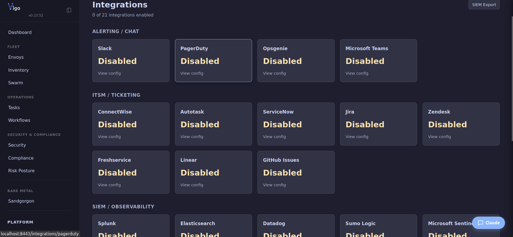

# Set up monitoring

You'll finish this page with a Prometheus instance scraping the Vigo server, the five bundled Grafana dashboards loaded, and alert rules firing on the conditions that matter: stale envoys, convergence failures, license drift, CVE counts, and (if you run hub-spoke) spoke health.

**When you'd use this:** any deployment where someone other than you needs to know about fleet anomalies. For a single-operator home lab, `vigocli doctor` + the Web UI dashboard is enough; Prometheus + Grafana starts paying for itself around five envoys or when you need history.

**When you'd skip this:** single-laptop development. The `/metrics` endpoint exists either way — you can come back when you need it.



The Vigo server exposes Prometheus metrics at `GET /metrics` on the REST port (default 8443).

## Available Metrics

### Fleet Gauges

| Metric | Type | Description |
|--------|------|-------------|
| `vigo_nodes_total` | Gauge | Total number of enrolled envoys |
| `vigo_nodes_active_total` | Gauge | Envoys that checked in within the last hour |
| `vigo_convergence_pct` | Gauge | Fleet-wide compliance percentage (0.0 to 1.0) |
| `vigo_database_size_bytes` | Gauge | Current SQLite database file size in bytes |

### Compliance

| Metric | Type | Labels | Description |
|--------|------|--------|-------------|
| `vigo_compliance_status` | Gauge | `envoy`, `status` | Per-envoy convergence status (1 for current status). Status values: converged, relapsed, diverged, degraded, failed, offline, no data |

### Check-ins

| Metric | Type | Labels | Description |
|--------|------|--------|-------------|
| `vigo_checkins_total` | Counter | `status` | Total number of agent check-ins |
| `vigo_checkin_age_seconds` | Histogram | | Distribution of seconds since last check-in across all envoys |

The `vigo_checkin_age_seconds` histogram uses custom buckets: 60s, 120s, 300s, 600s, 900s, 1800s, 3600s, 7200s. This replaced per-envoy last-seen gauges to avoid cardinality explosion at scale.

### gRPC

| Metric | Type | Labels | Description |
|--------|------|--------|-------------|
| `vigo_grpc_requests_total` | Counter | `method`, `code` | Total gRPC requests by full method name and status code |
| `vigo_grpc_request_duration_seconds` | Histogram | `method` | gRPC request latency in seconds |

Covers all unary RPCs (CheckIn, ReportResult, ReportTraits, Register). Bidirectional streams (AgentStream) are not included — they use the check-in and delta metrics instead.

### Runs

| Metric | Type | Labels | Description |
|--------|------|--------|-------------|
| `vigo_run_duration_seconds` | Histogram | `envoy` | Duration of agent convergence runs in seconds |
| `vigo_drift_detected_total` | Counter | `envoy`, `module` | Drift detection events |
| `vigo_module_actions_total` | Counter | `type`, `action` | Module actions taken (by resource type and action) |

### Orchestration

| Metric | Type | Labels | Description |
|--------|------|--------|-------------|
| `vigo_push_runs_total` | Counter | `status` | Completed task runs by final status (complete, failed) |
| `vigo_workflow_runs_total` | Counter | `status` | Completed workflow runs by final status (complete, failed) |

### Webhooks

| Metric | Type | Labels | Description |
|--------|------|--------|-------------|
| `vigo_webhook_deliveries_total` | Counter | `status` | Webhook delivery outcomes (success, failed, rejected, cancelled, error) |

| `vigo_webhook_duration_seconds` | Histogram | | Webhook delivery latency including retries |

### SMTP

| Metric | Type | Labels | Description |
|--------|------|--------|-------------|
| `vigo_smtp_sends_total` | Counter | `event`, `status` | Email send attempts by event type and outcome (success, error) |

### Tungol

| Metric | Type | Labels | Description |
|--------|------|--------|-------------|
| `vigo_tungol_steorra_latency_seconds` | Histogram | `steorra` | Per-steorra RPC probe latency in seconds |
| `vigo_tungol_steorra_up` | Gauge | `steorra` | Per-steorra reachability (1=up, 0=down) |

Only populated on hub servers. Updated each time the hub probes the steorras under it.

### License

| Metric | Type | Description |
|--------|------|-------------|
| `vigo_license_envoys_used` | Gauge | Current number of active (non-revoked) envoys |
| `vigo_license_envoys_max` | Gauge | Maximum envoys allowed by the license |
| `vigo_license_stage` | Gauge | Enforcement stage: 0=compliant, 1=grace, 2=enrollment\_block, 3=service\_stop |
| `vigo_license_days_remaining` | Gauge | Days until license expiry (negative if expired) |
| `vigo_license_expiry_timestamp` | Gauge | Unix timestamp of license expiration date |
| `vigo_license_enrollments_blocked_total` | Counter | Enrollments rejected by the hard node-count gate (active\_envoys >= max) |
| `vigo_license_enforcement_errors_total` | Counter | Internal enforcement errors (count unavailable, fleet index missing) — gate fails closed on each |

### FleetIndex

| Metric | Type | Description |
|--------|------|-------------|
| `vigo_fleetindex_flush_duration_seconds` | Histogram | Time to flush dirty envoy state from the FleetIndex to SQLite |
| `vigo_fleetindex_dirty_count` | Gauge | Number of dirty entries in the last flush |

### Server

| Metric | Type | Labels | Description |
|--------|------|--------|-------------|
| `vigo_uptime_seconds` | Gauge | | Seconds since the server process started |
| `vigo_build_info` | Gauge | `version` | Server build information (always 1, version as label) |
| `vigo_streams_active` | Gauge | | Number of currently connected agent streams |

### Bootstrap

| Metric | Type | Labels | Description |
|--------|------|--------|-------------|
| `vigo_enrollments_total` | Counter | `status` | Bootstrap enrollment attempts (success, denied, error) |

### Secrets

| Metric | Type | Description |
|--------|------|-------------|
| `vigo_secret_rotations_total` | Counter | Secret rotation events detected by the watcher |
| `vigo_secret_resolution_errors_total` | Counter | Secret resolution failures during config loading |

### Security

| Metric | Type | Labels | Description |
|--------|------|--------|-------------|
| `vigo_sig_verify_failed_total` | Counter | `reason` | Signature verification failures |

| `vigo_security_cve_critical` | Gauge | | Fleet-wide count of critical CVEs across all scanned hosts |
| `vigo_security_cve_high` | Gauge | | Fleet-wide count of high CVEs across all scanned hosts |
| `vigo_security_cve_medium` | Gauge | | Fleet-wide count of medium CVEs across all scanned hosts |
| `vigo_security_cve_low` | Gauge | | Fleet-wide count of low CVEs across all scanned hosts |
| `vigo_security_hardening_avg` | Gauge | | Average hardening score across all scanned hosts (0-100) |
| `vigo_security_rootkit_warnings` | Gauge | | Fleet-wide count of rootkit warnings |
| `vigo_security_malware_detections` | Gauge | | Fleet-wide count of malware detections |
| `vigo_security_integrity_issues` | Gauge | | Fleet-wide count of file integrity issues |
| `vigo_security_scanned_hosts` | Gauge | | Number of hosts with security scan data |

### Convergence

| Metric | Type | Description |
|--------|------|-------------|
| `vigo_convergence_converged` | Gauge | Number of envoys in converged state |
| `vigo_convergence_relapsed` | Gauge | Number of envoys in relapsed state |
| `vigo_convergence_diverged` | Gauge | Number of envoys in diverged state |
| `vigo_convergence_failed` | Gauge | Number of envoys in error state |
| `vigo_convergence_offline` | Gauge | Number of envoys that have offline |
| `vigo_convergence_no_data` | Gauge | Number of envoys with no convergence data |
| `vigo_convergence_pct` | Gauge | Fleet-wide convergence percentage (0.0 to 1.0) |

### Risk

| Metric | Type | Labels | Description |
|--------|------|--------|-------------|
| `vigo_risk_avg_score` | Gauge | | Fleet-wide average risk score (0-100) |
| `vigo_risk_max_score` | Gauge | | Highest risk score across all envoys (0-100) |
| `vigo_risk_distribution` | Gauge | `level` | Number of envoys at each risk level (low, medium, high, critical) |

### Config

| Metric | Type | Description |
|--------|------|-------------|
| `vigo_config_reload_duration_seconds` | Histogram | Duration of config reloads |
| `vigo_config_reload_errors_total` | Counter | Config reload failures |

## AI Assistant Metrics

Defined in `server/ai/metrics.go`, registered separately.

| Metric | Type | Labels | Description |
|--------|------|--------|-------------|
| `vigo_ai_requests_total` | Counter | | AI assistant requests |
| `vigo_ai_tokens_total` | Counter | | Tokens consumed by AI responses |
| `vigo_ai_request_duration_seconds` | Histogram | | AI request latency |
| `vigo_ai_tool_calls_total` | Counter | `tool` | AI tool invocations by tool name |
| `vigo_ai_errors_total` | Counter | | AI request errors |

## Scrape Configuration

Add the Vigo server to your Prometheus scrape config:

```yaml
scrape_configs:
  - job_name: vigo
    static_configs:
      - targets: ['vigo-server:8443']
    scrape_interval: 30s
```


## Grafana Dashboard Suggestions

### Fleet Overview Panel

- **Total Envoys**: `vigo_nodes_total`
- **Active Envoys (1h)**: `vigo_nodes_active_total`
- **Compliance %**: `vigo_convergence_pct * 100`
- **Check-in Rate**: `rate(vigo_checkins_total[5m])`

### Compliance Breakdown

- Stacked gauge or pie chart using `vigo_compliance_status` grouped by `status`
- Time-series of `vigo_convergence_pct` for trend analysis

### Run Performance

- **P95 run duration**: `histogram_quantile(0.95, rate(vigo_run_duration_seconds_bucket[5m]))`
- **Failure rate**: `rate(vigo_checkins_total{status="failure"}[5m])`
- **Drift rate**: `rate(vigo_drift_detected_total[5m])`

### gRPC Latency

- **P99 check-in latency**: `histogram_quantile(0.99, rate(vigo_grpc_request_duration_seconds_bucket{method="/vigo.VigoAgent/CheckIn"}[5m]))`
- **Error rate by method**: `rate(vigo_grpc_requests_total{code!="OK"}[5m])`

### Orchestration

- **Task throughput**: `rate(vigo_push_runs_total[5m])`
- **Task failure rate**: `rate(vigo_push_runs_total{status="failed"}[5m])`
- **Workflow success rate**: `rate(vigo_workflow_runs_total{status="complete"}[5m]) / rate(vigo_workflow_runs_total[5m])`

### Webhooks

- **Delivery success rate**: `rate(vigo_webhook_deliveries_total{status="success"}[5m]) / rate(vigo_webhook_deliveries_total[5m])`
- **P95 delivery latency**: `histogram_quantile(0.95, rate(vigo_webhook_duration_seconds_bucket[5m]))`
- Alert on `rate(vigo_webhook_deliveries_total{status="failed"}[5m]) > 0`

### License

- **Envoy utilization**: `vigo_license_envoys_used / vigo_license_envoys_max * 100`
- **Days until expiry**: `vigo_license_days_remaining`
- **Expiry date**: `timestamp(vigo_license_expiry_timestamp)` for Grafana absolute time display
- Alert on `vigo_license_stage > 0` (any violation)
- Alert on `vigo_license_envoys_used / vigo_license_envoys_max >= 0.9` (approaching limit — hard gate will start rejecting at 1.0)
- Alert on `vigo_license_envoys_used >= vigo_license_envoys_max` (at capacity — next enrollment will be rejected)
- Alert on `increase(vigo_license_enrollments_blocked_total[1h]) > 0` (any hard-gate rejection — operator needs to act)
- Alert on `increase(vigo_license_enforcement_errors_total[5m]) > 0` (internal enforcement errors — investigate, gate is failing closed)
- Alert on `vigo_license_days_remaining < 30` (license expiring soon)

### Tungol

- **Steorra latency**: `histogram_quantile(0.95, rate(vigo_tungol_steorra_latency_seconds_bucket[5m]))`
- Alert on `vigo_tungol_steorra_up == 0` (steorra unreachable)

### Server Health

- **Uptime**: `vigo_uptime_seconds` (detects restarts in Grafana)
- **Version**: `vigo_build_info` label `version` (track rollout across instances)
- **Active streams**: `vigo_streams_active` (monitor agent connectivity)
- Alert on `vigo_uptime_seconds < 300` for recent restart detection
- Alert on `vigo_streams_active == 0` when `vigo_nodes_active_total > 0` (agents not connecting via stream)

### Security Alerts


- Alert on `rate(vigo_sig_verify_failed_total[5m]) > 0` to detect signature verification failures
- Alert on `vigo_config_reload_errors_total` increases
- Alert on `rate(vigo_secret_resolution_errors_total[5m]) > 0`

### Check-in Staleness

- **Median check-in age**: `histogram_quantile(0.5, rate(vigo_checkin_age_seconds_bucket[5m]))`
- Alert when `histogram_quantile(0.95, ...)` exceeds your expected check-in interval

## Metrics Refresh Interval

Gauge metrics (node counts, compliance, database size) are refreshed on a configurable interval:

```yaml
tuning:
  metrics_interval: "30s"    # default
```

See [Tuning Parameters](troubleshoot.md) for all tuning options.
---
*Confidential -- Alexander4, LLC. Not for redistribution. See [license](../legal/license.md).*


---

## Grafana dashboards


Pre-built Grafana dashboards for monitoring Vigo via Prometheus.

## Download

| Dashboard | Panels | Download |
|-----------|--------|----------|
| **Fleet Overview** | 40 panels across 11 rows: fleet stats, compliance breakdown, check-ins & gRPC latency, convergence & drift, operations, infrastructure, webhooks & SMTP, secrets, AI assistant, security posture, risk posture | [vigo-overview.json](#grafana-dashboards) |
| **Security Posture** | 14 panels across 4 rows: CVE counts by severity, hardening score gauge + trend, threat detection (rootkits, malware, integrity), scan coverage | [vigo-security.json](#grafana-dashboards) |
| **Convergence** | 9 panels across 3 rows: status pie chart + stat counters, compliance % + drift rate trends, check-in age heatmap | [vigo-convergence.json](#grafana-dashboards) |
| **Risk Posture** | 8 panels across 3 rows: average + max risk scores, distribution by level (low/medium/high/critical), risk score trends over time | [vigo-risk.json](#grafana-dashboards) |
| **Spanner** | 2 panels: spoke availability (UP/DOWN status map) and spoke latency (p50/p95 time series) | [vigo-spanner.json](#grafana-dashboards) |

## Import

1. Download the JSON file using the link above (or from the docs browser at `/docs/operations/grafana/vigo-overview.json`)
2. Open Grafana (typically http://localhost:3000)
3. Go to **Dashboards → Import**
4. Upload the JSON file or paste its contents
5. Select your Prometheus datasource when prompted

## Fleet Overview Dashboard

[Download vigo-overview.json](#grafana-dashboards)

### Row 1 — Fleet Overview

| Panel | Type | Metric |
|-------|------|--------|
| Total Nodes | Stat | `vigo_nodes_total` |
| Active Nodes | Stat | `vigo_nodes_active_total` |
| Compliance % | Gauge (0-100, red/yellow/green) | `vigo_compliance_pct` |
| Uptime | Stat | `vigo_uptime_seconds` |
| License Usage | Gauge (used vs max) | `vigo_license_envoys_used` / `vigo_license_envoys_max` |
| License Days Remaining | Stat (red < 30, yellow < 90) | `vigo_license_days_remaining` |
| Active Streams | Stat | `vigo_streams_active` |
| Database Size | Stat | `vigo_database_size_bytes` |

### Row 2 — Compliance Breakdown

| Panel | Type | Metric |
|-------|------|--------|
| Compliance Status by Type | Pie chart (green/yellow/red/gray) | `vigo_compliance_status` by `status` label |
| Compliance % Over Time | Time series | `vigo_compliance_pct` |

### Row 3 — Check-in & gRPC

| Panel | Type | Metric |
|-------|------|--------|
| Check-ins / min | Time series | `rate(vigo_checkins_total[5m]) * 60` |
| gRPC Request Rate | Time series by method | `rate(vigo_grpc_requests_total[5m])` |
| gRPC Latency (p50/p95/p99) | Time series | `histogram_quantile` on `vigo_grpc_request_duration_seconds` |

### Row 4 — Convergence & Drift

| Panel | Type | Metric |
|-------|------|--------|
| Run Duration (p50/p95) | Time series | `histogram_quantile` on `vigo_run_duration_seconds` |

| Drift Corrections / min | Time series | `rate(vigo_drift_detected_total[5m]) * 60` |
| Module Actions | Time series by action | `rate(vigo_module_actions_total[5m]) * 60` |

### Row 5 — Operations

| Panel | Type | Metric |
|-------|------|--------|
| Enrollments | Time series by status | `rate(vigo_enrollments_total[1h]) * 60` |
| Task Runs | Time series by status | `rate(vigo_task_runs_total[5m]) * 60` |
| Workflow Runs | Time series by status | `rate(vigo_workflow_runs_total[5m]) * 60` |
| Signature Verification Failures | Stat (green/red) | `vigo_sig_verify_failed_total` |

### Row 6 — Infrastructure

| Panel | Type | Metric |
|-------|------|--------|
| Config Reload Duration | Time series | `vigo_config_reload_duration_seconds` |
| Config Reload Errors | Stat (green/red) | `vigo_config_reload_errors_total` |
| FleetIndex Flush Duration (p50/p95) | Time series | `histogram_quantile` on `vigo_fleetindex_flush_duration_seconds` |
| FleetIndex Dirty Count | Time series | `vigo_fleetindex_dirty_count` |

### Row 7 — Webhooks & SMTP

| Panel | Type | Metric |
|-------|------|--------|
| Webhook Deliveries / min | Time series by status | `rate(vigo_webhook_deliveries_total[5m]) * 60` |
| Webhook Latency (p50/p95) | Time series | `histogram_quantile` on `vigo_webhook_duration_seconds` |
| SMTP Sends | Time series by status | `rate(vigo_smtp_sends_total[5m]) * 60` |

### Row 8 — Secrets

| Panel | Type | Metric |
|-------|------|--------|
| Secret Rotations | Stat | `vigo_secret_rotations_total` |
| Secret Resolution Errors | Stat (green/red) | `vigo_secret_resolution_errors_total` |

### Row 9 — AI Assistant

| Panel | Type | Metric |
|-------|------|--------|
| AI Requests / min | Time series | `rate(vigo_ai_requests_total[5m]) * 60` |
| AI Tokens Used | Stat | `vigo_ai_tokens_total` |
| AI Latency (p50/p95) | Time series | `histogram_quantile` on `vigo_ai_request_duration_seconds` |
| AI Errors | Stat (green/red) | `vigo_ai_errors_total` |

### Row 10 — Security Posture

| Panel | Type | Metric |
|-------|------|--------|
| Critical CVEs | Stat (green/red) | `vigo_security_cve_critical` |
| High CVEs | Stat (green/orange) | `vigo_security_cve_high` |
| Avg Hardening Score | Stat (red < 50, yellow < 80, green) | `vigo_security_hardening_avg` |
| Rootkit Warnings | Stat (green/red) | `vigo_security_rootkit_warnings` |

### Row 11 — Risk Posture

| Panel | Type | Metric |
|-------|------|--------|
| Avg Risk Score | Stat (green < 20, yellow < 40, orange < 70, red) | `vigo_risk_avg_score` |
| Max Risk Score | Stat (green < 20, yellow < 40, orange < 70, red) | `vigo_risk_max_score` |

| Low Risk | Stat (green) | `vigo_risk_distribution{level="low"}` |
| Medium Risk | Stat (blue) | `vigo_risk_distribution{level="medium"}` |
| High Risk | Stat (orange) | `vigo_risk_distribution{level="high"}` |
| Critical Risk | Stat (red) | `vigo_risk_distribution{level="critical"}` |

## Security Posture Dashboard

[Download vigo-security.json](#grafana-dashboards)

Dedicated security monitoring dashboard with CVE tracking, hardening scores, and threat detection.

### Row 1 — CVE Overview

| Panel | Type | Metric |
|-------|------|--------|
| Critical CVEs | Stat (green/red) | `vigo_security_cve_critical` |
| High CVEs | Stat (green/orange) | `vigo_security_cve_high` |
| Medium CVEs | Stat (green/yellow) | `vigo_security_cve_medium` |
| Low CVEs | Stat (blue) | `vigo_security_cve_low` |

### Row 2 — Hardening

| Panel | Type | Metric |
|-------|------|--------|
| Average Hardening Score | Gauge (0-100, red < 50, yellow < 80, green) | `vigo_security_hardening_avg` |
| Hardening Score Over Time | Time series | `vigo_security_hardening_avg` |

### Row 3 — Threat Detection

| Panel | Type | Metric |
|-------|------|--------|
| Rootkit Warnings | Stat (green/red) | `vigo_security_rootkit_warnings` |
| Malware Detections | Stat (green/red) | `vigo_security_malware_detections` |
| Integrity Issues | Stat (green/orange) | `vigo_security_integrity_issues` |

### Row 4 — Coverage

| Panel | Type | Metric |
|-------|------|--------|
| Scanned Hosts | Stat (green) | `vigo_security_scanned_hosts` |
| Total Nodes | Stat (blue) | `vigo_nodes_total` |

## Convergence Dashboard

[Download vigo-convergence.json](#grafana-dashboards)

Per-envoy convergence status breakdown, compliance trends, and check-in health.

### Row 1 — Status Breakdown

| Panel | Type | Metric |
|-------|------|--------|
| Convergence Status | Pie chart (green/yellow/orange/red/gray) | `vigo_convergence_converged`, `_relapsed`, `_diverged`, `_failed`, `_offline`, `_no_data` |
| Converged | Stat (green) | `vigo_convergence_converged` |
| Relapsed | Stat (yellow) | `vigo_convergence_relapsed` |
| Diverged | Stat (red) | `vigo_convergence_diverged` |
| Errors | Stat (green/red) | `vigo_convergence_failed` |
| Offline | Stat (green/orange) | `vigo_convergence_offline` |
| No Data | Stat | `vigo_convergence_no_data` |

### Row 2 — Trends


| Panel | Type | Metric |
|-------|------|--------|
| Compliance % | Time series (0-100) | `vigo_convergence_pct * 100` |
| Drift Rate | Time series | `rate(vigo_drift_detected_total[5m])` |

### Row 3 — Check-in Health

| Panel | Type | Metric |
|-------|------|--------|
| Check-in Age Distribution | Heatmap | `vigo_checkin_age_seconds_bucket` |

## Risk Posture Dashboard

[Download vigo-risk.json](#grafana-dashboards)

Fleet-wide risk scoring with distribution breakdown and trend tracking.

### Row 1 — Fleet Risk

| Panel | Type | Metric |
|-------|------|--------|
| Average Risk Score | Stat (green < 20, yellow < 40, orange < 70, red) | `vigo_risk_avg_score` |
| Max Risk Score | Gauge (0-100, green < 20, yellow < 40, orange < 70, red) | `vigo_risk_max_score` |

### Row 2 — Distribution

| Panel | Type | Metric |
|-------|------|--------|
| Low Risk | Stat (green) | `vigo_risk_distribution{level="low"}` |
| Medium Risk | Stat (blue) | `vigo_risk_distribution{level="medium"}` |
| High Risk | Stat (orange) | `vigo_risk_distribution{level="high"}` |
| Critical Risk | Stat (red) | `vigo_risk_distribution{level="critical"}` |

### Row 3 — Trends

| Panel | Type | Metric |
|-------|------|--------|
| Risk Score Over Time | Time series (average + maximum) | `vigo_risk_avg_score`, `vigo_risk_max_score` |

## Spanner Dashboard

[Download vigo-spanner.json](#grafana-dashboards)

Only populated on hub servers.

| Panel | Type | Metric |
|-------|------|--------|
| Steorra Availability | Stat with UP/DOWN mapping | `vigo_tungol_steorra_up` by `steorra` |
| Steorra Latency (p50/p95) | Time series by steorra | `histogram_quantile` on `vigo_tungol_steorra_latency_seconds` |

## Prometheus Configuration

Add the Vigo server as a scrape target in `prometheus.yml`:

```yaml
scrape_configs:
  - job_name: vigo
    static_configs:
      - targets: ['vigo-server:8443']
    metrics_path: /metrics
    scrape_interval: 30s
```

## Suggested Alerts

```yaml
groups:
  - name: vigo
    rules:
      - alert: VigoComplianceLow
        expr: vigo_compliance_pct < 90
        for: 10m
        labels: { severity: warning }
        annotations:
          summary: "Fleet compliance below 90%"

      - alert: VigoLicenseExpiring
        expr: vigo_license_days_remaining < 30 and vigo_license_days_remaining > 0
        for: 1h
        labels: { severity: warning }
        annotations:
          summary: "License expires in {{ $value }} days"

      - alert: VigoLicenseOverLimit
        expr: vigo_license_stage > 0
        for: 5m
        labels: { severity: critical }
        annotations:
          summary: "License enforcement active (stage {{ $value }})"

      - alert: VigoConfigReloadFailed
        expr: increase(vigo_config_reload_errors_total[5m]) > 0
        labels: { severity: warning }
        annotations:
          summary: "Config reload failed"

      - alert: VigoSignatureVerifyFailed
        expr: increase(vigo_sig_verify_failed_total[5m]) > 0
        labels: { severity: critical }
        annotations:
          summary: "ED25519 signature verification failures detected"

      - alert: VigoSteorraDown
        expr: vigo_tungol_steorra_up == 0
        for: 5m
        labels: { severity: critical }
        annotations:
          summary: "Tungol steorra {{ $labels.steorra }} is down"
```

## What's next

- **A metric is high and you don't know which envoy** → drill in via `vigocli envoys list` then the envoy detail page.
- **You need an alert routed to PagerDuty / Slack / ServiceNow** → see the integrations section above; same config block, different endpoint.
- **A metric value looks wrong** → [Troubleshoot common issues](troubleshoot.md).

---
*Verified on Vigo 0.51.6 · 2026-05-13.*

*Confidential -- Alexander4, LLC. Not for redistribution. See [license](../legal/license.md).*
