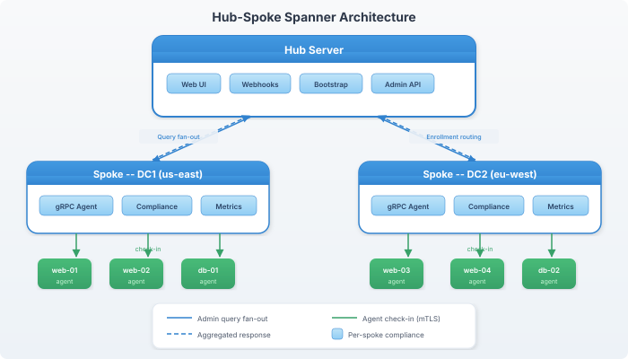

# Set up Spanner (hub-spoke sharding)

You'll finish this page with a hub server fronting one or more spoke servers — each spoke owning a hostname-pattern partition of the fleet, the hub aggregating their data and routing admin queries fleet-wide. Envoys keep checking in on whatever address they originally enrolled against; the hub's job is fan-out + aggregation, not steady-state traffic.

**When you'd use this:** when one server can no longer comfortably hold the fleet's check-in cadence, query load, or convergence-history retention. Practical inflection points are usually north of ~5,000 envoys per server, or when you want geographic partitioning so a regional outage doesn't take the whole control plane down.

**When you'd skip this:** smaller fleets (a single-server `standalone` deployment is the default and the right answer for almost every operator); fleets that need HA but not horizontal sharding (use `server/peer/` primary/secondary replication instead — see [set-up-peer.md](#) if it exists, otherwise the `peer:` section in `server.yaml`).

> **License requirement:** Spanner needs a paid license. The built-in free license (100 envoys) does not support hub or spoke mode; the server refuses to start with `spanner.role` set to `hub` or `spoke` on the free license. Paid licenses are bound to a specific server via [machine fingerprint](troubleshoot.md#machine-fingerprint-binding) — migrating the hub to a new machine requires a new license.

## Enable it

Three roles: `standalone` (default — no spanner config), `hub` (aggregates spokes), and `spoke` (handles its partition). Pick the role per server in `server.yaml`:

```yaml
# Hub server.yaml:
spanner:
  role: hub
  spokes:
    - hostname: spoke-east.lab
      partition: "*.east.example.com"
    - hostname: spoke-west.lab
      partition: "*.west.example.com"

# Spoke server.yaml:
spanner:
  role: spoke
  hub: hub.lab
  partition: "*.east.example.com"
```

Restart each server (hub first, spokes second). The hub will start health-checking spokes and aggregating their data.

## Use it

`vigocli spanner status` shows the spanner topology, per-spoke health, aggregated convergence + compliance + license usage. Cross-spoke admin queries (force-push, ad-hoc tasks, live queries) work through the hub: you talk to one place, the hub fans out to the right spoke(s).

If a spoke health-checks N times in a row, the hub drains it by reassigning its envoys to the hub itself (envoys keep checking in; no data loss). Recovery is automatic when the spoke returns.

## Architecture



## Roles

### standalone (default)

Single server handles everything. No spanner config needed.

### hub

The central server that:
- Serves the web UI, webhooks, bootstrap
- Routes enrollment to the correct spoke based on hostname patterns
- Fans out admin queries to all spokes and aggregates results
- Aggregates compliance and fleet statistics
- Handles license enforcement

```yaml
spanner:
  role: hub
  spokes:
    - id: dc1
      addr: "spoke1.example.com:1530"
      patterns: ["*.dc1.*"]
    - id: dc2
      addr: "spoke2.example.com:1530"
      patterns: ["*.dc2.*"]
```

### spoke

A partition server that:
- Handles agent check-ins for its assigned envoys
- Stores runs, traits, and results locally
- Responds to admin queries from the hub
- Does not serve the web UI, webhooks, or bootstrap

```yaml
spanner:
  role: spoke
  spoke_id: "dc1"
```

## Enrollment Routing

When a envoy bootstraps through the hub, the hub routes the enrollment to the correct spoke based on hostname pattern matching:

```
Envoy: web3.dc1.example.com
    ↓
Hub: match "*.dc1.*" → route to spoke dc1
    ↓
Spoke dc1: complete enrollment, store pubkey
```

## Admin Query Fan-out

CLI and API queries go through the hub, which fans out to all spokes:

```bash
vigocli envoys list
```

```
Hub receives request
    ↓
Fan out to spoke dc1 + spoke dc2 (parallel)
    ↓
Merge results
    ↓
Return to CLI
```

## Config Sync

When `vigocli config publish` runs on the hub, the config is automatically pushed to all spokes. The hub creates a tar.gz of the `.live/` directory and sends it via the `SyncConfig` RPC. Spokes extract the archive, overwrite their local `.live/` directory, and reload. This is best-effort — if a spoke is unreachable, it's skipped and logged.

## Spoke Health

The hub monitors spoke health via periodic gRPC probes. Spokes can also push their status to the hub if `hub_addr` is configured. The web UI shows:
- Spoke status (online/offline)
- Per-spoke compliance breakdown
- Per-spoke latency metrics
- Envoy count per spoke

### Spoke Status Reporting

Spokes can proactively report their status to the hub:

```yaml
spanner:
  role: spoke
  spoke_id: "dc1"
  hub_addr: "hub.example.com:1530"  # enables spoke→hub reporting
```

The spoke sends compliance metrics to the hub every 30 seconds. If the hub is unreachable, the spoke continues operating normally.

### Hub Failover for Spokes

When the hub has [peer replication](../howto/set-up-spanner.md) configured, spokes should list the hub's peer addresses as fallbacks. After 3 consecutive failures on the current hub address, the spoke automatically tries the next fallback:

```yaml
spanner:
  role: spoke
  spoke_id: "dc1"
  hub_addr: "hub.example.com:1530"
  hub_fallback_addrs:
    - "hub-standby.example.com:1530"
```


The spoke cycles through all addresses (primary, then fallbacks) until one responds. This ensures spokes reconnect to a promoted hub peer without manual intervention.

### Auto-Failover

The hub can automatically drain unhealthy spokes:

```yaml
spanner:
  role: hub
  auto_failover:
    enabled: true
    threshold: 3      # consecutive failures before drain (default 3)
    interval: "30s"   # health check interval (default 30s)
```

When a spoke fails `threshold` consecutive health checks (default: 3 failures = 90 seconds), the hub automatically drains all its envoys to other spokes based on hostname pattern matching. When the spoke recovers, it's marked healthy again and can accept new envoys.

## Envoy Reassignment

Move envoys between spokes:

```bash
vigocli spanner reassign --hostname "web3.dc1.*" --to dc2
```

Drain all envoys from a spoke:

```bash
vigocli spanner drain --spoke dc1 --to dc2
```

The agent handles reconnection automatically — on next check-in, it's redirected to the new spoke.

## Spoke Detail

View detailed spoke information:

```bash
vigocli spanner spoke dc1
```

The web UI has a spoke detail page at `/spanner/spokes/{id}` showing per-spoke compliance, recent runs, and envoy list.

## Related

- [Architecture](../reference/_index.md) — System overview
- [Server Configuration](../reference/server-yaml.md) — spanner: section

## What's next

- **HA for the hub itself** → `server/peer/` primary/secondary replication. Pair it with `hub_fallback_addrs:` on every spoke so failover is transparent.
- **A spoke is wedged** → `vigocli spanner status` shows per-spoke health; the hub auto-drains after `threshold` consecutive misses. Manually drain with `vigocli spanner drain --spoke <id> --to <other>`.
- **License is too small** → spanner needs a paid license; see [license](../reference/server-yaml.md) and [troubleshoot.md#machine-fingerprint-binding](troubleshoot.md#machine-fingerprint-binding) for fingerprint rebinds.
- **Cross-spoke admin queries are slow** → spoke health-probe interval is `30s` by default; reduce for tighter convergence on flapping spokes (`spanner.auto_failover.interval`).

---
*Verified on Vigo 0.51.6 · 2026-05-13.*

*Confidential — Alexander4, LLC. Not for redistribution. See [../legal/license.md](../legal/license.md).*
