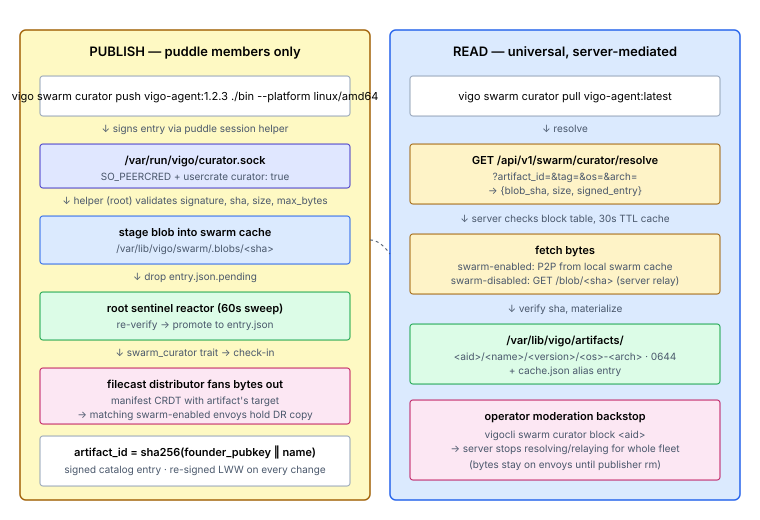

# Set up Curator

You'll finish this page with an artifact (binary, archive, package, container image) published from one envoy and pullable on every envoy in the fleet — peer-to-peer when reachable, server-relayed when not. The blob is signed by the publisher's puddle and verified end-to-end on every read. Reads are universal; writes are puddle-members-only.

**When you'd use this:** any time the same bytes have to land on more than one envoy — agent binaries, vendor tarballs, custom `.deb` / `.rpm` packages, ML model files, container images, large fixtures. Curator earns its keep when an HTTP file server is the alternative you're avoiding.

**When you'd skip this:** secrets and credentials (use [lockbox](set-up-lockbox.md) or the `secret:` config prefix); state that should live as a git repo (use [gitback](set-up-gitback.md)); ad-hoc admin-pushed config files (use filecast).

## Enable it

Per-envoy: opt in via `server.yaml`:

```yaml
swarm:
  curator:
    enabled:
      - "*"                   # pattern list, first-match-wins; "-" prefix denies
    max_bytes: 2147483648     # per-blob cap; default 2 GiB
```

Per-user: grant `curator: true` on the usercrate (heavier than `gitback:` — write access to a fleet-readable artifact registry):

```yaml
resources:
  - type: user
    username: dan
    puddle: true              # required
    curator: true             # opt-in for curator publish
```

Publish (`sudo vigocli config publish`).

## Use it

From an envoy where the operator has puddle unlocked:

```bash
# Publish a binary or archive (the implicit namespace is the operator's puddle name):
vigo swarm curator push vigo-agent:1.2.3 ./vigo-agent-linux-amd64 \
  --platform linux/amd64

# Tag mutably:
vigo swarm curator tag vigo-agent:latest 1.2.3

# Resolve / pull anywhere (no puddle needed for read):
vigo swarm curator resolve vigo-agent:latest      # show coordinates
vigo swarm curator pull vigo-agent:latest         # fetch to /var/lib/vigo/artifacts/...

# Operator views:
vigo swarm curator list                           # everything published
vigo swarm curator inspect vigo-agent             # full signed entry
vigo swarm curator versions vigo-agent
```

From the admin server (`vigocli`) — same verbs plus moderation:

```bash
vigocli swarm curator list
vigocli swarm curator block <artifact_id>         # server refuses to resolve/relay
vigocli swarm curator unblock <artifact_id>
```

## How it works



Curator combines two existing fleet primitives: the swarm blob substrate (content-addressed, chunked, target-scoped, P2P) handles the *bytes*, and gitback's puddle-keyed identity/access machinery handles the *who-can-do-what*. A thin signed-catalog layer stitches them together.

### Identity

`artifact_id = sha256(founder_puddle_pubkey ‖ name)` — same shape as a gitback project ID, so two operators can both publish `redis` without collision. Human-facing reference: `<founder-puddle-name>/<name>` (resolves to a pubkey via the [ADR-022](../../adr/022-gitback-friendly-names.md) fleet name map, then to an artifact_id). The operator's own puddle is the implicit default namespace — `vigo-agent:latest` ≡ `<your-puddle>/vigo-agent:latest`. The hex `<artifact_id>/<name>` form always works (self-certifying).

### Catalog entry

One signed envelope per artifact, re-signed last-write-wins on every mutation:

```jsonc
{
  "body": {
    "name": "vigo-agent",
    "founder_puddle_pubkey": "<hex 32-byte ed25519>",   // frozen forever
    "signing_puddle_pubkey": "<hex 32-byte ed25519>",   // == founder until rekey
    "versions": {
      "1.2.3": { "platforms": [
        { "os": "linux",  "arch": "amd64", "blob_sha": "<hex>", "size": 12345678 },
        { "os": "darwin", "arch": "arm64", "blob_sha": "<hex>", "size": 13402011 }
      ]}
    },
    "tags":   { "latest": "1.2.3", "stable": "1.2.0" },   // mutable
    "target": "*",                                         // which envoys hold the DR replica
    "issued_at": 1714521600000                             // unix ms; LWW key
  },
  "signature": "<hex 64-byte ed25519 sig over canonical_bytes(body)>"
}
```

The signature anchors to the founder pubkey: any envoy verifying the entry rejects it if the signature doesn't trace back (via the [ADR-019](../../adr/019-gitback-founder-rekey.md) rekey-bridge chain) to the pubkey that hashes the artifact_id. A founder cannot mutate another founder's artifact.

### Publishing — write path

`vigo swarm curator push <name>:<version> <file>` runs as a real user with `curator: true` on their usercrate and an unlocked puddle. The CLI:

1. Hashes the file (`sha256` + size), then drops the file plus a re-signed catalog entry into the helper daemon at `/var/run/vigo/curator.sock`.
2. The helper (root) validates the signature + delegation chain end-to-end, confirms the streamed bytes match `blob_sha` / `size`, and enforces the per-blob cap `swarm.curator.max_bytes` (default 2 GiB; raise for container images).
3. Stages the blob into the swarm blob cache and records a manifest entry with the artifact's `target` — the existing filecast distributor then fans the bytes out to matching swarm-enabled envoys, exactly like a filecast blob.
4. Drops the signed entry as `~<user>/.vigo-curator/<artifact_id>/entry.json.pending`. The root sentinel reactor (60s sweep) re-verifies it and promotes to `entry.json`, where the agent's trait collector picks it up → the server-side catalog aggregator → the fleet catalog.

Re-signs that don't ship new bytes (`tag` / `untag` / `set-recipients` / `set-target` / `rm`) ride the same socket via header-only ENTRY verbs. `set-target` also re-records the manifest seed for blobs this envoy seeded so distribution to the new target set fires on the next pass.

### Reading — universal, server-mediated

Every envoy (swarm-enabled or not) resolves via the server:

```
GET /api/v1/swarm/curator/resolve?artifact_id=<hex>&tag=<t>|&version=<v>&os=<os>&arch=<arch>
```

The server returns `{blob_sha, size, signed_entry}` from its 30-second-TTL aggregated catalog (block/unblock invalidates the cache). The agent then fetches bytes:

- **Swarm-enabled envoy** — P2P from the swarm cache (usually already holds the DR replica because `target` matched it).
- **Swarm-disabled envoy** — `GET /api/v1/swarm/curator/blob/<sha>` from the server, which relays from the server's co-resident envoy. Scoped to current-catalog shas only — not a back door to arbitrary swarm blobs.

Either way the agent verifies the sha and materializes to `/var/lib/vigo/artifacts/<artifact_id>/<name>/<version>/<os>-<arch>` (mode 0644), updating `/var/lib/vigo/artifacts/cache.json` with both `:<tag>` and `@<version>` aliases.

Agents also cache the fleet catalog at `/var/lib/vigo/artifacts/catalog.json` (refreshed every check-in), so a swarm-enabled envoy can resolve and materialize **locally** through a server outage for any artifact it already holds.

### Authorization

Two layers gate publishing. Both must say yes:

| Layer | Where | Question |
|---|---|---|
| Envoy | `server.yaml#swarm.curator.enabled` pattern list | Is curator available on this envoy at all? |
| User | usercrate `curator: bool` flag | May this Unix user publish? |

Plus the operator-puddle layer at signing time: the user's puddle session helper must be running (`vigo swarm puddle unlock`).

`curator: true` is a **heavier** grant than `gitback: true` — "may publish to the fleet's registry, fleet-readable by default" vs "may found personal git repos." Removing it from a usercrate triggers a scrub on the next reconcile (`~/.vigo-curator/` wiped for that user). Already-published artifacts stay; you can't recall them by losing a flag.

Reading is **ungated** — artifacts are fleet-readable. `pull` materializes into a root-owned tree, so it requires `sudo`.

The operator-moderation backstop is `vigocli swarm curator block <ref>` (admin-only). The server stops resolving/relaying the blocked artifact fleet-wide regardless of who published it. The signed entry still exists and gossips, and the DR bytes still sit on swarm-enabled envoys — only a publisher `vigo swarm curator rm` truly purges.

### Leaving curator / decommissioning a user

Unlike longdrawer/lockbox there's no per-user state under `/var/lib/vigo/` to orphan — curator's root-side state (`/var/lib/vigo/artifacts/catalog.json`, `cache.json`, materialized blob tree) is fleet-global, not user-partitioned. And `userdel -r <user>` removes `~/.vigo-curator/` along with the rest of the home dir, so the common case self-cleans.

What DOES linger after a `userdel -r` if no pre-cleanup was done: this envoy's **manifest-side seed advertisements** for every blob the departed user published. Peers' fleet caches keep resolving those entries until the next manifest GC ages them out, and `vigocli swarm curator fleet` will keep listing the departed user as the seeder.

**Pre-`userdel -r` workflow** — as the user, run:

```bash
vigo swarm curator purge --yes      # wipes ~/.vigo-curator/ + revokes this envoy's manifest seeds
```

Then `userdel -r` is safe. `purge` does NOT unpublish across the fleet — peers retain the last entry they saw. For full retraction of a specific artifact, the publisher runs `vigo swarm curator rm <artifact_id>` (signs and gossips a tombstone) BEFORE `purge`.

If `userdel -r` already happened without prior `purge`: the user's `~/.vigo-curator/` is gone, the published entries are still in every peer's fleet catalog forever (until the publishing puddle's identity comes back to retract them — typically never). The operator-moderation `vigocli swarm curator block <ref>` is the only fleet-wide remedy.

### CLI surfaces

Two thin clients of the same backend:

- **`vigo swarm curator`** (agent-side, runs as the user) — founder + consumer surface. Mutating verbs sign via the puddle helper and submit to the local socket. Read verbs (`status`, `list`, `inspect`, `versions`, `resolve`, `pull`) work locally + against the server. Cleanup verbs (`stale`, `prune`, `gc`, `purge`) hygiene the envoy.
- **`vigocli swarm curator`** (server-side, operator front-end) — read views + admin moderation (`block` / `unblock`). Mutating verbs deliberately don't live here — they need an unlocked per-user puddle, which doesn't fit vigocli's root-only / peer-auth posture.

### Accelerating agent updates (0.51.8+)

Curator can absorb the bandwidth cost of agent self-updates. The flow:

1. After you cross-compile a new agent, push the resulting binary as a curator artifact under your operator puddle, one platform per cross-compile target. The artifact name is **`vigo-agent`** and the tag is the version string — those are the conventions the agent looks for.

   ```bash
   vigo swarm curator push vigo-agent:0.51.8 ./dist/agent/linux/amd64/vigo --platform linux/amd64
   vigo swarm curator push vigo-agent:0.51.8 ./dist/agent/linux/arm64/vigo --platform linux/arm64
   # ... one push per platform you ship
   ```

2. On every check-in, when an envoy decides to self-update to version V, it first asks curator for `vigo-agent:V` on its host platform. If the catalog says yes and the artifact's `blob_sha` matches what the server's `/api/v1/agent/latest` reports, the envoy pulls the bytes P2P from the local swarm cache (or via the server relay if it's swarm-disabled) instead of re-downloading from `/dist/agent/<os>/<arch>/vigo`.

3. The agent verifies SHA256 + ed25519 binary signature on the bytes regardless of where they came from. **The REST endpoint stays the authority** — if the curator artifact is missing, the SHAs don't match, or curator is broken in any way, the agent silently falls back to `/dist/agent/<os>/<arch>/vigo` and self-updates as it always has.

This is opportunistic. You never have to publish `vigo-agent` for the fleet to update; you do it when you want to spare your server's egress on a fleet-wide bump. A mismatched `blob_sha` (you pushed the wrong build) produces one `warn!` in the agent log and falls back to REST — the published artifact is just ignored until you repush.

### Pulling container images through curator

When `swarm.curator.local_port` is set to a non-zero value in `server.yaml`, the agent exposes a local OCI Distribution v2 shim on `127.0.0.1:<port>` that serves curator artifacts as a Docker registry. That means a `container:` resource can use `artifact:` instead of `image:`:

```yaml
- name: redis-cache
  type: container
  container: redis-cache
  artifact: alexander4/redis:7.2-alpine    # pulled via the curator shim
  state: running
  ports: "6379:6379"
  healthcheck_command: "redis-cli ping"
  restart: unless-stopped
```

The agent translates `artifact: <ns>/<name>:<tag>` to `docker pull 127.0.0.1:<port>/<ns>/<name>:<tag>` at apply time. To publish container images, push them as OCI archives (`docker save --format=oci`) with `--kind oci-archive`, and `vigo swarm curator push` them like any other artifact. `image:` (a normal registry reference) and `artifact:` are mutually exclusive — pick one per resource. See [`container`](../../reference/vigo/resources/container.md) for the full parameter surface.

### Hosting a private package repository

The same `swarm.curator.local_port` listener also serves a **package-repo facade** at `http://127.0.0.1:<port>/repo/<name>/…` — a private apt/dnf/apk repository, distributed P2P, with no repo server (no Aptly, reprepro, Pulp, or nginx). Use it to host *your own* `.deb`/`.rpm`/`.apk` packages — in-house builds, vendored third-party, air-gapped sets. (Pointing hosts at an *upstream* distro repo stays the [`repository`](../../reference/vigo/resources/repository.md) resource's job; this is for repos *you* publish.)

**Publish.** `vigo swarm curator repo-publish` builds the repo tree, signs the metadata, tars it, and publishes it as a curator artifact — one command from a directory of loose packages:

```sh
# ./debs/ holds your .deb files; the signing key is your own gnupg key.
vigo swarm curator repo-publish acme-repo \
    --dir ./debs --kind apt-repo --sign-key ACME-SIGNING-KEY-ID
```

`repo-publish` shells out to the toolchain matching `--kind` — `dpkg-scanpackages` + `gpg` for `apt-repo`, `createrepo_c` + `gpg` for `dnf-repo`, `apk index` + `abuild-sign` for `apk-repo` — so the publishing host must have it installed (a missing tool gives a clear "install …" error). `--sign-key` is a GPG key id for `apt-repo`/`dnf-repo` and an abuild RSA private-key path for `apk-repo` (apk repos are RSA-signed, not GPG). `--suite`/`--component` default to `stable`/`main` (apt only); `--version` defaults to today's UTC date, `--tag` to `latest`. `--kind` is set once at first publish and is immutable. apt/dnf/apk URLs carry no tag, so the facade always serves the `latest` tag.

`repo-publish` is deliberately thin — one suite, one component, the architectures present in `--dir`. For the long tail (source packages, multiple components, incremental adds) build the signed tree yourself with the standard tools, pack it as a **plain, uncompressed `.tar`** (the facade requires uncompressed), include the public signing key as a file in the tree so consumers can fetch it from the same facade, and `vigo swarm curator push <name> --file <tar> --version <v> --tag latest --os linux --arch all --kind apt-repo` it (a repo tarball is architecture-agnostic — `--os linux --arch all` is a placeholder the facade ignores).

**Consume.** Point a `repository` resource at the facade — no new resource type, the existing one already imports a signing key and writes the source entry:

```yaml
- name: acme-internal
  type: repository
  repository: acme-internal
  repo: "deb http://127.0.0.1:5000/repo/alexander4/acme-repo stable main"
  key_url: "http://127.0.0.1:5000/repo/alexander4/acme-repo/key.asc"
```

From there it is native `apt`: `apt update` then `apt install <your-package>` resolves dependencies and pulls `.deb`s from the curator-hosted repo. `dnf` and `apk` work the same way against a `dnf-repo` / `apk-repo` artifact. Pointing an `apt` host at a `dnf-repo` (or vice versa) fails fast with a clear kind-mismatch error rather than a confusing 404.

**Caveat.** A repo is one tarball artifact — adding a package means rebuilding and re-publishing the whole repo as a new artifact version. Fine for modest private repos; raise `swarm.curator.max_bytes` for large ones.

### Exposing artifacts over an S3 API

`swarm.curator.s3_port` opens a read-only, S3-compatible HTTPS endpoint (ADR-027) so **non-envoy** clients — CI runners, dev laptops, anything with an S3 SDK — can fetch curator artifacts. Any S3 toolchain works against it unmodified. It reuses the server's TLS material and requires the `local` secrets backend.

Enable it in `server.yaml` (`0`, the default, disables it):

```yaml
swarm:
  curator:
    s3_port: 9000
```

Mint a credential — admin-only; the secret is **derived, never stored**, and shown once:

```
$ vigocli swarm curator s3-credentials create --name ci-runner
Curator S3 credential created.
  Access key ID:     VIGO2X4QPL7N8K3M9R6T
  Secret access key: 9f3a…  (shown once — store it now)
  Scope:             *
```

Point any S3 client at the endpoint with those keys:

```
$ aws --endpoint-url https://vigo.example.com:9000 s3 ls s3://vigo-curator/
$ aws --endpoint-url https://vigo.example.com:9000 s3 cp \
    s3://vigo-curator/alexander4/vigo-agent/0.66.28/linux-amd64 ./vigo
```

Object keys are `<publisher>/<artifact>/<version-or-tag>/<os>-<arch>` — `<publisher>` is the puddle friendly-name when one is unambiguously claimed, else the founder-pubkey hex (both forms resolve on `GetObject`). `HeadObject` carries the artifact's kind in an `x-amz-meta-vigo-kind` header.

The API is **read-only** — every write or management verb returns an S3 `405`; publishing stays `vigo swarm curator push`. A credential can be scoped to one publisher (`s3-credentials create --scope <publisher>`); operator-blocked artifacts are invisible over S3 too. Note that `GetObject` of a repo-kind artifact (`apt-repo` / `dnf-repo` / `apk-repo`) returns the repo *tarball* — to consume a private apt/dnf/apk repo browsably, point a `repository` resource at the agent-local `/repo/` facade above, not at the S3 endpoint. Master-key rotation re-derives every S3 secret, so operators re-mint credentials after a rotation.

### Where to look when it doesn't work

- **`vigo swarm curator status`** — local cache state, in-flight pushes, helper-daemon liveness.
- **`vigocli swarm curator list / fleet`** — server-side view of who's published what, who's pulled what, the blocked set.
- **Agent logs** carry one specific WARN per actionable failure (`sha mismatch`, `blob exceeds max_bytes`, `entry signature invalid`, `target glob matched zero envoys`).
- **Disk pressure**: like the other swarm subsystems, curator skips pushes to peers ≤10% free disk. See [Disk Space](set-up-swarm.md#disk-space).

## What's next

- **Refer to artifacts from a configcrate's `package` / `source_package` / `file` resource** → `resources/package` in the reference vocabulary. Curator URIs work wherever a download URL fits.
- **The blob is bigger than 2 GiB** → raise `swarm.curator.max_bytes` per envoy. Republish; tags re-anchor automatically.
- **Recall a bad release** → `vigocli swarm curator block <artifact_id>` blocks fleet-wide resolution; only a publisher `rm` truly purges the bytes.
- **`pull` hangs or sha-mismatches** → [Troubleshoot common issues](../operate/troubleshoot.md).

---
*Verified on Vigo 0.66.28 · 2026-05-22.*

*Confidential — Alexander4, LLC. Not for redistribution. See [../legal/license.md](../../legal/license.md).*
