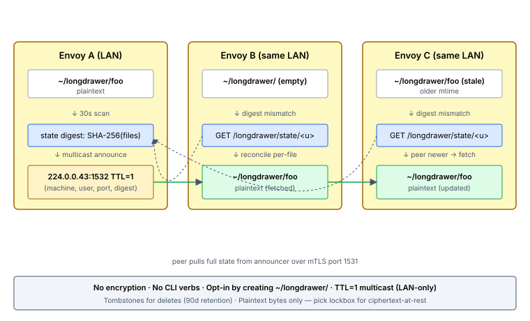

# Set up Longdrawer

You'll finish this page with `~/longdrawer/` syncing on the LAN — drop a file on any envoy where you have an account, it lands on every other envoy in the same broadcast domain within ~60s; delete it and the tombstone fans out the same way. No config files, no CLI verbs, no server involvement. Activation is "create `~/longdrawer/` on at least one envoy."

**When you'd use this:** ambient working files you want present on every machine you log into — scratch notes, dotfile drafts, shell history bookmarks, work-in-progress that you don't want to ferry over scp. The LAN-only scope is the design: the bytes don't leave the trust boundary of the broadcast domain.

**When you'd skip this:** anything you want at rest on disk as ciphertext (use [lockbox](set-up-lockbox.md) — identical shape, encryption included); anything you need fan-out for across the WAN (longdrawer doesn't cross subnets without an explicit peer list); state that's better held as a git repo (use [gitback](set-up-gitback.md)).

## Enable it

Longdrawer is opt-in by directory existence — no usercrate flag, no server.yaml gate. **Create `~/longdrawer/` on at least one envoy** and the agent picks it up on the next 30-second scan. Other envoys hosting the same user with `~/longdrawer/` will start syncing automatically.

For cross-subnet peers (LAN multicast doesn't reach them) add them to the user's longdrawer config:

```yaml
# /home/<user>/.longdrawer/config.yaml
cross_subnet_peers:
  - peer-host.example.com
  - 10.20.30.40
```

## Use it

There are no CLI verbs. Drop a file into `~/longdrawer/`; it appears on every peer. Remove it; the tombstone propagates. That's the whole operator surface.

If a file isn't propagating, check:

- `~/longdrawer/` exists on both sides (it's an opt-in-by-existence signal).
- Multicast traffic isn't being firewalled on `224.0.0.43:1532` (or that the cross-subnet peer list is set, if peers are on different subnets).
- The disk has more than 10% free on both sides (the swarm-wide refuse-below threshold applies).

## How It Works



Longdrawer is one of four content subsystems that ride the [swarm](set-up-swarm.md) substrate. The server plays no role in content or discovery — longdrawer reuses swarm's mTLS peer channel (port 1531) for transfers and runs its own multicast group (`224.0.0.43:1532`) for announcements.

Pure peer-to-peer LAN feature. Envoys discover each other via UDP multicast and exchange files directly over mTLS on swarm's peer port.

1. **Scan.** Every 30 seconds each agent scans `~/longdrawer/` for every local user. Files are hashed (SHA-256), and the in-memory state (file list + deletion tombstones) is compared against the previous snapshot. Added files show up in the new state; deleted files get a tombstone stamped with the current time.
2. **Announce.** Each agent multicasts a **digest-only announcement** on `224.0.0.43:1532`: `{machine, user, port, generation, state_digest}`. The digest is a 16-byte truncated SHA-256 over the sorted file + tombstone set. **File paths, sha256s, mtimes never ride on the wire** — everything a LAN observer can see is the peer's identity and a short opaque digest. TTL=1, LAN-local.
3. **Compare digest.** Each receiver computes its own state_digest for the same user. On match, skip — already in sync. On mismatch, pull the peer's full `UserState` via `GET /longdrawer/state/{user}` over the existing swarm mTLS channel on port 1531.
4. **Reconcile.** With the full state now in hand, the receiver diffs entry-by-entry:
    - **Peer has a file we don't** → fetch it.
    - **Peer has a newer version** (higher mtime) → fetch it.
    - **Peer has a tombstone we don't, and our file's mtime is older than the deletion time** → delete the file.
    - **Peer has a tombstone but our file is newer than the deletion time** → keep the file (it was re-added after the delete) and our next announce will propagate it back.

    Re-adding a previously-tombstoned file by `mv`-ing it back into `~/longdrawer/` preserves the original mtime, which would lose the comparison against the (newer) tombstone. The scanner detects this case — a file currently present that has a local tombstone — and bumps the file's on-disk mtime to the current scan time before the announce. Without this bump, peers' tombstones would re-delete the file on the next sync round.
5. **Transfer.** Files are fetched over HTTPS from the sender's swarm peer port (1531) via a dedicated `/longdrawer/{user}/{filename}` route. Content is verified against the announced SHA-256 before being written to the destination.
6. **Apply.** The receiving agent writes the file to `~/{user}/longdrawer/{filename}` with correct ownership (`chown user:user`) and preserved modification time.

**Privacy model (0.30.11+).** Earlier builds broadcast the full `UserState` JSON (files + tombstones with paths, hashes, and mtimes) in every multicast packet. On any shared broadcast domain this leaked every user's directory listing to anyone listening. The digest-only model closes that leak: the public wire carries no file metadata at all. File names and hashes are revealed only over the mTLS-authenticated peer channel, and only when the receiver already has a reason to ask (digest changed).

## Behavior

| Action | Behavior |
|--------|----------|
| Add a file | Synced to other machines within ~60s |
| Update a file | Newer mtime wins, overwrites on other machines |
| Delete a file | Tombstone propagates, file disappears on other machines within ~60s |
| Re-add a deleted file | Newer mtime beats the tombstone, file reappears everywhere |
| Conflicting edits on two machines | Last-write-wins by mtime (trust the OS clock — run NTP) |
| `rm -rf ~/longdrawer/*` (wholesale empty) | **Does NOT propagate.** Peers keep their copies and refill this envoy on the next sync. Treat this as "clear my local copy," not "wipe everywhere." |
| `rm -rf ~/longdrawer` (remove the dir entirely) | This envoy goes dormant for the user; peers continue without it. `mkdir ~/longdrawer/` later re-engages and re-syncs from peers. |
| `userdel -r <user>` | This envoy's state for the user is swept on the next scan; reusing the username later starts fresh (no stale tombstones from the prior user). |

## Activation

No configuration. Longdrawer activates automatically when:

1. The agent is running and has enrollment certificates (mTLS)
2. A user has created `~/longdrawer/` in their home directory

The directory is **not** created automatically — users opt in by creating it. Symmetrically, if the directory is absent, the agent's receive path drops incoming peer announcements for that user (no silent re-creation) and the scan path skips the user entirely. To leave longdrawer on an envoy, remove `~/longdrawer/`.

## State Storage

The agent keeps per-user state (file snapshots + tombstones) under `/var/lib/vigo/swarm/longdrawer/<user>.json`. This survives agent restarts. **Tombstones are garbage-collected after 30 days** — after that, a long-offline machine that still has the file will resurrect it on rejoin. If this matters to you, don't let machines stay offline for more than a month.

The state file for a user is **deleted automatically** when that user is removed from `/etc/passwd` (e.g. via `userdel -r`). This prevents stale state from re-attaching to a same-name user later — a real risk if usernames get reused with different UIDs.

## Limits

| Limit | Value |
|-------|-------|
| Max file size | 2 GB per file |
| Supported content | Regular files in the top-level directory only (no subdirectories, no symlinks) |
| Dotfiles | Skipped (files starting with `.`) |
| Scope | LAN only (TTL=1 multicast, no cross-subnet routing) |
| Machine identity | Hostname — if two machines share a hostname, longdrawer will self-confuse |

**Disk-pressure guardrail.** Cross-subnet announcements (`POST /longdrawer/announce`) first probe the target at `GET /health/storage?for=longdrawer&user=<user>` and skip if the peer reports `free_pct <= 10` on `~<user>/longdrawer`. Announcements are tiny, but if the recipient can't store the files they point at, there's no point announcing either. Multicast LAN announces are not probed — the announcement itself is sub-KB and the receivers pull files via `GET /longdrawer/{user}/{filename}` at their own discretion (they already self-gate on disk before writing). See [Disk Space in swarm operations](../../howto/swarm/set-up-swarm.md#disk-space).

## Platform Support

| Platform | Home Directory | Ownership |
|----------|---------------|-----------|
| Linux | `/home/{user}/longdrawer/` | `chown user:user` |
| macOS | `/Users/{user}/longdrawer/` | `chown user:user` |
| Windows | `C:\Users\{user}\longdrawer\` | (untested) |

## Security

- All transport is mTLS, same bootstrap certificates as the swarm peer server
- Files are stored **plaintext on disk**. Longdrawer is LAN-trusted sync; anyone with shell on a participating machine sees the contents.
- The longdrawer HTTP route canonicalizes paths and rejects anything that resolves outside `~/{user}/longdrawer/` to prevent symlink escape
- Filenames are validated: no `/`, `\`, `\0`, `.`, `..`, or leading `.`
- Users can only sync files into their own home directory on other machines

**For encrypted sync**, use [lockbox](set-up-lockbox.md) — the sibling subsystem that keeps ciphertext at rest on every envoy and gates decryption behind a per-user password-wrapped age identity. Longdrawer is deliberately unencrypted now; the 0.25.0 `encrypt: true` opt-in was removed in 0.26.1 because maintaining two overlapping encryption models confused the threat-model story.

## Cross-subnet receivers

By default longdrawer is LAN-only (multicast TTL=1). To reach a peer on a different subnet, list it in `~/.longdrawer/config.yaml`:

```yaml
cross_subnet_peers:
  - offsite-box.example.com
```

The sender POSTs each scan cycle's announcement directly to `https://offsite-box.example.com:1531/longdrawer/announce` over mTLS. The receiver feeds the announcement into the same reconciler path multicast uses — no transport changes, no server involvement.

Unreachable cross_subnet_peers log a debug-level error and retry next cycle; transient outages don't stall the scan loop.

## What Longdrawer Does NOT Do

- No subdirectory sync (only flat files at the top level)
- No cross-LAN sync via multicast (TTL=1 by design). Use `cross_subnet_peers:` for explicit cross-subnet targets.
- No server-side state, no API, no web UI
- No conflict resolution beyond last-write-wins
- No versioning or history
- No clock-skew correction — bad clocks mean bad sync
- No encryption. Use [lockbox](set-up-lockbox.md) if you need encrypted sync.

## Observability (`/longdrawer` UI)

Every envoy with per-user longdrawer state on disk ships a `longdrawer` trait containing the file set (sha + size + mtime), tombstones, and a stable 16-byte digest over the full-file-set. The server-side aggregator (`server/swarm/longdrawermesh/`) joins these across the fleet for the `/longdrawer` page.

The `/longdrawer`, `/lockbox`, `/gitback` pages and every mesh endpoint (`/api/v1/swarm/longdrawer/*`, `/api/v1/swarm/lockbox/*`, `/api/v1/swarm/gitback/fleet`, and the UI fragment drill-downs) are admin-only — fleet-wide per-user file lists aren't appropriate for non-admin roles. Viewer and compliance-role users get a 403 on direct access and don't see the nav links. The legacy `/mesh` URL 301-redirects to `/longdrawer` (or `/lockbox` with `?tab=crypt`) for one release while muscle memory migrates.

Surfaces:

- **Presence matrix** — per (user × envoy × filename) live / tombstoned / missing / divergent (mismatched shas)
- **Three-state envoy reporting** — reporting / stale (>5 min) / not_reporting
- **Drill-down endpoint** — `GET /api/v1/swarm/longdrawer/envoy/{id}/users/{user}/files` for the unbounded file list when an operator clicks through.

Longdrawer is LAN-only plaintext, so there's no signing-key or encryption-state signal to surface (unlike lockbox).

## Troubleshooting

If files aren't syncing between two machines:

1. **Same LAN?** Longdrawer won't traverse routers. Check that both envoys can multicast to each other — `tcpdump -i <iface> host 224.0.0.43` should show announcements from the peer.
2. **Same user account?** Both machines need a user with the exact same username. Syncing happens per-user.
3. **`~/longdrawer/` exists on both?** A user without the directory doesn't participate.
4. **Clocks synced?** Last-write-wins trusts mtimes — badly skewed clocks will cause files to ping-pong or losers to appear.
5. **mTLS healthy?** Longdrawer uses the same enrollment certs as the swarm peer server. If `curl https://<peer>:1531/health` fails from one machine to another, so does longdrawer.
6. **Check `/var/lib/vigo/swarm/longdrawer/<user>.json`** for the current snapshot and tombstone log.

## Operability

Longdrawer is gated per-envoy via the `swarm.longdrawer.enabled` pattern list in server.yaml (0.41.0+). Both `swarm.enabled` AND `swarm.longdrawer.enabled` must allow the host. There is no usercrate flag — per-user opt-in is via the user creating `~/longdrawer/` on their own machine.

```yaml
swarm:
  enabled: ["*"]
  longdrawer:
    enabled: ["-rasp1", "*"]   # everything except rasp1
```

A host that doesn't match the pattern list stops announcing on multicast (`224.0.0.43:1532`), stops responding to peer requests, and idles its push handler — gate wired through `Substrate::Longdrawer` in `agent/src/swarm/gates.rs`. User content under `~user/longdrawer/` is preserved across pattern flips (gate-only by design — longdrawer content is plaintext user data; destructive removal is always a manual operator action).

Pattern-list changes record tamper-evident audit-chain entries (`swarm.longdrawer.enabled`) under `actor=config.reload` at publish time. See [swarm Operability](set-up-swarm.md#operability--pattern-list-authorization) for the full picture.

## Related

- [Swarm](set-up-swarm.md) — Infrastructure-level P2P blob distribution (operator-controlled, server-orchestrated)
- [Swarm Operations](../../howto/swarm/set-up-swarm.md) — Swarm configuration and troubleshooting
- [Gitback](set-up-gitback.md) — Personal-DR git mirroring (sister subsystem; pure P2P as of 0.23.0, receivers hold root-owned bare repos only)

## What's next

- **You need confidentiality at rest** → [Set up Lockbox](set-up-lockbox.md). Same drop-a-file shape; ciphertext on every envoy.
- **You need to reach an envoy on a different subnet** → add it to `~/.longdrawer/config.yaml` under `cross_subnet_peers:` (the multicast scan never crosses routers by design).
- **A file isn't propagating** → run the troubleshooting list above; if it persists, [Troubleshoot common issues](../operate/troubleshoot.md).

---
*Verified on Vigo 0.51.6 · 2026-05-13.*
