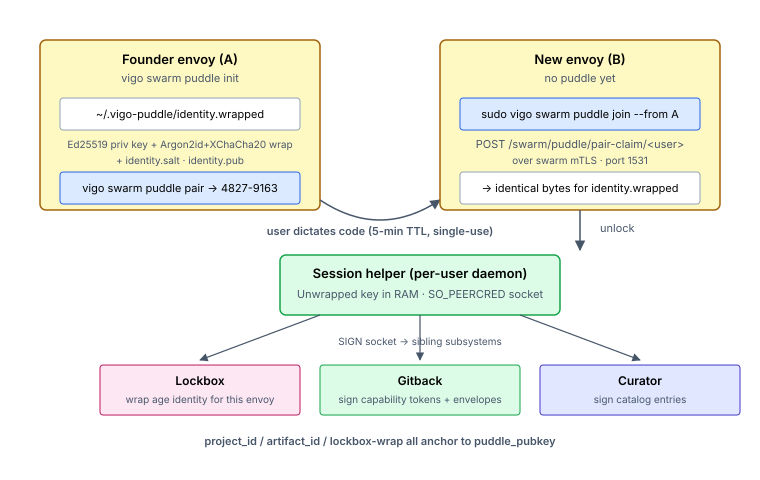
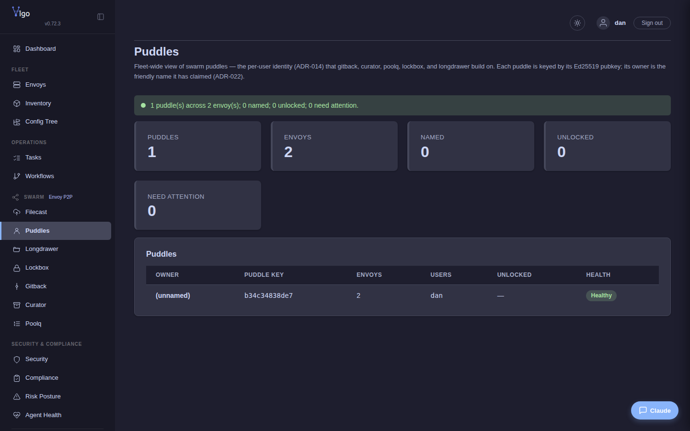

# Set up Puddle

You'll finish this page with a puddle (per-user Ed25519 identity) initialized on one envoy and propagated to every other envoy a given user touches — paired peer-to-peer with a 5-minute single-use code. Once puddle is in place, the per-user content subsystems ([lockbox](set-up-lockbox.md), [gitback](set-up-gitback.md)) bootstrap on top of it.

**When you'd use this:** before turning on lockbox or gitback for any user. Puddle is the substrate identity those subsystems consume.

**When you'd skip this:** users who only need admin-pushed content (filecast, curator) — those don't require puddle. The default-off setting on the usercrate `puddle:` field is fine for service accounts and human users who don't need per-user encrypted state.

A **puddle** is the per-user identity that ties together "this user's collection of envoys, treated as one trust unit." It's the prerequisite for lockbox (per-user encrypted directory) and gitback (puddle-keyed git repos) — both subsystems consume puddle membership to express who can read / write.

## Enable it

Puddle is per-user, not per-fleet. Grant a user the `puddle: true` flag in their usercrate:

```yaml
# /srv/vigo/stacks/stockpile/usercrates/dan.vgo
resources:
  - type: user
    username: dan
    home: /home/dan
    shell: /bin/bash
    puddle: true              # enables puddle + (as of 0.40.0) lockbox
    gitback: true             # opt-in for git-over-swarm too
    authorized_keys: |
      ssh-ed25519 AAAA... operator@laptop
```

Publish (`sudo vigocli config publish`); the next agent convergence creates the necessary directories and dependency-installs.

## Use it

On the user's first envoy (the **founder envoy**):

```bash
vigo swarm puddle init       # generate keypair, set passphrase
vigo swarm puddle status     # confirm
```

On every additional envoy where the user wants the same puddle identity:

```bash
# On the founder envoy:
vigo swarm puddle pair       # prints a 5-minute single-use code

# On the new envoy:
vigo swarm puddle join --from <founder-host>   # claims the pair code over swarm mTLS
vigo swarm puddle unlock                       # enter passphrase, bring the local session up
```

The puddle's full verb tree: `init,pair,join,rekey-pair,rekey,unlock,lock,pubkey,members,rotate-passphrase,status,name {set,clear,show}`. Day-to-day, the operator only touches `unlock` (every login) and `status` / `members` when curious.


## How it works



A puddle is a per-user Ed25519 keypair representing "this user's collection of envoys, treated as one trust unit." Without it, every per-user subsystem (lockbox, gitback) would have to re-do peer-pair ceremony per envoy. Puddle is that primitive: one keypair, multiple envoys, distributable peer-to-peer.

The puddle keypair is generated locally by `vigo swarm puddle init`. The private half is wrapped under the user's passphrase using Argon2id (64 MiB / 3 iter / 1 lane) + XChaCha20-Poly1305 with a fresh nonce — the same envelope lockbox uses for its identity keys. The wrapped blob is **portable** across envoys; every member envoy holds identical bytes for `~/.vigo-puddle/identity.wrapped`. The unwrapping passphrase is held only by the user.

### Membership

An envoy is a puddle member when these three files exist together:

- `~/.vigo-puddle/identity.wrapped` (mode 0600) — passphrase-wrapped private key
- `~/.vigo-puddle/identity.salt` (mode 0600) — Argon2id input
- `~/.vigo-puddle/identity.pub` (mode 0644) — `ed25519:<hex>` puddle pubkey

There is no central registry. Sibling subsystems (lockbox, gitback) detect "is user X puddle-enabled here?" by checking these files.

### Onboarding a new envoy — peer-pair (primary)

```
   founder envoy (A)              new envoy (B)
   ──────────────────             ─────────────────
   vigo swarm puddle pair
   → prints 8-char code           sudo vigo swarm puddle join --from A
   (5-min TTL, single-use)        → POST /swarm/puddle/pair-claim/<user>
                                    with {"code": "4827-9163"}
   (handler verifies code,
    returns wrapped blob)         (B writes blob + salt + pubkey to
                                   ~/.vigo-puddle/, prompts passphrase,
                                   verifies unwrap)
                                  vigo swarm puddle unlock   (no sudo)
```

The wrapped blob and salt cross the wire over swarm mTLS on port 1531. The **passphrase never leaves B**. The pairing code is the human-explicit authorization preventing any other CA-trusted peer from silently requesting the wrapped blob — same model as Signal / Bluetooth pairing.

Authorization is dual: (1) mTLS — the caller is some enrolled envoy in the same Vigo CA; (2) the pairing code — a 5-minute single-use shared secret the user just dictated.

`sudo` on `join` because the agent's mTLS key file (`tls.key`, mode 0600 root-owned) is needed for the outbound mTLS call. Other puddle verbs (`init`, `pair`, `unlock`, `lock`, etc.) stay in the user's home and don't need root.

### Onboarding via manual scp (air-gapped fallback)

For envoys with no swarm connectivity to any active puddle member:

```
[A]  scp ~/.vigo-puddle/identity.{wrapped,salt,pub}  usb:/path/
[B]  cp -r usb:/path/  ~/.vigo-puddle/
[B]  vigo swarm puddle unlock
```

The wrapped blob is opaque ciphertext on disk; the security boundary is passphrase wrapping, not the transport.

### Session helper

`unlock` reads the wrapped blob, prompts for the passphrase, unwraps to an Ed25519 signing key, then spawns a `setsid`-detached per-user daemon that holds the key in process memory and serves SIGN / STATUS / PUBKEY / LOCK over a SO_PEERCRED-gated Unix socket (Linux: `$XDG_RUNTIME_DIR/vigo/puddle.sock`; macOS: `$TMPDIR/lockbox-<UID>/puddle.sock`; both mode 0600).

The key never lives on disk in plaintext; the unwrapped bytes are passed through stdin to the helper and immediately zeroized in both ends.

Three independent triggers each scrub the key and exit:

- explicit `vigo swarm puddle lock`,
- parent shell PID disappears (10s polling watchdog),
- idle timeout (default 24 hours; resets on every SIGN / STATUS; override per-unlock with `--idle-mins <N>`).

### Friendly names (ADR-022)

`gitback://<project_id>/<repo>` is self-certifying but unmemorable. A **name claim** binds a human name to a puddle pubkey so `gitback://<name>/<repo>` resolves. `vigo swarm puddle name set <name>` (requires unlocked puddle) writes a signed `~/.vigo-puddle/name-claim.json` blob; the `gitback` trait collector reports it; `server/swarm/gitbackmesh/` joins claims fleet-wide; agents cache the resulting map at `/var/lib/vigo/swarm/puddle/names.json` (refreshed startup + 15min, off the check-in hot path).

**First-come, cooperatively enforced; ambiguous on collision.** `name set` refuses a name another puddle holds in the agent's current view; it can't beat the propagation window. Two unrelated claims for the same name → resolvers error and require the hex form. No automatic tiebreaker. **A name is a hint, not a trust anchor**; the unforgeable form is always `gitback://<project_id>/<repo>`.

### State files

User-side, all under `~/.vigo-puddle/` (mode 0700, owned by the user):

| File | Mode | Purpose |
|---|---|---|
| `identity.wrapped` | 0600 | Ed25519 private key, passphrase-wrapped. Portable across envoys. |
| `identity.salt` | 0600 | 16 random bytes, Argon2id input. Portable across envoys. |
| `identity.pub` | 0644 | `ed25519:<hex>` puddle pubkey, public; sibling subsystems read this. |
| `pair.pending` | 0600 | Active pairing-code session. Removed on first claim or TTL expiry. |
| `rekey.pending` | 0600 | Active rekey-claim session (same shape as `pair.pending`). |
| `retired_puddles.json` | 0600 | Rotation log (ADR-018). |
| `session.unlocked` | 0600 | Session-helper PID; siblings probe this + `pid_alive` to detect lock state. |
| `name-claim.json` | 0644 | Signed friendly-name claim (ADR-022). Public-by-construction. |

Daemon-side cache (server-host-only): `/var/lib/vigo/swarm/puddle/names.json` — the fleet friendly-name map.

### Failure modes and limits

- **Passphrase forgotten.** No recovery in v1. Re-init creates a new puddle (different pubkey); existing gitback project tokens and lockbox recipients become orphaned. `vigo swarm puddle status` surfaces the recovery instructions.
- **All wrapped key copies lost across all envoys.** Same as passphrase forgotten — re-init from scratch.
- **Single envoy compromised** (attacker has the wrapped blob *and* the passphrase). System-level disk encryption is strongly recommended; the session-helper idle timeout limits exposure for in-memory key material.
- **Pair-claim code brute force.** 100M code space (`NNNN-NNNN`) + 5-min TTL + single-use + mTLS-only callers. Every probe is forensically attributable; brute force is infeasible.

Phase 1 deliberately defers: multi-puddle per user (one puddle per user for now), Shamir / quorum / escrow recovery (none — passphrase loss is total), and cross-envoy gossip of puddle membership (`members` shows only the local view).

### Where to look when it doesn't work

- **`vigo swarm puddle status`** — `init` / `unlock` / `pair-pending` / `rekey` state; recovery hints.
- **`session.unlocked` sentinel** — if absent, the session helper is down; sibling subsystems (lockbox, gitback signing) won't work.
- **Agent logs** carry WARN lines for pair-claim mismatch, signature failures, and helper crashes.
- **ADRs** for the design rationale: [ADR-014](../../adr/014-puddle-primitive.md) (the primitive), [ADR-015](../../adr/015-unified-gitback-substrate.md) (gitback on puddle), [ADR-016](../../adr/016-lockbox-membership-on-puddle.md) (lockbox on puddle), [ADR-017](../../adr/017-no-puddle-level-revoke.md) (no puddle-level revoke), [ADR-018](../../adr/018-puddle-rekey.md) (rekey), [ADR-022](../../adr/022-gitback-friendly-names.md) (friendly names).

## See it fleet-wide

The web UI's **Puddles** page (`/swarm/puddle`) rolls every puddle up across the fleet — owner (friendly name, or `(unnamed)`), short pubkey, how many envoys carry it, which Unix users it belongs to, whether a session is unlocked, and a health badge. It's the single read-only source of truth for "who has a puddle, where, and is it healthy" — the substrate that lockbox, gitback, curator, and poolq all build on.



Health is `Healthy` / `Warning` / `Degraded`; a puddle whose envoys disagree on membership or whose key copies have drifted shows up here before its dependent subsystems start failing.

## What's next

- **Turn on the per-user content subsystems** → [Set up Lockbox](set-up-lockbox.md), [Set up Gitback](set-up-gitback.md).
- **You forgot the passphrase** → re-init from scratch (puddle has no recovery in v1); existing lockbox recipients and gitback project tokens for the old puddle pubkey become orphans.
- **A `pair` / `join` is failing** → [Troubleshoot common issues](../operate/troubleshoot.md).

---
*Verified on Vigo 0.51.6 · 2026-05-13.*

*Confidential — Alexander4, LLC. Not for redistribution. See [../legal/license.md](../../legal/license.md).*
