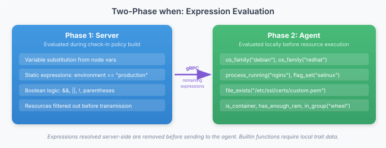

# Writing configcrates

This is the canonical reference for operators authoring Vigo configcrates. It covers the YAML format, every resource type, the conditional language, the templating engine, the composition primitives (roles, hostcrates, common.vgo, usercrates, environments.vgo), lookups, retraction, and stream-edit pipelines. If you're new, work through the [Quickstart](../quickstart.md) and [Write your first configcrate](../howto/configcrates/write-your-first-configcrate.md) first; come back here when you need the full surface.

---
## Config Format

All Vigo configuration lives in YAML files with the `.vgo` extension under `stacks/`. The server reloads config when `vigocli config publish` syncs files to `.live/`.

## Directory Structure

The config directory doubles as a envoy hierarchy. Subdirectories define inheritance — `common.vgo` at any level defines configcrates, roles, and vars inherited by all entries in subdirectories below it.

```
stacks/
├── configcrates/                     # Configcrate definitions (unchanged)
│   ├── nginx.vgo
│   ├── postgres.vgo
│   ├── compliance.vgo           # Configcrate-tree: fleet-wide claims inherited by every configcrate
│   ├── monitoring.vgo
│   └── users/
│       ├── compliance.vgo       # Configcrate-tree: claims inherited by configcrates/users/*.vgo
│       └── dan.vgo
├── templates/                   # Template files for source: references
├── roles.vgo                    # All role definitions in one file
├── common.vgo                   # Configcrates/roles/vars inherited by ALL subdirs
├── compliance.vgo               # Envoys-tree: compliance waivers (optional, inherits like common.vgo)
├── production/
│   ├── common.vgo               # Inherited by all production subdirs
│   └── web/
│       └── web.vgo              # Leaf entry: match: "web*.prod.example.com"
└── staging/
    └── staging.vgo              # Leaf entry: match: "*.staging.example.com"
```

**Key conventions:**
- `common.vgo` at any directory level = inheritance definition (no `match:`). Applies only to subdirectories.
- `compliance.vgo` at any directory level = compliance configuration. **Location determines semantics:** files in the envoys tree (outside `configcrates/`) contribute waivers; files in the configcrates tree contribute per-configcrate compliance claims inherited by every configcrate in the same subtree. See [Compliance Waivers + Claims](#compliance-waivers--claims) below and the [Lookup Tables concept](#lookups) for per-envoy resource variation.
- Any other `.vgo` file outside `configcrates/` = leaf entry with `match:` patterns mapping hostnames to configcrates.
- `roles.vgo` at root = single file containing all role definitions.
- `configcrates/` holds a flat library of configcrate definitions. **One exception:** `compliance.vgo` files under `configcrates/` are not configcrate definitions — they are directory-level compliance claim declarations (see below). The loader recognizes the filename and routes it through a separate walker; you can drop a `compliance.vgo` at any depth under `configcrates/` without the file being mistaken for a configcrate. Every other `.vgo` file under `configcrates/` is treated as a configcrate definition and must have `name:` and `resources:` fields.
- `templates/` = unchanged (templates are referenced by explicit `source:` path from within configcrates).

### Why `compliance.vgo` under `configcrates/` is a special case

Vigo's configcrate loader walks every `.vgo` file under `configcrates/` and parses it as a configcrate definition. A configcrate needs a `name:` field and (usually) a `resources:` block. A directory-level compliance claim declaration has neither — it only holds `compliance:` and optionally `waivers:` — so if the loader tried to parse it as a configcrate it would reject the file with "missing required name field" or "configcrate has no resources".

Rather than force operators to put compliance claim files in a sibling directory (which would break the "claims live next to the configcrates they apply to" ergonomics we wanted), the loader knows that any file literally named `compliance.vgo` under `configcrates/` is skipped by the configcrate walker and picked up by a separate directory-level walker that unions its claims into every configcrate in the same subtree. Publish-time lint knows about the same exception — it won't run modlint against `compliance.vgo` files — and so does the secret-scanner.

This is the only file-name special case in the configcrate library today. If you ever introduce a `compliance.vgo` under `configcrates/` and see a lint error about missing `name:` or empty `resources:`, it means you're running against a vigo build older than 0.21.3 and need to rebuild. No other file name under `configcrates/` gets this treatment — everything else is parsed as a configcrate.

The legacy layout with `envoys/`, `roles/`, and `vars/` directories is still supported for backward compatibility.

## Configcrates

A configcrate is a reusable set of resources. It defines packages to install, files to manage, services to run, etc.

```yaml
name: nginx

vars:
  nginx_port: 80
  worker_connections: 1024

resources:
  - name: nginx-package
    type: package
    package: nginx

  - name: nginx-config
    type: file
    target_path: /etc/nginx/nginx.conf
    content: |
      worker_connections {{ .Vars.worker_connections }};
    depends_on: [nginx-package]
    notify: [restart-nginx]
  - name: nginx-service
    type: service
    service: nginx
    state: running
    enabled: true
    depends_on: [nginx-package]

  - name: restart-nginx
    type: service
    service: nginx
    state: restarted
    when: "changed"
```

### Configcrate Fields

| Field | Required | Description |
|-------|----------|-------------|
| `name` | yes | Unique configcrate name |
| `vars` | no | Default variable values (overridden by envoy-level vars) |
| `defaults` | no | Default attributes applied to all resources in this configcrate |
| `depends_on` | no | Other configcrates this configcrate depends on (configcrate-level ordering) |
| `before` | no | Configcrates that must run after this configcrate |
| `resources` | yes | List of resources to manage |
| `compliance` | no | Per-configcrate compliance attribution block — two sub-keys, both routed through Vigo-curated catalogs (see [Compliance authoring](#compliance-authoring) below): `compliance.provides:` (functional capability tags) and `compliance.bundle:` (framework-scope-cut tags). |

> **Shape history.** Pre-0.66.48 `compliance:` carried inline framework→control lists; that shape was retired when the catalogs landed. 0.66.48-through-0.66.56 parked the replacement keys at top level (`provides:` / `bundle:`). 0.66.57 re-folded them under a `compliance:` parent block — same catalog semantics, but the at-a-glance compliance signal is restored in configcrate YAML. Modlint hard-errors on both retired shapes with migration pointers (`configcrate-compliance-key-retired` for the framework→control shape; `configcrate-top-level-provides-bundle` for the 0.66.48 top-level keys). Directory-level `compliance.vgo` files keep the framework→control shape — that's a different file kind (inheritance, not configcrate attribution).

### Compliance authoring

The `compliance:` block carries two parallel catalog-backed lists. Each tag in either list is resolved through a Vigo-curated catalog into the (framework → control IDs) it satisfies, and the loader unions the results into the configcrate's effective coverage.

- **`compliance.provides:`** — functional capability tags. The configcrate ships a chrony daemon ⇒ `compliance: { provides: [time-sync] }`. The catalog (`server/compliance/provisions.go`) maps each tag to controls it satisfies across multiple frameworks; the configcrate doesn't care which frameworks. Use this for cross-framework functional claims.
- **`compliance.bundle:`** — framework-scope-cut tags. The configcrate exists to implement CIS-Ubuntu §5 access controls ⇒ `compliance: { bundle: [cis-ubuntu-access] }`. The catalog (`server/compliance/bundles.go`) carries the framework's published cross-walks for that scope. Use this when the configcrate is authored against a specific framework section.

A configcrate may declare both:

```yaml
name: openssh
compliance:
  provides: [ssh-hardening]
  bundle:   [cis-ubuntu-access]
resources:
  - name: install-sshd
    type: package
    package: openssh-server
    state: present
```

Minimal `provides:`-only example:

```yaml
name: chrony
compliance:
  provides: [time-sync]
resources:
  - name: install-chrony
    type: package
    package: chrony
    state: present
```

That `compliance.provides: [time-sync]` is equivalent to the hand-rolled framework→control block this configcrate used to carry — `cis-ubuntu [2.1.1.1, 2.1.1.2]`, `cis-rhel [2.1.1.1, 2.1.1.2]`, `iso-27001 [A.12.4.4]`, `nist-800-53 [AU-8]`, `pci-dss [10.6.1, 10.6.2, 10.6.3]` — captured once in the catalog instead of repeated in every time-sync configcrate.

Minimal `bundle:`-only example:

```yaml
name: cis-ubuntu-access
compliance:
  bundle: [cis-ubuntu-access]
resources:
  - name: pam-faillock
    type: file
    target_path: /etc/pam.d/common-auth-faillock
    ...
```

Operator surface:

- `vigocli compliance provisions` — list provisions (`--show <name>` for one tag's full framework → controls).
- `vigocli compliance bundles` — list bundles (`--show <name>` for one tag's full framework → controls).
- `vigocli config trace <hostname>` — per-control source attribution. Each row carries `(via <provision>)` or `(via bundle:<id>)` so an audit reviewer can walk every claim back to its catalog entry.

Unknown tags in either field are caught at configcrate load (modlint Error with did-you-mean suggestion) and contribute nothing to coverage. Extending either catalog is a code change — propose a PR with the new tag + its framework cross-walks.

## Roles

A role is a named list of configcrates. Roles provide a layer of abstraction — assign a role to an envoy instead of listing individual configcrates.

```yaml
name: webserver
configcrates:
  - nginx
  - logrotate
  - name: monitoring
    when: "!is_container"
```

Configcrates in a role can be plain strings or objects with a `when:` expression for conditional inclusion.

A configcrate object can also carry `foreach:` (a list var) and, for a list of maps, `key:` (the item field naming each instance) — the configcrate is instantiated once per list item as `<configcrate>[<key>]`, with each item's fields available inside as `{{ .Each.<field> }}`. This works wherever a configcrate reference appears (role `configcrates:`/`case:`, `common.vgo`, `environments.vgo`, a match block). See [Configcrate-level `foreach:`](#configcrate-level-foreach--stamp-out-a-configcrate-per-item).

### Role-Level When

A role definition can have its own `when:` expression. All configcrates in the role inherit the condition unless they have their own:

```yaml
- name: cis-ubuntu
  when: "distro('ubuntu')"
  configcrates: [cis-ubuntu-access, cis-ubuntu-network, cis-ubuntu-logging]
```

### Conditional Case

For roles that need different configcrates per OS or platform, use `case:`. Each branch has a `when:` and its own configcrate list. All matching cases contribute configcrates:

```yaml
- name: remote-access
  case:
    - when: "os_family('linux')"
      configcrates: [x11vnc, xrdp]
    - when: "os_family('windows')"
      configcrates: [tightvnc]
```

A role can have unconditional `configcrates:` and `case:` together — the unconditional configcrates always apply, cases apply conditionally:

```yaml
- name: monitoring
  configcrates: [node-exporter]        # always applied
  case:
    - when: "os_family('linux')"
      configcrates: [collectd]
    - when: "os_family('windows')"
      configcrates: [windows-exporter]
```

### Conditional Role References

Role references in match blocks support the same scalar-or-object syntax. Use this to apply different roles based on OS or other traits:

```yaml
envoys:
  - match: "*.example.com"
    roles:
      - name: cis-ubuntu
        when: "distro('ubuntu')"
      - name: cis-rhel
        when: "distro('rhel') || distro('centos') || distro('rocky')"
      - name: cis-windows
        when: "os_family('windows')"
```

When a role ref has a `when:` condition, all configcrates from that role inherit the condition (unless the configcrate already has its own `when:`, which takes precedence). This lets you write one match block that works across your entire fleet.

### When Inheritance

When expressions are inherited with most-specific-wins precedence:

1. Configcrate's own `when:` (highest priority)
2. Case `when:`
3. Role definition `when:`
4. Role ref `when:` (at the match block level)

### Role Includes

Roles can include other roles using `includes:` to compose shared configcrate sets:

```yaml
name: webserver
includes:
  - base-security
configcrates:
  - nginx
  - logrotate
```

Included role configcrates are prepended before the role's own configcrates. Includes are **single level only** — an included role cannot itself have `includes:`. Duplicate configcrates across includes and the role's own list are automatically deduplicated (first occurrence wins).

## Hostcrate (envoys.vgo)

The `envoys.vgo` file maps envoy hostnames to roles and configcrates. **First match wins** — the server tries each entry in order and uses the first one whose `match` glob matches the envoy's hostname.

```yaml
envoys:
  - match: "web*.prod.example.com"
    environment: production
    roles: [webserver]
    tags: [webserver, production]
    vars:
      nginx_port: 443

  - match: "web*.staging.example.com"
    environment: staging
    roles: [webserver]
    tags: [webserver, staging]
    vars:
      nginx_port: 8080

  - match: "db*.example.com"
    roles: [database]
    tags: [database]
    configcrates: [monitoring]

  - match: "*"
    configcrates: [base, monitoring]
```

### Node Entry Fields

| Field | Required | Description |
|-------|----------|-------------|
| `match` | yes | Hostname glob pattern (e.g., `web*.example.com`, `*`) |
| `environment` | no | Environment name used to select the matching block in `environments.vgo` |
| `roles` | no | List of role names to assign |
| `configcrates` | no | Additional configcrates (beyond those from roles) |
| `usercrates` | no | Positive include of usercrates (e.g., `[alice, dan]`); usercrates are inert until listed |
| `vars` | no | Variable overrides (override configcrate defaults and inherited `common.vgo` vars) |
| `exclude_configcrates` | no | Opt out of specific inherited configcrates (e.g., `[monitoring]`) |
| `tags` | no | Static tags for targeting — referenced by `vigocli` as `tag:<name>` and by [lookup tables](#lookups) in resource attributes |

### Tags

Tags are labels attached to envoys at config-resolution time. They are the single source of truth for envoy classification — **the hostcrate is the only writer**. There is no admin API to set tags out of band; editing this file and publishing is the only way to tag an envoy.

Tags are synced into the in-memory fleet index on every check-in. Once synced, they are available to:

- Admin targeting (`vigocli task ... --target tag:webserver`, `vigocli query ... --target tag:database`)
- Per-envoy field variation in resource attributes via [lookup tables](#lookups)

Because the hostcrate is the only writer, tagging is deterministic and reproducible. A fresh server restart rebuilds tags by matching envoy hostnames against the current hostcrate — no DB state to drift from config.

## Directory Inheritance

Instead of listing every configcrate on every envoy entry, define shared configcrates in `common.vgo` files at directory levels. Everything in subdirectories inherits automatically.

```yaml
# common.vgo (at root) — all subdirs get these
configcrates: [sshd, ntp, monitoring]
vars:
  dns_server: "1.1.1.1"
```

```yaml
# production/common.vgo — production subdirs also get these
configcrates: [log-shipping, auditd]
vars:
  log_level: warn
```

```yaml
# production/web/web.vgo — leaf entry
envoys:
  - match: "web*.prod.example.com"
    configcrates: [nginx, certbot]
    vars:
      nginx_port: 443
```

Result for `web01.prod.example.com`: configcrates `sshd, ntp, monitoring, log-shipping, auditd, nginx, certbot` with vars `dns_server=1.1.1.1, log_level=warn, nginx_port=443`.

**Rules:**
- Parent configcrates come **before** child configcrates in the DAG (foundation first).
- Child vars **override** parent vars of the same name.
- `exclude_configcrates:` on a leaf entry removes specific inherited configcrates:
  ```yaml
  envoys:
    - match: "docker*.example.com"
      configcrates: [docker]
      exclude_configcrates: [ntp]  # containers use host clock
  ```
- Root-level `common.vgo` applies only to subdirectories — leaf entries at the root level are self-contained.
- Use `vigocli config trace <hostname>` to see the full inheritance chain for a specific host.
- Use `vigocli config tree` to see the entire directory hierarchy at a glance.
- Use `vigocli config search --configcrate <name>` to find which entries use a specific configcrate.

## Usercrates

Usercrates are per-user configcrates (user account + home-dir config + dotfiles, typically) that live in a dedicated `stacks/**/usercrates/` directory class. As of 0.54.0, **a usercrate is inert until it is positively included** by a carrier's `usercrates:` field — exactly like a regular configcrate. The directory is a library, not an auto-apply zone. See the [Glossary](../glossary.md#usercrate) for why the kind is distinct from a regular configcrate.

```
stacks/
  usercrates/
    admin.vgo              # defined here; inert until included
  customerA/
    envoys.vgo             # hostcrate for customerA envoys
    usercrates/
      alice.vgo            # defined here; inert until included
  common.vgo               # could include [admin, alice] for everyone under it
```

### Positive include — four sites

`usercrates:` is a positive include list. It lives on the same four carriers `configcrates:` lives on:

| Carrier | YAML location | Scope |
|---|---|---|
| Match block | `envoys.vgo` | Single envoy |
| `common.vgo` | Any directory | Every envoy at this dir and below |
| `environments.vgo` per-env block | Any directory | Every envoy of that environment in scope |
| Role | `stacks/roles.vgo` | Every envoy that assigns the role |

```yaml
# envoys.vgo — include directly on a match block
envoys:
  - match: "plex"
    usercrates: [admin, dan]
```

```yaml
# common.vgo — fleet-wide or subtree default
usercrates: [anja, ann, dan, elena]
```

```yaml
# stacks/roles.vgo — bundle usercrates with a role
roles:
  - name: ops
    configcrates: [sshd, ntp]
    usercrates: [admin, oncall]
```

### Shape rule — exactly one `type: user` resource

A usercrate file must declare **exactly one** `type: user` resource. Additional non-user resources (a `file` for `authorized_keys` or dotfiles, an `exec` for post-create setup) are permitted. A file with zero or multiple `user` resources fails to load with: `usercrate must declare exactly one type: user resource — found N. Move it to configcrates/ or restructure.`

### Cross-kind validation

`configcrates:` and `usercrates:` reference disjoint sets:

- A `configcrates:` entry that names a usercrate fails to load with: `configcrates: references "alice" — that name is a usercrate defined at usercrates/alice.vgo; use \`usercrates:\` instead of \`configcrates:\``.
- A `usercrates:` entry that names a regular configcrate fails to load with the mirrored error.

This is enforced at every reference site (envoy own, common.vgo chain, role expansion, role-include expansion, per-env override). All mismatches are surfaced in one publish attempt so operators can fix the whole stack in one pass.

### Name namespace

Usercrates and regular configcrates share one namespace — the `name:` field in a usercrate must be globally unique across all configcrates and usercrates. Load-time collision is a fatal error with both source paths reported. The cross-kind validation above ensures each reference site can only land on the right kind.

The `name:` field is optional; when omitted, it defaults to the filename stem (`dan.vgo` → `dan`).

### Unreferenced-usercrate warning

If a usercrate is defined in `stacks/**/usercrates/` but no carrier includes it, the loader emits a publish-time warning: `unreferenced usercrates — defined under stacks/**/usercrates/ but not included by any envoy count=N names=[...]`. Either include it (positive `usercrates:` somewhere) or move/delete the file.

### Migration from <0.54.0

The pre-0.54.0 auto-apply rule and the `exclude_usercrates:` opt-out field are removed. A hostcrate, common.vgo, or environments.vgo containing `exclude_usercrates:` on an envoy entry fails to load with: ``exclude_usercrates:` was removed in 0.54.0 — usercrates are now inert until positively included via `usercrates:` (see docs/reference/configcrate-language.md)``. To migrate: delete the field and add a positive `usercrates:` list to each carrier (hostcrate, common.vgo, role, or environments.vgo) that should pick up the usercrates that used to auto-apply.

### User management specifically

See [User management — why usercrates exist](#user-management--why-usercrates-exist) for why user accounts specifically benefit from the usercrate pattern — `user` executor complexity, per-person audit trail, two-phase retirement.

## Compliance Waivers + Claims

Compliance claims and waivers use **distinct filenames in distinct trees** — filename-per-tree, enforced fatally at publish and load since 0.29.1.

| Filename | Tree | Top-level key | What it does |
|---|---|---|---|
| `compliance.vgo` | `stacks/` | `compliance:` | Per-configcrate compliance claims. Claims are unioned into every configcrate and usercrate in the same subtree. |
| `waivers.vgo` | `stacks/` | `waivers:` | Per-envoy compliance exceptions. Waivers follow the same inheritance pattern as `common.vgo` — root applies fleet-wide, subdirs apply only to their subtree. |

**Mixed keys are a hard error.** A `waivers:` block inside `stacks/compliance.vgo`, or a `compliance:` block inside `stacks/waivers.vgo` — both rejected by `vigocli config publish` with an actionable move hint, and rejected on reload if someone hand-edits `.live/`.

**Claims** from a `stacks/**/compliance.vgo` are unioned into every configcrate defined anywhere beneath that file. A usercrate at `stacks/usercrates/dan.vgo` inherits claims from `stacks/usercrates/compliance.vgo` AND from `stacks/compliance.vgo` if both exist, plus whatever the usercrate itself declares in its own inline `compliance:` block. All sources union with dedupe.

**Waivers** apply only to envoys whose hostcrate lives under the same directory subtree. `stacks/customerA/waivers.vgo` waivers don't cross into `stacks/customerB/`. Waived controls count as "accepted" in compliance scoring and render with a distinct "waived" badge on dashboards — not hidden.

```yaml
# stacks/compliance.vgo — claims only
compliance:
  cis: ["1.1.1"]
  nist-800-53: ["AC-1", "CM-1"]
```

```yaml
# stacks/usercrates/compliance.vgo — claims scoped to usercrates
compliance:
  cis: ["5.4.1"]
  nist-800-53: ["AC-3", "AC-6", "AC-6(1)", "IA-2", "IA-5"]
  pci-dss: ["8.1.1", "8.1.2", "8.1.4"]
  soc2: ["CC6.1", "CC6.2", "CC6.3"]
  hipaa: ["164.312(a)(1)", "164.312(a)(2)(i)", "164.312(d)"]
```

```yaml
# stacks/waivers.vgo — fleet-wide waivers
waivers:
  cis-ubuntu:
    - control: "6.1.10"
      reason: "Build artifacts require world-writable tmp"
      approved_by: dan
      expires: 2027-01-01

    - control: "6.2.5"
      reason: "Home directories managed by LDAP"
      approved_by: dan
```

**Waiver fields:**
- `control` — control ID matching the compliance tag in the configcrate (required)
- `reason` — justification (required)
- `approved_by` — who approved (required)
- `expires` — optional expiration date (YYYY-MM-DD). Expired waivers are automatically excluded.

### Why compliance.vgo is a special filename under stacks/configcrates/

The configcrate loader walks every `.vgo` file under `stacks/configcrates/` and parses it as a configcrate definition (requires `name:` and `resources:`). `compliance.vgo` has neither — it's a directory-level claim declaration with a `compliance:` block only. The loader and the publish-time linter both key off the literal filename `compliance.vgo` under `stacks/` and route it to a separate claim-inheritance walker instead of the configcrate parser. This is the only named exception in the configcrate library.

### Rationale for the filename split

Earlier versions (0.21.x through 0.29.0) used the same filename `compliance.vgo` in both trees, with location determining which block was active. Operators had to remember which tree needed which key, and mis-placement produced only a logged warning. 0.29.1 made two changes that tighten this up:

1. **Distinct filenames** — `compliance.vgo` for claims, `waivers.vgo` for waivers. The filename is now self-documenting.
2. **Fatal validation** — misplaced files or mis-keyed contents block publish and reload with an exact remediation hint (including the correct destination path).

The only valid top-level keys in either file are `compliance:` and `waivers:`. Any other top-level key is a parse error.

### Migration from pre-0.29 layouts

Existing deployments migrate automatically on first boot via `entrypoint.sh`:

- `/srv/vigo/stacks/` → `/srv/vigo/stacks/` (if old layout exists)
- `stacks/configcrates/` → `stacks/configcrates/`
- `stacks/.live/` → `.live/`
- `stacks/envoys.vgo`, `stacks/roles.vgo`, `stacks/common.vgo` → `stacks/`
- `stacks/compliance.vgo` containing a `waivers:` block → `stacks/waivers.vgo` (waivers side)

The migration is idempotent — safe to re-run after upgrades.

## Variable Resolution

Variables are resolved in three layers (last wins):

```
Configcrate vars (defaults)
    ↓ overridden by
Inherited common.vgo vars (parent → child)
    ↓ overridden by
Match-block vars
    ↓ overridden by
environments.vgo vars (for the match block's environment:)
```

Tag-keyed and platform-keyed lookup tables inside configcrate fields then resolve final field values based on the envoy's tags and traits. See [Lookup Tables](#lookups) for the per-trait/per-tag variation mechanism.

For environment-specific values, use `environments.vgo` at the appropriate directory level — not per-match-block overrides. See [Multi-Axis Config](#multi-axis-config) for the canonical model and why earlier mechanisms (`environment_overrides:`, `vars_from:`, conditional vars) were removed in 0.27.0.

## Resource Format

Every resource has these common fields:

| Field | Required | Description |
|-------|----------|-------------|
| `name` | yes | Unique name within the configcrate |
| `type` | yes | Executor type (file, package, service, etc.) |
| `state` | no | Target state, usually `present` (default) or `absent` |
| `when` | no | Conditional expression — skip if false |
| `depends_on` | no | Resources that must succeed before this one |
| `before` | no | Resources that must run after this one |
| `notify` | no | Resources (or configcrates) to trigger when this one changes |
| `subscribes` | no | Resources (or configcrates) to watch — re-apply self when they change |
| `watch_secret` | no | Secret paths to watch — re-apply when rotated |

Plus type-specific attributes (see [Executors](../reference/vigo/resources/_index.md)).

## Auto-Comments (`#~`)

When you run `vigocli config publish`, the configcrate linter formats your **source** crates in place: it adds/refreshes `#~`-prefixed standard labels (one per module, one per resource) **while preserving everything else you wrote** — your `#` comments, formatting, and content. Separately, the copy of each configcrate/usercrate synced to `.live/` (what the server reads) is **stripped of all comments**, since the server ignores them. So your source stays human-readable; `.live/` stays clean. (Scaffolding files — `envoys.vgo`, `roles.vgo`, `waivers.vgo`, `environments.vgo` — keep their comments in `.live/`; harmless, since the server ignores `.live/` comments either way.)

```yaml
#~ Manages package, file, service
name: nginx

resources:
  #~ Install nginx package
  - name: nginx-package
    type: package
    package: nginx

  #~ Deploy /etc/nginx/sites-available/default
  - name: nginx-config
    type: file
    target_path: /etc/nginx/sites-available/default
    content: |
      server {
          listen {{ .Vars.nginx_port }};
      }
    owner: root
    group: root
    mode: "0644"
    notify: [nginx-service]

  # Custom note: we use reloaded here because nginx supports graceful reload
  #~ Reload nginx on dependency change
  - name: nginx-service
    type: service
    service: nginx
    state: reloaded
    when: changed
    subscribes: [nginx-config]
```

**Rules:**
- `#~` comments are auto-generated — they're refreshed in place on every publish. Don't edit them; your text is overwritten.
- `#` comments (no tilde) are **yours and are never touched** in source. Use them for your own notes. This includes **commented-out attributes** like `#owner: 0644` — Vigo treats those as operator information, not disposable comments, and leaves them exactly where you put them.
- `#` characters inside `content:` blocks and `files/` are file **data** — never touched, in source or `.live/`.
- In `.live/` (server-facing), both `#~` labels and your `#` comments are stripped from configcrates and usercrates; only the config and content remain. (Scaffolding files keep their comments in `.live/` — the server ignores them regardless.)
- The linter also repairs YAML issues (tabs, unquoted booleans) and normalizes key ordering. See [Config Publish Pipeline](../howto/configcrates/publish-config.md#configcrate-linter) for details.

## Config Reload

After `vigocli config publish` syncs files to `.live/`, it calls the server's reload endpoint. The server:
1. Re-parses the entire config tree
2. Rebuilds configcrate definitions, role definitions, and match blocks
3. The next agent check-in gets the updated config

No server restart needed. Config parse errors are logged and trigger an SMTP notification if configured.


---
## Resource Language

Beyond basic resource definitions, Vigo supports several advanced config patterns for reducing repetition and expressing complex desired state.

## defaults

Apply default attributes to all resources in a configcrate:

```yaml
name: web-configs
defaults:
  owner: www-data
  group: www-data
  mode: "0644"

resources:
  - name: index-html
    type: file
    target_path: /var/www/html/index.html
    content: "<h1>Hello</h1>"
    # owner, group, mode inherited from defaults

  - name: error-page
    type: file
    target_path: /var/www/html/error.html
    content: "<h1>Error</h1>"
    # also inherits defaults
```

Resources can override defaults by specifying the attribute explicitly.

## foreach

Iterate over a variable to create multiple resources from a single definition:

```yaml
name: user-management

vars:
  users:
    - name: alice
      shell: /bin/bash
    - name: bob
      shell: /bin/zsh

resources:
  - name: "user-{{ .Item.name }}"
    type: user
    username: "{{ .Item.name }}"
    shell: "{{ .Item.shell }}"
    state: present
    foreach: users
```

This expands at config load time into:

```yaml
resources:
  - name: user-alice
    type: user
    username: alice
    shell: /bin/bash
  - name: user-bob
    type: user
    username: bob
    shell: /bin/zsh
```

The `foreach` field references a variable that must be a list. For string lists, each value is available as `{{ .Item }}`. For list-of-maps, access fields with `{{ .Each.key }}` (or `{{ .Item.key }}`):

```yaml
# Firewall rules from a list of maps
vars:
  extra_allow: []   # override in common.vgo

resources:
  - name: "allow-{{ .Each.name }}"
    type: firewall
    foreach: extra_allow
    port: "{{ .Each.port }}"
    proto: "{{ .Each.proto }}"
    action: allow
    comment: "{{ .Each.comment }}"
```

```yaml
# common.vgo — operators configure here
vars:
  extra_allow:
    - name: https
      port: "443"
      proto: tcp
      comment: HTTPS
    - name: app
      port: "8080"
      proto: tcp
      comment: App server
```

Empty lists produce zero resources — canonical configcrates stay untouched.

To instantiate a *whole configcrate* per item (not just one resource), put `foreach:` on the configcrate reference instead — see [Configcrate-level `foreach:`](#configcrate-level-foreach--stamp-out-a-configcrate-per-item).

### Configcrate-level `foreach:` — Stamp Out a Configcrate Per Item

**Problem:** A "vhost" isn't one resource — it's a docroot directory *plus* a config file *plus* a logrotate stanza *plus* a service reload. You have 8 of them, each with a different `server_name` and a couple of per-vhost knobs. Resource-level `foreach:` (Layer 4) only multiplies *one* resource at a time; you want to multiply the whole bundle.

**Solution:** Write the bundle once as a configcrate, then reference it with `foreach:` — the configcrate is instantiated once per item in a list var. Each item's fields are available throughout the configcrate's resources as `{{ .Each.<field> }}` (or `{{ .Item }}` for a list of scalars).

```yaml
# configcrates/vhost.vgo — the "vhost type", written once
name: vhost
vars:
  doc_root_base: "/var/www"
resources:
  - name: vhost-docroot
    type: directory
    target_path: "{{ .Vars.doc_root_base }}/{{ .Each.server_name }}"
    owner: www-data
    mode: "0755"
  - name: vhost-conf
    type: file
    target_path: "/etc/nginx/sites-enabled/{{ .Each.server_name }}.conf"
    source: templates/nginx-vhost.tmpl     # the template sees .Each, .Vars, .Traits
    depends_on: [vhost-docroot]
    notify: [nginx-reload]                 # a resource in the (singleton) nginx configcrate
  - name: vhost-logrotate
    type: file
    target_path: "/etc/logrotate.d/nginx-{{ .Each.server_name }}"
    content: |
      /var/log/nginx/{{ .Each.server_name }}.access.log { weekly rotate 8 compress }
```

```yaml
# roles/webserver.vgo — reference the configcrate with foreach: + key:
name: webserver
configcrates:
  - nginx                       # singleton: package + service (defines nginx-reload)
  - name: vhost
    foreach: vhosts             # the var list to iterate
    key: server_name            # which item field names each instance
  - firewall-web
```

```yaml
# environments.vgo (or a common.vgo, or the match block) — the data
env:
  production:
    vars:
      vhosts:
        - server_name: www.example.com
        - server_name: shop.example.com
```

On a production web host this expands to configcrate instances **`vhost[www.example.com]`** and **`vhost[shop.example.com]`**, each carrying its three resources with `{{ .Each.server_name }}` baked in. The configcrate is written once; every host's set of vhosts is pure data, and it can live at whatever layer fits — a `common.vgo` for "every host in this subtree", `environments.vgo` for "prod vs. staging", or the match block for one host.

**Naming.** A foreach instance and its resources are suffixed with `[<key>]` — configcrate `vhost[www.example.com]`, resource `vhost-conf[www.example.com]` — so instances never collide. You write plain resource names in the configcrate; the loader does the suffixing, and rewrites intra-configcrate `depends_on`/`notify`/`subscribes`/`before` references to match (so `depends_on: [vhost-docroot]` becomes `depends_on: [vhost-docroot[www.example.com]]` inside that instance, while a reference to a resource in another configcrate — `notify: [nginx-reload]` — is left alone).

**Keys.**

- A list of **scalars** (`foreach: cache_kinds` over `[nginx, redis]`) is keyed by the value: instances `cache[nginx]`, `cache[redis]`. Omit `key:`.
- A list of **maps** requires `key:` on the ref naming which field supplies the suffix. It's a load-time error to omit it, to point `key:` at a field an item lacks, or for two items to resolve to the same key.

**Var defaults.** A foreach instance still gets the configcrate's `vars:` defaults (`doc_root_base` above), merged with the envoy's vars as usual. The `{{ .Each.<field> }}` values come from the list item and are substituted at config-load time; `{{ .Vars.<field> }}` and `{{ .Traits.<field> }}` resolve at check-in like any other configcrate. Because `.Each` is substituted by name at load time, **every item must provide every `.Each` field the configcrate references** — a leftover `{{ .Each.something }}` is a load error, not a silent skip.

**Per-instance variation** is interpolation (`{{ .Each.port }}`) plus, for "this instance also gets an extra resource", a resource in the configcrate gated on `when:` against an item field:

```yaml
  # in configcrates/vhost.vgo
  - name: vhost-extra-locations
    type: blockinfile
    when: "'{{ .Each.has_extra }}' == 'yes'"        # items set has_extra: yes / no
    target_path: "/etc/nginx/sites-enabled/{{ .Each.server_name }}.conf"
    content: "{{ .Each.extra_locations }}"
```

Items then carry `has_extra: yes` (and `extra_locations:`) or `has_extra: no`. Vigo's template language is interpolation-only — there is no `{{ if }}`/`{{ range }}` *inside* a `content:` body — so per-instance structural differences are expressed as separate `when:`-gated resources (or, for a clean split, a second configcrate `foreach:`-ed over a filtered sub-list). This is by design: config stays data, readable at a glance, and statically lintable.

**Limitations.** A configcrate can be `foreach:`-ed under one name at most (the same name used both plainly and with `foreach:`, or two `foreach:` refs of the same configcrate, is collapsed by the first-ref-wins rule — put everything in one list). A resource *inside* a foreach'd configcrate that carries its own resource-level `foreach:` iterates a global var, not the configcrate item — nested data-dependent iteration isn't supported.


## case / match

Select attribute overrides based on a template expression:

```yaml
resources:
  - name: package-manager-config
    type: file
    target_path: /etc/package-manager.conf
    case: "{{ .Traits.os.family }}"
    match:
      debian:
        content: "manager=apt"
        target_path: /etc/apt/apt.conf.d/99-custom
      redhat:
        content: "manager=yum"
        target_path: /etc/yum.conf.d/custom.conf
```

The `case` expression is evaluated, and the matching `match` branch's attributes override the resource's base attributes. If no branch matches, the resource uses its base attributes (or is skipped if no base `content` exists).

## conditional_block

Group resources under a shared `when:` expression:

```yaml
resources:
  - conditional_block:
      when: "os_family('debian')"
      resources:
        - name: apt-update
          type: exec
          command: "apt-get update"

        - name: build-tools
          type: package
          package: build-essential

        - name: dev-headers
          type: package
          package: linux-headers-generic
```

At config load time, this is flattened. Each child resource gets the block's `when:` composed with any existing `when:` via AND:

```yaml
# Equivalent to:
- name: apt-update
  type: exec
  command: "apt-get update"
  when: "os_family('debian')"

- name: build-tools
  type: package
  package: build-essential
  when: "os_family('debian')"

- name: dev-headers
  type: package
  package: linux-headers-generic
  when: "os_family('debian')"
```

If a child resource already has a `when:`, the block's expression is ANDed:

```yaml
- conditional_block:
    when: "os_family('debian')"
    resources:
      - name: special
        type: package
        package: special-tool
        when: "arch('amd64')"
        # effective when: "os_family('debian') && arch('amd64')"
```

## state: absent

Every executor supports `state: absent` to remove/disable the managed resource:

```yaml
- name: remove-old-package
  type: package
  package: legacy-tool
  state: absent

- name: remove-old-config
  type: file
  target_path: /etc/legacy/config.yaml
  state: absent

- name: disable-old-service
  type: service
  service: legacy-daemon
  state: stopped
  enabled: false
```

## Reversal (`revert:` / `on_revert:`)

A handful of resource types have **no `state`** — they perform an action (`exec`, `backup`, `db_backup`, `replace`, `ssh_exec`, `powershell`) or set an always-present value (`hostname`, `timezone`), so `state: absent` doesn't apply. For these, **removing the resource from config does *not* undo it** — that only stops enforcement; the change Vigo made persists. To actively undo, set `revert: true`.

There are three flavors:

- **Value-setters** (`hostname`, `timezone`) — the agent snapshots the value it first finds on each node (write-once) before changing it. `revert: true` restores that prior value. If no snapshot was captured (the resource never applied here, or agent state was rebuilt), revert **fails loud** at apply rather than guessing — set the desired value explicitly instead.

  ```yaml
  - name: set-hostname
    type: hostname
    hostname: web-01
    revert: true          # restore the hostname Vigo first found on this node
  ```

- **Local-command actions** (`exec`, `backup`, `db_backup`, `replace`) — there's no inferable inverse, so you declare one with `on_revert:` (a shell command run locally via `sh -c`). `revert: true` runs it. `revert: true` without an `on_revert:` is rejected at `config publish`.

  ```yaml
  - name: open-8080
    type: exec
    command: "iptables -A INPUT -p tcp --dport 8080 -j ACCEPT"
    onlyif: "! iptables -C INPUT -p tcp --dport 8080 -j ACCEPT"
    on_revert: "iptables -D INPUT -p tcp --dport 8080 -j ACCEPT"
    revert: true          # run on_revert to undo
  ```

- **Native-context commands** (`ssh_exec`, `powershell`) — like local-command actions, but the `on_revert:` inverse runs in the executor's own context rather than local `sh -c`: `ssh_exec` runs it on the remote device over the same SSH connection, `powershell` via `powershell.exe`. The agent re-dispatches with the idempotency guards stripped so the inverse runs unconditionally. `revert: true` without an `on_revert:` is rejected at `config publish`.

  ```yaml
  - name: open-8080-on-fw
    type: ssh_exec
    command: "iptables -A INPUT -p tcp --dport 8080 -j ACCEPT"
    on_revert: "iptables -D INPUT -p tcp --dport 8080 -j ACCEPT"
    revert: true          # run on_revert on the device to undo
  ```

Reversal is **idempotent**: once honored it reports settled on subsequent runs (it never flaps or re-runs), and a normal (non-revert) apply re-arms it. `modlint` annotates every reversible resource's `#~` comment so the lever is visible where you read the resource.

### `on_revert: none` — declaring an action has no inverse

Many command resources are pure **enforce/apply actions** — tighten permissions on an OS-owned file (`chmod 0600 /etc/crontab`), reload a daemon (`sysctl --system`, `augenrules --load`), enable a service (`ufw enable`). These create no removable artifact of their own (the perms stay, the daemon is already managed elsewhere), so there's no command to put in `on_revert:`, and writing a no-op one would be a lie. Declare the truth instead:

```yaml
- name: tighten-crontab
  type: exec
  command: "chmod 0600 /etc/crontab && chown root:root /etc/crontab"
  onlyif: "! stat -c '%a %U:%G' /etc/crontab | grep -q '600 root:root'"
  on_revert: none        # this action has no inverse
```

`on_revert: none` only matters under **configcrate retraction** (`state: absent`, below): a resource marked `none` is **omitted** from the retracted configcrate — it isn't run, and Vigo automatically scrubs any `depends_on`/`before` references to it so the dependency graph stays intact. During normal (`present`) enforcement the resource runs its `command:` as usual; `none` is ignored. Setting `revert: true` together with `on_revert: none` is a contradiction and is rejected at `config publish`.

Use `none` when the action's removable state (if any) is owned by a **sibling** `file`/`package`/`service` resource in the same configcrate (those retract on their own). Use a real `on_revert:` when the action leaves state with no sibling to clean it up (e.g. an `exec` that appends a kernel boot parameter to `/etc/default/grub`) — there, omitting it would silently orphan that change.

> Reversal currently covers the action/value types above. The stanza/policy setters (`cisco_interface`, `junos_interface`, `local_security_policy`, `service_recovery_windows`) are a tracked follow-on — their prior state is a multi-field structure or sits on a remote device this build doesn't yet snapshot.

## Combining Patterns

These features compose naturally:

```yaml
name: multi-os-packages

vars:
  debian_packages: [nginx, curl, jq]
  redhat_packages: [nginx, curl, jq]

resources:
  - conditional_block:
      when: "os_family('debian')"
      resources:
        - name: "pkg-{{ .Item }}"
          type: package
          package: "{{ .Item }}"
          foreach: debian_packages

  - conditional_block:
      when: "os_family('redhat')"
      resources:
        - name: "pkg-{{ .Item }}"
          type: package
          package: "{{ .Item }}"
          foreach: redhat_packages
```

## stream_edit

Pipe file content through scripts on the envoy before writing. Accepts a single path or a list for chained transforms:

```yaml
resources:
  - name: deploy-filter
    type: file
    target_path: /usr/local/bin/strip-comments.sh
    content: |
      #!/bin/sh
      grep -v '^[[:space:]]*#'
    mode: "0755"

  - name: clean-config
    type: file
    target_path: /etc/myapp/config.conf
    content: |
      # database settings
      host = localhost
      port = 5432
    stream_edit: /usr/local/bin/strip-comments.sh
    depends_on: [deploy-filter]
```

Each script reads stdin and writes to stdout. Non-zero exit fails the resource. See [file executor: stream_edit](../reference/vigo/resources/file.md#stream-edit) for full reference.

## timeout

Every resource has an implicit execution timeout. If the executor doesn't complete within the limit, the resource fails with "execution timed out." Override per-resource with the `timeout` parameter (seconds):

```yaml
- name: install-large-package
  type: package
  package: texlive-full
  timeout: 600    # 10 minutes
```

Default timeouts by resource type:

| Type | Default |
|------|---------|
| `exec`, `source_package`, `nonrepo_package`, `custom`, `package`, `repository` | 300s (5 min) |
| All others (`file`, `service`, `user`, etc.) | 60s |


---
## When Expressions

The `when:` attribute on resources and configcrates controls conditional execution. Expressions evaluate to true or false — the resource is skipped when false.

## Syntax

When expressions support boolean logic and function calls:

```yaml
when: "os_family('debian')"
when: "!is_container"
when: "os_family('debian') && arch('amd64')"
when: "file_exists('/opt/app') || dir_exists('/opt/app')"
when: "os_family('redhat') && !version_ge('9')"
```

## Operators

| Operator | Description | Example |
|----------|-------------|---------|
| `&&` | Logical AND | `os_family('debian') && arch('amd64')` |
| `\|\|` | Logical OR | `file_exists('/a') \|\| file_exists('/b')` |
| `!` | Logical NOT | `!is_container` |
| `==` | String equality | `release == 'jammy'` |
| `!=` | String inequality | `'{{ .Vars.target_release }}' != ''` |
| `(` `)` | Grouping | `(os_family('debian') \|\| os_family('redhat')) && arch('amd64')` |

`==` and `!=` are string-typed: operands must be single-quoted string literals or variable references. Function calls return booleans and aren't comparable. Comparisons don't chain — write `(a == b) && (b == c)`, not `a == b == c`. Precedence sits between unary `!` and `&&`, matching C / Java / Python: `a && b == c` parses as `a && (b == c)`.

## Builtin Functions (16)

All builtins are evaluated on the agent using local system state and traits.

### Filesystem

| Function | Args | Description |
|----------|------|-------------|
| `file_exists(path)` | 1 | True if path is a regular file |
| `dir_exists(path)` | 1 | True if path is a directory |

```yaml
- name: migrate-data
  type: exec
  command: "/opt/app/migrate.sh"
  when: "file_exists('/opt/app/migrate.sh')"
```

### Process

| Function | Args | Description |
|----------|------|-------------|
| `process_running(name)` | 1 | True if a process with this name exists |
| `command_succeeds(cmd)` | 1 | True if the command exits 0 |

```yaml
- name: stop-old-service
  type: exec
  command: "systemctl stop legacy-app"
  when: "process_running('legacy-app')"
```

### Time

| Function | Args | Description |
|----------|------|-------------|
| `hour_range(start, end)` | 2 | True if current local hour is within [start, end) |
| `minute_range(start, end)` | 2 | True if current local minute is within [start, end) |
| `day_of_week(day)` | 1 | True if current day matches (e.g., `monday`, `friday`) |
| `day_of_month(day)` | 1 | True if current day-of-month matches (1-31) |

```yaml
- name: maintenance-cleanup
  type: exec
  command: "/opt/cleanup.sh"
  when: "hour_range('2', '5') && day_of_week('sunday')"

- name: staggered-task
  type: exec
  command: "/opt/rotate-logs.sh"
  when: "minute_range('0', '15')"
```

### OS / Traits

| Function | Args | Description |
|----------|------|-------------|
| `os_family(family)` | 1 | True if `os.family` trait matches (case-insensitive) |
| `distro(name)` | 1 | True if `os.distro` trait matches (case-insensitive) |
| `arch(arch)` | 1 | True if `os.arch` trait matches |
| `version_ge(version)` | 1 | True if `os.version` trait is >= the given version |
| `has_display()` | 0 | True if a display server is available (X11, Wayland, Quartz, or Windows) |

```yaml
- name: apt-package
  type: package
  package: nginx
  when: "os_family('debian')"

- name: yum-package
  type: package
  package: nginx
  when: "os_family('redhat')"

- name: install-gui-app
  type: source_package
  url: "https://example.com/app-{{ .Traits.os.arch }}.deb"
  target_path: /tmp/app-install
  when: "has_display() and os_family('debian')"
```

### System

| Function | Args | Description |
|----------|------|-------------|
| `flag_set(flag)` | 1 | True if `/var/lib/vigo/flags/<flag>` exists |
| `in_group(group)` | 1 | True if the system group exists |

```yaml
- name: enable-feature
  type: exec
  command: "/opt/app/enable-beta.sh"
  when: "flag_set('beta-features')"
```

Flags are a simple feature-gate mechanism. Create a flag:
```bash
mkdir -p /var/lib/vigo/flags
touch /var/lib/vigo/flags/beta-features
```

### Network

| Function | Args | Description |
|----------|------|-------------|
| `port_listening(port)` | 1 | True if the given TCP port is in LISTEN state (from `ports` trait) |

```yaml
- name: haproxy-backend
  type: file
  target_path: /etc/haproxy/haproxy.cfg
  content: "..."
  when: "port_listening(8080)"
```

## Trigger Guard: changed

The special keyword `changed` in a `when:` expression makes a resource only execute when triggered by `notify`, `subscribes`, or `watch_secret`. It is skipped on normal check-ins.

```yaml
- name: restart-app
  type: exec
  command: "systemctl restart myapp"
  subscribes: [app-config]
  when: "changed"
```

`changed` can be combined with other expressions:

```yaml
when: "changed && os_family('debian')"
```

This is the standard way to create a resource that only runs in reaction to another resource changing, similar to Puppet's `refreshonly` or Ansible's handler model.

## Variables in When

When expressions can reference variables that resolve to boolean names. The server resolves variable names at check-in time:

```yaml
vars:
  is_debian:
    trait: os.family
    in: [debian]
  has_enough_ram:
    trait: hardware.memory_mb
    gte: 4096

resources:
  - name: heavy-service
    type: service
    service: analytics
    when: "is_debian && has_enough_ram"
```

Conditional vars (those with a `trait:` field) are resolved by the server and substituted as `true`/`false` before the expression reaches the agent. Builtin function calls are passed through to the agent for local evaluation.

## Evaluation Model

When expressions are evaluated in two phases:



If the expression is fully resolved after variable substitution (e.g., `true && true`), the server can filter the resource before sending it to the agent.

If the expression contains builtin function calls, it's passed to the agent for local evaluation.

## Configcrate-Level When

Apply a `when:` to an entire configcrate reference:

```yaml
# In a role definition
configcrates:
  - name: monitoring
    when: "!is_container"
```

Or in envoys.vgo:

```yaml
envoys:
  - match: "*"
    configcrates:
      - name: monitoring
        when: "!is_container"
```

## Role-Level When

Apply a `when:` to an entire role definition. All configcrates inherit the condition:

```yaml
- name: cis-ubuntu
  when: "distro('ubuntu')"
  configcrates: [cis-ubuntu-access, cis-ubuntu-network, cis-ubuntu-logging]
```

## Role Case

Use `case:` for roles that need different configcrates per platform:

```yaml
- name: remote-access
  case:
    - when: "os_family('linux')"
      configcrates: [x11vnc, xrdp]
    - when: "os_family('windows')"
      configcrates: [tightvnc]
```

All matching cases contribute configcrates. A configcrate with its own `when:` keeps it regardless of the case condition.

### Inheritance Precedence

1. Configcrate's own `when:` (highest priority)
2. Case `when:`
3. Role definition `when:`
4. Role ref `when:` (at the match block)


---
## Templates

Vigo uses Go template syntax for dynamic content in resource definitions. Templates are rendered agent-side during policy evaluation.

## Where Templates Are Allowed

Templates are rendered in **all string attributes** on every resource. This includes `content:`, `source:`, `target_path:`, `command:`, `repo:`, `key_url:`, `url:`, `owner:`, `group:`, `mode:`, `when:`, and any other string field.

```yaml
# All of these support {{ .Traits.* }} and {{ .Vars.* }}
- name: docker-repo
  type: repository
  key_url: "https://download.docker.com/linux/{{ .Traits.os.upstream_id }}/gpg"
  repo: "deb https://download.docker.com/linux/{{ .Traits.os.upstream_id }} {{ .Traits.os.upstream_codename }} stable"

- name: install-consul
  type: source_package
  url: "https://releases.hashicorp.com/consul/{{ .Vars.consul_version }}/consul_{{ .Vars.consul_version }}_linux_{{ .Traits.os.arch }}.zip"
```

For small templates, use `content:` directly. For larger config files, put the template in the `templates/` directory and reference it with `source:`. The `content:` and `source:` attributes are mutually exclusive.

## Template Data

Templates have access to two namespaces:

### .Vars

Configcrate variables (after resolution):

```yaml
vars:
  app_port: 8080
  app_name: myapp

resources:
  - name: app-config
    type: file
    target_path: /etc/app/config.yaml
    content: |
      name: {{ .Vars.app_name }}
      port: {{ .Vars.app_port }}
```

### .Traits

Envoy traits (auto-discovered facts):

```yaml
resources:
  - name: motd
    type: file
    target_path: /etc/motd
    content: |
      ==========================================
      Hostname: {{ .Traits.network.hostname }}
      OS:       {{ .Traits.os.distro }} {{ .Traits.os.version }}
      Arch:     {{ .Traits.os.arch }}
      CPUs:     {{ .Traits.hardware.cpu_count }}
      Memory:   {{ .Traits.hardware.memory_mb }} MB
      ==========================================
```

## Go Template Syntax

### Variable Output

```
{{ .Vars.key }}
{{ .Traits.os.family }}
```

### Conditionals

```
{{ if eq .Traits.os.family "debian" }}
apt is the package manager
{{ else }}
yum/dnf is the package manager
{{ end }}
```

### Iteration

```
{{ range .Vars.allowed_users }}
AllowUser {{ . }}
{{ end }}
```

Where `allowed_users` is a list variable:

```yaml
vars:
  allowed_users: [alice, bob, charlie]
```

### Nested Map Access

```
{{ .Traits.os.distro }}
{{ index .Traits.network.ip_addresses 0 }}
{{ .Traits.network.fqdn }}
```

### Default Values

```
{{ .Vars.log_level | default "info" }}
```

Note: Go templates don't have a built-in `default` filter. Use `if` instead:

```
{{ if .Vars.log_level }}{{ .Vars.log_level }}{{ else }}info{{ end }}
```

## Examples

### SSH Configuration

```yaml
- name: sshd-config
  type: file
  target_path: /etc/ssh/sshd_config
  content: |
    Port {{ .Vars.ssh_port }}
    PermitRootLogin no
    PasswordAuthentication no
    {{ range .Vars.allowed_users }}
    AllowUsers {{ . }}
    {{ end }}
  notify: [sshd-service]
```

### Nginx Virtual Host

```yaml
- name: vhost
  type: file
  target_path: /etc/nginx/sites-available/app
  content: |
    server {
        listen {{ .Vars.nginx_port }};
        server_name {{ .Vars.server_name }};

        location / {
            proxy_pass http://127.0.0.1:{{ .Vars.app_port }};
            proxy_set_header Host $host;
            proxy_set_header X-Real-IP $remote_addr;
        }
    }
```

### System Information

```yaml
- name: node-info
  type: file
  target_path: /etc/vigo-node-info
  content: |
    hostname={{ .Traits.network.hostname }}
    os={{ .Traits.os.distro }}
    version={{ .Traits.os.version }}
    arch={{ .Traits.os.arch }}
    ip={{ index .Traits.network.ip_addresses 0 }}
    managed_by=vigo
```

## Common Mistakes

**Template in targetpath (won't work):**
```yaml
# WRONG — templates not allowed in targetpath
- name: config
  type: file
  target_path: "/etc/{{ .Vars.app_name }}/config.yaml"
```

**Fix:** Use a literal path or set it via vars at the node level.

**Template in command (won't work):**
```yaml
# WRONG — templates not allowed in command
- name: restart
  type: exec
  command: "systemctl restart {{ .Vars.service_name }}"
```

**Fix:** Use vars to set the service name directly as a resource attribute.


---
## Multi-Axis Configuration

Vigo composes an envoy's effective config from **a small number of orthogonal axes**. One canonical way to answer each question. The axis list is deliberately short — every mechanism earns its place by doing something the others can't.

The whole config operation lives under a single parent directory, **stacks** (`/srv/vigo/stacks/`). Inside it, three subtrees have distinct roles:

- **`stacks/`** — the operator's working tree. Holds *every* config primitive: `configcrates/` (definitions), `usercrates/`, `templates/`, `tasks/`, `workflows/`, plus the assignment files themselves (`envoys.vgo` hostcrates, `roles.vgo`, `common.vgo`, `waivers.vgo`, `environments.vgo`) and directory-inherited `compliance.vgo` claims. **There is one operator-edited tree.**
- **`examples/`** — read-only install-template tree seeded by the image. Operators copy from here into stacks via `vigocli config examples copy <name>`.
- **`.live/`** — the validated published output. `vigocli config publish` lints stacks and atomically syncs it here; the server reads `.live/` on every reload.

Operators edit `stacks/`. Never `.live/`. Never edit `examples/` directly — copy first, then edit your stacks copy.

> The 0.33.1 collapse merged the prior `worksite/{stacks,scaffolding,structure}/` layout into the `stacks/{stacks,examples,.live}/` shape. Existing installs migrate automatically on first boot. The `scaffolding/` tree is gone — its contents (hostcrates, roles, common.vgo, waivers, environments.vgo) live in stacks alongside configcrates and usercrates.

## The axes

| Axis | Where | What it does |
|---|---|---|
| **Directory structure** | `stacks/<org>/<site>/` | Organizes by business axis (customer, site, tenant). Inheritance via `common.vgo`. **Not used for env.** |
| **Hostcrates** | `stacks/**/envoys.vgo` (or any `.vgo` with an `envoys:` block, anywhere outside `configcrates/`/`templates/`/`tasks/`/`workflows/`/`usercrates/`) | Maps hostname patterns to roles + environment + tags + vars. First-match-wins. |
| **Roles** | `stacks/roles.vgo` | Named groupings of configcrates. Supports `when:` (role-wide) and `case:` (per-platform configcrate groups). Single fleet-wide file at the stacks root. |
| **Configcrates** | `stacks/configcrates/**/*.vgo` | Reusable resource sets. Declared once, referenced by roles or `common.vgo`. Directory name is `configcrates/` on disk; YAML keys and identifiers stay `configcrate`. |
| **Usercrates** | `stacks/**/usercrates/*.vgo` | Per-user configcrates. Inert until positively included via a carrier's `usercrates:` field (match block, common.vgo, role, or environments.vgo). |
| **Common defaults** | `stacks/**/common.vgo` | Directory-inherited configcrates/usercrates/roles/vars + `exclude_configcrates`. |
| **Environment** | `environment:` field on match block | Cross-cutting env declaration. Orthogonal to directory structure. |
| **Per-env overrides** | `stacks/**/environments.vgo` | Env-specific configcrate sets + vars. Scope follows ancestor chain. |
| **Lookup tables** | Inside configcrate fields (`tag:...`, `os_family:...`) | Per-trait or per-tag field variation. |
| **Conditional resources** | `when:` on individual resources | Skip a resource based on traits or vars. |
| **Compliance claims** | `stacks/**/compliance.vgo` | Directory-level claim inheritance for configcrates + usercrates. |
| **Waivers** | `stacks/**/waivers.vgo` | Per-envoy compliance exceptions. |

### Canonical filename rule

Two file shapes are protected by name. Both live in stacks:

| Filename | Top-level key |
|---|---|
| `compliance.vgo` | `compliance:` (directory-inherited claims) |
| `waivers.vgo` | `waivers:` (directory-inherited waivers) |

Mixing the keys inside a file (e.g., `compliance.vgo` carrying a `waivers:` block) is rejected at publish and reload with a move hint. The validator also rejects:

- Any `.vgo` file with a top-level `waivers:` block but not named `waivers.vgo` — the loader globs the exact filename, so a stray `corp-waivers.vgo` would silently not load. Rename to `waivers.vgo`.
- Any "claims-only" `.vgo` file (top-level `compliance:` with no `resources:`/`name:`/`vars:`) not named `compliance.vgo` — same trap. Rename to `compliance.vgo`. Configcrate definitions carrying their own `compliance:` block are unaffected (the validator looks at presence of `resources:`/`name:` to distinguish configcrates from claim files).

## Resolution order — one diagram

For an envoy `web01.customerA.example.com` checking in:

```
┌──────────────────────────────────────────────────────────────────┐
│  Match block lookup (first-match-wins, all hostcrates walked)    │
│                                                                  │
│  stacks/customerA/envoys.vgo:                                 │
│    - match: "web01.customerA.*"                                  │
│      role: web-server                                            │
│      environment: prod         ← env declared HERE               │
│      tags: [web, primary]      ← tags declared HERE              │
│      vars: { port: 443 }       ← envoy-level vars                │
└──────────────────────────────────────────────────────────────────┘
                              │
                              ▼
┌──────────────────────────────────────────────────────────────────┐
│  Compose configcrate list (in order)                                  │
│                                                                  │
│  1. Inherited common.vgo configcrates (parent → child)                │
│       stacks/common.vgo              → [baseline, monitoring] │
│       stacks/customerA/common.vgo    → [customerA-baseline]   │
│                                                                  │
│  2. Role configcrates (expand via roles.vgo; case: applied per OS)    │
│       web-server → [nginx, php, tls]                             │
│                                                                  │
│  3. Usercrates (positive include — same 4 carriers as configcrates)   │
│       common.vgo `usercrates: [dan]`            → users/dan      │
│       match block `usercrates: [alice]`         → users/alice    │
│                                                                  │
│  4. environments.vgo (ancestor chain, env == "prod")             │
│       stacks/environments.vgo (prod)  → [audit-logging]       │
│       stacks/customerA/environments.vgo (prod)                │
│                                            → [customerA-prod-only] │
└──────────────────────────────────────────────────────────────────┘
                              │
                              ▼
┌──────────────────────────────────────────────────────────────────┐
│  Apply exclusions                                                │
│    match block:  exclude_configcrates                                 │
│    per_env:      exclude_configcrates per env                         │
└──────────────────────────────────────────────────────────────────┘
                              │
                              ▼
┌──────────────────────────────────────────────────────────────────┐
│  Attach compliance claims (from stacks/**/compliance.vgo)     │
│  to each configcrate in the list, walking up the directory ancestor   │
│  chain of each configcrate's source file.                             │
└──────────────────────────────────────────────────────────────────┘
                              │
                              ▼
┌──────────────────────────────────────────────────────────────────┐
│  Attach waivers (from stacks/**/waivers.vgo) to the envoy,    │
│  walking up the directory ancestor chain of the hostcrate.       │
└──────────────────────────────────────────────────────────────────┘
                              │
                              ▼
┌──────────────────────────────────────────────────────────────────┐
│  Var resolution (3-layer, low → high)                            │
│    configcrate defaults                                               │
│      < common.vgo inherited vars (parent → child)                │
│      < match-block vars                                          │
│      < environments.vgo vars (env == "prod")                     │
│                                                                  │
│  Tag-keyed and platform-keyed lookup tables inside configcrates       │
│  resolve final field values based on the envoy's tags + traits.  │
└──────────────────────────────────────────────────────────────────┘
                              │
                              ▼
┌──────────────────────────────────────────────────────────────────┐
│  Resource-level `when:` expressions filter the final resource    │
│  set per envoy. Trait-function calls evaluate agent-side; pure   │
│  var expressions evaluate server-side.                           │
└──────────────────────────────────────────────────────────────────┘
                              │
                              ▼
                      Bundle sent to agent
```

## Canonical rulebook — one answer per question

| Question | Canonical answer |
|---|---|
| How does a configcrate get assigned to an envoy? | Via a **role** (defined in `stacks/roles.vgo`) that the hostcrate assigns, OR via inheritance from `stacks/**/common.vgo`. Inline `configcrates:` on a match block is allowed but warns at >4 entries — that's the signal you should define a role. |
| How does a host get per-host config? | Tag the host in its match block; use tag-keyed lookup tables inside configcrates to vary field values. Separate match blocks only for genuinely bespoke hosts. |
| How does config differ per env? | Declare `environment:` on the match block. Declare env-specific configcrates/vars in `stacks/**/environments.vgo` at the appropriate directory level. Env is **cross-cutting** — orthogonal to the directory tree. Do NOT nest subdirectories by env. |
| How does a configcrate branch per OS / platform? | `case:` on the role (when whole configcrates differ per platform) OR platform-keyed lookup tables inside configcrate fields (when only values differ). Never inline `when:` on a resource when the axis is platform — that's harder to read. |
| How do vars resolve? | 3 layers, low-to-high: configcrate defaults < common.vgo inherited vars < envoy match-block vars < environments.vgo vars. |
| How is a user account configured? | A **usercrate** in `stacks/usercrates/` (fleet-wide) or `stacks/<scope>/usercrates/` (scoped). The directory is a library — positively include via a `usercrates:` field on a carrier (match block, common.vgo, role, or environments.vgo). See [User Management](#usercrates). |
| Where do compliance claims live? | `stacks/**/compliance.vgo` — directory-level, inherited by every configcrate and usercrate in the subtree. Inline `compliance:` on a configcrate definition for configcrate-specific exceptions. |
| Where do waivers live? | `stacks/**/waivers.vgo` — at any directory level, scoped by directory. Distinct filename from compliance claims. |
| Where do I copy an example from? | `vigocli config examples list` to browse, then `vigocli config examples copy <name>` to materialize one into stacks. |

## Directory layout — reference

```
/srv/vigo/
├── stacks/                       ← operator-edited config tree
│   ├── compliance.vgo            ← fleet-wide claims
│   ├── waivers.vgo               ← fleet-wide waivers
│   ├── common.vgo                ← fleet-wide defaults (configcrates, roles, vars)
│   ├── environments.vgo          ← fleet-wide env overrides (optional)
│   ├── roles.vgo                 ← role definitions (single, fleet-wide)
│   │
│   ├── configcrates/             ← configcrate definitions (any depth)
│   │   ├── nginx.vgo
│   │   ├── postgres.vgo
│   │   └── compliance.vgo        ← claims inherited by every configcrate beneath
│   ├── usercrates/               ← user-scoped library (include via `usercrates:` on a carrier)
│   │   ├── dan.vgo
│   │   └── compliance.vgo        ← claims inherited by every usercrate here
│   ├── templates/                ← Go template files referenced by source: in configcrates
│   ├── tasks/                    ← reusable task definitions for `vigocli task dispatch`
│   ├── workflows/                ← workflow definitions
│   │
│   └── customerA/                ← organization axis: customer A
│       ├── common.vgo            ← customerA defaults
│       ├── waivers.vgo           ← customerA waivers (scoped)
│       ├── environments.vgo      ← customerA env overrides (optional)
│       ├── envoys.vgo            ← hostcrate: hostname → role + env + tags
│       └── usercrates/
│           └── alice.vgo         ← customerA-only usercrate
│
├── stacks-examples/              ← read-only install templates (image-seeded)
│   ├── configcrates/<cat>/<name>.vgo.example
│   ├── usercrates/<name>.vgo.example
│   └── ...
│
└── .live/                        ← validated published output the server reads
                                    (locked read-only between publishes; mirrors
                                    stacks/ contents flat after modlint)
```

Key rules:

- **Operators only edit `stacks/`.** `.live/` is locked between publishes; `examples/` is image-managed.
- **No env in directory paths.** No `prod/` or `staging/` directories. Env is a field on the match block.
- **Roles live once.** `stacks/roles.vgo`, fleet-wide.
- **Configcrates live under `stacks/configcrates/`.** Walked recursively.
- **Usercrates live at any scope within stacks.** Root for fleet-wide, customer subdir for customer-scoped.
- **Organization axes** (customer, site, tenant, region, cloud) mirror your business, not your infrastructure. `aws/` or `gcp/` also works if cloud is your organizing axis.

## User management — why usercrates exist

The `user` executor is the most complex resource type Vigo manages: it reads and writes across `/etc/passwd`, `/etc/shadow`, `/etc/group`, `~/.ssh/authorized_keys`, `~/.xsession`, and `/etc/sudoers.d/<u>`; `groups:` is the only list field with both merge (`useradd -aG`) and replace (`purge_groups: true`) semantics; `authorized_keys:` deliberately preserves Scrier ephemeral lines across convergence; the executor kills user processes with `pkill -u` when `usermod` fails "user is currently used by process"; `system: true` auto-assigns a UID < 1000; and the four platform implementations (`user`, `user_macos`, `user_freebsd`, `user_windows`) diverge more than any other `type:`. Full reference at [reference/vigo/resources/user.md](../reference/vigo/resources/user.md).

User accounts also vary per-envoy more than any other resource (per-host shell, per-host group sets, per-host `sudo_nopasswd`), have a multi-step lifecycle (joiners → key/group rotation → retirement), and need per-person audit history for compliance. That combination is why **usercrates** exist — see [Usercrates](#usercrates) for the layout and the positive-include rules.

### Retirement two-phase (do not skip)

When a person leaves, the user resource must be **`state: absent` in the config for at least one convergence cycle** so the agent actually runs `userdel`. Deleting the usercrate file directly stops the configcrate from being applied but never tells the agent to delete the account.

The convention:

1. Edit the resource to `state: absent` (keep `username`, keep `password`-`secret:` ref so the secret can be retired after).
2. Move the file to `stacks/usercrates/retired/<name>.vgo`.
3. Commit, publish, wait one full convergence cycle on every envoy that ever held the account.
4. Only then is it safe to delete the file. The `retired/` directory is the historical roster — git history plus the retained file answers "did we provision `<name>` on this envoy between X and Y" cleanly.

### Things that look right but aren't

- **User resources in general-purpose configcrates.** Don't put `type: user` in `configcrates/base.vgo`. Git blame becomes useless and per-person audit is impossible. Put it in a usercrate.
- **Dropping a file into `usercrates/` and assuming it applies.** As of 0.54.0 the directory is a library; a usercrate is inert until positively included via a carrier's `usercrates:` field. Include fleet-wide users in `stacks/common.vgo`; scope-restricted users in the scoped carrier (subdir `common.vgo`, match block, role, or per-env override).
- **One human across multiple files.** Splitting a human's config across files makes history noisier without benefit. The opposite — multiple humans per file (a team / role / on-call rotation crate) — is supported when the group genuinely moves together; drop the bundle from a carrier's `usercrates:` list to remove it cleanly.


---
## Tag/Host/Trait Lookup Tables

Lookup tables let a single resource definition vary its field values per envoy without duplicating the whole resource. They are the primary way to express "for hosts tagged X, this field is Y" in vigo configs.

## Motivation

A user named `dan` needs to exist on every envoy, but:

- On `danlap` (a workstation) he wants to be in `virtualbox` and `kvm` groups and use `/bin/fish`.
- On `plex.home` (a media server) he wants to be in the `plex` group and use `/bin/bash`.
- On every other machine he just wants to be in `docker` with `/bin/bash`.

Writing three separate resources — one per host — would work but scales poorly. A lookup table expresses the variation inline:

```yaml
resources:
  - name: dan
    type: user
    username: dan
    groups:
      tag:workstation:  [docker, virtualbox, kvm]
      tag:mediaserver:  [docker, plex]
      default:          [docker]
    shell:
      danlap:  /bin/fish
      default: /bin/bash
    sudo_nopasswd:
      tag:workstation: true
      default:         false
```

One resource, three per-envoy-varying fields. Every other field (`name`, `username`, …) stays literal.

## Syntax

A lookup table is a YAML map assigned as the value of a resource attribute. The map **must** contain a `default` key — that key is how the resolver tells a lookup table apart from a literal map value.

```yaml
<field>:
  <spec>: <value>
  <spec>: <value>
  default: <value>
```

Each `<spec>` uses the same mini-language as `vigocli ... --target`:

| Spec form        | Example             | Matches |
|------------------|---------------------|---------|
| Exact hostname   | `danlap`            | Envoy whose hostname equals `danlap` |
| Hostname glob    | `*.web.prod`        | Envoys whose hostname matches the glob (`*`/`?`) |
| Tag              | `tag:workstation`   | Envoys tagged `workstation` in their match block |
| Tag glob         | `tag:*web*`         | Envoys whose tags match the glob |
| Trait filter     | `os.distro=ubuntu`  | Envoys whose trait `os.distro` equals `ubuntu` |
| `default`        | `default`           | Fallback when no other arm matches |

Tags come from the `tags:` field on the envoy's match block in `envoys.vgo`. Traits come from the agent's latest reported trait snapshot. Hostname is the envoy's actual hostname, not its match pattern.

## Precedence

Lookup resolution depends on the value type:

### List-valued lookups: union all matching arms

If every arm (including `default`) is a YAML list, the resolver unions all matching arms in declaration order and deduplicates repeated scalar elements.

```yaml
groups:
  tag:workstation: [docker, virtualbox]
  tag:mediaserver: [docker, plex]
  danlap:          [kvm]
  default:         []
```

For `danlap` (which is tagged `workstation`), the result is `[docker, virtualbox, kvm]` — union of the `tag:workstation` arm and the `danlap` arm. Declaration order determines output order; duplicates (like `docker`) only appear once.

### Scalar-valued lookups: most-specific match wins

If every arm is a scalar (string, bool, int), the resolver picks the most specific match. Specificity ranking, highest first:

1. Exact hostname (e.g., `danlap`)
2. Trait filter (e.g., `os.distro=ubuntu`)
3. Tag (e.g., `tag:workstation`)
4. Hostname glob (e.g., `*.prod.example.com`)

Ties within a rank are broken by declaration order. This means **you can put the arms in any order** — the resolver picks the right one. Your `danlap` host-specific override will always win over `tag:workstation` even if it appears later in the file.

```yaml
shell:
  tag:workstation: /bin/zsh       # wins for workstations without a more specific arm
  danlap:          /bin/fish      # wins for danlap regardless of file position
  default:         /bin/bash      # wins for everyone else
```

### Mixed-type arms are a config error

A lookup table cannot mix list and scalar values across its arms. This catches `groups: { tag:foo: [a, b], default: "bad" }` at config load time.

## `default` is mandatory

Every lookup table must have a `default` arm. This is the discriminator that tells the resolver "this map is a lookup table" (rather than a literal map value), and it also forces the author to think about the no-match case explicitly. If no arm matches and no default is present, it's a config bug.

Use `default: []` for list fields that should be empty when no arm matches, `default: null` for optional scalars, or write a sensible fallback value.

## What's NOT supported (yet)

- **Lookup tables in `vars:` blocks.** Only resource attributes are inspected today. If you want a lookup table that feeds multiple resources, duplicate it at each resource — or ask for vars-level support.
- **Nested lookups.** Only top-level resource attributes are resolved. `{ foo: { bar: { tag:x: y, default: z } } }` doesn't work.
- **Literal maps with a `default` key.** If you want a map-typed resource attribute whose keys include the string `default`, you'll need to escape or rename that key. Vanishingly rare in practice.

## How it works under the hood

At config load time, vigo scans every resource attribute and sets `HasLookups=true` on the `EnvoyConfig` if any attribute is a lookup table. At check-in time, configs with `HasLookups=true` bypass the pattern-level policy cache and get a freshly resolved bundle per envoy — the same mechanism that `case:` conditional resources already use. The cost is a bundle rebuild per check-in for affected envoys; for configs without lookups, nothing changes.

---
## Retraction: flip `state` first

The cheapest way to retract a resource is to **flip its `state`** — change `state: present` to `state: absent` (or `state: stopped` for a service, `unmounted` for a mount) and republish. Vigo then *removes* what the resource created on the next convergence. Because `state` is a **required field on every resource that supports it**, the lever is always visible in the resource you're editing — you don't have to remember a default or reach for tooling.

`vigocli config publish` validates the `state` *value* against what the type accepts: most types take `present`/`absent`, but some have their own vocabulary — `service` (`running`/`stopped`/`restarted`/`reloaded`, plus `started`/`disabled`/`maintenance` on illumos), `mount` (`mounted`/`present`/`unmounted`/`absent`), `package` (`present`/`absent` — keep-at-newest is `version: latest`, not a state), `swap` (adds `on`/`off`), `kernel_module` (adds `loaded`/`unloaded`), and a few others. A typo (`state: absnt`) or a wrong-vocabulary flip (`state: stopped` on a `file`) is rejected at publish with the valid set listed, rather than failing — or silently no-op'ing — at apply time on the agent. Templated values (`state: "{{.Vars.x}}"`) are left for the agent to validate after rendering.

```yaml
# Before — the resource is enforced:
- name: allow-miniserve
  type: firewall
  state: present        # ← flip this…
  port: 8080
  action: allow
  proto: tcp

# After — the rule is removed fleet-wide on next converge:
- name: allow-miniserve
  type: firewall
  state: absent         # ← …to this
  port: 8080
  action: allow
  proto: tcp
```

Reach for the heavier retract-configcrate machinery below only when a flip isn't enough — removing a **whole set** of resources at once, uninstalling packages, or reversing `exec` actions that have no inverse `state`. One caveat on the flip: `state: absent` **deletes**, it does not revert. For a file Vigo *created* (motd, an app config) that's exactly right; for a file Vigo only edits the *content* of while the OS owns it (e.g. `/etc/ssh/sshd_config`), `absent` removes the file rather than restoring the original — revert the `content:` instead.

## Per-configcrate `state:` (inline retraction)

To retract a **whole configcrate** declaratively — without the `.retract` file dance below — set `state: absent` on the configcrate reference itself. Every resource the configcrate manages resolves to its retracted form (stateful types flip to `absent`/`stopped`, `revert:`-capable command types reverse via their `on_revert:`) on the next convergence:

```yaml
envoys:
  # Retract docker everywhere it matches here — packages removed, services
  # stopped+disabled, files deleted — while leaving nginx enforced.
  - match: "*.legacy.example.com"
    configcrates:
      - {name: docker, state: absent}
      - nginx
```

`state:` accepts `present` (the default; a bare string `docker` is always `present`) or `absent`. It works on a reference in **any** carrier — a hostcrate match block, `common.vgo`, a role, or an `environments.vgo` per-environment block.

**Precedence is most-specific-wins.** When the same configcrate is referenced from more than one carrier with a different `state:`, the most specific carrier wins, in this order:

```
environments.vgo  >  match block  >  common.vgo  >  role
```

So a coarse retraction can be un-retracted at a finer level. A common pattern — retract fleet-wide, exempt one host:

```yaml
# stacks/datacenter-west/common.vgo
configcrates:
  - {name: docker, state: absent}      # retract docker across the subtree

# stacks/datacenter-west/envoys.vgo
envoys:
  - match: "build01.dc-west.example.com"
    configcrates:
      - {name: docker, state: present}  # …except build01 (match > common)
```

**Limits.**

- `state:` is only valid on `configcrates:` references, not `usercrates:` — usercrate retraction would remove the user, which is intentionally not an inline operation.
- A configcrate that contains a resource type Vigo can't yet reverse (e.g. the cisco/junos stanza setters, Windows-only policy setters) **errors at publish**, naming the resource and type. Use a `.retract` configcrate (below) for those.
- A command-type resource (`exec`, `replace`, …) inside an `absent` configcrate must already declare an `on_revert:` command **or `on_revert: none`** (the action has no inverse — it's then omitted from the retraction), or publish errors — there's no generic inverse for an arbitrary command.

> **Retraction removes; it does not restore.** Retracting a configcrate flips its stateful resources to `absent`/`stopped` (files deleted, packages removed, services stopped) and runs declared `on_revert:` inverses, but it does **not** undo what an irreversible action changed: an `on_revert: none` exec that tightened permissions on an OS-owned file leaves those permissions tightened, and any OS-state a no-inverse action mutated stays mutated. Inline retraction cleanly removes **Vigo-managed artifacts** — for a full return to a prior baseline you must author the reversal explicitly (a real `on_revert:` or a `.retract` configcrate).

This is the declarative complement to the AI-assisted `.retract` workflow below: the inline flag covers the common case (reverse a configcrate built from reversible resources) with version-controlled intent that flips with the config; the `.retract` generator handles arbitrary resources the AI must reason about.

## Configcrate Retraction

Configcrate retraction automatically generates `.retract` files --- the reverse of each configcrate --- so you always have a clean undo ready. When enabled, `vigocli config publish` generates a retract configcrate for every new or changed configcrate, and shows affected envoys when a configcrate is removed.

## Requirements

Both settings must be enabled in `server.yaml`:

```yaml
ai:
  enabled: true
  provider: claude    # or openai, ollama

publish:
  retraction:
    enabled: true
```

## How It Works

### On new or changed configcrates

1. Run `vigocli config publish` after adding or modifying a configcrate in `stacks/configcrates/`
2. The publish pipeline detects new/changed configcrates and reads their content
3. The server generates a deterministic retract configcrate (flipping each resource to its absent state)
4. The AI reviews and improves the draft, especially for `exec` resources where reversal requires reasoning
5. A `.retract` file is written alongside the configcrate in `stacks/configcrates/`

### On removed configcrates

1. Run `vigocli config publish` after removing a configcrate from `stacks/configcrates/`
2. The publish pipeline detects the removal and reads the configcrate content from the previous config
3. The server generates the retract configcrate and looks up which envoys previously ran it
4. A `.retract` file is written to `stacks/configcrates/` with a detailed summary of affected envoys and per-resource confidence levels

## Generated Output

The generated `.retract` file is inert --- it won't be loaded by the config system until renamed to `.vgo`. For removed configcrates, the CLI also prints:

- Which envoys previously ran the configcrate
- Per-resource confidence levels (high for package/file/service, low for exec)
- Step-by-step instructions for applying the retraction

## Resource Reversal Rules

| Resource Type | Reversal | Confidence |
|---|---|---|
| `file`, `directory`, `symlink` | `state: absent` | High |
| `package` | `state: absent` | High |
| `service` | `state: stopped`, `enabled: false` | High |
| `user` | `state: absent` | Medium (home dir may have data) |
| `cron` | `state: absent` | High |
| `repository` | `state: absent` | High |
| `sysctl` | `state: absent` (resets to system default) | High |
| `firewall` | `state: absent` | High |
| `source_package` | Delete target file | Medium (extracted contents not removed) |
| `nonrepo_package` | `state: absent` (remove via dpkg/rpm) | High |
| `exec` | AI-generated reversal with `onlyif` guard | Low (always review) |

## Applying a Retraction

1. Review the generated file: `stacks/configcrates/<name>.retract`
2. Rename to `<name>-retract.vgo`
3. Add configcrate `<name>-retract` to the relevant match blocks or roles
4. Run `vigocli config publish`
5. After all affected envoys converge, remove the retract configcrate and its match block

The retract configcrate is idempotent --- it's safe to leave in the config for multiple convergence cycles while all envoys catch up. Remove it once cleanup is confirmed.

## API

**`POST /api/v1/config/retract`**

Called automatically by `vigocli config publish`. Can also be called directly:

```json
{
  "configcrates": [
    {"name": "nginx", "content": "name: nginx\nresources:\n  ..."}
  ]
}
```

Returns generated retract YAML, warnings, and affected envoy list for each configcrate.

## Example Retractions

Every example configcrate in `example-configs/stacks/configcrates/` has a pre-built retraction counterpart in `example-configs/retractions/configcrates/`. These follow the same reversal rules documented above and serve as reference implementations.

To use an example retraction:

1. Copy the retraction to your stacks:
   ```bash
   cp example-configs/retractions/configcrates/web/nginx-retract.vgo.example \
      /srv/vigo/stacks/configcrates/nginx-retract.vgo
   ```
2. Review the file, especially any `# REVIEW:` or `# WARNING:` comments
3. Add `nginx-retract` to the relevant match blocks or roles
4. Publish: `vigocli config publish`
5. After all affected envoys converge, remove the retract configcrate and its match block

---
## Stream-Edit

The `file` resource accepts a `stream_edit:` attribute that pipes the file's rendered content through one or more agent-local scripts (stdin → stdout) before it's written to disk. This is the mechanism for turning a template into a lightly-transformed artifact without authoring a full executor or a second resource.

```yaml
resources:
  - name: "hardened sshd config"
    type: file
    path: /etc/ssh/sshd_config
    source: templates/sshd_config.tmpl
    stream_edit:
      - /srv/vigo/scripts/redact_comments.sh
      - /srv/vigo/scripts/normalize_whitespace.py
```

Each script in the list receives the previous stage's output on stdin and writes the transformed content to stdout. The final script's output is what gets written to the target path. Results are cached by (content hash × script path × script mtime), so unchanged inputs don't re-run the pipeline every convergence cycle.

## Why it exists

Two common needs motivate this attribute:

1. **Post-process a template output.** The built-in Go template engine renders `.Vars` and `.Traits` into the file, but sometimes you need to reformat, redact, or re-key values based on logic the template language can't cleanly express (e.g. sort a list, strip comments, run through a linter/formatter).
2. **Borrow a widely-understood formatter.** `jq`, `yq`, `sed`, `awk`, formatters like `black` or `rustfmt` — all of them read stdin and write stdout, so they work out of the box as stream-edit stages.

Use it when a transformation is cheap, deterministic, and genuinely helps; avoid it when the equivalent logic would live more clearly in the template or a dedicated resource.

## Safety model

Scripts run as the agent user (root, on most envoys) and can do anything that user can. Vigo guardrails the feature so it doesn't become an unexamined backdoor:

### `stream_edit.enabled`

Master switch. Default is `true` — stream-edit is available. Set to `false` in hardened deployments where operators want to guarantee no agent-local script execution through this path.

```yaml
stream_edit:
  enabled: false
```

Configcrates that reference `stream_edit:` against a disabled server receive a resource-level error at check-in and the file won't be written.

### `stream_edit.allowed_paths`

Directories that stream-edit scripts must reside within. Scripts outside the allowlist are rejected. Default is `[/srv/vigo/scripts]`.

```yaml
stream_edit:
  allowed_paths:
    - /srv/vigo/scripts
    - /opt/vigo/bin
```

Tighten this if you want a specific pinned-down script directory managed separately from stacks content.

### `stream_edit.default_timeout`

Per-script wall-clock timeout as a Go duration string. Default is `10s`. Scripts that exceed the timeout are killed and the stage reports an error. Set higher only for genuinely-slow transforms (a multi-megabyte yq roll-up on a slow host); lower is fine for mostly-instant scripts.

```yaml
stream_edit:
  default_timeout: "30s"
```

## Caching

Stream-edit results are cached across convergence cycles keyed on:

- The input content hash (SHA-256 of stdin)
- The script's absolute path
- The script's mtime

A cache hit skips execution and reuses the cached output; a cache miss runs the pipeline and stores the result. Because mtime is part of the key, rotating a script via `chmod`/`mv` or a Vigo-managed deployment invalidates the cache automatically.

Cache entries live under the agent's state directory and are pruned when their content becomes unreferenced. Restarting the agent does not clear the cache.

## Errors and idempotency

A script that exits non-zero fails the whole pipeline; the resource is reported as failed and the file is not written. The next convergence attempt re-runs the pipeline from scratch (cache miss is forced on the stage that failed).

Scripts should be pure transformations — stateless, deterministic, no side effects. Writing to disk, hitting the network, or depending on external state defeats caching and creates flaky convergence.
