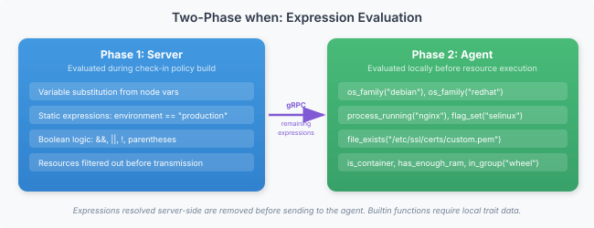

# Writing modules

This is the canonical reference for operators authoring Vigo modules. It covers the YAML format, every resource type, the conditional language, the templating engine, the composition primitives (roles, matchfiles, common.vgo, usercrates, environments.vgo), lookups, retraction, and stream-edit pipelines. If you're new, work through the [Quickstart](../quickstart.md) and [Write your first module](../howto/write-your-first-module.md) first; come back here when you need the full surface.


---
## Config Format

All Vigo configuration lives in YAML files with the `.vgo` extension under `stockpile/`. The server reloads config when `vigocli config publish` syncs files to `.live/`.

## Directory Structure

The config directory doubles as a envoy hierarchy. Subdirectories define inheritance — `common.vgo` at any level defines modules, roles, and vars inherited by all entries in subdirectories below it.

```
stockpile/
├── modules/                     # Module definitions (unchanged)
│   ├── nginx.vgo
│   ├── postgres.vgo
│   ├── compliance.vgo           # Module-tree: fleet-wide claims inherited by every module
│   ├── monitoring.vgo
│   └── users/
│       ├── compliance.vgo       # Module-tree: claims inherited by modules/users/*.vgo
│       └── dan.vgo
├── templates/                   # Template files for source: references
├── roles.vgo                    # All role definitions in one file
├── common.vgo                   # Modules/roles/vars inherited by ALL subdirs
├── compliance.vgo               # Envoys-tree: compliance waivers (optional, inherits like common.vgo)
├── production/
│   ├── common.vgo               # Inherited by all production subdirs
│   └── web/
│       └── web.vgo              # Leaf entry: match: "web*.prod.example.com"
└── staging/
    └── staging.vgo              # Leaf entry: match: "*.staging.example.com"
```

**Key conventions:**
- `common.vgo` at any directory level = inheritance definition (no `match:`). Applies only to subdirectories.
- `compliance.vgo` at any directory level = compliance configuration. **Location determines semantics:** files in the envoys tree (outside `modules/`) contribute waivers; files in the modules tree contribute per-module compliance claims inherited by every module in the same subtree. See [Compliance Waivers + Claims](#compliance-waivers--claims) below and the [Lookup Tables concept](#lookups) for per-envoy resource variation.
- Any other `.vgo` file outside `modules/` = leaf entry with `match:` patterns mapping hostnames to modules.
- `roles.vgo` at root = single file containing all role definitions.
- `modules/` holds a flat library of module definitions. **One exception:** `compliance.vgo` files under `modules/` are not module definitions — they are directory-level compliance claim declarations (see below). The loader recognizes the filename and routes it through a separate walker; you can drop a `compliance.vgo` at any depth under `modules/` without the file being mistaken for a module. Every other `.vgo` file under `modules/` is treated as a module definition and must have `name:` and `resources:` fields.
- `templates/` = unchanged (templates are referenced by explicit `source:` path from within modules).

### Why `compliance.vgo` under `modules/` is a special case

Vigo's module loader walks every `.vgo` file under `modules/` and parses it as a module definition. A module needs a `name:` field and (usually) a `resources:` block. A directory-level compliance claim declaration has neither — it only holds `compliance:` and optionally `waivers:` — so if the loader tried to parse it as a module it would reject the file with "missing required name field" or "module has no resources".

Rather than force operators to put compliance claim files in a sibling directory (which would break the "claims live next to the modules they apply to" ergonomics we wanted), the loader knows that any file literally named `compliance.vgo` under `modules/` is skipped by the module walker and picked up by a separate directory-level walker that unions its claims into every module in the same subtree. Publish-time lint knows about the same exception — it won't run modlint against `compliance.vgo` files — and so does the secret-scanner.

This is the only file-name special case in the module library today. If you ever introduce a `compliance.vgo` under `modules/` and see a lint error about missing `name:` or empty `resources:`, it means you're running against a vigo build older than 0.21.3 and need to rebuild. No other file name under `modules/` gets this treatment — everything else is parsed as a module.

The legacy layout with `envoys/`, `roles/`, and `vars/` directories is still supported for backward compatibility.

## Modules

A module is a reusable set of resources. It defines packages to install, files to manage, services to run, etc.

```yaml
name: nginx

vars:
  nginx_port: 80
  worker_connections: 1024

resources:
  - name: nginx-package
    type: package
    package: nginx

  - name: nginx-config
    type: file
    target_path: /etc/nginx/nginx.conf
    content: |
      worker_connections {{ .Vars.worker_connections }};
    depends_on: [nginx-package]
    notify: [restart-nginx]
  - name: nginx-service
    type: service
    service: nginx
    state: running
    enabled: true
    depends_on: [nginx-package]

  - name: restart-nginx
    type: service
    service: nginx
    state: restarted
    when: "changed"
```

### Module Fields

| Field | Required | Description |
|-------|----------|-------------|
| `name` | yes | Unique module name |
| `vars` | no | Default variable values (overridden by envoy-level vars) |
| `defaults` | no | Default attributes applied to all resources in this module |
| `depends_on` | no | Other modules this module depends on (module-level ordering) |
| `before` | no | Modules that must run after this module |
| `resources` | yes | List of resources to manage |

## Roles

A role is a named list of modules. Roles provide a layer of abstraction — assign a role to an envoy instead of listing individual modules.

```yaml
name: webserver
modules:
  - nginx
  - logrotate
  - name: monitoring
    when: "!is_container"
```

Modules in a role can be plain strings or objects with a `when:` expression for conditional inclusion.

A module object can also carry `foreach:` (a list var) and, for a list of maps, `key:` (the item field naming each instance) — the module is instantiated once per list item as `<module>[<key>]`, with each item's fields available inside as `{{ .Each.<field> }}`. This works wherever a module reference appears (role `modules:`/`case:`, `common.vgo`, `environments.vgo`, a match block). See [Composition Patterns: Module-level foreach](#composition-patterns#module-level-foreach--stamp-out-a-module-per-item).

### Role-Level When

A role definition can have its own `when:` expression. All modules in the role inherit the condition unless they have their own:

```yaml
- name: cis-ubuntu
  when: "distro('ubuntu')"
  modules: [cis-ubuntu-access, cis-ubuntu-network, cis-ubuntu-logging]
```

### Conditional Case

For roles that need different modules per OS or platform, use `case:`. Each branch has a `when:` and its own module list. All matching cases contribute modules:

```yaml
- name: remote-access
  case:
    - when: "os_family('linux')"
      modules: [x11vnc, xrdp]
    - when: "os_family('windows')"
      modules: [tightvnc]
```

A role can have unconditional `modules:` and `case:` together — the unconditional modules always apply, cases apply conditionally:

```yaml
- name: monitoring
  modules: [node-exporter]        # always applied
  case:
    - when: "os_family('linux')"
      modules: [collectd]
    - when: "os_family('windows')"
      modules: [windows-exporter]
```

### Conditional Role References

Role references in match blocks support the same scalar-or-object syntax. Use this to apply different roles based on OS or other traits:

```yaml
envoys:
  - match: "*.example.com"
    roles:
      - name: cis-ubuntu
        when: "distro('ubuntu')"
      - name: cis-rhel
        when: "distro('rhel') || distro('centos') || distro('rocky')"
      - name: cis-windows
        when: "os_family('windows')"
```

When a role ref has a `when:` condition, all modules from that role inherit the condition (unless the module already has its own `when:`, which takes precedence). This lets you write one match block that works across your entire fleet.

### When Inheritance

When expressions are inherited with most-specific-wins precedence:

1. Module's own `when:` (highest priority)
2. Case `when:`
3. Role definition `when:`
4. Role ref `when:` (at the match block level)

### Role Includes

Roles can include other roles using `includes:` to compose shared module sets:

```yaml
name: webserver
includes:
  - base-security
modules:
  - nginx
  - logrotate
```

Included role modules are prepended before the role's own modules. Includes are **single level only** — an included role cannot itself have `includes:`. Duplicate modules across includes and the role's own list are automatically deduplicated (first occurrence wins).

## Matchfile (envoys.vgo)

The `envoys.vgo` file maps envoy hostnames to roles and modules. **First match wins** — the server tries each entry in order and uses the first one whose `match` glob matches the envoy's hostname.

```yaml
envoys:
  - match: "web*.prod.example.com"
    environment: production
    roles: [webserver]
    tags: [webserver, production]
    vars:
      nginx_port: 443

  - match: "web*.staging.example.com"
    environment: staging
    roles: [webserver]
    tags: [webserver, staging]
    vars:
      nginx_port: 8080

  - match: "db*.example.com"
    roles: [database]
    tags: [database]
    modules: [monitoring]

  - match: "*"
    modules: [base, monitoring]
```

### Node Entry Fields

| Field | Required | Description |
|-------|----------|-------------|
| `match` | yes | Hostname glob pattern (e.g., `web*.example.com`, `*`) |
| `environment` | no | Environment name used to select the matching block in `environments.vgo` |
| `roles` | no | List of role names to assign |
| `modules` | no | Additional modules (beyond those from roles) |
| `vars` | no | Variable overrides (override module defaults and inherited `common.vgo` vars) |
| `exclude_modules` | no | Opt out of specific inherited modules (e.g., `[monitoring]`) |
| `exclude_usercrates` | no | Opt out of auto-applied usercrates (e.g., `[alice]`) |
| `tags` | no | Static tags for targeting — referenced by `vigocli` as `tag:<name>` and by [lookup tables](#lookups) in resource attributes |

### Tags

Tags are labels attached to envoys at config-resolution time. They are the single source of truth for envoy classification — **the matchfile is the only writer**. There is no admin API to set tags out of band; editing this file and publishing is the only way to tag an envoy.

Tags are synced into the in-memory fleet index on every check-in. Once synced, they are available to:

- Admin targeting (`vigocli task ... --target tag:webserver`, `vigocli query ... --target tag:database`)
- Per-envoy field variation in resource attributes via [lookup tables](#lookups)

Because the matchfile is the only writer, tagging is deterministic and reproducible. A fresh server restart rebuilds tags by matching envoy hostnames against the current matchfile — no DB state to drift from config.

## Directory Inheritance

Instead of listing every module on every envoy entry, define shared modules in `common.vgo` files at directory levels. Everything in subdirectories inherits automatically.

```yaml
# common.vgo (at root) — all subdirs get these
modules: [sshd, ntp, monitoring]
vars:
  dns_server: "1.1.1.1"
```

```yaml
# production/common.vgo — production subdirs also get these
modules: [log-shipping, auditd]
vars:
  log_level: warn
```

```yaml
# production/web/web.vgo — leaf entry
envoys:
  - match: "web*.prod.example.com"
    modules: [nginx, certbot]
    vars:
      nginx_port: 443
```

Result for `web01.prod.example.com`: modules `sshd, ntp, monitoring, log-shipping, auditd, nginx, certbot` with vars `dns_server=1.1.1.1, log_level=warn, nginx_port=443`.

**Rules:**
- Parent modules come **before** child modules in the DAG (foundation first).
- Child vars **override** parent vars of the same name.
- `exclude_modules:` on a leaf entry removes specific inherited modules:
  ```yaml
  envoys:
    - match: "docker*.example.com"
      modules: [docker]
      exclude_modules: [ntp]  # containers use host clock
  ```
- Root-level `common.vgo` applies only to subdirectories — leaf entries at the root level are self-contained.
- Use `vigocli config trace <hostname>` to see the full inheritance chain for a specific host.
- Use `vigocli config tree` to see the entire directory hierarchy at a glance.
- Use `vigocli config search --module <name>` to find which entries use a specific module.

## Usercrates

Usercrates are per-user modules (user account + home-dir config + dotfiles, typically) that live in a dedicated `stockpile/**/usercrates/` directory class and **auto-apply to every envoy within that directory's scope** — no need to list them in `common.vgo`. See the [Glossary](../glossary.md#usercrate) for what the term means and why it's distinct from a regular module.

```
stockpile/
  usercrates/
    admin.vgo              # fleet-wide — applies to every envoy
  customerA/
    envoys.vgo             # matchfile for customerA envoys
    usercrates/
      alice.vgo            # only applies under customerA/
  customerB/
    envoys.vgo
    usercrates/
      bob.vgo              # only applies under customerB/
```

Scope rule: a usercrate at `stockpile/<path>/usercrates/<name>.vgo` applies to every envoy whose matchfile lives at `stockpile/<path>/` or deeper. Mirrors the `common.vgo` inheritance chain, with one key difference: root-level usercrates at `stockpile/usercrates/` apply to root-level envoys too (unlike root `common.vgo`, which only applies to subdirectories).

### Auto-apply vs. explicit listing

Usercrates are the **only** auto-apply class. Regular modules still require explicit listing via `modules:` in `common.vgo` or a match block. The asymmetry is intentional: modules serve two purposes (direct application AND building blocks for roles), so they need explicit selection. Usercrates are always direct application — there's no "usercrate consumed by a role" pattern — so the filesystem path IS the scope.

### Opt-out

Drop a named usercrate from a specific envoy:

```yaml
# envoys.vgo
envoys:
  - match: "kiosk-*.example.com"
    roles: [kiosk]
    exclude_usercrates:
      - users/dan     # kiosks don't need dev accounts
      - users/alice
```

Drop a usercrate fleet-wide (or for everything under a subdirectory) by setting `exclude_usercrates:` on a `common.vgo`:

```yaml
# stockpile/production/common.vgo
exclude_usercrates:
  - users/dev-only-account   # prod excludes this user everywhere
```

`environments.vgo` blocks also support `exclude_usercrates:` with identical semantics.

### Name namespace

Usercrates and regular modules share one namespace — the `name:` field in a usercrate must be globally unique across all modules and usercrates. Load-time collision is a fatal error with both source paths reported. This keeps `modules:` references in roles + common.vgo unambiguous (they resolve to a module OR a usercrate, never both).

### User management specifically

See [User Management](#usercrates) for why user accounts benefit from the usercrate pattern specifically — per-person audit trail, lookup-table-driven per-envoy variation, two-phase retirement.

## Compliance Waivers + Claims

Compliance claims and waivers use **distinct filenames in distinct trees** — filename-per-tree, enforced fatally at publish and load since 0.29.1.

| Filename | Tree | Top-level key | What it does |
|---|---|---|---|
| `compliance.vgo` | `stockpile/` | `compliance:` | Per-module compliance claims. Claims are unioned into every module and usercrate in the same subtree. |
| `waivers.vgo` | `stockpile/` | `waivers:` | Per-envoy compliance exceptions. Waivers follow the same inheritance pattern as `common.vgo` — root applies fleet-wide, subdirs apply only to their subtree. |

**Mixed keys are a hard error.** A `waivers:` block inside `stockpile/compliance.vgo`, or a `compliance:` block inside `stockpile/waivers.vgo` — both rejected by `vigocli config publish` with an actionable move hint, and rejected on reload if someone hand-edits `.live/`.

**Claims** from a `stockpile/**/compliance.vgo` are unioned into every module defined anywhere beneath that file. A module at `stockpile/modules/users/dan.vgo` inherits claims from `stockpile/modules/users/compliance.vgo` AND from `stockpile/compliance.vgo` if both exist, plus whatever the module itself declares in its own inline `compliance:` block. All sources union with dedupe.

**Waivers** apply only to envoys whose matchfile lives under the same directory subtree. `stockpile/customerA/waivers.vgo` waivers don't cross into `stockpile/customerB/`. Waived controls count as "accepted" in compliance scoring and render with a distinct "waived" badge on dashboards — not hidden.

```yaml
# stockpile/compliance.vgo — claims only
compliance:
  cis: ["1.1.1"]
  nist-800-53: ["AC-1", "CM-1"]
```

```yaml
# stockpile/modules/users/compliance.vgo — claims scoped to user modules
compliance:
  cis: ["5.4.1"]
  nist-800-53: ["AC-3", "AC-6", "AC-6(1)", "IA-2", "IA-5"]
  pci-dss: ["8.1.1", "8.1.2", "8.1.4"]
  soc2: ["CC6.1", "CC6.2", "CC6.3"]
  hipaa: ["164.312(a)(1)", "164.312(a)(2)(i)", "164.312(d)"]
```

```yaml
# stockpile/waivers.vgo — fleet-wide waivers
waivers:
  cis-ubuntu:
    - control: "6.1.10"
      reason: "Build artifacts require world-writable tmp"
      approved_by: dan
      expires: 2027-01-01

    - control: "6.2.5"
      reason: "Home directories managed by LDAP"
      approved_by: dan
```

**Waiver fields:**
- `control` — control ID matching the compliance tag in the module (required)
- `reason` — justification (required)
- `approved_by` — who approved (required)
- `expires` — optional expiration date (YYYY-MM-DD). Expired waivers are automatically excluded.

### Why compliance.vgo is a special filename under stockpile/modules/

The module loader walks every `.vgo` file under `stockpile/modules/` and parses it as a module definition (requires `name:` and `resources:`). `compliance.vgo` has neither — it's a directory-level claim declaration with a `compliance:` block only. The loader and the publish-time linter both key off the literal filename `compliance.vgo` under `stockpile/` and route it to a separate claim-inheritance walker instead of the module parser. This is the only named exception in the module library.

### Rationale for the filename split

Earlier versions (0.21.x through 0.29.0) used the same filename `compliance.vgo` in both trees, with location determining which block was active. Operators had to remember which tree needed which key, and mis-placement produced only a logged warning. 0.29.1 made two changes that tighten this up:

1. **Distinct filenames** — `compliance.vgo` for claims, `waivers.vgo` for waivers. The filename is now self-documenting.
2. **Fatal validation** — misplaced files or mis-keyed contents block publish and reload with an exact remediation hint (including the correct destination path).

The only valid top-level keys in either file are `compliance:` and `waivers:`. Any other top-level key is a parse error.

### Migration from pre-0.29 layouts

Existing deployments migrate automatically on first boot via `entrypoint.sh`:

- `/srv/vigo/stockpile/` → `/srv/vigo/stacks/stockpile/` (if old layout exists)
- `stockpile/modules/` → `stockpile/modules/`
- `stockpile/.live/` → `.live/`
- `stockpile/envoys.vgo`, `stockpile/roles.vgo`, `stockpile/common.vgo` → `stockpile/`
- `stockpile/compliance.vgo` containing a `waivers:` block → `stockpile/waivers.vgo` (waivers side)

The migration is idempotent — safe to re-run after upgrades.

## Variable Resolution

Variables are resolved in three layers (last wins):

```
Module vars (defaults)
    ↓ overridden by
Inherited common.vgo vars (parent → child)
    ↓ overridden by
Match-block vars
    ↓ overridden by
environments.vgo vars (for the match block's environment:)
```

Tag-keyed and platform-keyed lookup tables inside module fields then resolve final field values based on the envoy's tags and traits. See [Lookup Tables](#lookups) for the per-trait/per-tag variation mechanism.

For environment-specific values, use `environments.vgo` at the appropriate directory level — not per-match-block overrides. See [Multi-Axis Config](#multi-axis-config) for the canonical model and why earlier mechanisms (`environment_overrides:`, `vars_from:`, conditional vars) were removed in 0.27.0.

## Resource Format

Every resource has these common fields:

| Field | Required | Description |
|-------|----------|-------------|
| `name` | yes | Unique name within the module |
| `type` | yes | Executor type (file, package, service, etc.) |
| `state` | no | Target state, usually `present` (default) or `absent` |
| `when` | no | Conditional expression — skip if false |
| `depends_on` | no | Resources that must succeed before this one |
| `before` | no | Resources that must run after this one |
| `notify` | no | Resources (or modules) to trigger when this one changes |
| `subscribes` | no | Resources (or modules) to watch — re-apply self when they change |
| `watch_secret` | no | Secret paths to watch — re-apply when rotated |

Plus type-specific attributes (see [Executors](../reference/vigo/resources/_index.md)).

## Auto-Comments (`#~`)

When you run `vigocli config publish`, the module linter automatically adds `#~` prefixed comments to changed modules:

```yaml
#~ Manages package, file, service
name: nginx

resources:
  #~ Install nginx package
  - name: nginx-package
    type: package
    package: nginx

  #~ Deploy /etc/nginx/sites-available/default
  - name: nginx-config
    type: file
    target_path: /etc/nginx/sites-available/default
    content: |
      server {
          listen {{ .Vars.nginx_port }};
      }
    owner: root
    group: root
    mode: "0644"
    notify: [nginx-service]

  # Custom note: we use reloaded here because nginx supports graceful reload
  #~ Reload nginx on dependency change
  - name: nginx-service
    type: service
    service: nginx
    state: reloaded
    when: changed
    subscribes: [nginx-config]
```

**Rules:**
- `#~` comments are auto-generated — they are stripped and regenerated on every publish. Do not edit them.
- `#` comments (no tilde) are hand-written and never touched by the linter. Use these for your own notes.
- The linter also repairs YAML issues (tabs, unquoted booleans) and normalizes key ordering. See [Config Publish Pipeline](../howto/publish-config.md#module-linter) for details.

## Config Reload

After `vigocli config publish` syncs files to `.live/`, it calls the server's reload endpoint. The server:
1. Re-parses the entire config tree
2. Rebuilds module definitions, role definitions, and match blocks
3. The next agent check-in gets the updated config

No server restart needed. Config parse errors are logged and trigger an SMTP notification if configured.

## Related

- [Resource DAG](../reference/writing-modules.md#resource-dag) — Dependency ordering
- [Resource Language](#resource-types) — Advanced config features
- [When Expressions](#when-expressions) — Conditional logic
- [Templates](#templates) — Go templates in content: attributes
---
*Confidential -- Alexander4, LLC. Not for redistribution. See [license](../legal/license.md).*


---
## Resource Language

Beyond basic resource definitions, Vigo supports several advanced config patterns for reducing repetition and expressing complex desired state.

## defaults

Apply default attributes to all resources in a module:

```yaml
name: web-configs
defaults:
  owner: www-data
  group: www-data
  mode: "0644"

resources:
  - name: index-html
    type: file
    target_path: /var/www/html/index.html
    content: "<h1>Hello</h1>"
    # owner, group, mode inherited from defaults

  - name: error-page
    type: file
    target_path: /var/www/html/error.html
    content: "<h1>Error</h1>"
    # also inherits defaults
```

Resources can override defaults by specifying the attribute explicitly.

## foreach

Iterate over a variable to create multiple resources from a single definition:

```yaml
name: user-management

vars:
  users:
    - name: alice
      shell: /bin/bash
    - name: bob
      shell: /bin/zsh

resources:
  - name: "user-{{ .Item.name }}"
    type: user
    username: "{{ .Item.name }}"
    shell: "{{ .Item.shell }}"
    state: present
    foreach: users
```

This expands at config load time into:

```yaml
resources:
  - name: user-alice
    type: user
    username: alice
    shell: /bin/bash
  - name: user-bob
    type: user
    username: bob
    shell: /bin/zsh
```

The `foreach` field references a variable that must be a list. For string lists, each value is available as `{{ .Item }}`. For list-of-maps, access fields with `{{ .Each.key }}` (or `{{ .Item.key }}`):

```yaml
# Firewall rules from a list of maps
vars:
  extra_allow: []   # override in common.vgo

resources:
  - name: "allow-{{ .Each.name }}"
    type: firewall
    foreach: extra_allow
    port: "{{ .Each.port }}"
    proto: "{{ .Each.proto }}"
    action: allow
    comment: "{{ .Each.comment }}"
```

```yaml
# common.vgo — operators configure here
vars:
  extra_allow:
    - name: https
      port: "443"
      proto: tcp
      comment: HTTPS
    - name: app
      port: "8080"
      proto: tcp
      comment: App server
```

Empty lists produce zero resources — canonical modules stay untouched.

To instantiate a *whole module* per item (not just one resource), put `foreach:` on the module reference instead — see [Composition Patterns: Module-level foreach](#composition-patterns#module-level-foreach--stamp-out-a-module-per-item).

## case / match

Select attribute overrides based on a template expression:

```yaml
resources:
  - name: package-manager-config
    type: file
    target_path: /etc/package-manager.conf
    case: "{{ .Traits.os.family }}"
    match:
      debian:
        content: "manager=apt"
        target_path: /etc/apt/apt.conf.d/99-custom
      redhat:
        content: "manager=yum"
        target_path: /etc/yum.conf.d/custom.conf
```


The `case` expression is evaluated, and the matching `match` branch's attributes override the resource's base attributes. If no branch matches, the resource uses its base attributes (or is skipped if no base `content` exists).

## conditional_block

Group resources under a shared `when:` expression:

```yaml
resources:
  - conditional_block:
      when: "os_family('debian')"
      resources:
        - name: apt-update
          type: exec
          command: "apt-get update"

        - name: build-tools
          type: package
          package: build-essential

        - name: dev-headers
          type: package
          package: linux-headers-generic
```

At config load time, this is flattened. Each child resource gets the block's `when:` composed with any existing `when:` via AND:

```yaml
# Equivalent to:
- name: apt-update
  type: exec
  command: "apt-get update"
  when: "os_family('debian')"

- name: build-tools
  type: package
  package: build-essential
  when: "os_family('debian')"

- name: dev-headers
  type: package
  package: linux-headers-generic
  when: "os_family('debian')"
```

If a child resource already has a `when:`, the block's expression is ANDed:

```yaml
- conditional_block:
    when: "os_family('debian')"
    resources:
      - name: special
        type: package
        package: special-tool
        when: "arch('amd64')"
        # effective when: "os_family('debian') && arch('amd64')"
```

## state: absent


Every executor supports `state: absent` to remove/disable the managed resource:

```yaml
- name: remove-old-package
  type: package
  package: legacy-tool
  state: absent

- name: remove-old-config
  type: file
  target_path: /etc/legacy/config.yaml
  state: absent

- name: disable-old-service
  type: service
  service: legacy-daemon
  state: stopped
  enabled: false
```

## Combining Patterns

These features compose naturally:

```yaml
name: multi-os-packages

vars:
  debian_packages: [nginx, curl, jq]
  redhat_packages: [nginx, curl, jq]

resources:
  - conditional_block:
      when: "os_family('debian')"
      resources:
        - name: "pkg-{{ .Item }}"
          type: package
          package: "{{ .Item }}"
          foreach: debian_packages

  - conditional_block:
      when: "os_family('redhat')"
      resources:
        - name: "pkg-{{ .Item }}"
          type: package
          package: "{{ .Item }}"
          foreach: redhat_packages
```

## stream_edit

Pipe file content through scripts on the envoy before writing. Accepts a single path or a list for chained transforms:

```yaml
resources:
  - name: deploy-filter
    type: file
    target_path: /usr/local/bin/strip-comments.sh
    content: |
      #!/bin/sh
      grep -v '^[[:space:]]*#'
    mode: "0755"

  - name: clean-config
    type: file
    target_path: /etc/myapp/config.conf
    content: |
      # database settings
      host = localhost
      port = 5432
    stream_edit: /usr/local/bin/strip-comments.sh
    depends_on: [deploy-filter]
```

Each script reads stdin and writes to stdout. Non-zero exit fails the resource. See [file executor: stream_edit](../reference/vigo/resources/file.md#stream-edit) for full reference.

## timeout

Every resource has an implicit execution timeout. If the executor doesn't complete within the limit, the resource fails with "execution timed out." Override per-resource with the `timeout` parameter (seconds):

```yaml
- name: install-large-package
  type: package
  package: texlive-full
  timeout: 600    # 10 minutes
```

Default timeouts by resource type:

| Type | Default |
|------|---------|
| `exec`, `source_package`, `nonrepo_package`, `custom`, `package`, `repository` | 300s (5 min) |
| All others (`file`, `service`, `user`, etc.) | 60s |

## Related

- [Config Format](#config-format) — Module and variable structure
- [Resource DAG](../reference/writing-modules.md#resource-dag) — Dependency ordering
- [When Expressions](#when-expressions) — Conditional logic
---
*Confidential -- Alexander4, LLC. Not for redistribution. See [license](../legal/license.md).*


---
## When Expressions

The `when:` attribute on resources and modules controls conditional execution. Expressions evaluate to true or false — the resource is skipped when false.

## Syntax

When expressions support boolean logic and function calls:

```yaml
when: "os_family('debian')"
when: "!is_container"
when: "os_family('debian') && arch('amd64')"
when: "file_exists('/opt/app') || dir_exists('/opt/app')"
when: "os_family('redhat') && !version_ge('9')"
```

## Operators

| Operator | Description | Example |
|----------|-------------|---------|
| `&&` | Logical AND | `os_family('debian') && arch('amd64')` |
| `\|\|` | Logical OR | `file_exists('/a') \|\| file_exists('/b')` |
| `!` | Logical NOT | `!is_container` |
| `==` | String equality | `release == 'jammy'` |
| `!=` | String inequality | `'{{ .Vars.target_release }}' != ''` |
| `(` `)` | Grouping | `(os_family('debian') \|\| os_family('redhat')) && arch('amd64')` |

`==` and `!=` are string-typed: operands must be single-quoted string literals or variable references. Function calls return booleans and aren't comparable. Comparisons don't chain — write `(a == b) && (b == c)`, not `a == b == c`. Precedence sits between unary `!` and `&&`, matching C / Java / Python: `a && b == c` parses as `a && (b == c)`.

## Builtin Functions (16)

All builtins are evaluated on the agent using local system state and traits.

### Filesystem

| Function | Args | Description |
|----------|------|-------------|
| `file_exists(path)` | 1 | True if path is a regular file |
| `dir_exists(path)` | 1 | True if path is a directory |

```yaml
- name: migrate-data
  type: exec
  command: "/opt/app/migrate.sh"
  when: "file_exists('/opt/app/migrate.sh')"
```

### Process

| Function | Args | Description |
|----------|------|-------------|
| `process_running(name)` | 1 | True if a process with this name exists |
| `command_succeeds(cmd)` | 1 | True if the command exits 0 |

```yaml
- name: stop-old-service
  type: exec
  command: "systemctl stop legacy-app"
  when: "process_running('legacy-app')"
```

### Time


| Function | Args | Description |
|----------|------|-------------|
| `hour_range(start, end)` | 2 | True if current local hour is within [start, end) |
| `minute_range(start, end)` | 2 | True if current local minute is within [start, end) |
| `day_of_week(day)` | 1 | True if current day matches (e.g., `monday`, `friday`) |
| `day_of_month(day)` | 1 | True if current day-of-month matches (1-31) |

```yaml
- name: maintenance-cleanup
  type: exec
  command: "/opt/cleanup.sh"
  when: "hour_range('2', '5') && day_of_week('sunday')"

- name: staggered-task
  type: exec
  command: "/opt/rotate-logs.sh"
  when: "minute_range('0', '15')"
```

### OS / Traits

| Function | Args | Description |
|----------|------|-------------|
| `os_family(family)` | 1 | True if `os.family` trait matches (case-insensitive) |
| `distro(name)` | 1 | True if `os.distro` trait matches (case-insensitive) |
| `arch(arch)` | 1 | True if `os.arch` trait matches |
| `version_ge(version)` | 1 | True if `os.version` trait is >= the given version |
| `has_display()` | 0 | True if a display server is available (X11, Wayland, Quartz, or Windows) |

```yaml
- name: apt-package
  type: package
  package: nginx
  when: "os_family('debian')"

- name: yum-package
  type: package
  package: nginx
  when: "os_family('redhat')"

- name: install-gui-app
  type: source_package
  url: "https://example.com/app-{{ .Traits.os.arch }}.deb"
  target_path: /tmp/app-install
  when: "has_display() and os_family('debian')"
```

### System

| Function | Args | Description |
|----------|------|-------------|
| `flag_set(flag)` | 1 | True if `/var/lib/vigo/flags/<flag>` exists |
| `in_group(group)` | 1 | True if the system group exists |

```yaml
- name: enable-feature
  type: exec
  command: "/opt/app/enable-beta.sh"
  when: "flag_set('beta-features')"
```

Flags are a simple feature-gate mechanism. Create a flag:
```bash
mkdir -p /var/lib/vigo/flags
touch /var/lib/vigo/flags/beta-features
```


### Network

| Function | Args | Description |
|----------|------|-------------|
| `port_listening(port)` | 1 | True if the given TCP port is in LISTEN state (from `ports` trait) |

```yaml
- name: haproxy-backend
  type: file
  target_path: /etc/haproxy/haproxy.cfg
  content: "..."
  when: "port_listening(8080)"
```

## Trigger Guard: changed

The special keyword `changed` in a `when:` expression makes a resource only execute when triggered by `notify`, `subscribes`, or `watch_secret`. It is skipped on normal check-ins.

```yaml
- name: restart-app
  type: exec
  command: "systemctl restart myapp"
  subscribes: [app-config]
  when: "changed"
```

`changed` can be combined with other expressions:

```yaml
when: "changed && os_family('debian')"
```

This is the standard way to create a resource that only runs in reaction to another resource changing, similar to Puppet's `refreshonly` or Ansible's handler model.

## Variables in When

When expressions can reference variables that resolve to boolean names. The server resolves variable names at check-in time:

```yaml
vars:
  is_debian:
    trait: os.family
    in: [debian]
  has_enough_ram:
    trait: hardware.memory_mb
    gte: 4096

resources:
  - name: heavy-service
    type: service
    service: analytics
    when: "is_debian && has_enough_ram"
```

Conditional vars (those with a `trait:` field) are resolved by the server and substituted as `true`/`false` before the expression reaches the agent. Builtin function calls are passed through to the agent for local evaluation.

## Evaluation Model

When expressions are evaluated in two phases:




If the expression is fully resolved after variable substitution (e.g., `true && true`), the server can filter the resource before sending it to the agent.

If the expression contains builtin function calls, it's passed to the agent for local evaluation.

## Module-Level When

Apply a `when:` to an entire module reference:

```yaml
# In a role definition
modules:
  - name: monitoring
    when: "!is_container"
```

Or in envoys.vgo:

```yaml
envoys:
  - match: "*"
    modules:
      - name: monitoring
        when: "!is_container"
```

## Role-Level When

Apply a `when:` to an entire role definition. All modules inherit the condition:

```yaml
- name: cis-ubuntu
  when: "distro('ubuntu')"
  modules: [cis-ubuntu-access, cis-ubuntu-network, cis-ubuntu-logging]
```

## Role Case

Use `case:` for roles that need different modules per platform:

```yaml
- name: remote-access
  case:
    - when: "os_family('linux')"
      modules: [x11vnc, xrdp]
    - when: "os_family('windows')"
      modules: [tightvnc]
```

All matching cases contribute modules. A module with its own `when:` keeps it regardless of the case condition.

### Inheritance Precedence

1. Module's own `when:` (highest priority)
2. Case `when:`
3. Role definition `when:`
4. Role ref `when:` (at the match block)

## Related

- [Resource Language](#resource-types) — conditional_block for grouping
- [Config Format](#config-format) — Conditional vars
- [Trait Collectors](../reference/vigo/traits/_index.md) — Available trait data for expressions
---
*Confidential -- Alexander4, LLC. Not for redistribution. See [license](../legal/license.md).*


---
## Templates

Vigo uses Go template syntax for dynamic content in resource definitions. Templates are rendered agent-side during policy evaluation.

## Where Templates Are Allowed

Templates are rendered in **all string attributes** on every resource. This includes `content:`, `source:`, `target_path:`, `command:`, `repo:`, `key_url:`, `url:`, `owner:`, `group:`, `mode:`, `when:`, and any other string field.

```yaml
# All of these support {{ .Traits.* }} and {{ .Vars.* }}
- name: docker-repo
  type: repository
  key_url: "https://download.docker.com/linux/{{ .Traits.os.upstream_id }}/gpg"
  repo: "deb https://download.docker.com/linux/{{ .Traits.os.upstream_id }} {{ .Traits.os.upstream_codename }} stable"

- name: install-consul
  type: source_package
  url: "https://releases.hashicorp.com/consul/{{ .Vars.consul_version }}/consul_{{ .Vars.consul_version }}_linux_{{ .Traits.os.arch }}.zip"
```

For small templates, use `content:` directly. For larger config files, put the template in the `templates/` directory and reference it with `source:`. The `content:` and `source:` attributes are mutually exclusive.

## Template Data

Templates have access to two namespaces:

### .Vars

Module variables (after resolution):

```yaml
vars:
  app_port: 8080
  app_name: myapp

resources:
  - name: app-config
    type: file
    target_path: /etc/app/config.yaml
    content: |
      name: {{ .Vars.app_name }}
      port: {{ .Vars.app_port }}
```

### .Traits

Envoy traits (auto-discovered facts):

```yaml
resources:
  - name: motd
    type: file
    target_path: /etc/motd
    content: |
      ==========================================
      Hostname: {{ .Traits.network.hostname }}
      OS:       {{ .Traits.os.distro }} {{ .Traits.os.version }}
      Arch:     {{ .Traits.os.arch }}
      CPUs:     {{ .Traits.hardware.cpu_count }}
      Memory:   {{ .Traits.hardware.memory_mb }} MB
      ==========================================
```

## Go Template Syntax

### Variable Output

```
{{ .Vars.key }}
{{ .Traits.os.family }}
```

### Conditionals

```
{{ if eq .Traits.os.family "debian" }}
apt is the package manager
{{ else }}
yum/dnf is the package manager
{{ end }}
```

### Iteration

```
{{ range .Vars.allowed_users }}
AllowUser {{ . }}
{{ end }}
```

Where `allowed_users` is a list variable:

```yaml
vars:
  allowed_users: [alice, bob, charlie]
```

### Nested Map Access

```
{{ .Traits.os.distro }}
{{ index .Traits.network.ip_addresses 0 }}
{{ .Traits.network.fqdn }}
```

### Default Values

```
{{ .Vars.log_level | default "info" }}
```

Note: Go templates don't have a built-in `default` filter. Use `if` instead:

```
{{ if .Vars.log_level }}{{ .Vars.log_level }}{{ else }}info{{ end }}
```

## Examples


### SSH Configuration

```yaml
- name: sshd-config
  type: file
  target_path: /etc/ssh/sshd_config
  content: |
    Port {{ .Vars.ssh_port }}
    PermitRootLogin no
    PasswordAuthentication no
    {{ range .Vars.allowed_users }}
    AllowUsers {{ . }}
    {{ end }}
  notify: [sshd-service]
```

### Nginx Virtual Host

```yaml
- name: vhost
  type: file
  target_path: /etc/nginx/sites-available/app
  content: |
    server {
        listen {{ .Vars.nginx_port }};
        server_name {{ .Vars.server_name }};

        location / {
            proxy_pass http://127.0.0.1:{{ .Vars.app_port }};
            proxy_set_header Host $host;
            proxy_set_header X-Real-IP $remote_addr;
        }
    }
```

### System Information

```yaml
- name: node-info
  type: file
  target_path: /etc/vigo-node-info
  content: |
    hostname={{ .Traits.network.hostname }}
    os={{ .Traits.os.distro }}
    version={{ .Traits.os.version }}
    arch={{ .Traits.os.arch }}
    ip={{ index .Traits.network.ip_addresses 0 }}
    managed_by=vigo
```

## Common Mistakes

**Template in targetpath (won't work):**
```yaml
# WRONG — templates not allowed in targetpath
- name: config
  type: file
  target_path: "/etc/{{ .Vars.app_name }}/config.yaml"
```

**Fix:** Use a literal path or set it via vars at the node level.

**Template in command (won't work):**
```yaml
# WRONG — templates not allowed in command
- name: restart
  type: exec
  command: "systemctl restart {{ .Vars.service_name }}"
```

**Fix:** Use vars to set the service name directly as a resource attribute.

## Related

- [Config Format](#config-format) — Vars and environments.vgo
- [Trait Collectors](../reference/vigo/traits/_index.md) — Available .Traits data
- [Executors](../reference/vigo/resources/_index.md) — Which attributes each executor uses
---
*Confidential -- Alexander4, LLC. Not for redistribution. See [license](../legal/license.md).*


---
## Composition Patterns

## The Problem

Configuration management at scale creates repetition. You have 50 web servers that are mostly identical, 3 environments with slightly different settings, and cross-cutting concerns (monitoring, security, logging) that apply to everything. Without composition tools, you end up with hundreds of lines of copy-pasted YAML with minor variations — a maintenance burden where a single change requires editing dozens of files.

Other CM systems solve this with full programming languages (Puppet's DSL, Chef's Ruby, Ansible's Jinja2 + Python). These are powerful but sacrifice readability — an operator unfamiliar with the tool can't glance at a config and understand it.

Vigo solves this differently: **layered composition in plain YAML**, with each layer handling a specific type of reuse. No DSL, no programming language, no templating for control flow. Every config file is readable by anyone who knows YAML.

## The Composition Stack

Vigo provides six layers of composition, from broadest to most specific:

```
directory inheritance → shared base config via common.vgo at directory levels
  envoy glob match   → assigns roles/modules to groups of machines
    roles             → bundles modules into reusable profiles
      modules         → packages related resources together
        resource tools → foreach, case, conditional_block, when, defaults
          templates    → dynamic values from traits and vars
```

Each layer eliminates a specific type of repetition.

## Layer 0: Directory Inheritance — Shared Base Config

**Problem:** Every machine needs sshd, monitoring, and NTP. Every production machine also needs log shipping and audit logging. You don't want to repeat these on every envoy entry.

**Solution:** Place `common.vgo` files at directory levels. Everything in subdirectories inherits automatically.

```
stockpile/
├── common.vgo            # modules: [sshd, ntp, monitoring]
├── production/
│   ├── common.vgo        # modules: [log-shipping, auditd]
│   └── web/web.vgo       # match: "web*.prod.example.com", modules: [nginx]
└── staging/staging.vgo   # match: "*.staging.example.com", modules: [debug-tools]
```

A production web server gets: `sshd, ntp, monitoring, log-shipping, auditd, nginx`. A staging box gets: `sshd, ntp, monitoring, debug-tools`. Zero duplication.

Use `exclude_modules:` to opt out: a container host can drop `ntp` with `exclude_modules: [ntp]`.

See [Config Format: Directory Inheritance](#config-format#directory-inheritance) for full details.

## Layer 1: Glob Matching — Group Machines by Name

**Problem:** 50 web servers need the same configuration.

**Solution:** One envoy entry with a glob pattern covers all of them.

```yaml
# envoys/web-servers.vgo
envoys:
  - match: "web*.prod.example.com"
    environment: production
    roles: [webserver]
    vars:
      workers: 16
```

This single entry covers `web01.prod.example.com` through `web99.prod.example.com`. First match wins — more specific patterns go first, catch-all `"*"` goes last.

**Split by environment with the same role:**

```yaml
envoys:
  - match: "web*.prod.example.com"
    environment: production
    roles: [webserver]
    vars:
      workers: 16
      ssl: true

  - match: "web*.staging.example.com"
    environment: staging
    roles: [webserver]
    vars:
      workers: 4
      ssl: false

  - match: "web*.dev.example.com"
    environment: development
    roles: [webserver]
    vars:
      workers: 1
      ssl: false
```

Three entries cover an entire multi-environment web fleet with different tuning per environment.

**Per-host variation via tags and lookup tables:**

```yaml
envoys:
  - match: "web*.prod.example.com"
    environment: production
    roles: [webserver]
    tags: [web, primary]
    vars:
      workers: 16
```

A per-host snowflake gets its own match block above the glob, or lookup-table entries keyed by hostname/tag inside the relevant module (see [Lookup Tables](#lookups)). There is no per-host external var file — the 0.27.0 refactor removed `vars_from:` because directory inheritance + lookup tables already cover the same use cases without the extra file concept.

## Layer 2: Roles — Bundle Modules into Profiles

**Problem:** A "webserver" needs nginx, logrotate, monitoring, and security hardening. Listing all four modules in every envoy entry is repetitive.

**Solution:** Define a role once, assign it everywhere.

```yaml
# roles/webserver.vgo
name: webserver
modules:
  - nginx
  - logrotate
  - node-exporter
  - name: security-hardening
    when: "!is_container"
```

Now envoy entries just say `roles: [webserver]`.

**Role includes for shared foundations:**

```yaml
# roles/base.vgo
name: base
modules:
  - ntp
  - sshd-config
  - sudo-config
  - log-forwarding

# roles/webserver.vgo
name: webserver
includes: [base]          # pulls in ntp, sshd, sudo, logging
modules:
  - nginx
  - logrotate

# roles/database.vgo
name: database
includes: [base]          # same foundation
modules:
  - postgres
  - pgbouncer
  - backup-agent
```

Every role that includes `base` gets the foundational modules. Change `base` once, it propagates to all roles.

**Conditional modules in roles:**

```yaml
name: webserver
includes: [base]
modules:
  - nginx
  - logrotate
  - name: node-exporter
    when: "!is_container"       # skip monitoring agent in containers
  - name: crowdsec
    when: "os_family('debian')" # security agent only on Debian
```

## Layer 3: Modules — Package Related Resources

**Problem:** Installing nginx requires a package, a config file, and a service, all wired together with dependencies and notifications.

**Solution:** A module bundles these into a single reusable unit with configurable variables.

```yaml
# modules/nginx.vgo
name: nginx
vars:
  nginx_port: 80
  worker_connections: 1024
  server_names: [localhost]

resources:
  - name: nginx-package
    type: package
    package: nginx

  - name: nginx-config
    type: file
    target_path: /etc/nginx/nginx.conf
    source: templates/nginx.conf.tmpl
    depends_on: [nginx-package]
    notify: [nginx-service]

  - name: nginx-service
    type: service
    service: nginx
    state: running
    enabled: true
    depends_on: [nginx-package]
```

Envoy entries override the module's default vars:

```yaml
envoys:
  - match: "web*.prod.example.com"
    roles: [webserver]
    vars:
      nginx_port: 443
      worker_connections: 4096
      server_names: [app.example.com, api.example.com]
```

The module definition stays clean. Only the values that differ are overridden at the node level.

**Module-level `defaults` for shared attributes:**

```yaml
name: app-configs

defaults:
  owner: deploy
  group: deploy
  mode: "0640"

resources:
  - name: app-config
    type: file
    target_path: /etc/myapp/config.yaml
    content: "..."
    # owner, group, mode inherited from defaults

  - name: db-config
    type: file
    target_path: /etc/myapp/database.yaml
    content: "..."
    # also inherits defaults
```

**Module ordering with `depends_on` and `before`:**

```yaml
# modules/app.vgo
name: app
depends_on: [nginx, postgres]   # app module runs after nginx and postgres modules

resources:
  - name: deploy-app
    type: exec
    command: "/usr/local/bin/deploy.sh"
```

### Module-level `foreach:` — Stamp Out a Module Per Item

**Problem:** A "vhost" isn't one resource — it's a docroot directory *plus* a config file *plus* a logrotate stanza *plus* a service reload. You have 8 of them, each with a different `server_name` and a couple of per-vhost knobs. Resource-level `foreach:` (Layer 4) only multiplies *one* resource at a time; you want to multiply the whole bundle.

**Solution:** Write the bundle once as a module, then reference it with `foreach:` — the module is instantiated once per item in a list var. Each item's fields are available throughout the module's resources as `{{ .Each.<field> }}` (or `{{ .Item }}` for a list of scalars).

```yaml
# modules/vhost.vgo — the "vhost type", written once
name: vhost
vars:
  doc_root_base: "/var/www"
resources:
  - name: vhost-docroot
    type: directory
    target_path: "{{ .Vars.doc_root_base }}/{{ .Each.server_name }}"
    owner: www-data
    mode: "0755"
  - name: vhost-conf
    type: file
    target_path: "/etc/nginx/sites-enabled/{{ .Each.server_name }}.conf"
    source: templates/nginx-vhost.tmpl     # the template sees .Each, .Vars, .Traits
    depends_on: [vhost-docroot]
    notify: [nginx-reload]                 # a resource in the (singleton) nginx module
  - name: vhost-logrotate
    type: file
    target_path: "/etc/logrotate.d/nginx-{{ .Each.server_name }}"
    content: |
      /var/log/nginx/{{ .Each.server_name }}.access.log { weekly rotate 8 compress }
```

```yaml
# roles/webserver.vgo — reference the module with foreach: + key:
name: webserver
modules:
  - nginx                       # singleton: package + service (defines nginx-reload)
  - name: vhost
    foreach: vhosts             # the var list to iterate
    key: server_name            # which item field names each instance
  - firewall-web
```

```yaml
# environments.vgo (or a common.vgo, or the match block) — the data
env:
  production:
    vars:
      vhosts:
        - server_name: www.example.com
        - server_name: shop.example.com
```

On a production web host this expands to module instances **`vhost[www.example.com]`** and **`vhost[shop.example.com]`**, each carrying its three resources with `{{ .Each.server_name }}` baked in. The module is written once; every host's set of vhosts is pure data, and it can live at whatever layer fits — a `common.vgo` for "every host in this subtree", `environments.vgo` for "prod vs. staging", or the match block for one host.

**Naming.** A foreach instance and its resources are suffixed with `[<key>]` — module `vhost[www.example.com]`, resource `vhost-conf[www.example.com]` — so instances never collide. You write plain resource names in the module; the loader does the suffixing, and rewrites intra-module `depends_on`/`notify`/`subscribes`/`before` references to match (so `depends_on: [vhost-docroot]` becomes `depends_on: [vhost-docroot[www.example.com]]` inside that instance, while a reference to a resource in another module — `notify: [nginx-reload]` — is left alone).

**Keys.**

- A list of **scalars** (`foreach: cache_kinds` over `[nginx, redis]`) is keyed by the value: instances `cache[nginx]`, `cache[redis]`. Omit `key:`.
- A list of **maps** requires `key:` on the ref naming which field supplies the suffix. It's a load-time error to omit it, to point `key:` at a field an item lacks, or for two items to resolve to the same key.

**Var defaults.** A foreach instance still gets the module's `vars:` defaults (`doc_root_base` above), merged with the envoy's vars as usual. The `{{ .Each.<field> }}` values come from the list item and are substituted at config-load time; `{{ .Vars.<field> }}` and `{{ .Traits.<field> }}` resolve at check-in like any other module. Because `.Each` is substituted by name at load time, **every item must provide every `.Each` field the module references** — a leftover `{{ .Each.something }}` is a load error, not a silent skip.

**Per-instance variation** is interpolation (`{{ .Each.port }}`) plus, for "this instance also gets an extra resource", a resource in the module gated on `when:` against an item field:

```yaml
  # in modules/vhost.vgo
  - name: vhost-extra-locations
    type: blockinfile
    when: "'{{ .Each.has_extra }}' == 'yes'"        # items set has_extra: yes / no
    target_path: "/etc/nginx/sites-enabled/{{ .Each.server_name }}.conf"
    content: "{{ .Each.extra_locations }}"
```

Items then carry `has_extra: yes` (and `extra_locations:`) or `has_extra: no`. Vigo's template language is interpolation-only — there is no `{{ if }}`/`{{ range }}` *inside* a `content:` body — so per-instance structural differences are expressed as separate `when:`-gated resources (or, for a clean split, a second module `foreach:`-ed over a filtered sub-list). This is by design: config stays data, readable at a glance, and statically lintable.

**Limitations.** A module can be `foreach:`-ed under one name at most (the same name used both plainly and with `foreach:`, or two `foreach:` refs of the same module, is collapsed by the first-ref-wins rule — put everything in one list). A resource *inside* a foreach'd module that carries its own resource-level `foreach:` iterates a global var, not the module item — nested data-dependent iteration isn't supported.

## Layer 4: Resource Tools — Eliminate Per-Resource Repetition

### foreach — Generate N resources from one definition

**Problem:** Manage 5 nginx vhosts with the same structure.

```yaml
vars:
  vhosts:
    - name: app
      domain: app.example.com
      root: /var/www/app
    - name: api
      domain: api.example.com
      root: /var/www/api
    - name: docs
      domain: docs.example.com
      root: /var/www/docs

resources:
  - name: "vhost-{{ .Item.name }}"
    type: file
    foreach: vhosts
    target_path: "/etc/nginx/sites-enabled/{{ .Item.name }}.conf"
    content: |
      server {
          server_name {{ .Item.domain }};
          root {{ .Item.root }};
      }
    notify: [reload-nginx]

  - name: "webroot-{{ .Item.name }}"
    type: directory
    foreach: vhosts
    target_path: "{{ .Item.root }}"
    owner: www-data
```

Two resource definitions expand to 6 resources (3 config files + 3 directories). Adding a vhost means adding one entry to the `vhosts` var — zero resource duplication.

### case — Switch resource attributes by value

**Problem:** Package manager config differs by OS family.


```yaml
resources:
  - name: package-manager-config
    type: file
    case: "{{ .Traits.os.family }}"
    match:
      debian:
        target_path: /etc/apt/apt.conf.d/99-vigo
        content: |
          APT::Install-Recommends "false";
      redhat:
        target_path: /etc/yum.conf.d/vigo.conf
        content: |
          installonly_limit=3
```

One resource definition, two behaviors. The `case` expression selects which `match` branch applies.

**Combined with traits for hardware-adaptive config:**

```yaml
resources:
  - name: jvm-heap
    type: file
    target_path: /etc/app/jvm.opts
    case: "{{ if ge .Traits.hardware.memory_mb 32768 }}large{{ else if ge .Traits.hardware.memory_mb 8192 }}medium{{ else }}small{{ end }}"
    match:
      large:
        content: "-Xmx16g -XX:+UseG1GC"
      medium:
        content: "-Xmx4g -XX:+UseG1GC"
      small:
        content: "-Xmx512m -XX:+UseSerialGC"
```

The agent's actual RAM determines the JVM configuration — no per-host overrides needed.

### conditional_block — Group resources under a shared condition

**Problem:** A block of Debian-specific resources clutters the module with repeated `when:` guards.

```yaml
resources:
  - conditional_block:
      when: "os_family('debian')"
      resources:
        - name: apt-transport-https
          type: package
          package: apt-transport-https

        - name: ca-certificates
          type: package
          package: ca-certificates

        - name: apt-update
          type: exec
          command: "apt-get update -qq"
          unless: "test -f /var/lib/apt/lists/lock"
  - conditional_block:
      when: "os_family('redhat')"
      resources:
        - name: epel-release
          type: package
          package: epel-release
```

The `when:` is written once per block, not once per resource.

### when — Conditional individual resources

**Problem:** Some resources only make sense on certain platforms or configurations.

```yaml
resources:
  - name: enable-firewall
    type: service
    service: ufw
    state: running
    enabled: true
    when: "os_family('debian') && !is_container"

  - name: install-selinux-tools
    type: package
    package: policycoreutils-python-utils
    when: "os_family('redhat') && has_selinux"
```

### environments.vgo — Per-environment variable overrides

**Problem:** Production, staging, and dev need different values for the same variables.

Declare `environment:` on each match block, then put env-specific vars in `environments.vgo` at the appropriate directory level:

```yaml
# envoys.vgo
envoys:
  - match: "app*.prod.example.com"
    environment: production
    roles: [app-server]
  - match: "app*.staging.example.com"
    environment: staging
    roles: [app-server]
  - match: "app*.dev.example.com"
    environment: development
    roles: [app-server]
```

```yaml
# environments.vgo (alongside envoys.vgo, or at any ancestor directory)
env:
  production:
    vars:
      replicas: 3
      log_level: warn
      debug: false
  staging:
    vars:
      replicas: 1
      log_level: debug
      debug: true
  development:
    vars:
      replicas: 1
      log_level: trace
      debug: true
```

Env is cross-cutting — declaring it on the match block + centralizing the overrides in a sibling file means the same role can serve every tier with no inline per-env boilerplate. See [Multi-Axis Config](#multi-axis-config).

### fleet: — Pull a value from the rest of the fleet

**Problem:** A load-balancer's backend pool *is* the current set of `web` hosts. A monitoring file should list every host running `node-exporter`. A cluster member list (`etcd --initial-cluster=…`) should track the actual cluster. Hand-maintaining these as a literal list goes stale the moment a host is added or replaced.

**Solution:** a top-level var whose value is a `fleet:` construct resolves, at check-in, to a value derived from the live fleet — every envoy matching a selector, with a chosen field rendered and (optionally) joined into a block:

```yaml
# in a common.vgo / environments.vgo / a match block — wherever vars are set
vars:
  app_backends:
    fleet:
      where: "tag('app') && os_family('linux')"      # selector over each envoy's traits/tags
      select: "    server {{ .IP }}:8080;"            # rendered once per matched envoy
      join: "\n"                                      # glue them into one block (omit → a list)
      include_stale: false                            # default: drop offline envoys
```

```yaml
# the module that consumes it
resources:
  - name: app-upstream
    type: file
    target_path: /etc/nginx/conf.d/app-upstream.conf
    content: |
      upstream app {
      {{ .Vars.app_backends }}
      }
    notify: [reload-nginx]
```

On every check-in the server resolves `app_backends` from its in-memory fleet index — for `web*` and any other host tagged `app` — and the file is rendered with the current pool, sorted (so there's no needless churn from map order). Offline hosts (per the staleness threshold) are excluded unless `include_stale: true`. The result is cached for a short TTL (`checkin.fleet_lookup_ttl`, default 30s) so a check-in is a cache hit, not a fleet walk.

- **`where:`** is the `when:` language plus three fleet-specific builtins: `tag('<glob>')`, `host('<glob>')`, and `trait('<key>', '<value>')` (use `trait()` for dotted trait keys like `os.distro` — the `when:` lexer won't take a dot in a bare identifier). The OS/arch builtins (`os_family`, `distro`, `arch`, `version_ge`, `has_display`) work too. Agent-only builtins (`file_exists`, `has_command`, …) are rejected at config publish — a fleet selector must be fully server-evaluable.
- **`select:`** is a Go template over the matched envoy's `{{ .Hostname }}`, `{{ .IP }}`, `{{ .Tags }}`, and `{{ .Traits }}` (a flat map — `{{ index .Traits "network.primary_ip" }}` for a dotted key). It does **not** see `.Vars` — the value is the same for every host that uses it, derived from the fleet, not from the asking host.
- **`join:`** glues the per-envoy strings into one string for `content:`. Omit it and the var is a list instead — which you can `foreach:` over to produce N resources (N firewall rules, N `sshkey` entries): `foreach:` over a `fleet:` var works (it's expanded after the lookup resolves). `foreach:` needs a list, so don't set `join:` in that case.
- **Where it can appear:** a *top-level* var value only — `myvar: { fleet: {...} }`. Not nested inside another var, and not a resource attribute. Put a `fleet:` in its own var and reference the var.
- **No inline `{{ if }}`/`{{ range }}`** — Vigo's templates are interpolation-only. Per-instance shaping is the `select:` template plus, if you need it, a second `fleet:` var with a narrower `where:`.

`fleet:` is the one cross-node mechanism — every other layer above governs *which static config applies to which host*; `fleet:` is *config derived from the other hosts' live state*. It's eventually-consistent: at an empty fleet the value is empty and fills in as hosts enroll.

## Layer 5: Templates — Dynamic Values from Traits

**Problem:** Config file content needs to reference the machine's actual hostname, IP, CPU count, etc.

```yaml
resources:
  - name: prometheus-config
    type: file
    target_path: /etc/prometheus/prometheus.yml
    content: |
      global:
        scrape_interval: 15s
        external_labels:
          host: {{ .Traits.hostname }}
          environment: {{ .Vars.environment }}

      scrape_configs:
        - job_name: node
          static_configs:
            - targets: ['localhost:{{ .Vars.exporter_port }}']
```

Templates resolve at check-in time using the envoy's actual traits and resolved vars. They're only allowed in `content:` attributes and `source:` template files — not in `command:`, `target_path:`, or other parameters.

## Putting It All Together

A complete example managing a web fleet across two environments:

```yaml
# roles/base.vgo
name: base
modules: [ntp, sshd-config, node-exporter]

# roles/webserver.vgo
name: webserver
includes: [base]
modules:
  - nginx
  - logrotate
  - name: crowdsec
    when: "os_family('debian')"

# modules/nginx.vgo
name: nginx
vars:
  nginx_port: 80
  vhosts: []
defaults:
  owner: root
  group: root
resources:
  - name: nginx-package
    type: package
    package: nginx
  - name: "vhost-{{ .Item.name }}"
    type: file
    foreach: vhosts
    target_path: "/etc/nginx/sites-enabled/{{ .Item.name }}.conf"
    source: templates/nginx-vhost.tmpl
    notify: [reload-nginx]
  - name: reload-nginx
    type: exec
    command: "nginx -s reload"
    when: "changed"
  - name: nginx-service
    type: service
    service: nginx
    state: running
    enabled: true

# envoys/web-fleet.vgo
envoys:
  - match: "web*.prod.example.com"
    environment: production
    roles: [webserver]
  - match: "web*.staging.example.com"
    environment: staging
    roles: [webserver]

# environments.vgo
env:
  production:
    vars:
      nginx_port: 443
      vhosts:
        - {name: app, domain: app.example.com}
        - {name: api, domain: api.example.com}
  staging:
    vars:
      nginx_port: 8080
      vhosts:
        - {name: app, domain: staging-app.example.com}
```

**What this achieves:**

- `base` role shared across webserver, database, and any future role
- `webserver` role composes base + nginx + logrotate + conditional security
- `nginx` module is fully parameterized — vhosts driven by a var list
- Match blocks stay tiny — one line per tier, env-specific values live in `environments.vgo`
- Per-host snowflakes get their own match block above the glob, or use lookup tables keyed by hostname/tag
- Templates inject actual hostnames, ports, and domains at check-in time

**No duplication.** Adding a new vhost: add one entry to the `vhosts` list. Adding a new environment: add one envoy entry with the environment name. Adding monitoring to all servers: add the module to `base` role. Each change happens in exactly one place.

## Related

- [Config Format](#config-format) — Module, role, and envoy structure
- [Resource Language](#resource-types) — foreach, case, conditional_block, defaults, stream_edit
- [When Expressions](#when-expressions) — Conditional logic syntax
- [Templates](#templates) — Go template expressions in content
- [Resource DAG](../reference/writing-modules.md#resource-dag) — Dependency and notification ordering
---
*Confidential -- Alexander4, LLC. Not for redistribution. See [license](../legal/license.md).*


---
## Multi-Axis Configuration

Vigo composes an envoy's effective config from **a small number of orthogonal axes**. One canonical way to answer each question. The axis list is deliberately short — every mechanism earns its place by doing something the others can't.

The whole config operation lives under a single parent directory, **stacks** (`/srv/vigo/stacks/`). Inside it, three subtrees have distinct roles:

- **`stockpile/`** — the operator's working tree. Holds *every* config primitive: `modules/` (definitions), `usercrates/`, `templates/`, `tasks/`, `workflows/`, plus the assignment files themselves (`envoys.vgo` matchfiles, `roles.vgo`, `common.vgo`, `waivers.vgo`, `environments.vgo`) and directory-inherited `compliance.vgo` claims. **There is one operator-edited tree.**
- **`examples/`** — read-only install-template tree seeded by the image. Operators copy from here into stockpile via `vigocli config examples copy <name>`.
- **`anti-examples/`** — read-only retract-template tree, mirroring `examples/modules/` one-for-one. Each install template `examples/modules/<cat>/<name>.vgo.example` has a paired retract at `anti-examples/modules/<cat>/<name>-retract.vgo.example`. Copy with `vigocli config anti-examples copy <name>`; verify completeness with `vigocli config anti-examples mirror-check`. Never read by the server, never published.
- **`.live/`** — the validated published output. `vigocli config publish` lints stockpile and atomically syncs it here; the server reads `.live/` on every reload.

Operators edit `stockpile/`. Never `.live/`. Never edit `examples/` directly — copy first, then edit your stockpile copy.

> The 0.33.1 collapse merged the prior `worksite/{stockpile,scaffolding,structure}/` layout into the `stacks/{stockpile,examples,.live}/` shape. Existing installs migrate automatically on first boot. The `scaffolding/` tree is gone — its contents (matchfiles, roles, common.vgo, waivers, environments.vgo) live in stockpile alongside modules and usercrates.

## The axes

| Axis | Where | What it does |
|---|---|---|
| **Directory structure** | `stockpile/<org>/<site>/` | Organizes by business axis (customer, site, tenant). Inheritance via `common.vgo`. **Not used for env.** |
| **Matchfiles** | `stockpile/**/envoys.vgo` (or any `.vgo` with an `envoys:` block, anywhere outside `modules/`/`templates/`/`tasks/`/`workflows/`/`usercrates/`) | Maps hostname patterns to roles + environment + tags + vars. First-match-wins. |
| **Roles** | `stockpile/roles.vgo` | Named groupings of modules. Supports `when:` (role-wide) and `case:` (per-platform module groups). Single fleet-wide file at the stockpile root. |
| **Modules** | `stockpile/modules/**/*.vgo` | Reusable resource sets. Declared once, referenced by roles or `common.vgo`. Directory name is `modules/` on disk; YAML keys and identifiers stay `module`. |
| **Usercrates** | `stockpile/**/usercrates/*.vgo` | Per-user modules. Auto-apply within directory scope — no need to list in `common.vgo`. |
| **Common defaults** | `stockpile/**/common.vgo` | Directory-inherited modules/roles/vars + `exclude_modules`/`exclude_usercrates`. |
| **Environment** | `environment:` field on match block | Cross-cutting env declaration. Orthogonal to directory structure. |
| **Per-env overrides** | `stockpile/**/environments.vgo` | Env-specific module sets + vars. Scope follows ancestor chain. |
| **Lookup tables** | Inside module fields (`tag:...`, `os_family:...`) | Per-trait or per-tag field variation. |
| **Conditional resources** | `when:` on individual resources | Skip a resource based on traits or vars. |
| **Compliance claims** | `stockpile/**/compliance.vgo` | Directory-level claim inheritance for modules + usercrates. |
| **Waivers** | `stockpile/**/waivers.vgo` | Per-envoy compliance exceptions. |

### Canonical filename rule

Two file shapes are protected by name. Both live in stockpile:

| Filename | Top-level key |
|---|---|
| `compliance.vgo` | `compliance:` (directory-inherited claims) |
| `waivers.vgo` | `waivers:` (directory-inherited waivers) |

Mixing the keys inside a file (e.g., `compliance.vgo` carrying a `waivers:` block) is rejected at publish and reload with a move hint. The validator also rejects:

- Any `.vgo` file with a top-level `waivers:` block but not named `waivers.vgo` — the loader globs the exact filename, so a stray `corp-waivers.vgo` would silently not load. Rename to `waivers.vgo`.
- Any "claims-only" `.vgo` file (top-level `compliance:` with no `resources:`/`name:`/`vars:`) not named `compliance.vgo` — same trap. Rename to `compliance.vgo`. Module definitions carrying their own `compliance:` block are unaffected (the validator looks at presence of `resources:`/`name:` to distinguish modules from claim files).

## Resolution order — one diagram

For an envoy `web01.customerA.example.com` checking in:

```
┌──────────────────────────────────────────────────────────────────┐
│  Match block lookup (first-match-wins, all matchfiles walked)    │
│                                                                  │
│  stockpile/customerA/envoys.vgo:                                 │
│    - match: "web01.customerA.*"                                  │
│      role: web-server                                            │
│      environment: prod         ← env declared HERE               │
│      tags: [web, primary]      ← tags declared HERE              │
│      vars: { port: 443 }       ← envoy-level vars                │
└──────────────────────────────────────────────────────────────────┘
                              │
                              ▼
┌──────────────────────────────────────────────────────────────────┐
│  Compose module list (in order)                                  │
│                                                                  │
│  1. Inherited common.vgo modules (parent → child)                │
│       stockpile/common.vgo              → [baseline, monitoring] │
│       stockpile/customerA/common.vgo    → [customerA-baseline]   │
│                                                                  │
│  2. Role modules (expand via roles.vgo; case: applied per OS)    │
│       web-server → [nginx, php, tls]                             │
│                                                                  │
│  3. Usercrates (auto-apply, ancestor chain)                      │
│       stockpile/usercrates/dan.vgo              → users/dan      │
│       stockpile/customerA/usercrates/alice.vgo  → users/alice    │
│                                                                  │
│  4. environments.vgo (ancestor chain, env == "prod")             │
│       stockpile/environments.vgo (prod)  → [audit-logging]       │
│       stockpile/customerA/environments.vgo (prod)                │
│                                            → [customerA-prod-only] │
└──────────────────────────────────────────────────────────────────┘
                              │
                              ▼
┌──────────────────────────────────────────────────────────────────┐
│  Apply exclusions                                                │
│    match block:  exclude_modules / exclude_usercrates            │
│    common.vgo:   exclude_usercrates (dir scope and below)        │
│    per_env:      exclude_modules / exclude_usercrates per env    │
└──────────────────────────────────────────────────────────────────┘
                              │
                              ▼
┌──────────────────────────────────────────────────────────────────┐
│  Attach compliance claims (from stockpile/**/compliance.vgo)     │
│  to each module in the list, walking up the directory ancestor   │
│  chain of each module's source file.                             │
└──────────────────────────────────────────────────────────────────┘
                              │
                              ▼
┌──────────────────────────────────────────────────────────────────┐
│  Attach waivers (from stockpile/**/waivers.vgo) to the envoy,    │
│  walking up the directory ancestor chain of the matchfile.       │
└──────────────────────────────────────────────────────────────────┘
                              │
                              ▼
┌──────────────────────────────────────────────────────────────────┐
│  Var resolution (3-layer, low → high)                            │
│    module defaults                                               │
│      < common.vgo inherited vars (parent → child)                │
│      < match-block vars                                          │
│      < environments.vgo vars (env == "prod")                     │
│                                                                  │
│  Tag-keyed and platform-keyed lookup tables inside modules       │
│  resolve final field values based on the envoy's tags + traits.  │
└──────────────────────────────────────────────────────────────────┘
                              │
                              ▼
┌──────────────────────────────────────────────────────────────────┐
│  Resource-level `when:` expressions filter the final resource    │
│  set per envoy. Trait-function calls evaluate agent-side; pure   │
│  var expressions evaluate server-side.                           │
└──────────────────────────────────────────────────────────────────┘
                              │
                              ▼
                      Bundle sent to agent
```

## Canonical rulebook — one answer per question

| Question | Canonical answer |
|---|---|
| How does a module get assigned to an envoy? | Via a **role** (defined in `stockpile/roles.vgo`) that the matchfile assigns, OR via inheritance from `stockpile/**/common.vgo`. Inline `modules:` on a match block is allowed but warns at >4 entries — that's the signal you should define a role. |
| How does a host get per-host config? | Tag the host in its match block; use tag-keyed lookup tables inside modules to vary field values. Separate match blocks only for genuinely bespoke hosts. |
| How does config differ per env? | Declare `environment:` on the match block. Declare env-specific modules/vars in `stockpile/**/environments.vgo` at the appropriate directory level. Env is **cross-cutting** — orthogonal to the directory tree. Do NOT nest subdirectories by env. |
| How does a module branch per OS / platform? | `case:` on the role (when whole modules differ per platform) OR platform-keyed lookup tables inside module fields (when only values differ). Never inline `when:` on a resource when the axis is platform — that's harder to read. |
| How do vars resolve? | 3 layers, low-to-high: module defaults < common.vgo inherited vars < envoy match-block vars < environments.vgo vars. |
| How is a user account configured? | A **usercrate** in `stockpile/usercrates/` (fleet-wide) or `stockpile/<scope>/usercrates/` (scoped). Auto-applies within the directory scope — no listing needed. See [User Management](#usercrates). |
| Where do compliance claims live? | `stockpile/**/compliance.vgo` — directory-level, inherited by every module and usercrate in the subtree. Inline `compliance:` on a module definition for module-specific exceptions. |
| Where do waivers live? | `stockpile/**/waivers.vgo` — at any directory level, scoped by directory. Distinct filename from compliance claims. |
| Where do I copy an example from? | `vigocli config examples list` to browse, then `vigocli config examples copy <name>` to materialize one into stockpile. |
| Where does a module example's retract come from? | `vigocli config anti-examples copy <name>` materializes the paired retract from `anti-examples/modules/<cat>/<name>-retract.vgo.example` into stockpile alongside the install module. `vigocli config anti-examples mirror-check` reports any module example missing a paired retract. |

## Directory layout — reference

```
/srv/vigo/stacks/
├── stockpile/                    ← operator-edited working tree
│   ├── compliance.vgo            ← fleet-wide claims
│   ├── waivers.vgo               ← fleet-wide waivers
│   ├── common.vgo                ← fleet-wide defaults (modules, roles, vars)
│   ├── environments.vgo          ← fleet-wide env overrides (optional)
│   ├── roles.vgo                 ← role definitions (single, fleet-wide)
│   │
│   ├── modules/                  ← module definitions (any depth)
│   │   ├── nginx.vgo
│   │   ├── postgres.vgo
│   │   └── compliance.vgo        ← claims inherited by every module beneath
│   ├── usercrates/               ← fleet-wide users (auto-apply everywhere)
│   │   ├── dan.vgo
│   │   └── compliance.vgo        ← claims inherited by every usercrate here
│   ├── templates/                ← Go template files referenced by source: in modules
│   ├── tasks/                    ← reusable task definitions for `vigocli task dispatch`
│   ├── workflows/                ← workflow definitions
│   │
│   └── customerA/                ← organization axis: customer A
│       ├── common.vgo            ← customerA defaults
│       ├── waivers.vgo           ← customerA waivers (scoped)
│       ├── environments.vgo      ← customerA env overrides (optional)
│       ├── envoys.vgo            ← matchfile: hostname → role + env + tags
│       └── usercrates/
│           └── alice.vgo         ← customerA-only usercrate
│
├── examples/                     ← read-only install templates (image-seeded)
│   ├── modules/<cat>/<name>.vgo.example
│   ├── usercrates/<name>.vgo.example
│   └── ...
│
├── anti-examples/                ← read-only retract templates (mirrors examples/modules)
│   └── modules/<cat>/<name>-retract.vgo.example
│
└── .live/                        ← validated published output (server reads here;
                                    locked read-only between publishes)
    └── stockpile/                ← canonical bytes synced from stockpile after modlint
```

Key rules:

- **Operators only edit `stockpile/`.** `.live/` is locked between publishes; `examples/` is image-managed.
- **No env in directory paths.** No `prod/` or `staging/` directories. Env is a field on the match block.
- **Roles live once.** `stockpile/roles.vgo`, fleet-wide.
- **Modules live under `stockpile/modules/`.** Walked recursively.
- **Usercrates live at any scope within stockpile.** Root for fleet-wide, customer subdir for customer-scoped.
- **Organization axes** (customer, site, tenant, region, cloud) mirror your business, not your infrastructure. `aws/` or `gcp/` also works if cloud is your organizing axis.

## Layout history

These transitions all migrate automatically via the container entrypoint on first boot — no operator action required.

- **0.28.0** — moved the tree under `worksite/`; promoted `.live/` out as sibling `structure/`.
- **0.29.0** — split into `stockpile/` (module library) and `stockpile/` (envoy rules) subtrees; renamed `stockpile/modules/` at the filesystem level (YAML keys + Go/Rust identifiers keep `module`); renamed waivers-tree `compliance.vgo` → `waivers.vgo`.
- **0.29.1** — enforced filename-per-tree as fatal checks at publish and load (previously a silent warning).
- **0.33.1** — collapsed `worksite/{stockpile,scaffolding,structure}/` into `stacks/{stockpile,examples,.live}/`. Single operator-edited tree (stockpile) holding every primitive; `.live/` rename completes the path. The two-tree filename-per-tree rule simplified to canonical-filename rules within stockpile.

## What this replaces — removed 0.27.0

These mechanisms were deleted because they duplicated what other axes already do, not because their underlying use cases went away.

- **`environment_overrides:`** on match blocks (per-host in-matchfile env overrides). **Removed.** Use `environments.vgo` at the appropriate directory level.
- **`vars_from:`** external var files loaded into match blocks or `common.vgo`. **Removed.** Put shared var blocks in `common.vgo` at a parent directory — directory inheritance does what `vars_from:` did without the extra file concept.
- **Conditional vars** (`when:`-guarded var values that produced booleans). **Removed.** Use `when: "os_family('debian')"` directly on resources or in role `case:` — evaluate against traits without the indirection layer. If you need a named boolean shared across resources, define a tag on the envoy.
- **Match vars** (`when:`-with-fallback chains inside var definitions). **Removed.** Use tag-keyed or platform-keyed lookup tables inside the resource fields that need the variation.
- **`modules/users/` pattern** (per-user modules listed in `common.vgo`). **Removed.** Migrate to `stockpile/usercrates/` — auto-applies, no listing needed. See [User Management](#usercrates).

Conditional vars and match vars flowed all the way to the agent via protobuf `ConditionalVarDef`. That machinery is gone; the agent no longer evaluates trait-based boolean vars on each check-in.

## Related reading

- [Config Format](#config-format) — file-level YAML structure for modules, roles, matchfiles, common.vgo, environments.vgo.
- [User Management](#usercrates) — the usercrate pattern for per-user config.
- [Lookup Tables](#lookups) — tag-keyed and platform-keyed field variation inside modules.
- [Composition Patterns](#composition-patterns) — roles, includes, inheritance, when expressions.
- [Glossary](../glossary.md) — canonical term definitions for stacks, stockpile, examples, .live, stone, usercrate.


---
## User Account Management

User accounts are the most complicated resource type vigo manages. This page explains why, and why that complexity shapes how stockpiles should organize user-management modules.

## Why the `user` executor is exceptional

The `user` executor (see [reference/executors/user.md](../reference/vigo/resources/user.md)) stands apart from every other executor in the tree in five ways. No other executor combines all of these.

### 1. Multi-file state

Most executors touch one file or one daemon. `file:` edits one file. `service:` talks to systemd or launchd. `package:` calls the distro package manager. The `user` executor reads and writes across a half-dozen independent state locations:

- `/etc/passwd` — existence, UID, GID, home, shell, GECOS
- `/etc/shadow` — password hash, password aging
- `/etc/group` — supplementary group membership
- `~<user>/.ssh/authorized_keys` — SSH access, with ownership fixup and symlink detection
- `~<user>/.xsession` — desktop session selection for RDP access
- `/etc/sudoers.d/<username>` — privilege escalation policy

Every convergence cycle, the executor reads all six to compute drift, and writes only the subset that needs to change. A single user resource can touch every one of those files in a single run.

### 2. List fields with merge-vs-replace semantics

`groups:` on a user resource is the only list-valued attribute in vigo that has **both** merge and replace semantics, toggled by a flag:

- **Default (merge):** `useradd -aG` on create, then selective add/remove on update. A user already in `wheel` outside vigo's knowledge stays in `wheel`. The resource adds missing groups from the list and otherwise leaves memberships alone.
- **With `purge_groups: true` (replace):** `useradd -G` / `usermod -G`. Vigo becomes authoritative — anything not in the list is removed.

No other executor has this toggle. `file:` always replaces. `package:` state is binary. Only `user` treats a list attribute as something that can be either "these are the groups we care about" or "these are the only groups."

`authorized_keys:` has a similar split: Vigo-managed keys are replaced on every run, but ephemeral Scrier remote-access keys are preserved across converges so an active Scrier session can't be terminated by a convergence run. Again, unique to `user`.

### 3. Process-killing recovery

If `usermod` fails with "user is currently used by process," the executor runs `pkill -u <username>` and retries. This is the only executor that kills processes on the host as part of its normal idempotency logic. The reason is that user modifications on a logged-in account fail deterministically — you either skip the change (accepting drift) or evict the user's running processes. The executor picks the latter because "the resource didn't converge" is worse than "that user got logged out."

### 4. Desktop session mapping and system UID auto-assignment

- **Desktop mapping:** `desktop: cinnamon` writes `~<user>/.xsession` with the correct exec command for cinnamon, and similarly for gnome, xfce, mate, plasma, lxde, lxqt, fvwm, i3, sway, openbox, budgie. This knowledge lives inside the executor because no other vigo concept needs it.
- **System UID auto-assignment:** `system: true` with a user already holding UID ≥ 1000 finds an available UID in the 100–999 range and reassigns. No other executor reorganizes kernel-level identifiers.

### 5. Cross-platform divergence

`type: user` maps to four different implementations:

- `user` (Linux)
- `user_macos`
- `user_freebsd`
- `user_windows` (which manages SIDs, local groups, RDP-User group membership, and very different sudoers equivalents)

The behavior is consistent enough that you can write one resource and have it apply everywhere, but the implementations under the hood are fully separate. This is true for `file:` and `service:` to a lesser extent, but `user`'s platform branches diverge the most.

## What that complexity implies for organization

All of the above is intrinsic to user management — you can't simplify the executor without giving up capability. But the complexity has organizational consequences that shape how you should lay out user-management modules in a stockpile.

### User accounts vary per envoy more than any other resource

A given user typically needs a slightly different configuration on every envoy they touch. The shell might be `/bin/fish` on a workstation and `/bin/bash` everywhere else. Supplementary groups might include `virtualbox` and `kvm` on workstations but `plex` on mediaservers. `sudo_nopasswd` might be `true` on trusted hosts and `false` in production. Keys might rotate. Desktop sessions apply on some boxes and not others.

By contrast, `package:` and `file:` resources tend to be uniform fleet-wide — nginx is nginx, the same `nginx.conf` template renders everywhere. Per-host variation is the exception, not the rule. For users it's the rule.

### Users have a lifecycle beyond convergence

- **Joiners:** new account, new home dir, new initial keys, specific per-host placement.
- **Rotators:** SSH key rotation, password changes, group changes over time as responsibilities shift.
- **Retirees:** `state: absent`, `userdel -r`, audit trail of when and why.

No other resource type has this lifecycle with the same level of audit relevance. A package install doesn't need per-user git blame. A user account does — "when did dan get sudo access on plex.home?" is a real question for compliance audits.

### Audit trail per person

Compliance frameworks (CIS, NIST 800-53, PCI-DSS, SOC 2, HIPAA) all have controls that require per-user auditing of account existence, privileges, credentials, and retirement. Keeping user resources grouped by person (rather than scattered across general-purpose modules) makes that audit trivial: `git log stockpile/usercrates/alice.vgo` answers every question about alice's fleet-wide account history.

## The recommended organizational pattern

From those three properties — heavy per-envoy variation, long lifecycle, per-person audit — a clear organizational shape falls out. Per-user config files are called **usercrates** (see [Glossary](../glossary.md#usercrate)). They live in `stockpile/usercrates/` and auto-apply to every envoy in that directory's scope — no need to list them in `common.vgo`.

```
stockpile/usercrates/
  dan.vgo              # one file per human operator
  alice.vgo
  bob.vgo
  service-accounts.vgo # one file per category for non-humans (nginx, postgres, etc.)
  retired/             # moved here during retirement, see "Retirement" below
    ex-employee.vgo    # state: absent, kept for audit history
```

For per-site scoping (MSP-style multi-customer stockpiles), nest usercrates under the relevant directory — `stockpile/customerA/usercrates/alice.vgo` applies only to envoys matched under `customerA/`.

A typical usercrate is a single-resource module:

```yaml
# stockpile/usercrates/dan.vgo
resources:
  - name: dan
    type: user
    username: dan
    comment: Daniel Alexander
    # Per-envoy variation via lookup tables:
    shell:
      danlap:  /bin/fish
      default: /bin/bash
    groups:
      tag:workstation:  [docker, virtualbox, kvm]
      tag:mediaserver:  [docker, plex]
      default:          [docker]
    sudo_nopasswd:
      tag:workstation: "true"
      default:         "false"
    password: secret:vigo/os-users/dan
    authorized_keys: |
      ssh-ed25519 AAAA... dan@workstation
```

The module-level `name:` field is optional and defaults to the filename stem — `stockpile/usercrates/dan.vgo` becomes the `dan` usercrate. Only set `name:` explicitly when you want the identifier to differ from the filename.

Compliance claims shared across every usercrate in a directory belong in a sibling `compliance.vgo` file inside that `usercrates/` directory — exactly like `modules/compliance.vgo` works for the modules tree. Claims declared there are inherited by every usercrate in the same directory (and scoped subtrees get their own). For claims that apply to just one usercrate, attach an inline `compliance:` block at the module level of that crate.

```
stockpile/usercrates/
  compliance.vgo         # shared claims (CIS 5.4.1, NIST AC-3, etc.) inherited by every crate here
  dan.vgo
  alice.vgo
  retired/
    ex-employee.vgo
```

A scoped `customerA/usercrates/compliance.vgo` attaches only to usercrates under `customerA/usercrates/`; it does not leak into root-level usercrates. Waiver blocks (`waivers:`) in a usercrate-tree `compliance.vgo` are warned-and-ignored, the same treatment modules-tree `compliance.vgo` gives them — waivers belong in the envoys tree.

### Team, role, or project crates

The 1:1 convention (one crate per human) is the recommended shape for individual operators because it gives clean per-person git blame. But the loader permits multiple `user:` resources in a single crate file when grouping makes sense — a team crate (`usercrates/ops_team.vgo` with alice, bob, carol), a role crate (`usercrates/on_call.vgo` with a rotating set), or a service-account bundle (`usercrates/service-accounts.vgo` with nginx, postgres, redis). The auto-apply and opt-out behaviors work the same way at the crate level; `exclude_usercrates: [ops_team]` excludes the whole bundle as a unit.

### Why this pattern, specifically

- **One file per human, per category for non-humans.** Humans need per-user git blame and audit trail. A 20-person `humans.vgo` makes that messy. Service accounts, by contrast, are typically interchangeable ("the nginx account, the postgres account, the deploy bot") and benefit from being grouped so common attributes are visible together.
- **Auto-apply within directory scope.** Drop a file in `stockpile/usercrates/` and it applies fleet-wide. Drop it in `stockpile/customerA/usercrates/` and it scopes to customerA envoys only. No explicit listing in `common.vgo` required — the filesystem path IS the scope. Per-envoy exclusion via `exclude_usercrates: [alice]` on a match block.
- **Lookup tables handle per-host variation inside the usercrate.** See [Lookup Tables](#lookups). The `shell:`, `groups:`, and `sudo_nopasswd:` fields all accept a tag/host/trait-keyed map, which removes the need for separate usercrates per envoy profile.
- **Directory-level compliance claims avoid duplication.** The compliance block that would otherwise be copy-pasted into every usercrate lives once in `stockpile/usercrates/compliance.vgo` and flows down. See [config-format.md](#config-format#compliance-waivers--claims).
- **Retirement convention is two-phase.** When someone leaves, edit the resource to `state: absent`, move the file to `stockpile/usercrates/retired/<name>.vgo`, commit, publish, wait at least one full convergence cycle so every envoy runs `userdel`. Only then is it safe to delete the file. The `retired/` subdirectory is a historical roster — if you ever need to answer "did we provision `ex-employee` on this envoy between X and Y," git history plus the retained file gives you a complete answer.

### What NOT to do

- **Don't put user resources in general-purpose modules.** `modules/base.vgo` is the wrong home for a user resource. Git blame becomes useless, and per-person audit is impossible.
- **Prefer one file per human, with the filename matching the identifier.** For individual operators the 1:1 shape gives clean per-person git blame and lets the default `name:` behavior stay transparent. Team/role/project crates (multiple users per file) are supported but should be a deliberate choice for groups that genuinely move together. Splitting one human across multiple files makes history noisier without any corresponding benefit.
- **Don't re-list usercrates from match blocks or `common.vgo`.** Usercrates auto-apply based on their directory scope — listing them explicitly is redundant and will break if the crate is later renamed. Use `exclude_usercrates:` on a match block to opt out.
- **Don't skip the retirement two-phase.** Deleting a user file without first converting to `state: absent` leaves the account in place on every envoy the user ever touched. The loader's module-retraction mechanism tells agents to stop applying the module, but it does not run `userdel` — the resource must be in the config with `state: absent` at least once for the agent to run the deletion.

## Summary

User management looks deceptively similar to other vigo resource management on paper — it's just another resource type — but the executor is fundamentally more complicated and the organizational needs are fundamentally different. The recommended pattern (per-user files under `stockpile/usercrates/`, inline compliance claims, lookup-table per-host variation, two-phase retirement) falls out directly from those needs. Follow it and user management stays auditable, per-host variation stays readable, and retirement stays clean.

## Related

- [reference/executors/user.md](../reference/vigo/resources/user.md) — parameter reference, examples, idempotency details
- [Lookup Tables](#lookups) — per-envoy resource field variation via tag/host/trait keys
- [Config Format](#config-format#compliance-waivers--claims) — directory-level compliance claim inheritance
---
*Confidential -- Alexander4, LLC. Not for redistribution. See [license](../legal/license.md).*


---
## Tag/Host/Trait Lookup Tables

Lookup tables let a single resource definition vary its field values per envoy without duplicating the whole resource. They are the primary way to express "for hosts tagged X, this field is Y" in vigo configs.

## Motivation

A user named `dan` needs to exist on every envoy, but:

- On `danlap` (a workstation) he wants to be in `virtualbox` and `kvm` groups and use `/bin/fish`.
- On `plex.home` (a media server) he wants to be in the `plex` group and use `/bin/bash`.
- On every other machine he just wants to be in `docker` with `/bin/bash`.

Writing three separate resources — one per host — would work but scales poorly. A lookup table expresses the variation inline:

```yaml
resources:
  - name: dan
    type: user
    username: dan
    groups:
      tag:workstation:  [docker, virtualbox, kvm]
      tag:mediaserver:  [docker, plex]
      default:          [docker]
    shell:
      danlap:  /bin/fish
      default: /bin/bash
    sudo_nopasswd:
      tag:workstation: true
      default:         false
```

One resource, three per-envoy-varying fields. Every other field (`name`, `username`, …) stays literal.

## Syntax

A lookup table is a YAML map assigned as the value of a resource attribute. The map **must** contain a `default` key — that key is how the resolver tells a lookup table apart from a literal map value.

```yaml
<field>:
  <spec>: <value>
  <spec>: <value>
  default: <value>
```

Each `<spec>` uses the same mini-language as `vigocli ... --target`:

| Spec form        | Example             | Matches |
|------------------|---------------------|---------|
| Exact hostname   | `danlap`            | Envoy whose hostname equals `danlap` |
| Hostname glob    | `*.web.prod`        | Envoys whose hostname matches the glob (`*`/`?`) |
| Tag              | `tag:workstation`   | Envoys tagged `workstation` in their match block |
| Tag glob         | `tag:*web*`         | Envoys whose tags match the glob |
| Trait filter     | `os.distro=ubuntu`  | Envoys whose trait `os.distro` equals `ubuntu` |
| `default`        | `default`           | Fallback when no other arm matches |

Tags come from the `tags:` field on the envoy's match block in `envoys.vgo`. Traits come from the agent's latest reported trait snapshot. Hostname is the envoy's actual hostname, not its match pattern.

## Precedence

Lookup resolution depends on the value type:

### List-valued lookups: union all matching arms

If every arm (including `default`) is a YAML list, the resolver unions all matching arms in declaration order and deduplicates repeated scalar elements.

```yaml
groups:
  tag:workstation: [docker, virtualbox]
  tag:mediaserver: [docker, plex]
  danlap:          [kvm]
  default:         []
```

For `danlap` (which is tagged `workstation`), the result is `[docker, virtualbox, kvm]` — union of the `tag:workstation` arm and the `danlap` arm. Declaration order determines output order; duplicates (like `docker`) only appear once.

### Scalar-valued lookups: most-specific match wins

If every arm is a scalar (string, bool, int), the resolver picks the most specific match. Specificity ranking, highest first:

1. Exact hostname (e.g., `danlap`)
2. Trait filter (e.g., `os.distro=ubuntu`)
3. Tag (e.g., `tag:workstation`)
4. Hostname glob (e.g., `*.prod.example.com`)

Ties within a rank are broken by declaration order. This means **you can put the arms in any order** — the resolver picks the right one. Your `danlap` host-specific override will always win over `tag:workstation` even if it appears later in the file.

```yaml
shell:
  tag:workstation: /bin/zsh       # wins for workstations without a more specific arm
  danlap:          /bin/fish      # wins for danlap regardless of file position
  default:         /bin/bash      # wins for everyone else
```

### Mixed-type arms are a config error

A lookup table cannot mix list and scalar values across its arms. This catches `groups: { tag:foo: [a, b], default: "bad" }` at config load time.

## `default` is mandatory

Every lookup table must have a `default` arm. This is the discriminator that tells the resolver "this map is a lookup table" (rather than a literal map value), and it also forces the author to think about the no-match case explicitly. If no arm matches and no default is present, it's a config bug.

Use `default: []` for list fields that should be empty when no arm matches, `default: null` for optional scalars, or write a sensible fallback value.

## What's NOT supported (yet)

- **Lookup tables in `vars:` blocks.** Only resource attributes are inspected today. If you want a lookup table that feeds multiple resources, duplicate it at each resource — or ask for vars-level support.
- **Nested lookups.** Only top-level resource attributes are resolved. `{ foo: { bar: { tag:x: y, default: z } } }` doesn't work.
- **Literal maps with a `default` key.** If you want a map-typed resource attribute whose keys include the string `default`, you'll need to escape or rename that key. Vanishingly rare in practice.

## How it works under the hood

At config load time, vigo scans every resource attribute and sets `HasLookups=true` on the `EnvoyConfig` if any attribute is a lookup table. At check-in time, configs with `HasLookups=true` bypass the pattern-level policy cache and get a freshly resolved bundle per envoy — the same mechanism that `case:` conditional resources already use. The cost is a bundle rebuild per check-in for affected envoys; for configs without lookups, nothing changes.


---
## Module Retraction

Module retraction automatically generates `.retract` files --- the reverse of each module --- so you always have a clean undo ready. When enabled, `vigocli config publish` generates a retract module for every new or changed module, and shows affected envoys when a module is removed.

## Requirements

Both settings must be enabled in `server.yaml`:

```yaml
ai:
  enabled: true
  provider: claude    # or openai, ollama

publish:
  retraction:
    enabled: true
```

## How It Works

### On new or changed modules

1. Run `vigocli config publish` after adding or modifying a module in `stockpile/modules/`
2. The publish pipeline detects new/changed modules and reads their content
3. The server generates a deterministic retract module (flipping each resource to its absent state)
4. The AI reviews and improves the draft, especially for `exec` resources where reversal requires reasoning
5. A `.retract` file is written alongside the module in `stockpile/modules/`

### On removed modules

1. Run `vigocli config publish` after removing a module from `stockpile/modules/`
2. The publish pipeline detects the removal and reads the module content from the previous config
3. The server generates the retract module and looks up which envoys previously ran it
4. A `.retract` file is written to `stockpile/modules/` with a detailed summary of affected envoys and per-resource confidence levels

## Generated Output

The generated `.retract` file is inert --- it won't be loaded by the config system until renamed to `.vgo`. For removed modules, the CLI also prints:

- Which envoys previously ran the module
- Per-resource confidence levels (high for package/file/service, low for exec)
- Step-by-step instructions for applying the retraction

## Resource Reversal Rules

| Resource Type | Reversal | Confidence |
|---|---|---|
| `file`, `directory`, `symlink` | `state: absent` | High |
| `package` | `state: absent` | High |
| `service` | `state: stopped`, `enabled: false` | High |
| `user` | `state: absent` | Medium (home dir may have data) |
| `cron` | `state: absent` | High |
| `repository` | `state: absent` | High |
| `sysctl` | `state: absent` (resets to system default) | High |
| `firewall` | `state: absent` | High |
| `source_package` | Delete target file | Medium (extracted contents not removed) |
| `nonrepo_package` | `state: absent` (remove via dpkg/rpm) | High |
| `exec` | AI-generated reversal with `onlyif` guard | Low (always review) |

## Applying a Retraction

1. Review the generated file: `stockpile/modules/<name>.retract`
2. Rename to `<name>-retract.vgo`
3. Add module `<name>-retract` to the relevant match blocks or roles
4. Run `vigocli config publish`
5. After all affected envoys converge, remove the retract module and its match block

The retract module is idempotent --- it's safe to leave in the config for multiple convergence cycles while all envoys catch up. Remove it once cleanup is confirmed.

## API

**`POST /api/v1/config/retract`**

Called automatically by `vigocli config publish`. Can also be called directly:

```json
{
  "modules": [
    {"name": "nginx", "content": "name: nginx\nresources:\n  ..."}
  ]
}
```

Returns generated retract YAML, warnings, and affected envoy list for each module.

## Example Retractions

Every example module in `example-configs/stockpile/modules/` has a pre-built retraction counterpart in `example-configs/retractions/modules/`. These follow the same reversal rules documented above and serve as reference implementations.

To use an example retraction:

1. Copy the retraction to your stockpile:
   ```bash
   cp example-configs/retractions/modules/web/nginx-retract.vgo.example \
      /srv/vigo/stacks/stockpile/modules/nginx-retract.vgo
   ```
2. Review the file, especially any `# REVIEW:` or `# WARNING:` comments
3. Add `nginx-retract` to the relevant match blocks or roles
4. Publish: `vigocli config publish`
5. After all affected envoys converge, remove the retract module and its match block


---
## Stream-Edit

The `file` resource accepts a `stream_edit:` attribute that pipes the file's rendered content through one or more agent-local scripts (stdin → stdout) before it's written to disk. This is the mechanism for turning a template into a lightly-transformed artifact without authoring a full executor or a second resource.

```yaml
resources:
  - name: "hardened sshd config"
    type: file
    path: /etc/ssh/sshd_config
    source: templates/sshd_config.tmpl
    stream_edit:
      - /srv/vigo/scripts/redact_comments.sh
      - /srv/vigo/scripts/normalize_whitespace.py
```

Each script in the list receives the previous stage's output on stdin and writes the transformed content to stdout. The final script's output is what gets written to the target path. Results are cached by (content hash × script path × script mtime), so unchanged inputs don't re-run the pipeline every convergence cycle.

## Why it exists

Two common needs motivate this attribute:

1. **Post-process a template output.** The built-in Go template engine renders `.Vars` and `.Traits` into the file, but sometimes you need to reformat, redact, or re-key values based on logic the template language can't cleanly express (e.g. sort a list, strip comments, run through a linter/formatter).
2. **Borrow a widely-understood formatter.** `jq`, `yq`, `sed`, `awk`, formatters like `black` or `rustfmt` — all of them read stdin and write stdout, so they work out of the box as stream-edit stages.

Use it when a transformation is cheap, deterministic, and genuinely helps; avoid it when the equivalent logic would live more clearly in the template or a dedicated resource.

## Safety model

Scripts run as the agent user (root, on most envoys) and can do anything that user can. Vigo guardrails the feature so it doesn't become an unexamined backdoor:

### `stream_edit.enabled`

Master switch. Default is `true` — stream-edit is available. Set to `false` in hardened deployments where operators want to guarantee no agent-local script execution through this path.

```yaml
stream_edit:
  enabled: false
```

Modules that reference `stream_edit:` against a disabled server receive a resource-level error at check-in and the file won't be written.

### `stream_edit.allowed_paths`

Directories that stream-edit scripts must reside within. Scripts outside the allowlist are rejected. Default is `[/srv/vigo/scripts]`.

```yaml
stream_edit:
  allowed_paths:
    - /srv/vigo/scripts
    - /opt/vigo/bin
```

Tighten this if you want a specific pinned-down script directory managed separately from stockpile content.

### `stream_edit.default_timeout`

Per-script wall-clock timeout as a Go duration string. Default is `10s`. Scripts that exceed the timeout are killed and the stage reports an error. Set higher only for genuinely-slow transforms (a multi-megabyte yq roll-up on a slow host); lower is fine for mostly-instant scripts.

```yaml
stream_edit:
  default_timeout: "30s"
```

## Caching

Stream-edit results are cached across convergence cycles keyed on:

- The input content hash (SHA-256 of stdin)
- The script's absolute path
- The script's mtime

A cache hit skips execution and reuses the cached output; a cache miss runs the pipeline and stores the result. Because mtime is part of the key, rotating a script via `chmod`/`mv` or a Vigo-managed deployment invalidates the cache automatically.

Cache entries live under the agent's state directory and are pruned when their content becomes unreferenced. Restarting the agent does not clear the cache.

## Errors and idempotency

A script that exits non-zero fails the whole pipeline; the resource is reported as failed and the file is not written. The next convergence attempt re-runs the pipeline from scratch (cache miss is forced on the stage that failed).

Scripts should be pure transformations — stateless, deterministic, no side effects. Writing to disk, hitting the network, or depending on external state defeats caching and creates flaky convergence.

## Related

- [Server-config > stream_edit](../reference/server-yaml.md#stream_edit) — config reference
- [Resource Language](#resource-types) — the `file` resource and its attributes
- [Templates](#templates) — upstream rendering before stream-edit stages
- [Guardrails](../howto/troubleshoot.md) — the broader self-protection model for agent-side execution


---
*Confidential — Alexander4, LLC. Not for redistribution. See [../legal/license.md](../legal/license.md).*
