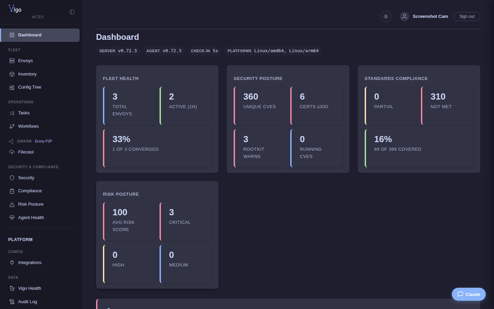

# 1 · Stand up the server

By the end of this page you'll have a running Vigo server, be logged into its web UI, and have the server's own machine enrolled as the first envoy. Budget ten minutes, plus about 20 if you build the image from source.

This is the first of four tutorials — work through them in order; each builds on the last.

## Prerequisites

- A Linux host on x86_64 with Docker and the Compose plugin. Building the image from source instead also needs the Buildx plugin, `git` and `rsync`, plus Go 1.25 if you create the optional signing key.
- Ports 8443, 1530 and 1531 reachable from the machines you will enroll.
- Root (or `sudo`) on that host.
- That's it. No external services.

## 1. Bring it up

You can pull the published server image or build it yourself. Either way the image ends up tagged `vigo:latest`, the name the generated compose file runs.

**Pull the published image.** This is the quick path. The host needs Docker with the Compose plugin and an x86_64 CPU; on Ubuntu, `sudo apt-get install -y docker.io docker-compose-v2` installs them. The image is signed with the project's release key, so envoys update their agent on their own when you move to a newer image. It carries the Linux agent for amd64 and arm64. To pin a release, use its version tag, such as `:0.80.1`, in place of `:latest`.

```bash
sudo docker pull ghcr.io/daniel-alexander4/vigo:latest
sudo docker tag ghcr.io/daniel-alexander4/vigo:latest vigo:latest
IMAGE=vigo:latest
```

**Or build it from source.** The build runs inside Docker. The host needs Docker with the Compose and Buildx plugins, plus `git` and `rsync`; on Ubuntu, `sudo apt-get install -y git rsync docker.io docker-compose-v2 docker-buildx` installs them. The first build takes about 20 minutes. The optional signing key lets envoys update their agent on their own; without it, every upgrade means re-running the bootstrap on each envoy. Creating it needs Go 1.25, and you should keep the key safe.

```bash
git clone https://github.com/daniel-alexander4/vigo.git && cd vigo
go run ./server/hardening/cmd/sign -genkey -output signing.key   # optional: lets envoys self-update
sudo scripts/upgrade.sh full --norun   # builds the server image and the amd64 agent
IMAGE=vigo:latest   # the tag the build gives the local image
```

Then seed the data directory and start it:

```bash
sudo mkdir -p /srv/vigo
sudo docker run --rm -v /srv/vigo:/srv/vigo "$IMAGE" --seed-only
sudo sed -i "s|^  # hostname: .*|  hostname: $(hostname)|" /srv/vigo/server.yaml
cd /srv/vigo && sudo docker compose up -d
```

The `sed` line sets `server.hostname` in `server.yaml` to this host's name; the server needs it to find its own agent when you create your login.

The server listens on **`:1530`** (gRPC, for agents) and **`:8443`** (REST + web UI). Give it a few seconds, then check it's healthy:

```bash
sudo docker compose ps
```

You'll see `vigo` and `vigo-guacd` both `Up (healthy)`. While the server is still starting, `vigo` shows `Up (health: starting)`; `curl -sk https://127.0.0.1:8443/healthz` prints `ok` once it is ready.

## 2. Log in

Open **`https://127.0.0.1:8443`** in a browser and accept the self-signed certificate. There is no default admin login. Do step 3 first and wait about 30 seconds for that agent to check in. The account you log in as needs an SSH public key in `~/.ssh/` (create one with `ssh-keygen -t ed25519` if it has none). Set up the secrets vault with `sudo vigocli secrets init` and `sudo vigocli secrets unlock`, then create your admin from a real OS account on this host with `sudo vigocli webusers create --username <yourname> --role admin`, which asks for the login password, and sign in as `<yourname>`.

You'll land on the dashboard — empty for now, because no envoys exist yet.

## 3. Enroll the server's own machine

Every Vigo server runs a local agent alongside it, enrolled over loopback. This is the **first thing to do after install** — run it from the server host:

```bash
curl -sSfk https://127.0.0.1:8443/bootstrap | sudo sh
```

> Use the IPv4 literal **`127.0.0.1`** — not `localhost`, not the hostname. The agent writes this exact address into its config and dials it on every check-in, so the path must not depend on name resolution.

The default trusted-enrollment policy (private + loopback CIDRs) auto-signs this one without a token. Within a check-in interval, **refresh the dashboard — one envoy appears.** That's the server's own machine, now managed.



## Checkpoint

You have: a healthy server, a browser session, and one converging envoy. If the dashboard still shows zero envoys after a minute, see [Troubleshoot common issues](../howto/operate/troubleshoot.md).

**Next:** [Enroll your first envoy →](enroll-your-first-envoy.md) — a *separate* machine.
